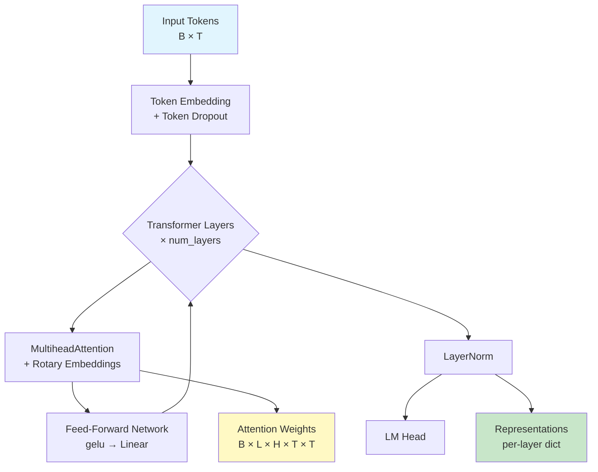
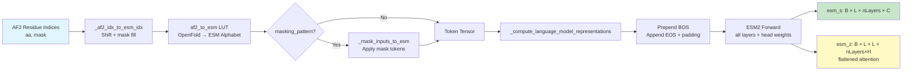
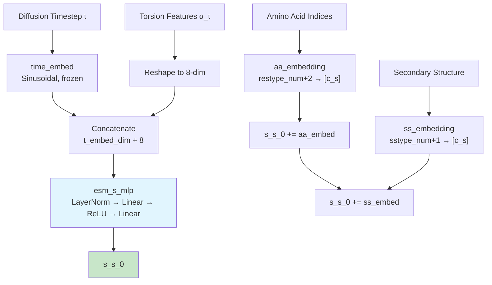

IDPForge incorporates the **ESM-2 protein language model** as a foundational encoding subsystem, providing pretrained sequence representations that can augment the diffusion-based structure generation pipeline. This page dissects the ESM-2 architecture as embedded within IDPForge, the preprocessing wrapper that bridges ESM-2 outputs to the folding trunk, and the alternative embedding strategy that IDPForge employs for its core sequence-state initialization during training and inference.

## ESM-2 Model Architecture

The ESM-2 implementation resides in [`esm/esm2.py`](esm/esm2.py) and follows the standard BERT-style transformer encoder with several protein-specific adaptations. The `ESM2` class is a `nn.Module` parameterized by layer count, embedding dimension, and attention head count, with all configurations converging on a shared architectural template: **token embedding → stacked transformer layers → layer norm → language modeling head**.



Each `TransformerLayer` applies **pre-norm residual connections**: the input is layer-normalized before self-attention and again before the feed-forward network, with residuals added after each sub-operation. The feed-forward network uses the GELU activation with an expansion factor of 4× (i.e., `ffn_embed_dim = 4 * embed_dim`). A critical architectural detail is that all ESM-2 layers use **rotary position embeddings** (RoPE), which encode relative positional information directly into the query and key vectors rather than through additive position embeddings.

Sources: [esm2.py](esm/esm2.py#L14-L148), [modules.py](esm/modules.py#L84-L142)

## Rotary Position Embeddings

The rotary embedding implementation in [`esm/rotary_embedding.py`](esm/rotary_embedding.py) follows the RoFormer formulation where query and key vectors are transformed by **rotation matrices** parameterized by position-dependent angles. This produces relative position encoding as an inherent property of the dot-product attention computation rather than requiring explicit positional encoding injection.

The `RotaryEmbedding` module maintains an inverse frequency buffer `inv_freq = 1.0 / (10000 ** (arange(0, dim, 2) / dim))` and caches cosine/sine tables for the current sequence length. The `rotate_half` operation splits the vector into two halves and applies the 2D rotation: `(x₁, x₂) → (x₁cos − x₂sin, x₁sin + x₂cos)`. This is applied identically to both queries and keys, ensuring that the attention logits naturally capture relative positional relationships.

Sources: [rotary_embedding.py](esm/rotary_embedding.py#L1-L70)

## Pretrained Model Registry

IDPForge ships a **registry of 11 ESM-2 checkpoint variants** spanning six parameter scales, each available in both the full UniRef50 training checkpoint (270K steps) and an intermediate checkpoint (500K steps for some sizes). The registry is defined in [`idpforge/esm_wrapper.py`](idpforge/esm_wrapper.py) using `functools.partial` to defer model loading:

| Registry Key | Parameters | Layers | Embed Dim | Heads | Checkpoint |
|---|---|---|---|---|---|
| `esm2_8M` | 8M | 6 | 320 | 20 | UR50D 500K |
| `esm2_8M_270K` | 8M | 6 | 320 | 20 | UR50D 270K |
| `esm2_35M` | 35M | 12 | 480 | 20 | UR50D 500K |
| `esm2_35M_270K` | 35M | 12 | 480 | 20 | UR50D 270K |
| `esm2_150M` | 150M | 30 | 640 | 20 | UR50D 500K |
| `esm2_150M_270K` | 150M | 30 | 640 | 20 | UR50D 270K |
| `esm2_650M` | 650M | 33 | 1280 | 20 | UR50D 270K |
| `esm2_650M_270K` | 650M | 33 | 1280 | 20 | UR50D 270K |
| `esm2_3B` | 3B | 36 | 2560 | 40 | UR50D 270K |
| `esm2_3B_270K` | 3B | 36 | 2560 | 40 | UR50D 500K |
| `esm2_15B` | 15B | 48 | 3840 | 60 | UR50D 270K |

Model loading proceeds through [`esm/pretrained.py`](esm/pretrained.py): `load_model_and_alphabet_hub` downloads the checkpoint from `https://dl.fbaipublicfiles.com/fair-esm/models/`, then `_load_model_and_alphabet_core_v2` reconstructs the `ESM2` model from the saved configuration (`cfg.encoder_layers`, `cfg.encoder_embed_dim`, `cfg.encoder_attention_heads`) and loads the state dict after stripping legacy prefix names (`encoder.sentence_encoder.`, `encoder.`). Regression weights for contact prediction are co-loaded when available (skipped for 270K/500K intermediate checkpoints).

Sources: [esm_wrapper.py](idpforge/esm_wrapper.py#L19-L32), [pretrained.py](esm/pretrained.py#L85-L142)

## ESM_preprocess Wrapper

The `ESM_preprocess` class in [`idpforge/esm_wrapper.py`](idpforge/esm_wrapper.py) is the **bridge between ESM-2's language model representations and IDPForge's structure pipeline**. It encapsulates the full preprocessing flow: amino acid index remapping, optional masking, BOS/EOS token insertion, ESM-2 forward pass, and representation extraction.



**Index remapping** is a critical cross-framework concern. IDPForge uses OpenFold/AlphaFold2 residue indexing (0-indexed, 20 standard amino acids + X), while ESM-2 uses its own `Alphabet` token ordering. The static method `_af2_to_esm` builds a lookup table that maps from the AF2 convention to ESM alphabet indices, inserting the padding token at position 0. The forward path first shifts AF2 indices by +1 (to reserve 0 for padding), then applies the lookup table via `self.af2_to_esm[aa_embed.cpu()]`.

The `_compute_language_model_representations` method handles the language model interface: it prepends a BOS token (`<cls>`) and appends an EOS token by replacing the first padding position after the sequence. The ESM-2 model is called with `repr_layers=range(num_layers + 1)` to extract **all intermediate layer representations** and optionally `need_head_weights=True` for attention maps. The BOS/EOS positions are sliced from the output (`esm_s[:, 1:-1]`), yielding per-residue embeddings of shape `B × L × nLayers × C` and (if requested) attention maps of shape `B × L × L × (nLayers × H)` after permutation and flattening.

Two key design decisions ensure ESM-2 operates as a **frozen feature extractor**: the model is cast to half precision via `self.esm.half()` and all gradients are disabled via `self.esm.requires_grad_(False)`. The output representations are detached (`.detach()`) before returning, preventing any gradient flow back through the language model.

> [!TIP]
> The `ESM_preprocess` module is designed as a standalone preprocessing component. It is not invoked within IDPForge's default training or inference loops — instead, IDPForge uses its own lightweight embedding strategy (see next section). The `ESM_preprocess` wrapper serves scenarios where precomputed ESM-2 embeddings are needed as auxiliary inputs or for analysis pipelines.

Sources: [esm_wrapper.py](idpforge/esm_wrapper.py#L34-L97)

## Sequence State Initialization in IDPForge

The IDPForge model ([`idpforge/model.py`](idpforge/model.py)) initializes its **single sequence state** `s_s_0` through a custom embedding pathway that replaces the ESM-2 encoder with a diffusion-aware alternative. This is the core architectural departure from ESMFold: rather than consuming frozen ESM-2 embeddings, IDPForge constructs sequence features from **three complementary signals**:



The construction proceeds in three additive stages:

1. **Diffusion time + torsion projection** (`esm_s_mlp`): The sinusoidal time embedding (dimension `t_embed_dim = 32`) is concatenated with the 8-dimensional torsion feature vector reshaped from `alpha_t`, producing a `(t_embed_dim + 8)`-dimensional input. This passes through a two-layer MLP with LayerNorm, ReLU, and output dimension `c_s` (the sequence state dim, typically 1024 or 128 depending on config).

2. **Amino acid embedding** (`aa_embedding`): A learned embedding table of size `(restype_num + 2) × c_s` maps each residue type to a vector added to the sequence state. The +2 accounts for padding (index 0, with `padding_idx=0`) and the mask token.

3. **Secondary structure embedding** (`ss_embedding`): A learned embedding table of size `(sstype_num + 1) × c_s` encodes the secondary structure assignment per residue. During training, secondary structure labels are randomly zeroed out with 20% probability (`torch.rand(1).item() < 0.2`), forcing the model to be robust to missing structural priors — a critical design choice for intrinsically disordered regions where secondary structure predictions are unreliable.

The **pairwise state** `s_z_0` is initialized as zeros and then augmented with geometric features derived from the noised backbone coordinates `x_t` via `xyz_to_t2d`, which computes distance and orientation binning features encoding the current state of the diffusion process.

Sources: [model.py](idpforge/model.py#L36-L119), [wrapper.py](idpforge/wrapper.py#L56-L83)

## Alphabet and Tokenization

The ESM-2 `Alphabet` class ([`esm/data.py`](esm/data.py)) defines the token vocabulary and its organization. For the ESM-1b architecture used by all ESM-2 models, the token layout is:

| Position | Tokens | Description |
|---|---|---|
| 0 | `<cls>` | BOS / classification token |
| 1 | `<pad>` | Padding |
| 2 | `<eos>` | End of sequence |
| 3 | `<unk>` | Unknown residue |
| 4–29 | L A G V S E R T I D P K Q N F Y M H W C X B U Z O . - | 26 protein sequence tokens |
| 30–33 | `<null_1>` … `<null_4>` | Alignment padding to multiple of 8 |
| 34 | `<mask>` | Masked token for MLM |

The 26 standard tokens (defined in [`esm/constants.py`](esm/constants.py)) include the 20 canonical amino acids plus ambiguity codes (X, B, U, Z, O) and gap characters (`.`, `-`). The vocabulary is padded to a multiple of 8 for hardware efficiency. The `BatchConverter` class (referenced via `get_batch_converter`) handles converting raw sequence strings into padded, tokenized tensors suitable for batched ESM-2 inference.

Sources: [data.py](esm/data.py#L91-L174), [constants.py](esm/constants.py#L1-L11)

## Multihead Attention with Rotary Embeddings

The `MultiheadAttention` module in [`esm/multihead_attention.py`](esm/multihead_attention.py) implements the core attention computation with optional rotary position encoding. When `use_rotary_embeddings=True`, a `RotaryEmbedding` instance is created with `dim = head_dim` and applied to queries and keys before the scaled dot-product attention:

```
q, k = rot_emb(q, k)  # Apply rotary position encoding
attn_weights = (q @ k^T) / sqrt(head_dim)
attn_probs = softmax(attn_weights)
output = attn_probs @ v
```

The module supports optional bias key/value vectors (`add_bias_kv`), zero-attention padding, and incremental decoding state for autoregressive generation. The initialization uses **Xavier uniform initialization with gain 1/√2** for Q/K/V projections when dimensions match, which was empirically observed to improve convergence for the ESM-2 family.

Sources: [multihead_attention.py](esm/multihead_attention.py#L67-L200)

## Embedding Dimension Flow and Model Selection

The choice of ESM-2 model size determines the embedding dimensions that flow through the system. When `ESM_preprocess` is used, the output representations have shape `B × L × nLayers × C` where C scales with model size. These representations must be projected to match the IDPForge trunk's `sequence_state_dim` and `pairwise_state_dim`:

| ESM-2 Model | Embed Dim (C) | Layers | Total Rep Dim | VRAM (fp16) |
|---|---|---|---|---|
| 8M | 320 | 6 | 1,920 | ~0.3 GB |
| 35M | 480 | 12 | 5,760 | ~0.7 GB |
| 150M | 640 | 30 | 19,200 | ~1.5 GB |
| 650M | 1,280 | 33 | 42,240 | ~2.5 GB |
| 3B | 2,560 | 36 | 92,160 | ~10 GB |
| 15B | 3,840 | 48 | 184,320 | ~28 GB |

For IDPForge's default pipeline (without `ESM_preprocess`), the effective per-residue input dimensionality is `c_s` (configurable, 128 in the provided train config), which is dramatically smaller than the full ESM-2 representation dimensions. This reflects IDPForge's design philosophy: **the diffusion timestep and noised geometric features carry sufficient information for structure denoising**, making the heavy ESM-2 encoder unnecessary during the denoising loop. The amino acid and secondary structure embeddings provide lightweight sequence identity signals.

> [!TIP]
> When selecting an ESM-2 variant for precomputed embedding analysis, the 150M model offers the best accuracy-to-cost tradeoff for sequences under 512 residues. For longer disordered regions, the 650M model provides meaningful gains in contact prediction quality that can inform experimental guidance potentials.

Sources: [esm_wrapper.py](idpforge/esm_wrapper.py#L19-L32), [model.py](idpforge/model.py#L30-L69)

## Architectural Relationship: ESMFold Trunk to IDPForge

IDPForge's `FoldingTrunk` ([`esm/esmfold/trunk.py`](esm/esmfold/trunk.py)) is architecturally derived from ESMFold but operates with **IDPForge-specific initialization**. The trunk receives pre-initialized `s_s_0` and `s_z_0` from the IDPForge model's embedding pathway (described above), rather than from ESM-2 embeddings as in the original ESMFold. Within the trunk, `TriangularSelfAttentionBlock` instances process the sequence and pairwise states through the same AlphaFold2-inspired operations: triangular multiplicative updates (outgoing + incoming), triangular attention (starting + ending nodes), sequence-to-pair and pair-to-sequence communication, and per-state MLPs.

The recycling mechanism in `FoldingTrunk.forward` applies up to `max_recycles` iterations (default 3), where each recycle feeds the previous output's single/pair states through layer norms and adds a distogram-based pairwise correction. IDPForge leverages this recycling during inference via its `self_condition` configuration option, where the previous denoising step's output serves as the recycle input — effectively creating an **implicit self-conditioning loop** within the diffusion denoising trajectory.

Sources: [trunk.py](esm/esmfold/trunk.py#L113-L200), [tri_self_attn_block.py](esm/esmfold/tri_self_attn_block.py#L26-L169), [model.py](idpforge/model.py#L121-L133)

## Next Steps

- For the complete model architecture that consumes these embeddings, see [IDPForge Transformer Network](5-idpforge-transformer-network)
- For how the diffusion timestep embeddings interact with the denoising loop, see [SE(3) Backbone Diffusion](6-se-3-backbone-diffusion)
- For the training pipeline where the embedding strategy is exercised, see [Training Workflow and Configuration](9-training-workflow-and-configuration)
- For how secondary structure embeddings are prepared for disordered regions, see [IDP Sampling (Fully Disordered)](12-idp-sampling-fully-disordered)