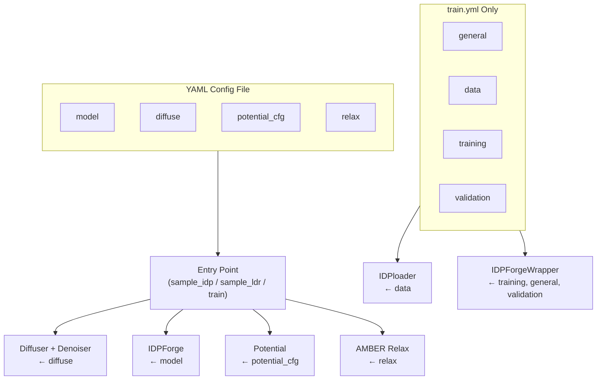

IDPForge is configured through **YAML files** for the core diffusion model and training pipeline, and a **Python module** (`AlphaFlex/config.py`) for the AlphaFlex orchestration layer. This reference documents every configurable parameter, its type, default value, and the code path that consumes it. Two canonical YAML configs ship with the repository: [`sample.yml`](configs/sample.yml) for inference and [`train.yml`](configs/train.yml) for training.

## Configuration Architecture

IDPForge's configuration follows a **layered consumption model** — the YAML file is the single source of truth, parsed by the entry-point script, then distributed to subsystems (diffusion, model, loss, relaxation, potentials) via dictionary slicing. No config-validation schema is enforced at load time; parameters are consumed directly via `yaml.safe_load()` and passed as `ml_collections.ConfigDict` objects where OpenFold/ESM subsystems require attribute-style access.



Sources: [sample_idp.py](sample_idp.py#L41-L47), [sample_ldr.py](sample_ldr.py#L41-L47), [train.py](train.py#L27-L34)

---

## Sampling Configuration (`configs/sample.yml`)

The sampling configuration governs **inference-time** behavior for both fully disordered IDP sampling (`sample_idp.py`) and local disordered region sampling with a folded template (`sample_ldr.py`).

### `model` — Transformer Network Architecture

These parameters define the IDPForge denoising network. They are shared identically between sampling and training configs and must **match the checkpoint's training config** at inference time.

| Parameter | Type | Default | Description |
|-----------|------|---------|-------------|
| `t_embed_dim` | int | `32` | Sinusoidal timestep embedding dimension. Fed into `esm_s_mlp` to project time + torsion features into sequence state space. |
| `self_condition` | bool | `true` | Enables self-conditioning: with 50% probability during training, the model receives its own previous-step prediction as additional input. |
| `t2d_params.DMIN` | float | `3.0` | Minimum pairwise distance (Å) for the 2D distance histogram bins used in pairwise state initialization. |
| `t2d_params.DMAX` | float | `39.0` | Maximum pairwise distance (Å) for the 2D distance histogram bins. |
| `t2d_params.DBINS` | int | `32` | Number of distance bins in the pairwise feature histogram. Determines input dimension of `z_mlp`. |
| `t2d_params.ABINS` | int | `32` | Number of angular bins in the pairwise feature histogram. |

Sources: [configs/sample.yml](configs/sample.yml#L2-L22), [idpforge/model.py](idpforge/model.py#L30-L33)

### `model.trunk` — Folding Trunk

The trunk wraps an ESMFold-style iterative folding architecture with recycle refinement.

| Parameter | Type | Default | Description |
|-----------|------|---------|-------------|
| `num_blocks` | int | `2` | Number of trunk blocks (each contains attention + transition layers). |
| `sequence_state_dim` | int | `128` | Per-residue single representation dimension (`c_s`). |
| `pairwise_state_dim` | int | `64` | Per-residue-pair representation dimension (`c_z`). |
| `sequence_head_width` | int | `32` | Width of each attention head in sequence (row) attention. |
| `pairwise_head_width` | int | `32` | Width of each attention head in pairwise (column) attention. |
| `max_recycles` | int | `3` | Maximum number of recycle iterations during inference. |
| `recycle_min_bin` | float | `3.375` | Minimum distance bin for the recycle distogram input. |
| `recycle_max_bin` | float | `39.375` | Maximum distance bin for the recycle distogram input. |

Sources: [configs/sample.yml](configs/sample.yml#L8-L17)

### `model.trunk.structure_module` — IPA Structure Module

The Invariant Point Attention (IPA) structure module outputs SE(3) frames and torsion angles. These parameters control its capacity and numerical behavior.

| Parameter | Type | Default | Description |
|-----------|------|---------|-------------|
| `c_s` | int | `256` | Single channel dimension inside the structure module. |
| `c_z` | int | `64` | Pair channel dimension inside the structure module. |
| `c_ipa` | int | `16` | IPA hidden channel dimension per head. |
| `c_resnet` | int | `128` | ResNet hidden dimension in the angle update network. |
| `no_heads_ipa` | int | `8` | Number of IPA attention heads. |
| `no_qk_points` | int | `4` | Number of geometric query/key points per IPA head. |
| `no_v_points` | int | `8` | Number of geometric value points per IPA head. |
| `dropout_rate` | float | `0.1` | Dropout probability applied within the structure module. |
| `no_blocks` | int | `4` | Number of structure module blocks (each: IPA → transition → angle update). |
| `no_transition_layers` | int | `1` | Number of transition MLP layers per block. |
| `no_resnet_blocks` | int | `2` | Number of ResNet blocks in the angle ResNet. |
| `no_angles` | int | `7` | Number of torsion angles predicted (ω, φ, ψ, χ1–χ4). |
| `trans_scale_factor` | float | `10` | Scaling factor applied to IPA translation outputs. |
| `epsilon` | float | `1e-8` | Numerical stability constant for normalization. |
| `inf` | float | `1e8` | Large constant used for masked attention logits. |

Sources: [configs/sample.yml](configs/sample.yml#L18-L31), [idpforge/model.py](idpforge/model.py#L37-L52)

### `diffuse` — Diffusion Schedule

Controls the forward (noising) and reverse (denoising) diffusion processes across all three diffusion spaces: Euclidean translations, SO(3) rotations, and torsion angles.

| Parameter | Type | Default (sample) | Default (train) | Description |
|-----------|------|---------|---------|-------------|
| `n_tsteps` | int | `200` | `200` | Total number of discretized diffusion timesteps **T**. Governs the granularity of the noise schedule. |
| `inference_steps` | int | `40` | — | Number of reverse-diffusion steps taken during sampling. Fewer steps = faster but coarser; must divide `n_tsteps` evenly in practice. |
| `n_tsteps_inf` | int | — | `40` | Training config uses `n_tsteps_inf` instead of `inference_steps` for the Denoiser. Semantically identical. |
| `euclid_b0` | float | `0.01` | `0.01` | Initial (t=0) noise level β₀ for Euclidean (translational) diffusion. |
| `euclid_bT` | float | `0.06` | `0.08` | Terminal (t=T) noise level β_T for Euclidean diffusion. Train uses a wider schedule (`0.08`). |
| `torsion_b0` | float | `0.01` | `0.01` | Initial noise level β₀ for torsion angle diffusion. |
| `torsion_bT` | float | `0.06` | `0.06` | Terminal noise level β_T for torsion angle diffusion. |
| `tseed` | int | `49` | — | Random seed for diffusion sampling (sample config only). |

> [!TIP]
> The `euclid_bT` parameter differs between sample (`0.06`) and train (`0.08`) configs by design — training uses a slightly wider translational noise schedule to improve robustness. When resuming from a checkpoint, ensure the `diffuse` section matches the training config exactly.

Sources: [configs/sample.yml](configs/sample.yml#L34-L41), [configs/train.yml](configs/train.yml#L51-L58), [idpforge/utils/diff_utils.py](idpforge/utils/diff_utils.py#L473-L505)

### `potential` and `potential_cfg` — Experimental Guidance Potentials

During sampling, differentiable potentials steer the reverse diffusion toward experimentally consistent conformations. The top-level `potential` boolean gates the entire system; when `false`, the `potential_cfg` block is ignored.

| Parameter | Type | Default | Description |
|-----------|------|---------|-------------|
| `potential` | bool | `false` | Master switch for guidance potentials during sampling. |
| `potential_cfg.timescale` | int | `10` | Multiplier on the potential gradient scaling function; higher values apply guidance more aggressively at earlier timesteps. |
| `potential_cfg.grad_clip` | float | `0.1` | Maximum gradient magnitude per atom; prevents potential explosions from destabilizing the denoiser. |

#### Contact (PRE/NOE) Potential

| Parameter | Type | Default | Description |
|-----------|------|---------|-------------|
| `potential_cfg.pre.exp_path` | str | `data/sic1_pre_exp.txt` | Path to the experimental PRE/NOE distance restraint file. |
| `potential_cfg.pre.exp_mask_p` | float | `0.8` | Probability of applying each pairwise restraint per denoising step (stochastic masking reduces gradient correlation). |
| `potential_cfg.pre.weight` | float | `1.0` | Weight of the contact potential in the composite gradient. Omit to use default. |

#### Radius of Gyration (Rg) Potential

| Parameter | Type | Default | Description |
|-----------|------|---------|-------------|
| `potential_cfg.rg.ens_avg` | float | — | Target ensemble-average Rg (Å) for the RoG potential. |
| `potential_cfg.rg.weight` | float | `1.0` | Weight of the Rg potential in the composite gradient. Omit to use default. |

The `potential_cfg` block may contain `pre`, `noe`, or `rg` keys. Each key triggers construction of the corresponding `Potential` subclass. The composite gradient is assembled at runtime: `potential_type` accumulates the active potential names, and `weights` maps each to its scalar multiplier.

Sources: [configs/sample.yml](configs/sample.yml#L32-L40), [sample_idp.py](sample_idp.py#L56-L79), [idpforge/utils/potential.py](idpforge/utils/potential.py#L62-L170)

### `relax` — AMBER Relaxation

Post-sampling AMBER restraint minimization applied to each conformer. When `max_iterations` is `0`, L-BFGS performs a single energy evaluation (effectively a no-op unless tolerance triggers early refinement).

| Parameter | Type | Default | Description |
|-----------|------|---------|-------------|
| `max_iterations` | int | `0` | Maximum L-BFGS iterations per minimization call. `0` = auto/limited. |
| `tolerance` | float | `10.0` | Convergence tolerance (kJ/mol/nm) for the minimizer. |
| `stiffness` | float | `10.0` | Positional restraint force constant (kJ/mol/nm²) applied to folded residues. |
| `max_outer_iterations` | int | `20` | Number of outer restraint-minimization cycles. |
| `exclude_residues` | list[int] | `[]` | Residue indices excluded from positional restraints. For LDR sampling, this is automatically populated with IDR indices at runtime. |

Sources: [configs/sample.yml](configs/sample.yml#L42-L48), [sample_ldr.py](sample_ldr.py#L93-L96)

### Top-Level Sampling Fields

| Parameter | Type | Default | Description |
|-----------|------|---------|-------------|
| `sec_path` | str/null | `null` | Path to a file of pre-computed secondary structure strings (one per line). When `null`, SS is sampled from the database at `data_path`. |
| `data_path` | str | `data/example_data.pkl` | Path to the secondary structure database pickle (tuple of `(sec_list, seq_list)`). Overridden by `--ss_db` CLI argument. |

Sources: [configs/sample.yml](configs/sample.yml#L32-L33), [sample_idp.py](sample_idp.py#L82-L94)

---

## Training Configuration (`configs/train.yml`)

The training config extends the sampling config with optimizer, data loading, loss, and validation sections.

### `general` — Run Management

| Parameter | Type | Default | Description |
|-----------|------|---------|-------------|
| `me` | str | `train_cfg.yml` | Self-referential config filename (informational). |
| `output` | str | `local` | Output directory root for TensorBoard logs and checkpoints. |
| `run_name` | str | `test` | Experiment name; used as the TensorBoard log subdirectory. |
| `save_pdb` | bool | `true` | Whether to periodically write predicted PDBs to the log directory. |
| `batch_save_freq` | int | `2` | PDB save frequency: only save when `(batch_idx + 1) % (batch_save_freq * 10) == 0`. |
| `epoch_save_freq` | int | `5` | PDB save frequency: only save when `(epoch + 1) % epoch_save_freq == 0`. |

Sources: [configs/train.yml](configs/train.yml#L2-L8), [idpforge/wrapper.py](idpforge/wrapper.py#L21-L24)

### `data` — Data Loading

| Parameter | Type | Default | Description |
|-----------|------|---------|-------------|
| `train_path` | list[str] | `["data/"]` | List of directories or pickle files for training data. Each entry is loaded as a `(ss, seq, coords)` tuple. |
| `val_path` | list[str] | `["data/"]` | List of directories or pickle files for validation data. |
| `tr_batch_size` | int | `16` | Training batch size (per GPU). |
| `val_batch_size` | int | `64` | Validation batch size. Typically larger since no gradients are stored. |

Sources: [configs/train.yml](configs/train.yml#L9-L15), [train.py](train.py#L34-L40)

### `training` — Optimizer and Training Loop

#### `training.lr_scheduler` — Learning Rate Schedule

Uses the `AlphaFoldLRScheduler` from OpenFold: linear warmup followed by cosine decay.

| Parameter | Type | Default | Description |
|-----------|------|---------|-------------|
| `max_lr` | float | `0.001` | Peak learning rate after warmup. |
| `warmup_no_steps` | int | `1000` | Number of training steps for linear warmup. |
| `start_decay_after_n_steps` | int | `5000` | Step at which cosine decay begins. |
| `decay_every_n_steps` | int | `5000` | Period of the cosine decay cycle. |

#### `training.trainer` — PyTorch Lightning Trainer

These keyword arguments are unpacked directly into the `Trainer` constructor.

| Parameter | Type | Default | Description |
|-----------|------|---------|-------------|
| `gradient_clip_val` | float | `0.1` | Gradient norm clipping threshold. |
| `accumulate_grad_batches` | int | `4` | Number of batches to accumulate before an optimizer step. Effective batch size = `tr_batch_size × accumulate_grad_batches × num_gpus`. |
| `accelerator` | str | `gpu` | PyTorch Lightning accelerator (`gpu`, `cpu`, `auto`). |
| `devices` | int | `1` | Number of GPU devices. |
| `max_epochs` | int | `100` | Maximum training epochs. |
| `num_sanity_val_steps` | int | `0` | Number of sanity validation steps before training begins. |

#### `training.ema_decay` — Exponential Moving Average

| Parameter | Type | Default | Description |
|-----------|------|---------|-------------|
| `ema_decay` | float | `0.99` | EMA decay for model weights. EMA parameters are used at validation and checkpoint save time. |

#### `training.diff_pkl`

| Parameter | Type | Default | Description |
|-----------|------|---------|-------------|
| `diff_pkl` | str | `data/diff_igso3.pkl` | Pre-computed IGSO(3) cache file for the SO(3) diffuser. Avoids expensive recomputation of `igso3_vals` at startup. |

Sources: [configs/train.yml](configs/train.yml#L16-L41), [idpforge/wrapper.py](idpforge/wrapper.py#L106-L128)

### `training.loss` — Loss Function Configuration

The composite training loss is a weighted sum: **L = w_fape·L_fape + w_dist·L_dist + w_angular·L_angular + w_violation·L_violation**.

#### `training.loss.weights`

| Parameter | Type | Default | Description |
|-----------|------|---------|-------------|
| `fape` | float | `1` | Weight for Frame-Aligned Point Error (backbone + sidechain FAPE). |
| `dist` | float | `0.005` | Weight for Cβ distance distribution loss. |
| `angular` | float | `0.1` | Weight for torsion angle loss. |
| `violation` | float | `0.01` | Weight for structural violation loss (clashes, bond length deviations). |

#### `training.loss.fape`

| Parameter | Type | Default | Description |
|-----------|------|---------|-------------|
| `use_clamp` | float | `0.5` | Whether to use clamped FAPE (value > 0 enables clamping). |
| `clamp_distance` | float | `10` | FAPE clamp distance (Å). |

#### `training.loss.dist`

| Parameter | Type | Default | Description |
|-----------|------|---------|-------------|
| `start_epoch` | int | `50` | Epoch at which the distance loss becomes active (curriculum learning). |
| `loop_clamp` | float | `10` | Clamping distance (Å) for the loop/IDR portion of the Cβ distance error. |
| `sidechain` | float | `0` | Weight for the sidechain distance loss term. `0` = disabled. |
| `sidechain_clamp` | float | `8` | Clamping distance for the sidechain distance loss. |

#### `training.loss.violation_cfg`

| Parameter | Type | Default | Description |
|-----------|------|---------|-------------|
| `start_epoch` | int | `80` | Epoch at which the violation loss becomes active. |

> [!TIP]
> The loss employs a two-stage curriculum: distance loss activates at epoch 50, violation loss at epoch 80. Before these epochs, the respective weight is effectively zero regardless of the `weights` value. This prevents early training instability from clash-gradient noise.

Sources: [configs/train.yml](configs/train.yml#L42-L50), [idpforge/loss.py](idpforge/loss.py#L48-L80)

### `validation` — Validation Metrics

| Parameter | Type | Default | Description |
|-----------|------|---------|-------------|
| `loss_weights.ca_drmsd` | float | `0.1` | Weight of Cα DRMSD in the composite validation loss. |
| `loss_weights.violation` | float | `0.0` | Weight of violation in validation loss. |
| `loss_weights.dist` | float | `0.05` | Weight of Cβ distance in validation loss. |
| `loss_weights.rg_error` | float | `1.0` | Weight of Rg error in validation loss. |
| `compute_cb_dist` | bool | `true` | Whether to compute Cβ distance distribution error during validation. |
| `compute_rg` | bool | `true` | Whether to compute Rg error during validation (requires `rg` in data). |

Sources: [configs/train.yml](configs/train.yml#L59-L67), [idpforge/wrapper.py](idpforge/wrapper.py#L67-L85)

---

## Command-Line Interface Reference

### `sample_idp.py` — Fully Disordered IDP Sampling

```
python sample_idp.py <seq> <ckpt_path> <output_dir> <sample_cfg> [options]
```

| Argument | Type | Default | Description |
|----------|------|---------|-------------|
| `seq` | pos | — | Amino acid sequence (one-letter code, e.g. `MDEKR...`). |
| `ckpt_path` | pos | — | Path to model checkpoint (`.ckpt`). |
| `output_dir` | pos | — | Directory for output PDB files. |
| `sample_cfg` | pos | — | Path to sampling YAML config. |
| `--batch` | int | `32` | Number of conformers generated per forward pass. |
| `--nconf` | int | `100` | Total number of conformers to generate. |
| `--cuda` | flag | `false` | Use CUDA if available. |
| `--ss_db` | str | `None` | Override `data_path` from config for the SS database pickle. |
| `--no_relax` | flag | `false` | Skip AMBER relaxation; output raw PDBs (`*_raw.pdb`). |
| `--verbose` | flag | `false` | Print structural validation details per conformer. |

Sources: [sample_idp.py](sample_idp.py#L171-L193)

### `sample_ldr.py` — IDR Sampling with Folded Template

```
python sample_ldr.py <ckpt_path> <fold_template> <output_dir> <sample_cfg> [options]
```

| Argument | Type | Default | Description |
|----------|------|---------|-------------|
| `ckpt_path` | pos | — | Path to model checkpoint. |
| `fold_template` | pos | — | Path to `.npz` template file (from `mk_ldr_template.py`). |
| `output_dir` | pos | — | Directory for output PDB files. |
| `sample_cfg` | pos | — | Path to sampling YAML config. |
| `--batch` | int | `32` | Batch size per forward pass. |
| `--nconf` | int | `200` | Total conformers to generate. |
| `--attn_chunk_size` | int | `None` | Chunk size for memory-efficient attention (reduces VRAM). |
| `--cuda` | flag | `false` | Use CUDA. |
| `--ss_db` | str | `None` | Override SS database path. |
| `--no_relax` | flag | `false` | Skip relaxation. |
| `--verbose` | flag | `false` | Verbose validation output. |
| `--fold_curv_ratio` | float | `0.0` | Fold curvature gate ratio — reject conformers exceeding this curvature threshold at the fold-IDR junction. |
| `--fold_curv_window` | int | `15` | Residue window size for the fold curvature check. |
| `--junction_kappa` | float | `0.0` | Junction curvature gate (Å⁻¹) — reject conformers with backbone curvature exceeding κ at the junction. |
| `--expected_knot_type` | str | `None` | Expected knot type for topological screening. |

Sources: [sample_ldr.py](sample_ldr.py#L170-L194)

### `train.py` — Training

```
python train.py --model_config_path <path> [options]
```

| Argument | Type | Default | Description |
|----------|------|---------|-------------|
| `--model_config_path` | str | `config.yml` | Path to training YAML config. |
| `--seed` | int | `42` | Global random seed. |
| `--run_version` | int | `None` | TensorBoard run version override. |
| `--early_stopping` | flag | `false` | Enable early stopping on `val_loss`. |
| `--resume_from_ckpt` | str | `None` | Path to checkpoint for resuming training. |
| `--load_weights_only` | flag | `false` | Load model weights only (ignore optimizer state). |
| `--log_lr` | flag | `true` | Log learning rate to TensorBoard. |

Sources: [train.py](train.py#L105-L153)

### `score_ensemble.py` — X-EISD Ensemble Scoring

```
python score_ensemble.py <protname> <pdbpath> [--jc] [--cs] [--noe] [--pre] [--fret] [options]
```

| Argument | Type | Default | Description |
|----------|------|---------|-------------|
| `protname` | pos | — | Protein name key in `EXP_DATA_LIB`. |
| `pdbpath` | pos | — | Directory containing PDB ensemble. |
| `--jc` / `--cs` / `--noe` / `--pre` / `--fret` | flags | — | Enable specific experimental data types for scoring. |
| `--all` | flag | `false` | Score every conformer in a single pass (vs. 30 trials × 100 subsamples). |
| `--ens-size` | int | `100` | Conformers per random subsample trial. |
| `--trials` | int | `30` | Number of random subsample trials. |
| `--force` | flag | `false` | Re-score even if output CSV exists. |
| `--normalize` | flag | `false` | Build cross-method benchmark table (Eq. S11). |
| `--rg` | flag | `false` | Compute per-ensemble Rg for the `|%dRg|/Rg` column. |

Sources: [score_ensemble.py](score_ensemble.py#L107-L162)

---

## AlphaFlex Pipeline Configuration (`AlphaFlex/config.py`)

The AlphaFlex pipeline uses a **Python-based configuration module** rather than YAML. All parameters are module-level constants organized by pipeline step. Paths are constructed relative to the `AlphaFlex/` directory.

### Global Paths

| Constant | Default | Description |
|----------|---------|-------------|
| `PROJECT_ROOT` | `os.path.dirname(__file__)` | AlphaFlex directory root. |
| `MASTER_DB_PATH` | `Data_Inputs/AlphaFlex_database_Nov2025.json` | Master AlphaFold database. |
| `LENGTH_REF_PATH` | `Data_Inputs/AF2_9606_HUMAN_v4_num_residues.json` | Residue count reference. |
| `PDB_LIBRARY_PATH` | `Data_Inputs/Test_Structures/` | PDB structure library. |
| `KNOT_SCREENING_PATH` | `Data_Inputs/knot_screening.json` | Knot type screening data. |

Sources: [AlphaFlex/config.py](AlphaFlex/config.py#L17-L29)

### Step 1: Case Labeling

| Constant | Default | Description |
|----------|---------|-------------|
| `LABELED_DB_PATH` | `Pipeline_Outputs/Step_1_Labeling/Labeled_...json` | Output path for labeled database. |
| `SUMMARY_TEXT_PATH` | `Pipeline_Outputs/Step_1_Labeling/idr_type_summary.txt` | IDR type summary output. |

### Step 1B: Subset Filtering

| Constant | Default | Description |
|----------|---------|-------------|
| `SUBSET_MIN_LENGTH` | `0` | Minimum protein length for subset filtering. |
| `SUBSET_MAX_LENGTH` | `250` | Maximum protein length. |
| `SUBSET_TAIL_COUNT` | `2` | Required number of disordered tails. |
| `SUBSET_LINKER_COUNT` | `1` | Required number of disordered linkers. |
| `SUBSET_LOOP_COUNT` | `1` | Required number of disordered loops. |
| `SUBSET_EXACT_COUNT` | `True` | Require exact match of tail/linker/loop counts (vs. minimum). |
| `SUBSET_IDR_MIN_LENGTH` | `None` | Minimum IDR segment length filter. |
| `SUBSET_IDR_MAX_LENGTH` | `None` | Maximum IDR segment length filter. |
| `SUBSET_MAX_SAMPLES` | `None` | Cap on number of entries in the subset. |

Sources: [AlphaFlex/config.py](AlphaFlex/config.py#L40-L56)

### Step 2: Template Generation

| Constant | Default | Description |
|----------|---------|-------------|
| `TEMPLATE_N_CONFS` | `200` | Number of seed conformers generated per template. |
| `TEMPLATE_SEED_SKEW` | `0.5` | Seed distance skew factor — controls the distribution of IDR seed placement relative to the folded anchor. |
| `TEMPLATE_MAX_RESIDUES` | `None` | Maximum total residues for graft-mode size truncation. `None` = no truncation. |
| `TEMPLATE_FOLD_PER_SIDE` | `10` | Minimum folded residues retained per junction side after truncation. |
| `TIMEOUT_STATIC_TEMPLATE` | `60` | Timeout (seconds) for static template generation. |
| `TIMEOUT_DYNAMIC_TEMPLATE` | `1000` | Timeout (seconds) for dynamic (flex) template generation. |
| `TRUNCATE_TO_ADJACENT` | `False` | Whether to truncate the template to only adjacent folded residues. |

Sources: [AlphaFlex/config.py](AlphaFlex/config.py#L59-L78)

### Step 3: Conformer Generation

| Constant | Default | Description |
|----------|---------|-------------|
| `SAMPLE_N_CONFS` | `10` | Target number of conformers per IDR. |
| `SAMPLE_BATCH_SIZE` | `6` | Batch size for conformer generation calls. |
| `SAMPLE_MAX_TOTAL_ATTEMPTS` | `500` | Maximum total generation attempts before giving up. |
| `DEVICE` | `"cuda"` | Compute device for sampling (`"cuda"` or `"cpu"`). |
| `SAMPLE_FOLD_CURV_RATIO` | `0.5` | Fold curvature gate ratio for conformer acceptance. |
| `SAMPLE_FOLD_CURV_WINDOW` | `15` | Residue window for fold curvature check. |
| `SAMPLE_JUNCTION_KAPPA` | `0.12` | Junction curvature gate threshold (Å⁻¹). |
| `MODEL_WEIGHTS_PATH` | `weights/mdl.ckpt` | Path to IDPForge model checkpoint. |
| `MODEL_CONFIG_PATH` | `configs/sample.yml` | Path to sampling YAML config. |
| `SS_DB_PATH` | `data/example_data.pkl` | Path to secondary structure database. |

Sources: [AlphaFlex/config.py](AlphaFlex/config.py#L81-L106)

### Step 4: Stitching and Relaxation

| Constant | Default | Description |
|----------|---------|-------------|
| `STITCH_N_CONFORMERS` | `10` | Target number of stitched conformers per protein. |
| `STITCH_MAX_ATTEMPTS` | `500` | Maximum stitching attempts. |
| `STITCH_FOLD_CURV_RATIO` | `0.5` | Fold curvature gate for stitched conformers. |
| `STITCH_FOLD_CURV_WINDOW` | `15` | Residue window for curvature check. |
| `RELAX_STIFFNESS` | `10.0` | AMBER restraint force constant (kJ/mol/nm²). |
| `RELAX_MAX_OUTER_ITER` | `20` | Outer AMBER relaxation iterations. |
| `MINIMIZATION_MAX_ITER` | `0` | L-BFGS inner iterations (`0` = auto). |
| `MINIMIZATION_TOLERANCE` | `10.0` | L-BFGS convergence tolerance (kJ/mol/nm). |
| `ALIGNMENT_STUB_HALF_SIZE` | `5` | Half-window size for alignment stub construction. |
| `ALIGNMENT_JUNCTION_SIZE` | `5` | Fallback stub size at junctions. |
| `MIN_CONFORMER_POOL_SIZE` | `5` | Minimum conformer pool size (warning threshold). |
| `STITCH_BASE_CLASH_THRESHOLD` | `10.0` | Base clash score threshold for conformer acceptance. |
| `STITCH_CLASH_INCREMENT` | `5.0` | Adaptive clash threshold escalation step. |

Sources: [AlphaFlex/config.py](AlphaFlex/config.py#L109-L123)

---

## Config Consumption Map

The following table traces each YAML section to its consuming class/function, enabling targeted modification without unintended side effects.

| YAML Section | Consumer | Entry Point |
|-------------|----------|-------------|
| `model` | `IDPForge.__init__` via `mlc.ConfigDict` | All |
| `model.trunk` | `FoldingTrunk.__init__` | All |
| `model.trunk.structure_module` | `StructureModule.__init__` | All |
| `diffuse` | `Diffuser.__init__`, `Denoiser.__init__` | All |
| `diffuse.inference_steps` / `n_tsteps_inf` | `Denoiser.__init__` | Sample / Train |
| `potential_cfg` | `sample_idp.main` → `Potential` subclasses | `sample_idp.py` only |
| `relax` | `output_to_pdb` → AMBER minimizer | `sample_idp.py`, `sample_ldr.py` |
| `data` | `IDPloader.__init__` | `train.py` only |
| `training.loss` | `calc_loss` | `train.py` only |
| `training.lr_scheduler` | `AlphaFoldLRScheduler` | `train.py` only |
| `training.trainer` | `Trainer(**kwargs)` | `train.py` only |
| `training.ema_decay` | `ExponentialMovingAverage` | `train.py` only |
| `validation` | `IDPForgeWrapper.validation_step` | `train.py` only |

Sources: [idpforge/model.py](idpforge/model.py#L35-L52), [idpforge/wrapper.py](idpforge/wrapper.py#L14-L24), [idpforge/utils/diff_utils.py](idpforge/utils/diff_utils.py#L473-L505)

---

## Suggested Reading

For context on how these configurations compose into end-to-end workflows, see [Training Workflow and Configuration](9-training-workflow-and-configuration) for the training pipeline, [IDP Sampling (Fully Disordered)](12-idp-sampling-fully-disordered) for sampling usage, and [Experimental Guidance Potentials](14-experimental-guidance-potentials) for potential-based steering.