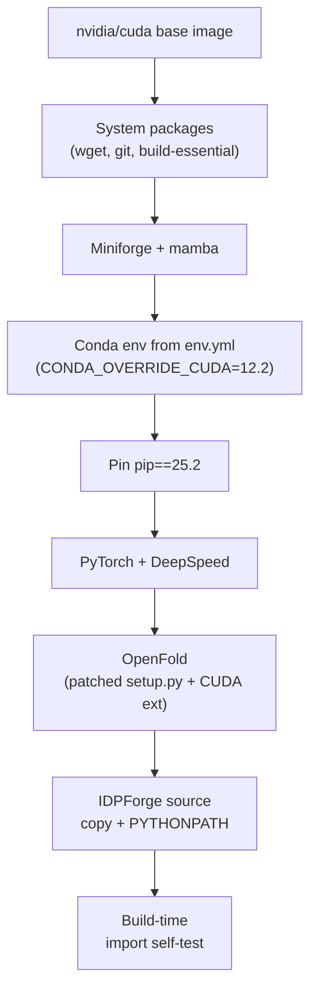

IDPForge ships **three deployment formats** — Docker images, Apptainer (Singularity) definition files, and a bare Conda environment — each available in **two GPU-architecture variants**: Ampere (CUDA 12.1) and Blackwell (CUDA 12.8). This page walks you through selecting the right variant, building the container or environment, and running your first sampling job inside it. The build pipeline is deliberately uniform across formats: every path shares the same Conda dependency manifest, the same pip pin, and the same OpenFold CUDA-extension patch — the only axis of variation is the CUDA/PyTorch version pair matched to your hardware.

## GPU Architecture Variants

The two variants exist because OpenFold's custom CUDA kernel (`attn_core_inplace_cuda`) must be compiled against compute capabilities that match the target GPU. IDPForge patches OpenFold's `setup.py` to control exactly which `sm_*` codes are emitted during the build.

| Variant | CUDA Toolkit | PyTorch | Compute Capabilities | Target GPUs |
|---------|-------------|---------|---------------------|-------------|
| **Ampere** | 12.1 | 2.5.1 | sm_61 (Pascal), sm_70 (Volta), sm_80 (Ampere) | A40, A100, V100, T4, GTX 1080+ |
| **Blackwell** | 12.8 | 2.7.1 | sm_61–sm_80 + sm_90 (Hopper/Ada), sm_120 (Blackwell) | H100, B200, RTX 5090, L40S |

The OpenFold setup patches make this distinction concrete. The Ampere variant compiles for three architectures:

```python
compute_capabilities = set([
    (6, 1), # Pascal
    (7, 0), # Volta
    (8, 0), # Ampere (A40/A100)
])
```

While the Blackwell variant extends the set with Hopper and Blackwell codes:

```python
compute_capabilities = set([
    (6, 1),  # Pascal
    (7, 0),  # Volta
    (8, 0),  # Ampere (A40/A100)
    (9, 0),  # Hopper/Ada
    (12, 0), # Blackwell
])
```

> [!TIP]
> Choose the **Ampere** variant if your HPC cluster runs NVIDIA A100/A40 or older GPUs — it is the safer default. Use **Blackwell** only when you know the target machine has Hopper (sm_90) or Blackwell (sm_120) hardware; the additional compute-capability flags increase compilation time and image size.

Sources: [openfold_setup_12.1.py](dockerfiles/openfold_setup_12.1.py#L55-L61), [openfold_setup_12.8.py](dockerfiles/openfold_setup_12.8.py#L55-L65)

## Docker Deployment

### Build

From the repository root, build the image matching your GPU architecture:

```bash
# Ampere variant (most clusters)
docker build -f dockerfiles/Dockerfile_Ampere -t idpforge:ampere .

# Blackwell variant (H100 / B200 clusters)
docker build -f dockerfiles/Dockerfile_Blackwell -t idpforge:blackwell .
```

Both Dockerfiles follow an identical layered construction strategy, differing only in the base image tag and PyTorch wheel index. The build pipeline proceeds through these stages:



### Run

Invoke sampling with GPU passthrough. The `--gpus all` flag is required for CUDA access inside the container:

```bash
docker run --gpus all -v $(pwd)/out:/app/out idpforge:ampere \
    python sample_idp.py \
    "MVKETFYTVGD" ./weights/mdl.ckpt /app/out \
    ./configs/sample.yml --nconf 10 --cuda --verbose
```

For ensemble scoring, mount experimental data as an additional volume:

```bash
docker run --gpus all \
    -v $(pwd)/out:/app/out \
    -v $(pwd)/exp_data:/data \
    -e IDPFORGE_EXP_DATA=/data \
    idpforge:ampere \
    python score_ensemble.py asyn /app/out --jc --noe --pre --fret
```

> [!TIP]
> The `CONDA_OVERRIDE_CUDA=12.2` environment variable is set during the Conda env creation step. This is critical because Docker builds execute on the CPU — without it, Conda would resolve the **CPU-only** variant of OpenMM, which cannot perform GPU-accelerated AMBER relaxation at runtime.

Sources: [Dockerfile_Ampere](dockerfiles/Dockerfile_Ampere#L1-L64), [Dockerfile_Blackwell](dockerfiles/Dockerfile_Blackwell#L1-L64)

## Apptainer (Singularity) Deployment for HPC

HPC clusters typically restrict Docker but allow Apptainer/Singularity containers. IDPForge provides `.def` definition files that build SIF images from the same NVIDIA CUDA base, using Apptainer's fakeroot build mode.

### Build

```bash
# Ampere variant
apptainer build idpforge_ampere.sif dockerfiles/idpforge_ampere.def

# Blackwell variant
apptainer build idpforge_blackwell.sif dockerfiles/idpforge_blackwell.def
```

> **Prerequisites before building**: You must have the model checkpoint (`weights/mdl.ckpt`) and fragment library (`data/example_data.pkl`) present in the repository tree — the `%files` section copies the `weights/` and `data/` directories into the image at `/opt/IDPForge/`.

### Run

The `--nv` flag binds the host's NVIDIA driver and CUDA libraries into the container. Bind-mount the output directory so sampled structures persist on the host filesystem:

```bash
# Sampling
apptainer run --nv --pwd /opt/IDPForge \
    -B "$PWD/out":/app/out \
    idpforge_ampere.sif /opt/IDPForge/sample_idp.py \
        "MVKETFYTVGD" /opt/IDPForge/weights/mdl.ckpt /app/out \
        /opt/IDPForge/configs/sample.yml --nconf 10 --cuda --verbose
```

```bash
# Scoring (experimental data not bundled — mount separately)
apptainer run --nv \
    -B "$PWD/../Data/exp":/data \
    --env IDPFORGE_EXP_DATA=/data \
    idpforge_ampere.sif /opt/IDPForge/score_ensemble.py \
        asyn /app/out --jc --noe --pre --fret
```

### Apptainer vs Docker: Structural Differences

| Aspect | Docker | Apptainer |
|--------|--------|-----------|
| Source inclusion | `COPY . /app` (full tree) | `%files` — explicit per-directory copy to `/opt/IDPForge/` |
| Python path | `ENV PYTHONPATH="/app"` | `%environment` exports `PYTHONPATH=/opt/IDPForge` |
| Entrypoint | None (explicit `python` in `docker run`) | `%runscript exec python "$@"` — script path is the sole argument |
| GPU access | `--gpus all` (Docker runtime) | `--nv` (host driver bind) |
| Self-test | `RUN python - <<'PY' ...` (fail-fast at build) | `%test` block (run via `apptainer test`) |
| Locale config | Not set | `LC_ALL=C.UTF-8`, `LANG=C.UTF-8` |
| Build user | Root | Fakeroot (Apptainer default) |

Sources: [idpforge_ampere.def](dockerfiles/idpforge_ampere.def#L1-L121), [idpforge_blackwell.def](dockerfiles/idpforge_blackwell.def#L1-L121)

## Conda Environment (Bare Metal)

If you prefer a native Conda installation — for example, on a workstation with a supported NVIDIA driver — use the root-level `environment.yml`. It contains inline comments marking the four lines you must toggle when switching from the Ampere default to the Blackwell alternative.

### Setup

```bash
# Create the environment (Ampere default)
mamba env create -f environment.yml
conda activate IDPForge

# Install IDPForge as an editable package
pip install -e .
```

### Switching to the Blackwell Variant

Edit `environment.yml` and change the **four marked lines**:

| Line | Default (Ampere) | Alternative (Blackwell) |
|------|-------------------|------------------------|
| `cuda-toolkit` | `nvidia::cuda-toolkit=12.1` | `nvidia::cuda-toolkit=12.8` |
| `cuda-version` | `conda-forge::cuda-version=12.1` | `conda-forge::cuda-version=12.8` |
| `--extra-index-url` | `https://download.pytorch.org/whl/cu121` | `https://download.pytorch.org/whl/cu128` |
| `torch` | `torch==2.5.1` | `torch==2.7.1` |

After editing, recreate the environment:

```bash
mamba env remove -n IDPForge
mamba env create -f environment.yml
conda activate IDPForge
pip install -e .
```

Sources: [environment.yml](environment.yml#L1-L82)

## Shared Dependency Manifest

Both the Docker and Apptainer builds consume `dockerfiles/env.yml` as their Conda dependency source. This manifest is a focused subset of the root `environment.yml` — it omits `cuda-toolkit` (supplied by the base image) and `gcc` (supplied by the devel image's system packages), delegating those to the container layer. The key dependency groups are:

| Group | Packages | Purpose |
|-------|----------|---------|
| Scientific & MD | `openmm`, `pdbfixer`, `mdtraj`, `biopython`, `scipy` | AMBER relaxation, structure I/O, trajectory analysis |
| Bioinformatics | `hmmer`, `hhsuite`, `kalign2`, `mmseqs2` | MSA generation for OpenFold |
| ML Core | `torch`, `pytorch-lightning`, `deepspeed` | Diffusion model training & inference |
| Data & Logging | `numpy`, `pandas`, `tensorboard`, `wandb` | Experiment tracking, data wrangling |
| Utilities | `PyYAML`, `tqdm`, `einops`, `ml-collections`, `aria2` | Config parsing, progress, tensor reshaping, downloads |

A **strict pip pin at version 25.2** is enforced in all three deployment formats. The Dockerfiles and `.def` files assert this invariant after every `pip install` call:

```bash
pip install --no-deps "pip==25.2" && \
    test "$(pip --version | awk '{print $2}')" = "25.2"
```

This ensures that no downstream dependency silently upgrades pip to a version that breaks IDPForge's installation graph.

Sources: [env.yml](dockerfiles/env.yml#L1-L51), [Dockerfile_Ampere](dockerfiles/Dockerfile_Ampere#L30-L32)

## Build-Time Verification

All container images embed a **self-test** that runs at the end of the build. It imports every critical package and prints the PyTorch/CUDA version pair, causing the build to fail immediately if any dependency is missing or misconfigured:

```python
import torch, numpy, scipy, pandas, mdtraj, yaml, tqdm
import ml_collections, einops
import Bio.PDB
import openmm, pdbfixer
import pytorch_lightning, tensorboard, modelcif
import openfold, idpforge, esm
print("torch:", torch.__version__, "cuda build:", torch.version.cuda)
print("idpforge ok, openfold ok, esm ok")
```

In Docker, this executes as a `RUN` step — a failed import **fails the build**. In Apptainer, it lives in the `%test` section and can be invoked post-hoc with `apptainer test idpforge.sif`.

Sources: [Dockerfile_Ampere](dockerfiles/Dockerfile_Ampere#L58-L64), [idpforge_ampere.def](dockerfiles/idpforge_ampere.def#L107-L115)

## Troubleshooting

| Symptom | Cause | Fix |
|---------|-------|-----|
| `openmm` imports but runs on CPU | `CONDA_OVERRIDE_CUDA` not set during build | Rebuild — the env.yml step must run with `CONDA_OVERRIDE_CUDA=12.2` |
| OpenFold CUDA extension fails to compile | Wrong compute capabilities for your GPU | Verify GPU arch with `nvidia-smi --query-gpu=compute_cap --format=csv` and select matching variant |
| `pip` version mismatch breaks installs | A downstream package upgraded pip past 25.2 | Re-pin: `pip install --no-deps "pip==25.2"` |
| Apptainer build fails in `%post` | Fakeroot cannot write to `/opt` | Use `apptainer build --fakeroot` or run as root on a build node |
| `ImportError: No module named 'idpforge'` at runtime | `PYTHONPATH` not exported in container | Docker: check `ENV PYTHONPATH`; Apptainer: verify `%environment` block |
| `--cs` scoring flag has no effect | CSpred external tool is not bundled | Install CSpred on the host and mount it into the container |

## Where to Go Next

Once your environment is operational, proceed to the core workflow pages:

- **[Architecture Overview](4-architecture-overview)** — understand how the components you just installed interact at runtime
- **[IDP Sampling (Fully Disordered)](12-idp-sampling-fully-disordered)** — run your first end-to-end sampling job with the container you just built
- **[Configuration Reference](22-configuration-reference)** — tune the `sample.yml` and `train.yml` configs for your hardware and sequence