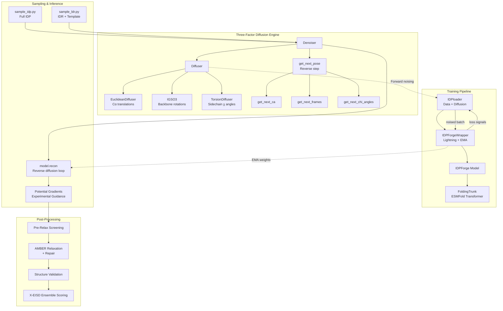
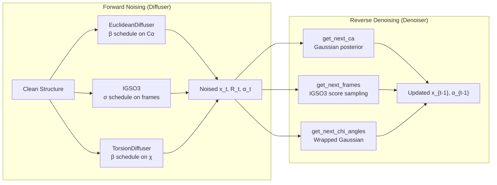
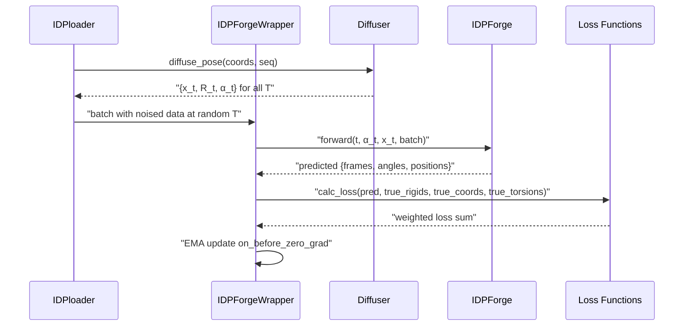
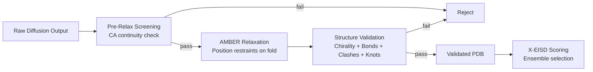

IDPForge is a **transformer protein language diffusion model** that generates all-atom structural ensembles for intrinsically disordered proteins (IDPs) and intrinsically disordered regions (IDRs) that maintain their folded domains. The system couples a modified ESMFold trunk with a three-factor diffusion process operating over SE(3) backbone frames, SO(3) rotational components, and torsion angle space — then closes the loop with experimental guidance potentials, AMBER relaxation, and X-EISD ensemble scoring.

## System Architecture



The architecture divides into four principal subsystems: **(1)** a training pipeline that jointly noises ground-truth structures and trains the denoising network, **(2)** a diffusion engine providing forward noising and reverse denoising across three geometric factors, **(3)** an inference subsystem supporting both fully disordered and template-conditioned sampling with experimental potentials, and **(4)** a post-processing chain that screens, relaxes, validates, and scores the resulting conformers.

Sources: [model.py](/idpforge/model.py#L1-L283), [wrapper.py](/idpforge/wrapper.py#L1-L208), [diff_utils.py](/idpforge/utils/diff_utils.py#L1-L685)

## Core Model: IDPForge Transformer

The `IDPForge` module is the neural denoising network. It extends the ESMFold `FoldingTrunk` with diffusion-specific input conditioning — transforming a noised structure at timestep *t* into a predicted clean structure. The model ingests four input streams: **sinusoidal timestep embeddings**, **noised torsion angle features** (α_t), **amino acid identity embeddings**, and **secondary structure type embeddings**. These are fused into a per-residue single state vector *s_s* that, together with a pairwise state *s_z* derived from noised backbone geometry, feeds the FoldingTrunk's attention-based structure prediction pipeline.

| Component | Input | Output | Dimensionality |
|---|---|---|---|
| `time_embed` | Timestep index *t* | Sinusoidal embedding | → `t_embed_dim` (32) |
| `esm_s_mlp` | [time_embed ⊕ α_t] | Single-state *s_s* | → `c_s` (384) |
| `z_mlp` | Pairwise distance bins | Pairwise-state *s_z* | → `c_z` (128) |
| `aa_embedding` | Residue type | Additive to *s_s* | → `c_s` |
| `ss_embedding` | SS type (H/E/C/…) | Additive to *s_s* | → `c_s` |
| `FoldingTrunk` | *s_s*, *s_z*, sequence | Frames, angles, positions | SE(3) + torsion output |

The forward pass supports **self-conditioning** via recycle: predictions from the previous iteration's output are injected as additional bias terms through `recycle_s_norm`, `recycle_z_norm`, and `recycle_disto`, enabling iterative refinement within a single denoising step. The `recon` method implements the full reverse diffusion loop, stepping from *t = T* down to *t = 0* while optionally fixing template residues at their native coordinates.

> [!TIP]
> The secondary structure embedding is randomly dropped to all-coil (sstype=7) with 20% probability during training, which teaches the model to generate disordered conformations even without explicit SS guidance — critical for IDP ensemble diversity.

Sources: [model.py](/idpforge/model.py#L30-L120), [model.py](/idpforge/model.py#L122-L200), [model.py](/idpforge/model.py#L202-L283)

## Three-Factor Diffusion Engine

IDPForge decomposes protein structure diffusion into three independent geometric channels, each with its own noise schedule and reverse-step algorithm. This factorization mirrors the natural symmetries of protein backbone geometry: translations live in ℝ³, backbone rotations in SO(3), and sidechain conformations in the torsion angle torus.



**Euclidean Cα Diffusion** applies a variance-preserving schedule with linear β from `euclid_b0` to `euclid_bT`. The reverse step computes the Gaussian posterior mean μ(x_t, x̂_0) and variance σ² using the standard DDPM derivation, then adds scaled noise to produce x_{t-1}. All backbone atoms (N, Cα, C, O, Cβ) are translated by the same δ per residue.

**IGSO(3) Frame Diffusion** operates on rotation matrices derived from backbone triplets (N-Cα-C). The forward pass samples rotation vectors from the IGSO(3) distribution using precomputed CDFs. The reverse step computes a score approximation from the predicted R_0 and current R_t, then combines this with stochastic noise scaled by the drift coefficient g(t). This is adapted from the RFdiffusion SO(3) framework.

**Torsion Angle Diffusion** applies the same variance-preserving schedule to sidechain χ angles, with wrapping to [-π, π) to respect the circular topology. A `torsion_mask` ensures that only residues with valid χ angles (e.g., not alanine or glycine) are diffused.

| Diffusion Channel | Space | Schedule | Reverse Method |
|---|---|---|---|
| Cα Translations | ℝ³ | Linear β (DDPM) | Gaussian posterior + noise |
| Backbone Rotations | SO(3) | Quadratic σ (IGSO3) | Score-based SDE discretization |
| Torsion Angles | [-π, π)⁴ | Linear β (wrapped) | Wrapped Gaussian posterior |

Sources: [diff_utils.py](/idpforge/utils/diff_utils.py#L1-L200), [diff_utils.py](/idpforge/utils/diff_utils.py#L200-L400), [diff_utils.py](/idpforge/utils/diff_utils.py#L400-L685)

## Training Pipeline

The training loop is orchestrated by `IDPForgeWrapper`, a PyTorch Lightning module that manages the interaction between the model, the diffuser, the data loader, and the loss computation. During each training step, a random timestep *T* is sampled with linearly increasing weights (favoring later, noisier timesteps), and the model is trained to predict the clean structure from the noised snapshot at that timestep.



The **data pipeline** (`IDPloader` → `DiffDataset` → `BatchCollator`) pre-computes the full forward diffusion trajectory for each training structure at setup time. Each `__getitem__` call selects a random timestep and returns the noised snapshot at both *t* and *t+1* (the latter for self-conditioning). The `BatchCollator` handles variable-length sequences through padding and dense tensor collation.

The **loss function** combines four complementary terms: **FAPE** (Frame Aligned Point Error) measuring backbone and sidechain rigidity alignment, **angular loss** on predicted vs. true torsion angles, **violation loss** penalizing steric clashes and bond geometry deviations, and **Cβ distance loss** enforcing inter-residue distance agreement with special treatment for secondary structure regions.

Sources: [wrapper.py](/idpforge/wrapper.py#L1-L208), [loader.py](/idpforge/loader.py#L1-L145), [loss.py](/idpforge/loss.py#L1-L189)

## Sampling and Inference

IDPForge provides two sampling modes that share the same reverse diffusion engine but differ in how template constraints and initial conditions are handled.

**Full IDP Sampling** (`sample_idp.py`) generates conformational ensembles for completely disordered proteins. Each conformer begins from isotropic Gaussian noise in translation, IGSO(3)-sampled rotations, and uniform torsion angles. Secondary structure assignments are sampled from a pre-built SS database matched by sequence, with random selection per conformer to capture structural diversity. The generation loop runs until the requested number of validated conformers is reached, with automatic resume via file counting.

**IDR Sampling with Folded Template** (`sample_ldr.py`) generates disordered regions while preserving a folded structural template. Template residues have their timesteps forced to *t = 0* and their coordinates/torsions fixed at native values throughout reverse diffusion, so the denoiser only updates the IDR positions. The template `.npz` file provides the sequence, folded coordinates, secondary structure, a binary mask, and torsion angles. For large templates, a truncation mechanism emits a `_truncation.json` graft specification for downstream reassembly via the AlphaFlex stitching pipeline.

| Feature | IDP Sampling | IDR Sampling |
|---|---|---|
| Initial state | Isotropic noise | Noise for IDR; native for fold |
| Template constraint | None | Fixed coordinates at t=0 |
| SS source | Database lookup | Hybrid (fold SS + IDR SS) |
| Typical use case | Fully disordered proteins | Partially structured proteins |
| Script | `sample_idp.py` | `sample_ldr.py` |

Sources: [sample_idp.py](/sample_idp.py#L1-L194), [sample_ldr.py](/sample_ldr.py#L1-L200), [model.py](/idpforge/model.py#L202-L283)

## Experimental Guidance Potentials

During reverse diffusion, differentiable potential functions bias the denoising trajectory toward agreement with experimental data. Each potential computes a scalar energy from the current predicted structure, and its gradient (computed via autograd) is added to the predicted x̂_0 before the reverse step. The `Potential` base class defines the interface; concrete implementations include:

| Potential | Experimental Data | Computation |
|---|---|---|
| `RoG` | Ensemble-averaged Rg | (Rg_pred − Rg_target)² |
| `Contact` | PRE / NOE distances | Switched inverse-distance matching |
| `Efret` | FRET efficiencies | Förster resonance transfer model |
| `JCoup` | J-coupling constants | Karplus equation on backbone φ |

The `Multiple` potential allows weighted combination of any of the above. Potentials are controlled by a timescale parameter (determining when during diffusion they become active) and a gradient clipping threshold to prevent instability. The gradient is applied only to Cα positions and broadcast to all backbone atoms.

Sources: [potential.py](/idpforge/utils/potential.py#L1-L170)

## Post-Processing Chain

Every generated conformer passes through a multi-stage validation and refinement pipeline before being accepted into the final ensemble.



**Pre-Relax Screening** checks consecutive Cα-Cα distances before any expensive relaxation. Junction residues (at fold-IDR boundaries) use a more permissive threshold (6.46 Å) than interior backbone bonds (9.12 Å). This filters catastrophically broken conformers early.

**AMBER Relaxation** applies OpenMM-based energy minimization with positional restraints on folded domain residues (excluding IDR residues from restraint). The `structure_repair` module handles common artifacts like flipped chirality and broken bonds before minimization.

**Structure Validation** performs comprehensive checks: chirality (D-amino acid detection via triple product), bond integrity (heavy-atom graph comparison against canonical connectivity), steric clashes (VDW overlap via KD-tree), and knot topology (Alexander polynomial screening with AlphaKnot2 hybrid detection). Knot expectations can be specified per-domain via a JSON screening file.

**X-EISD Ensemble Scoring** computes maximum log-likelihood scores for the ensemble against experimental data (chemical shifts, J-couplings, PRE/NOE distances, FRET). Each property uses property-specific back-calculators and optimal parameter estimation to compute a log-likelihood, and the total score determines the optimal ensemble subset.

Sources: [pre_relax.py](/idpforge/utils/pre_relax.py#L1-L30), [structure_validation.py](/idpforge/utils/structure_validation.py#L1-L200), [scorer.py](/scoring/scorer.py#L1-L136)

## ESM2 Integration

The `ESM_preprocess` module wraps Meta's ESM2 protein language model to compute per-residue embeddings and optional attention maps. It supports the full ESM2 model family (8M through 15B parameters). During template-based data preparation (`mk_flex_template.py`, `mk_ldr_template.py`), ESM2 embeddings can be pre-computed and cached, avoiding redundant inference during training. The wrapper maps AlphaFold2 residue indices to ESM token indices, adds BOS/EOS tokens, and extracts intermediate layer representations.

Sources: [esm_wrapper.py](/idpforge/esm_wrapper.py#L1-L100)

## Module Organization

```
idpforge/                        # Core library
├── model.py                     # IDPForge transformer (denoising network)
├── wrapper.py                   # PyTorch Lightning training wrapper + EMA
├── loader.py                    # DiffDataset + IDPloader (noised data pipeline)
├── loss.py                      # Multi-component loss (FAPE, angular, violation, dist)
├── misc.py                      # I/O: PDB writing, SS encoding, input processing
├── esm_wrapper.py               # ESM2 embedding pre-computation
└── utils/
    ├── diff_utils.py            # Diffuser + Denoiser + 3-factor diffusion
    ├── igso3_utils.py           # IGSO(3) distribution computation
    ├── potential.py             # Experimental guidance potentials
    ├── pre_relax.py             # Pre-relaxation backbone screening
    ├── relax.py                 # AMBER relaxation via OpenMM
    ├── structure_repair.py      # Chirality/bond repair before relaxation
    ├── structure_validation.py  # Comprehensive conformer validation
    └── validation_metrics.py    # Rg and other ensemble metrics

scoring/                         # X-EISD ensemble scoring
├── scorer.py                    # Per-property log-likelihood scoring
├── calculator.py                # Back-calculator orchestration
├── optimizer.py                 # Ensemble subset optimization
└── normalize.py                 # Score normalization

AlphaFlex/                       # AlphaFold + IDPForge hybrid pipeline
├── Step_1_case_label.py         # IDR classification from AF2 structures
├── Step_1B_subset_label.py      # Subset re-labeling
├── Step_2_mk_ldr_template.py   # Template creation for IDR sampling
├── Step_3_sample_conformer.py   # Conformer generation (calls sample_ldr)
├── Step_4_ldr_stitch.py         # Monte Carlo stitching of truncated domains
└── utils/
    ├── stitch.py                # MC assembly logic
    ├── graft_back.py            # Grafting folded domains back
    └── smart_scoring.py         # Integrated scoring for stitching
```

Sources: [model.py](/idpforge/model.py#L1-L283), [wrapper.py](/idpforge/wrapper.py#L1-L208), [diff_utils.py](/idpforge/utils/diff_utils.py#L1-L685), [loss.py](/idpforge/loss.py#L1-L189)

## Where to Go Next

The architecture overview establishes the system-level picture. To understand each subsystem in depth, follow this progression:

1. **Core Model** — Start with [IDPForge Transformer Network](5-idpforge-transformer-network) for the denoising network internals, then [SE(3) Backbone Diffusion](6-se-3-backbone-diffusion) and [SO(3) Rotational Diffusion](7-so-3-rotational-diffusion) for the geometric diffusion machinery, and [Torsion Angle Diffusion](8-torsion-angle-diffusion) for sidechain modeling.
2. **Training** — See [Training Workflow and Configuration](9-training-workflow-and-configuration) and [Loss Functions](10-loss-functions) for the optimization setup.
3. **Inference** — [IDP Sampling (Fully Disordered)](12-idp-sampling-fully-disordered) and [IDR Sampling with Folded Templates](13-idr-sampling-with-folded-templates) cover the two sampling modes; [Experimental Guidance Potentials](14-experimental-guidance-potentials) explains how NMR/FRET data steer generation.
4. **Quality Control** — [AMBER Relaxation and Repair](15-amber-relaxation-and-repair), [Structure Validation Pipeline](16-structure-validation-pipeline), and [X-EISD Ensemble Scoring](17-x-eisd-ensemble-scoring) detail the post-processing chain.
5. **Hybrid Pipeline** — [AlphaFlex Workflow Overview](18-alphaflex-workflow-overview) and [Monte Carlo Stitching and Assembly](20-monte-carlo-stitching-and-assembly) cover the end-to-end workflow for partially structured proteins.