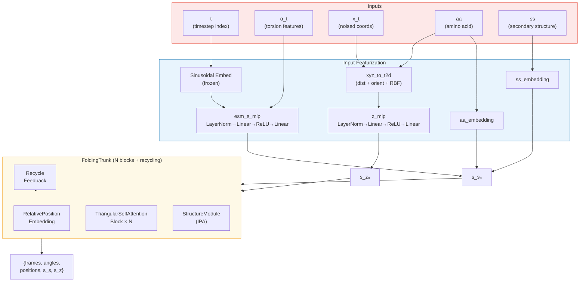
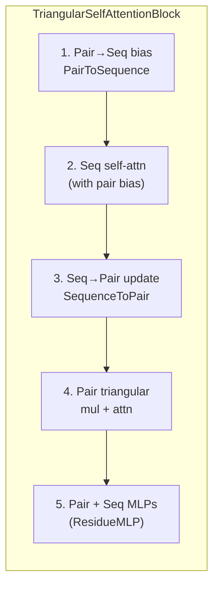

The IDPForge Transformer Network is the core neural architecture that drives structure prediction within a diffusion framework. It extends the ESMFold trunk with diffusion-timestep conditioning, noised-coordinate pairwise featurization, and secondary-structure embeddings — transforming a single-shot structure predictor into a **denoising network** capable of iteratively refining intrinsically disordered protein conformations from noise.

## Architectural Overview

The network follows a **dual-track transformer** paradigm: a sequence-state track (per-residue) and a pairwise-state track (residue-pair) exchange information through coupled attention blocks, culminating in an Invariant Point Attention (IPA) structure module. What distinguishes IDPForge from the base ESMFold trunk is the **diffusion-aware input featurization** that injects timestep, torsion, and noised-geometry signals into the initial hidden states.



Sources: [model.py](/idpforge/model.py#L36-L153), [trunk.py](/esm/esmfold/trunk.py#L113-L227)

## The IDPForge Module

The `IDPForge` class is the top-level `nn.Module` that orchestrates featurization and delegates to the `FoldingTrunk`. Its constructor receives two critical diffusion parameters — `n_tsteps` (total training timesteps) and `inf_tsteps` (inference sub-steps) — alongside an `IDPConfig` dataclass that controls every architectural dimension.

### Configuration Dataclass

| Parameter | Default | Role |
|---|---|---|
| `t_embed_dim` | 32 | Dimensionality of sinusoidal timestep embedding |
| `trunk` | `FoldingTrunkConfig()` | Nested config for the FoldingTrunk (blocks, dims, recycling) |

The `FoldingTrunkConfig` in turn exposes the dimensions that define the transformer's capacity:

| Parameter | Default | Training Config | Role |
|---|---|---|---|
| `num_blocks` | 48 | 2 | Number of TriangularSelfAttention blocks |
| `sequence_state_dim` | 1024 | 128 | Per-residue hidden dimension (c_s) |
| `pairwise_state_dim` | 128 | 64 | Per-pair hidden dimension (c_z) |
| `sequence_head_width` | 32 | 32 | Width per attention head (sequence track) |
| `pairwise_head_width` | 32 | 32 | Width per attention head (pairwise track) |
| `max_recycles` | 3 | 3 | Recycling iterations during inference |
| `structure_module.c_s` | 384 | 256 | Structure module single state dim |
| `structure_module.c_z` | 128 | 64 | Structure module pair state dim |
| `structure_module.no_blocks` | 8 | 4 | IPA structure module layers |

Sources: [model.py](/idpforge/model.py#L30-L33), [trunk.py](/esm/esmfold/trunk.py#L17-L54), [train.yml](/configs/train.yml#L61-L93)

### Embedding and Projection Layers

The `__init__` method constructs five core parameter groups:

**Timestep embedding** — A frozen sinusoidal embedding table maps integer timestep indices ∈ [0, n_tsteps) to a `t_embed_dim`-dimensional vector using the standard positional encoding formula with base 1000. This embedding is never updated by gradients, ensuring the diffusion schedule remains fixed throughout training.

**Sequence-state projection** (`esm_s_mlp`) — A two-layer MLP with LayerNorm input and ReLU activation projects the concatenation of timestep embedding (32-dim) and torsion features (8-dim) into the sequence state dimension c_s. This is the critical bridge between the diffusion state and the transformer's internal representation.

**Pairwise-state projection** (`z_mlp`) — Similarly structured, this MLP projects the 2D distance-orientation featurization of noised coordinates into c_z. Its input dimension is `2 × DBINS + 6 + 1` (one-hot distance bins + sinusoidal orientation angles + RBF Ca–Ca features).

**Amino acid and secondary structure embeddings** — Two separate `nn.Embedding` tables map residue type and secondary structure class into c_s. The padding index is 0, and both use the shift-by-1 convention where 0 represents padding and valid indices start at 1.

Sources: [model.py](/idpforge/model.py#L37-L69), [tensor_utils.py](/idpforge/utils/tensor_utils.py#L116-L125)

## Forward Pass: From Diffusion State to Structure

The `forward` method implements the single-step denoising prediction. It accepts the current diffusion state (timestep `t`, torsion angles `alpha_t`, noised backbone `x_t`) and a batch dictionary containing sequence, secondary structure, mask, and residue indices.

### Step 1 — Sequence State Initialization

The initial per-residue hidden state `s_s_0` is assembled as a sum of three information streams:

```
s_s_0 = MLP( [sin_emb(t) ‖ α_t] ) + Embed_aa(aa) + Embed_ss(ss)
```

The timestep embedding and torsion features are concatenated along the feature dimension, projected through `esm_s_mlp`, then the amino acid and secondary structure embeddings are **additively combined**. This additive fusion ensures each signal can be independently interpreted by downstream attention layers rather than entangled through multiplicative interactions.

A notable training augmentation in `IDPForgeWrapper.training_step` randomly zeroes out secondary structure labels with 20% probability (`torch.rand(1).item() < 0.2`), forcing the model to learn robust predictions without relying on SS annotations.

Sources: [model.py](/idpforge/model.py#L110-L114), [wrapper.py](/idpforge/wrapper.py#L56-L83)

### Step 2 — Pairwise State Initialization

The noised backbone coordinates `x_t` (shape B × L × 5 × 3, representing N, Cα, C, O, Cβ atoms) are converted into a rich 2D feature map via `xyz_to_t2d`:

| Feature | Dimension | Computation |
|---|---|---|
| Cβ–Cβ distance one-hot | DBINS + 1 | Bucketized inter-residue distances |
| Cα–Cα RBF | DBINS | Gaussian radial basis functions |
| Orientation (sin/cos) | 6 | sin(ω), cos(ω), sin(θ), cos(θ), sin(φ), cos(φ) |

The distance features capture **global spatial proximity** while the orientation features (dihedral ω, θ and planar angle φ) encode **local frame relationships** between residue pairs. Together they provide the transformer with a geometric snapshot of the current noised conformation. The combined feature vector is projected through `z_mlp` to yield `s_z_0`.

Sources: [model.py](/idpforge/model.py#L117-L119), [tensor_utils.py](/idpforge/utils/tensor_utils.py#L147-L219)

### Step 3 — Recycling Feedback

If `prev_outputs` is provided (from a previous recycle iteration or self-conditioning), the model injects three recycling signals:

1. **Sequence recycle** — LayerNorm of the previous `s_s`, added to `s_s_0`
2. **Pairwise recycle** — LayerNorm of the previous `s_z`, added to `s_z_0`
3. **Distogram recycle** — A binned Cβ–Cβ distance histogram from the previous predicted coordinates, embedded into `s_z_0`

Self-conditioning during training is applied stochastically (50% probability when enabled): the model is run once at timestep t+1 with `torch.no_grad()` to obtain `prev_outputs`, which then condition the actual forward pass at timestep t. This teaches the network to leverage its own predictions as input, improving convergence during iterative sampling.

Sources: [model.py](/idpforge/model.py#L121-L129), [wrapper.py](/idpforge/wrapper.py#L64-L68)

### Step 4 — FoldingTrunk Execution

The initialized `s_s_0` and `s_z_0` are passed to `FoldingTrunk.forward`, which executes the main transformer loop:

1. **Relative positional embedding** added to pairwise state
2. **N × TriangularSelfAttentionBlock** iterations (with optional recycling)
3. **StructureModule** (IPA-based) converts final hidden states to 3D coordinates

The trunk returns a dictionary containing single/pair states, backbone frames, sidechain frames, torsion angles (normalized and unnormalized), and atom positions. The `IDPForge.forward` method filters this to the seven keys needed downstream, attaches atom masks and residue indices, and returns the structure prediction.

Sources: [model.py](/idpforge/model.py#L131-L153), [trunk.py](/esm/esmfold/trunk.py#L160-L227)

## TriangularSelfAttentionBlock

Each block implements the core information-processing primitive of the dual-track transformer. The computation proceeds through five sequential stages within a single block:



### Stage 1 — Pair-to-Sequence Bias

`PairToSequence` applies LayerNorm to the pairwise state, then a linear projection from c_z to `num_heads`. The output serves as an **attention bias** added to the query-key dot products in the sequence self-attention, allowing pairwise geometric relationships to modulate which residues attend to each other.

### Stage 2 — Gated Sequence Self-Attention

A standard multi-head self-attention operates on the sequence state, enhanced by the pairwise bias from Stage 1. The attention mechanism uses a **gated output** where a sigmoid-activated linear projection of the input element-wise multiplies the attention output, providing a learned per-feature on/off switch. This gated attention is the same mechanism used in AlphaFold2's EvoFormer.

### Stage 3 — Sequence-to-Pair Update

`SequenceToPair` projects the updated sequence state through a linear layer, splits the result into query and key components, then computes both an **outer product** (q ⊙ k) and an **outer difference** (q − k) across all residue pairs. These are concatenated and projected to c_z, capturing both multiplicative and additive interactions between residue representations.

### Stage 4 — Triangular Pairwise Updates

Four operations update the pairwise state in sequence, all using **zero-initialized** final projections (ensuring the block starts as an identity mapping):

| Operation | OpenFold Component | Direction |
|---|---|---|
| Triangular multiplication (outgoing) | `TriangleMultiplicationOutgoing` | Row-wise aggregate → column broadcast |
| Triangular multiplication (incoming) | `TriangleMultiplicationIncoming` | Column-wise aggregate → row broadcast |
| Triangle attention (starting node) | `TriangleAttentionStartingNode` | Attend over rows |
| Triangle attention (ending node) | `TriangleAttentionEndingNode` | Attend over columns |

The triangular multiplication operations implement the **geometric reasoning** primitive from AlphaFold2: if residue i is close to j, and j is close to k, then information about the i–k relationship can be inferred through the intermediate node j. Row and column dropout (at 2× the base rate) provides regularization specific to each axial direction.

### Stage 5 — Residual MLPs

Both sequence and pairwise states pass through `ResidueMLP` modules (LayerNorm → Linear → ReLU → Linear → Dropout with residual connection), with inner dimension 4× the state dimension. These provide per-position feed-forward processing that refines the representations before the next block.

Sources: [tri_self_attn_block.py](/esm/esmfold/tri_self_attn_block.py#L26-L169), [misc.py](/esm/esmfold/misc.py#L120-L280)

## Zero Initialization Strategy

A critical architectural decision throughout the TriangularSelfAttentionBlock is **zero initialization** of all output projections. Every `linear_z`, `linear_o`, `o_proj`, and the final MLP layer in both `mlp_seq` and `mlp_pair` has its weights and biases initialized to zero. This means each block begins training as an approximate identity mapping, and the entire trunk initially passes its input featurization directly to the structure module. This stabilizes early training by ensuring the network starts from a well-conditioned baseline rather than random projections.

Sources: [tri_self_attn_block.py](/esm/esmfold/tri_self_attn_block.py#L88-L105)

## Iterative Denoising: The `recon` Method

While `forward` performs a single denoising step, `recon` orchestrates the **full reverse diffusion trajectory** from T → 0. It iterates backward through timesteps, calling `forward` at each step and delegating coordinate/torsion updates to the external `denoiser` object:

```python
for t in range(n_tsteps - 1, end_tsteps, -int(n_tsteps / inf_tsteps)):
```

Three conditioning mechanisms operate within this loop:

**Template conditioning** — When `template_cfg` is provided, residues covered by the template mask are force-set to timestep 0 with their template coordinates and torsions, ensuring folded regions remain anchored while disordered regions diffuse freely. See [IDR Sampling with Folded Templates](13-idr-sampling-with-folded-templates).

**Experimental guidance** — When a `potential` is active, gradient-based corrections are applied to the denoised prediction: `p_x0 += clamp(x_grad × scaler(t), max=clip)`. The scaler follows a configurable decay schedule (constant, linear, or quadratic), amplifying guidance at late timesteps when the structure is nearly formed. See [Experimental Guidance Potentials](14-experimental-guidance-potentials).

**Self-conditioning** — When enabled, the output from each denoising step is fed back as `prev_outputs` for the next step, creating a progressive refinement loop within the reverse diffusion itself.

Sources: [model.py](/idpforge/model.py#L155-L208)

## The `sample` Method: End-to-End Inference

The `sample` method provides the complete public API for generating conformations. It handles sequence/secondary-structure encoding (with multi-chain support via glycine linkers and residue-index offsets), tensor collation, optional masking patterns, potential initialization, and delegates to `recon`. The output dictionary contains final atom positions, residue types, atom masks, and the secondary structure assignment — ready for PDB writing or downstream scoring.

The `initialize_potential` factory supports both single-potential and composite (weighted multi-potential) configurations, with the decay schedule controlling how strongly experimental data guides the denoising at each timestep.

Sources: [model.py](/idpforge/model.py#L211-L269)

## Training Wrapper: IDPForgeWrapper

The `IDPForgeWrapper` PyTorch Lightning module wraps `IDPForge` with training infrastructure:

| Component | Implementation |
|---|---|
| **Optimizer** | Adam with AlphaFold-style LR scheduler (warmup + decay) |
| **EMA** | Exponential Moving Average applied before zeroing gradients; loaded for validation, restored after |
| **Validation** | Full reverse diffusion (`model.recon`) with composite loss: weighted sum of CA-DRMSD, violation, Cβ distance, and Rg error |
| **Checkpointing** | EMA state dict saved/loaded alongside model weights |

The training step applies two stochastic augmentations beyond standard data loading: (1) random SS dropout (20% chance of replacing all SS labels with the masked class), and (2) self-conditioning (50% chance when enabled, only when not at the final timestep). Loss computation delegates to [Loss Functions](10-loss-functions) which combines FAPE, angular, distance, and violation terms.

Sources: [wrapper.py](/idpforge/wrapper.py#L17-L208)

## Secondary Structure Taxonomy

IDPForge defines 8 secondary structure classes that extend the standard DSSP alphabet with disorder-specific categories:

| Index | Symbol | Description |
|---|---|---|
| 0 | H | α-helix |
| 1 | E | β-strand |
| 2 | P | Polyproline helix |
| 3 | A | α-helix coil |
| 4 | B | β-bridge coil |
| 5 | C | Coil (generic) |
| 6 | L | Loop |
| 7 | − | Masked / unknown |

The coil subtypes (A, B, C, L) are sampled according to learned probabilities {A: 0.3, B: 0.5, L: 0.1, C: 0.1} when no explicit Ramachandran-based assignment is available. This granular SS vocabulary provides the transformer with richer structural priors than a binary ordered/disordered label.

Sources: [definitions.py](/idpforge/utils/definitions.py#L9-L14), [misc.py](/idpforge/misc.py#L55-L73)

## Memory-Efficient Inference

The `set_chunk_size` method enables **axial attention chunking**, reducing memory complexity from O(L²) to approximately O(L) by processing the triangular attention dimensions in fixed-size chunks. This is essential for sampling long disordered regions where sequence lengths can exceed 500 residues. The chunk size is propagated to all TriangularSelfAttentionBlock instances within the trunk.

> [!TIP]
> When configuring the trunk for IDP sampling, the default ESMFold-scale architecture (48 blocks, c_s=1024, c_z=128) is intentionally reduced to 2 blocks with c_s=128, c_z=64. This ~200× parameter reduction is possible because the diffusion framework decomposes the mapping from sequence to structure into many small denoising steps, each requiring far less representational capacity than a single-shot prediction.

> [!TIP]
> The zero-initialized output projections in every TriangularSelfAttentionBlock mean the trunk initially acts as a passthrough — the structure module receives the raw featurized inputs on the first forward pass. This architectural choice eliminates the need for careful learning-rate warmup specific to the transformer blocks and allows the diffusion timestep embedding to immediately influence predictions from step 0 of training.

Sources: [model.py](/idpforge/model.py#L272-L278), [trunk.py](/esm/esmfold/trunk.py#L153-L158)

## Architectural Relationship to Subsystems

The IDPForge Transformer Network sits at the center of three interacting subsystems. Its **inputs** are prepared by [SE(3) Backbone Diffusion](6-se-3-backbone-diffusion) and [SO(3) Rotational Diffusion](7-so-3-rotational-diffusion) (which generate the noised coordinates and rotations), plus [Torsion Angle Diffusion](8-torsion-angle-diffusion) (which provides α_t). Its **outputs** are consumed by the denoiser during [IDP Sampling](12-idp-sampling-fully-disordered) or [IDR Sampling](13-idr-sampling-with-folded-templates), and its **training** is governed by the loss functions and data pipeline documented in [Loss Functions](10-loss-functions) and [Data Loading and Noising](11-data-loading-and-noising).