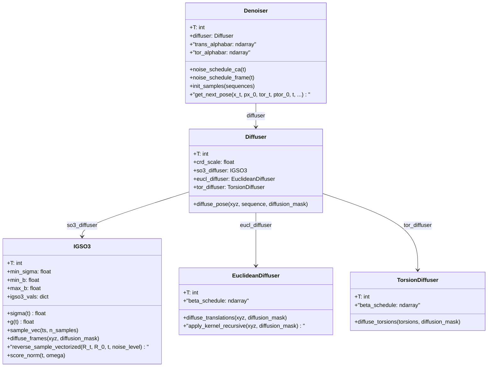
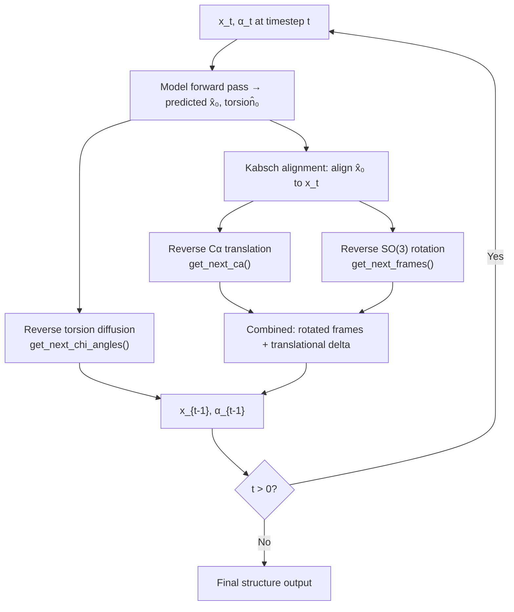

IDPForge generates intrinsically disordered protein conformers by reversing a structured diffusion process over the **SE(3)** manifold—the group of rigid-body transformations (rotation + translation) that govern backbone atom placement. Rather than diffusing raw Cartesian coordinates as a monolithic ℝ³ᴺ problem, IDPForge **factorizes SE(3) into its rotation group SO(3) and translation group ℝ³**, applying the Isotropic Gaussian on SO(3) (IGSO(3)) for backbone frame rotations and a standard Gaussian kernel for Cα translations. This factorization preserves the geometric structure of peptide frames during both noising and denoising, yielding physically plausible intermediate states at every timestep. A third diffusion channel over sidechain torsion angles (SO(2)⁴) operates in parallel, completing the full backbone-and-sidechain generative process.

## Mathematical Foundation

The SE(3) group is the semi-direct product **SE(3) = SO(3) ⋊ ℝ³**, meaning every rigid transformation decomposes into a rotation R ∈ SO(3) followed by a translation t ∈ ℝ³. IDPForge exploits this by defining three independent diffusion channels that are jointly applied during the forward process and sequentially composed during reverse inference:

| Channel | Manifold | Distribution | Parameters | Implementation |
|---------|----------|-------------|------------|----------------|
| **Backbone Rotation** | SO(3) | IGSO(3) — Isotropic Gaussian | σ(t) schedule: min_σ=0.05, min_b=1.5, max_b=2.5 | `IGSO3` class |
| **Cα Translation** | ℝ³ | Isotropic Gaussian (DDPM) | Linear β schedule: β₀=0.01, β_T=0.06–0.08 | `EuclideanDiffuser` class |
| **Sidechain Torsion** | SO(2)⁴ | Wrapped Gaussian | Linear β schedule: β₀=0.01, β_T=0.06 | `TorsionDiffuser` class |

The IGSO(3) density at rotation angle ω with variance parameter t is computed via the truncated power series (Leach et al. 2022, Equation 5):

**f(ω, t) = Σ_{l=0}^{L} (2l+1) · exp(−l(l+1)t/2) · sin(ω(l+½)) / sin(ω/2)**

where L=2000 is the truncation level and the reparameterization σ = √2·ε aligns IGSO(3) with Brownian motion on SO(3) under the canonical inner product ⟨u, v⟩_SO3 = Trace(uvᵀ)/2.

Sources: [igso3_utils.py](/idpforge/utils/igso3_utils.py#L42-L64), [diff_utils.py](/idpforge/utils/diff_utils.py#L303-L314)

## Architecture: Diffusion Hierarchy

The diffusion system is organized as a class hierarchy where the top-level `Diffuser` orchestrates the three sub-diffusers, and the `Denoiser` coordinates the reverse process. The following diagram captures the ownership and data-flow relationships:

The `Diffuser` is constructed with the total number of timesteps T (default 200) and schedule parameters for each channel. Each sub-diffuser pre-computes its noise schedule at initialization. The `Denoiser` wraps the `Diffuser` and additionally pre-computes the cumulative alpha-bar schedules needed for the reverse posterior distributions.

Sources: [diff_utils.py](/idpforge/utils/diff_utils.py#L491-L517), [diff_utils.py](/idpforge/utils/diff_utils.py#L574-L607)

## Forward Process: Noising a Protein Structure

The forward diffusion transforms a ground-truth protein structure into noise through T sequential steps. The `diffuse_pose` method orchestrates this by decomposing the input coordinates into frames, translations, and torsions, then applying each sub-diffuser independently.

### Frame Extraction

Backbone frames (rotation matrices) are extracted from the N–Cα–C atoms of each residue via Gram-Schmidt orthogonalization. Given coordinates for backbone atoms N, Cα, C, the rotation matrix R is constructed as:

- **e₁** = (C − Cα) / ‖C − Cα‖  
- **e₂** = normalize((N − Cα) − ⟨N − Cα, e₁⟩·e₁)  
- **e₃** = e₁ × e₂  
- **R** = [e₁ | e₂ | e₃]

This yields an SO(3) element per residue that encodes the local backbone orientation.

### Rotation Diffusion via IGSO(3)

At each timestep t, rotation vectors are sampled from IGSO(3) using inverse CDF sampling over the pre-computed discrete distribution. The sampled rotation is applied via left-multiplication to the true frame: **R_perturbed = R_sampled · R_true**. The perturbed coordinates are reconstructed by rotating the local backbone atoms around Cα: **xyz_perturbed = R_sampled · (xyz − Cα) + Cα**.

### Translation Diffusion

Cα positions are noised through a standard DDPM forward kernel with linear β schedule. At each step t, the kernel applies: **x_t = √(1−β_t) · x_{t−1} + √β_t · ε**, where ε ~ N(0, I). The `apply_kernel_recursive` method applies this T times, accumulating translational deltas. Coordinates are scaled by `crd_scale=0.25` before noising to normalize the spatial scale.

### Combined Noised Output

The final diffused backbone is the sum of the rotation-perturbed coordinates and the cumulative translational displacement: **diffused_BB = diffused_frame_crds + cumsum(deltas)**. Rigid transformations are assembled into 4×4 homogeneous matrices encoding both rotation and Cα position.

Sources: [diff_utils.py](/idpforge/utils/diff_utils.py#L519-L570), [np_utils.py](/idpforge/utils/np_utils.py#L194-L210), [diff_utils.py](/idpforge/utils/diff_utils.py#L426-L451), [diff_utils.py](/idpforge/utils/diff_utils.py#L216-L254)

## Reverse Process: Denoising to Generate Structures

The reverse process reconstructs a protein structure by iteratively denoising from T→0. The `Denoiser.get_next_pose` method implements one reverse step, taking the current noised state x_t and the network's prediction x̂₀ to produce x_{t−1}.

### Step-by-Step Reverse Pipeline

### Kabsch Alignment

Before denoising, the predicted structure x̂₀ is aligned to the current noised state x_t using the Kabsch algorithm (SVD-based optimal rotation). This removes spurious global rotations that would otherwise corrupt the per-residue update. When a template (folded motif) is present, alignment uses only the motif residues as anchors.

Sources: [diff_utils.py](/idpforge/utils/diff_utils.py#L25-L53), [diff_utils.py](/idpforge/utils/diff_utils.py#L622-L684)

### Reverse Translation (Cα Coordinates)

The reverse translational step uses the standard DDPM posterior. Given the noised Cα positions x_t and predicted clean positions x̂₀, the posterior mean and variance are:

- **μ = (√ᾱ_{t−1} · β_t)/(1−ᾱ_t) · x̂₀ + (√(1−β_t) · (1−ᾱ_{t−1}))/(1−ᾱ_t) · x_t**
- **σ = (1−ᾱ_{t−1})/(1−ᾱ_t) · β_t**

The next Cα is sampled as **x_{t−1} ~ N(μ, σ·noise_scale)**, where `noise_scale` follows a configurable schedule that can anneal from `noise_scale_ca=0.2` to `final_noise_scale_ca=1.0` over inference steps. The translational delta is then applied uniformly to all five backbone atoms (N, Cα, C, O, Cβ).

### Reverse Rotation (IGSO(3) Score-Based)

The reverse rotational step is implemented in `IGSO3.reverse_sample_vectorized`. It approximates the IGSO(3) score using the predicted clean rotation R₀:

1. **Compute relative rotation**: R_{0t} = R_t · R₀ᵀ (rotation from current to predicted)
2. **Extract rotation vector**: ω = ‖Log(R_{0t})‖, axis = Log(R_{0t})/ω
3. **Approximate score**: s ≈ (score_norm(t, ω)/ω) · Log(R_{0t}), where score_norm is interpolated from pre-computed values
4. **Discretized reverse SDE**: Δ_r = g(t)² · Δt · s, Perturb = Exp(Δ_r + g(t)·√Δt · Z)

The drift coefficient g(t) = √(dσ²/dt) is computed via automatic differentiation on the σ schedule. The resulting rotation `Perturb` is applied to the current coordinates around Cα.

### Noise Schedule Configuration

The inference noise schedules are independently configurable for translations and rotations, allowing asymmetric annealing strategies:

| Parameter | Default | Purpose |
|-----------|---------|---------|
| `noise_scale_ca` | 0.2 | Initial Cα noise scale at t=T |
| `final_noise_scale_ca` | 1.0 | Final Cα noise scale at t=0 |
| `noise_scale_frame` | 1.0 | Initial frame (SO(3)) noise scale |
| `final_noise_scale_frame` | 0.0 | Final frame noise scale (deterministic at t=0) |

When `final_noise_scale_frame=0`, the rotational update becomes deterministic at the final steps, producing sharper backbone geometry. The CA noise schedule transitions from "constant" (if final=0) to "linear" otherwise.

Sources: [diff_utils.py](/idpforge/utils/diff_utils.py#L78-L124), [diff_utils.py](/idpforge/utils/diff_utils.py#L126-L160), [diff_utils.py](/idpforge/utils/diff_utils.py#L454-L488), [diff_utils.py](/idpforge/utils/diff_utils.py#L574-L607)

## IGSO(3) Pre-Computation and Caching

Numerical evaluation of the IGSO(3) power series and its derivatives is expensive. The `calculate_igso3` function pre-computes four lookup tables over a discretized grid of σ values (500 points, exponentially spaced from min_σ to max_σ) and ω values (1000 points from 0 to π):

| Quantity | Computation | Usage |
|----------|-------------|-------|
| **CDF** | Cumulative sum of `igso3_density_angle` | Inverse CDF sampling during forward diffusion |
| **Score norm** | `d_logf_d_omega` via autograd on log(f) | Score approximation during reverse diffusion |
| **Expected score norms** | √(E[‖score‖²]) | Diagnostic/normalization |
| **Discrete σ/ω grids** | Exponential and linear spacings | Interpolation indices |

These values are cached as a pickle file (e.g., `data/diff_igso3.pkl`) and loaded on subsequent runs, eliminating repeated computation. The σ schedule uses an exponential discretization: **σ_n = min_σ^(1−n/N) · max_σ^(n/N)**, ensuring fine resolution at low noise levels where the distribution is most peaked.

Sources: [igso3_utils.py](/idpforge/utils/igso3_utils.py#L88-L132), [diff_utils.py](/idpforge/utils/diff_utils.py#L324-L334)

## σ(t) Schedule for Rotational Diffusion

The IGSO(3) noise level follows a quadratic-in-time schedule that controls how rapidly rotational noise increases:

**σ(t) = min_σ + t · min_b + t² · (max_b − min_b) / 2**

with default parameters min_σ=0.05, min_b=1.5, max_b=2.5. This schedule ensures σ(0)=min_σ (near-identity at t=0) and provides a smooth, monotonically increasing noise level. The corresponding drift coefficient for the reverse SDE is:

**g(t) = √(dσ²/dt) = √(2σ(t) · σ'(t))**

computed via PyTorch autograd. This schedule is critical: too aggressive a noise increase causes the IGSO(3) distribution to collapse to uniform on SO(3) prematurely, losing structural information; too conservative leaves insufficient noise for diverse sampling.

Sources: [diff_utils.py](/idpforge/utils/diff_utils.py#L354-L372)

## Initialization: Sampling from the Prior

At the start of reverse inference (t=T), structures are initialized from the noise distribution via `init_sample`. This function:

1. Places ideal backbone atom positions from residue-specific templates (`backbone_atom_positions`)
2. Samples random Cα translations: **t ~ N(0, I/crd_scale²)**, providing uniformly distributed positions in scaled space
3. Samples random rotations from IGSO(3) at t=T: **R ~ IGSO(3; I₃, σ(T)²)**, giving uniformly distributed orientations
4. Applies the sampled rigid transformation: **xyz = R · xyz_local + t**
5. Samples random torsion angles: **χ ~ Unif([−π, π))**, encoded as (sin χ, cos χ)

For IDR sampling with folded templates, template residues are fixed at their native coordinates and excluded from the initial noise, with `diffusion_mask` controlling which residues participate.

Sources: [diff_utils.py](/idpforge/utils/diff_utils.py#L187-L202), [definitions.py](/idpforge/utils/definitions.py#L27-L32)

## Integration with the IDPForge Transformer Network

The SE(3) diffusion process is tightly coupled with the neural network through the `IDPForge.recon` method, which orchestrates the full reverse inference loop. At each denoising step:

1. **Timestep embedding**: The current timestep t is embedded via a fixed sinusoidal positional encoding (32-dim), concatenated with the 8-dim torsion feature vector (sin/cos of 4 χ angles), and projected through `esm_s_mlp` to produce the initial per-residue state s_s₀.

2. **Pairwise geometry encoding**: The noised backbone coordinates x_t are converted to a 2D distance-and-orientation representation via `xyz_to_t2d`, which computes Cβ–Cβ distances (one-hot encoded over 32 bins), RBF features, and three angular features (ω, θ, φ dihedrals). This is projected through `z_mlp` to form the initial pairwise state s_z₀.

3. **Trunk prediction**: The ESMFold trunk processes (s_s₀, s_z₀) through its attention blocks and structure module, outputting predicted clean coordinates x̂₀ and torsion angles α̂₀.

4. **Denoising step**: `denoiser.get_next_pose` computes x_{t−1} and α_{t−1} from (x_t, x̂₀, α_t, α̂₀).

5. **Self-conditioning**: When enabled, the previous step's output is fed back as `prev_outputs` to provide recycle-style refinement, improving prediction quality especially at intermediate noise levels.

6. **Template fixing**: For IDR sampling, template residues bypass diffusion entirely—their timestep is set to 0 and their coordinates/torsions are overwritten with template values at each step.

The inference loop iterates from t=T−1 down to `end_tsteps` (default −1, meaning step 0), with step size controlled by `n_tsteps/n_tsteps_inf` to allow sub-stepping (e.g., 200 training steps → 40 inference steps = every 5th step).

Sources: [model.py](/idpforge/model.py#L155-L208), [model.py](/idpforge/model.py#L79-L153), [tensor_utils.py](/idpforge/utils/tensor_utils.py#L197-L219)

## Training Data Preparation

During training, the `DiffDataset.__getitem__` method applies the full forward diffusion to each training structure via `diffuser.diffuse_pose`, producing the complete trajectory of noised states from t=0 to t=T. A timestep T is sampled with linear weighting (p(t) ∝ t), biasing training toward higher noise levels where the model must make larger corrections. The dataset returns both the current state (x_t, α_t) and, for self-conditioning, the next state (x_{t+1}, α_{t+1}), along with the ground-truth frames and torsion angles for loss computation.

Sources: [loader.py](/idpforge/loader.py#L48-L99)

## Degeneracy Handling and Numerical Stability

The implementation includes several safeguards against numerical degeneracies that arise when operating on SO(3):

- **Degenerate rotation matrices**: When `rigid_from_3_points_np` produces matrices with |det(R)| < 10⁻⁶ (from collinear N–Cα–C atoms), they are replaced with the identity matrix before SVD decomposition.
- **SVD convergence failures**: Both `align_coords` and `reverse_sample_vectorized` catch `LinAlgError` from scipy's SVD, falling back to identity rotations (no update applied).
- **Division by ω**: The score computation divides by the rotation angle ω, which approaches zero for near-identity rotations. An epsilon of 10⁻⁶ is used as a floor: `Omega[Omega == 0] = eps`.
- **Right-handedness enforcement**: The Kabsch alignment explicitly checks `det(R)` and flips the last column of U when negative, ensuring proper rotations (det=+1) rather than reflections.

Sources: [diff_utils.py](/idpforge/utils/diff_utils.py#L133-L145), [diff_utils.py](/idpforge/utils/diff_utils.py#L459-L467), [diff_utils.py](/idpforge/utils/diff_utils.py#L44-L46)

> [!TIP]
> The SE(3) factorization in IDPForge is not merely a computational convenience—it is architecturally significant. By diffusing rotations on SO(3) via IGSO(3) rather than perturbing Cartesian coordinates in ℝ³, the model ensures that every intermediate backbone frame is a valid rotation matrix. This eliminates the "frame drift" problem where naively diffused coordinates can produce non-physical bond angles and peptide plane orientations, which is especially critical for the highly flexible backbones of IDPs where no strong structural prior constrains the denoising trajectory.

> [!TIP]
> The inference noise asymmetry—where `noise_scale_frame` anneals to 0 (deterministic rotation) while `noise_scale_ca` anneals to 1.0 (stochastic translation)—reflects a deliberate design choice: backbone orientations should converge sharply to the network's prediction, while Cα positions retain stochastic diversity. This produces ensembles with consistent local geometry but global conformational spread, matching the physical reality of IDPs where local peptide geometry is well-defined but long-range structure is highly variable.

## Next Steps

The SE(3) backbone diffusion is one of three interlocking diffusion channels. For deeper understanding of the rotational component, see [SO(3) Rotational Diffusion](7-so-3-rotational-diffusion); for the sidechain channel, see [Torsion Angle Diffusion](8-torsion-angle-diffusion). The complete inference pipeline is documented in [IDP Sampling (Fully Disordered)](12-idp-sampling-fully-disordered) and [IDR Sampling with Folded Templates](13-idr-sampling-with-folded-templates). Training-time noising is covered in [Data Loading and Noising](11-data-loading-and-noising).