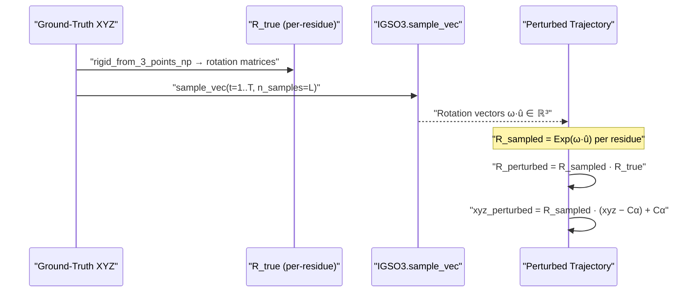
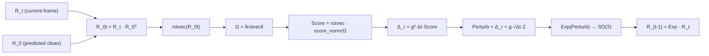
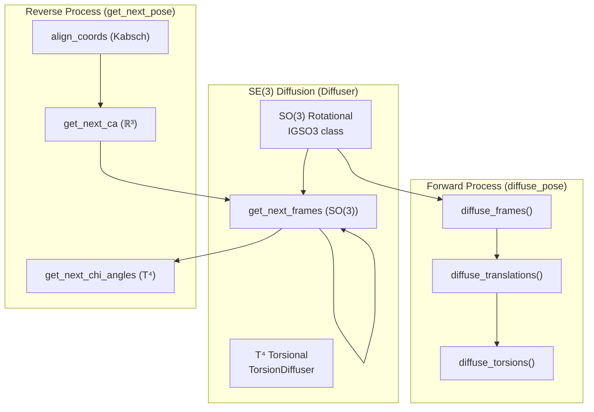

IDPForge models the stochastic evolution of backbone residue frames on the **SO(3) rotation group** via the Isotropic Gaussian distribution on SO(3) — abbreviated **IGSO(3)**. This is the rotational component of the broader SE(3) diffusion process that jointly corrupts translations and rotations during training, and reverses the corruption during inference to generate intrinsically disordered protein conformers. The implementation splits cleanly into two layers: **pure mathematical primitives** in `igso3_utils.py` (manifold maps, density functions, score fields) and an **operational class** `IGSO3` in `diff_utils.py` (precomputed lookup tables, forward noising, reverse sampling). Together they provide a numerically stable, precomputed-table-driven approach to Brownian-motion diffusion on the rotation manifold.

Sources: [igso3_utils.py](idpforge/utils/igso3_utils.py#L1-L133), [diff_utils.py](idpforge/utils/diff_utils.py#L303-L488)

## Mathematical Foundations

The SO(3) group — the set of all 3×3 proper rotation matrices — is a compact Lie group with rich geometric structure that IDPForge exploits through a chain of canonical maps connecting the group to its Lie algebra and to rotation vectors in ℝ³. These maps form the backbone of every subsequent operation: noising, scoring, and reverse sampling.

Sources: [igso3_utils.py](idpforge/utils/igso3_utils.py#L18-L40)

### Lie Algebra Maps

The **hat map** `hat(v)` lifts a vector **v** ∈ ℝ³ into the skew-symmetric matrix **v̂** ∈ so(3), the Lie algebra of SO(3). This is the infinitesimal generator: for any rotation vector **ω**, the matrix exponential `exp(hat(ω))` yields the corresponding rotation matrix. The implementation constructs the 3×3 skew-symmetric matrix directly from the vector components and enforces antisymmetry via transposition:

```python
hat_v[:, 0, 1], hat_v[:, 0, 2], hat_v[:, 1, 2] = -v[:, 2], v[:, 1], -v[:, 0]
return hat_v + -hat_v.transpose(2, 1)
```

Two exponential-logarithmic bridge functions connect rotation vectors to rotation matrices:

| Map | Signature | Direction | Mechanism |
|-----|-----------|-----------|-----------|
| `Log(R)` | SO(3) → ℝ³ | Matrix → rotation vector | `Rotation.from_matrix(R).as_rotvec()` |
| `log(R)` | SO(3) → so(3) | Matrix → skew-symmetric | `hat(Log(R))` |
| `Exp(A)` | ℝ³ → SO(3) | Rotation vector → matrix | `Rotation.from_rotvec(A).as_matrix()` |

These delegate to `scipy.spatial.transform.Rotation` for robust numerical conversion, supporting both NumPy arrays and PyTorch tensors through type dispatch.

Sources: [igso3_utils.py](idpforge/utils/igso3_utils.py#L21-L40)

### The IGSO(3) Density

The **Isotropic Gaussian on SO(3)** is the heat kernel of Brownian motion on the rotation group. Parameterized by a variance **t** (which maps onto diffusion time), its density with respect to the Haar measure decomposes via the **Peter–Weyl theorem** into a truncated Fourier series on the integer lattice ℓ ∈ ℕ:

$$f(\omega, t) = \sum_{\ell=0}^{L} (2\ell+1) \, e^{-\ell(\ell+1)t/2} \, \frac{\sin((\ell+\frac{1}{2})\omega)}{\sin(\omega/2)}$$

where **ω** is the rotation angle (the geodesic distance from the identity on SO(3)). The function `f_igso3` computes this truncated sum with a default cutoff of **L = 2000** terms. A critical reparameterization note: IDPForge uses **σ = √2 · ε** relative to the Leach et al. (2022) convention, so that IGSO(3) agrees with the canonical Brownian motion inner product ⟨u, v⟩_SO3 = Tr(uvᵀ)/2.

The **angle-marginal density** — the density of the rotation angle ω with respect to the Lebesgue measure on [0, π] — incorporates the SO(3) volume form factor `(1 − cos ω)/π`:

```python
def igso3_density_angle(omega, t, L=2000):
    return f_igso3(torch.tensor(omega), t, L).numpy() * (1 - np.cos(omega)) / np.pi
```

Sources: [igso3_utils.py](idpforge/utils/igso3_utils.py#L42-L76)

### The SO(3) Score Function

Reverse-time diffusion requires the **score** ∇_R log p(R; I, t) — the gradient of the log-density with respect to the rotation matrix. On SO(3), this score decomposes into a **scalar score norm** times a **unit direction vector** pointing along the rotation axis:

```python
def igso3_score(R, t, L=2000):
    omega = Omega(R)
    unit_vector = np.einsum('Nij,Njk->Nik', R, log(R)) / omega[:, None, None]
    return unit_vector * d_logf_d_omega(omega, t, L)[:, None, None]
```

The scalar derivative `d_logf_d_omega` is computed via PyTorch autograd on `log(f_igso3)`, ensuring numerical precision without manual derivation. The rotation angle extraction `Omega(R)` computes the Frobenius-norm-based geodesic distance: `||log(R)||_F / √2`.

Sources: [igso3_utils.py](idpforge/utils/igso3_utils.py#L66-L86)

## The IGSO3 Operational Class

The `IGSO3` class transforms the analytic formulas above into a **precomputed lookup-table system** that makes both forward noising and reverse sampling fast at inference time. This is essential because evaluating the truncated series and its autograd-based score derivative at every denoising step for every residue would be prohibitively expensive.

Sources: [diff_utils.py](idpforge/utils/diff_utils.py#L303-L488)

### Precomputation Strategy

Upon initialization, `IGSO3` calls `calculate_igso3` to populate a dictionary of discretized quantities over a grid of **500 sigma values** (exponentially spaced from `min_sigma=0.05` to `max_sigma=σ(1.0)`) and **1000 omega values** (linearly spaced in (0, π]):

| Key | Shape | Content |
|-----|-------|---------|
| `cdf` | (500, 1000) | Cumulative distribution function values per σ |
| `score_norm` | (500, 1000) | ∂/∂ω log f(ω, σ²) per σ |
| `exp_score_norms` | (500,) | Expected ‖score‖ under each σ |
| `discrete_omega` | (1000,) | ω grid points |
| `discrete_sigma` | (500,) | σ grid points (exponential schedule) |

The exponential noise schedule for σ is defined as `discrete_sigma[n] = min_eps^(1−n/N) · max_eps^(n/N)`, which is closely tied to the reverse SDE simulation scalings. Results can be cached to disk via pickle for reuse across runs — the training configuration references `data/diff_igso3.pkl` as the cache path.

Sources: [igso3_utils.py](idpforge/utils/igso3_utils.py#L88-L132), [diff_utils.py](idpforge/utils/diff_utils.py#L306-L335)

### Sigma Schedule and Drift Coefficient

The continuous **sigma schedule** maps normalized time t ∈ [0, 1] to the noise scale via a quadratic polynomial:

```python
def sigma(self, t):
    return self.min_sigma + t * self.min_b + (t**2) * (self.max_b - self.min_b) / 2
```

with defaults `min_b=1.5`, `max_b=2.5`. The **drift coefficient** `g(t)` — which governs the noise magnitude in the reverse SDE — is derived via autograd from σ²(t):

```python
def g(self, t):
    sigma_sqr = self.sigma(t) ** 2
    grads = torch.autograd.grad(sigma_sqr.sum(), t)[0]
    return np.sqrt(grads.detach().numpy())
```

Sources: [diff_utils.py](idpforge/utils/diff_utils.py#L354-L372)

### Index Mapping

Two index-mapping methods bridge continuous time to the precomputed table:

- **`sigma_idx(σ)`** — uses `np.digitize` to locate the nearest precomputed sigma index.
- **`t_to_idx(t)`** — composes `sigma_idx ∘ sigma(t/T)` to go from a discrete diffusion timestep to the table row.

Sources: [diff_utils.py](idpforge/utils/diff_utils.py#L345-L352)

## Forward Process: Noising Frames

The forward diffusion corrupts ground-truth backbone frames by composing each residue's true rotation matrix **R_true** with an IGSO(3)-sampled perturbation. The method `diffuse_frames` implements the full forward trajectory across all T timesteps:



The key insight is that **rotations are applied about each residue's own Cα center** — the local frame is rotated in place, preserving the translational component. The method returns both the perturbed coordinates (shape `[T+1, L, 5, 3]`, including the original at t=0) and the perturbed rotation matrices, which are stacked into 4×4 rigid-body matrices by the parent `Diffuser.diffuse_pose` method. A `diffusion_mask` selectively zeros out sampled rotations for held-out (motif) residues.

Sources: [diff_utils.py](idpforge/utils/diff_utils.py#L426-L451), [diff_utils.py](idpforge/utils/diff_utils.py#L519-L570)

### Sampling from IGSO(3)

Two complementary sampling methods exist:

- **`sample(ts, n_samples)`** — draws rotation **angles** ω via inverse-CDF interpolation against the precomputed `cdf` table, then returns the angles.
- **`sample_vec(ts, n_samples)`** — extends `sample` by multiplying the sampled angle with a uniformly random unit axis direction û ∈ S², producing full rotation vectors in ℝ³ ready for `Exp()` conversion.

Sources: [diff_utils.py](idpforge/utils/diff_utils.py#L374-L392)

## Reverse Process: Denoising Frames

The reverse diffusion step is the computational core of conformer generation. Given the current noised frame **R_t** and the model's prediction of the clean frame **R_0**, `reverse_sample_vectorized` computes a single reverse-time update that moves the frame distribution closer to the data manifold.

Sources: [diff_utils.py](idpforge/utils/diff_utils.py#L454-L488)

### Reverse Sample Algorithm

The method proceeds through four stages:

**1. Relative rotation.** Compute the rotation from the current frame to the predicted clean frame: `R_0t = R_t · R_0ᵀ`. Degenerate matrices (NaN entries) are replaced with identity before conversion to rotation vectors via `scipy_R.from_matrix`.

**2. Score approximation.** The score of the IGSO(3) transition density is approximated using the predicted R_0 as a proxy for the data distribution:

```python
Omega = np.linalg.norm(R_0t_rotvec, axis=-1)
Score_approx = R_0t_rotvec * (self.score_norm(t, Omega) / Omega)[..., None]
```

The `score_norm` method performs bilinear interpolation into the precomputed `score_norm` table using the time-indexed sigma and the observed rotation angle.

**3. Drift and noise scaling.** The deterministic drift term `Δ_r = g(t)² · Δt · Score_approx` moves along the score field, while stochastic noise `g(t) · √Δt · Z` (with Z ∼ N(0, I₃)) maintains distributional correctness. The `noise_level` parameter globally scales Z, enabling annealed denoising schedules.

**4. Exponential map.** The combined tangent-space perturbation is mapped back to SO(3) via `Exp(Perturb_tangent)`, yielding the rotation matrix to apply at this step.



Sources: [diff_utils.py](idpforge/utils/diff_utils.py#L454-L488)

### Integration with Backbone Coordinates

The function `get_next_frames` orchestrates the full per-residue reverse step. It extracts rotation matrices from both the current noised coordinates `x_t` and the predicted clean coordinates `p_x0` using `rigid_from_3_points_np` (which constructs an orthonormal frame from the N–Cα–C backbone atoms), sanitizes degenerate matrices, delegates to `reverse_sample_vectorized`, and then applies the returned rotation matrices about each Cα center:

```python
next_crds = np.einsum("...ij,...aj->...ai", all_rot_transitions,
                      xt - Ca_t[..., None, :]) + Ca_t[..., None, :]
```

Non-diffused residues (governed by `diffusion_mask`) retain identity rotations, ensuring motif regions remain fixed during IDR sampling.

Sources: [diff_utils.py](idpforge/utils/diff_utils.py#L126-L160), [np_utils.py](idpforge/utils/np_utils.py#L194-L210)

## Initialization at Maximum Noise

At the start of inference, conformers are initialized at the **maximum noise level** t = T. The function `init_sample` places each residue at the origin with idealized backbone geometry, then:

1. **Translations** — sampled from N(0, I₃/crd_scale) with `crd_scale=0.25` (effectively σ = 4 Å).
2. **Rotations** — sampled from IGSO(3) at time T via `so3_diffuser.sample_vec([T], n_samples=L)`, then applied via `Exp` to rotate each residue's local frame.
3. **Torsion angles** — sampled uniformly in [−π, π) as sin/cos pairs.

This produces a completely unstructured starting state from which the reverse process progressively resolves native-like backbone geometry.

Sources: [diff_utils.py](idpforge/utils/diff_utils.py#L187-L202)

## Orchestration: Diffuser and Denoiser

The `Diffuser` class aggregates all three diffusion channels — SO(3) rotations (`IGSO3`), ℝ³ translations (`EuclideanDiffuser`), and torsion angles (`TorsionDiffuser`) — into a unified `diffuse_pose` method that returns the full forward trajectory of noised coordinates, rigid-body matrices, and torsion angles. The `Denoiser` class wraps the `Diffuser` and provides `get_next_pose`, which at each reverse timestep:

1. **Aligns** the predicted p_x0 to x_t via the Kabsch algorithm (respecting motif masks).
2. **Updates translations** via `get_next_ca` (Gaussian reverse kernel).
3. **Updates rotations** via `get_next_frames` (IGSO(3) reverse sample).
4. **Updates torsions** via `get_next_chi_angles` (wrapped Gaussian reverse kernel).
5. **Composes** the translational delta with the rotated coordinates.

Noise annealing is controlled by two independent schedules: `noise_schedule_ca` for translations and `noise_schedule_frame` for rotations, both supporting `constant` or `linear` decay modes.

Sources: [diff_utils.py](idpforge/utils/diff_utils.py#L491-L685)

## Configuration Parameters

The SO(3) diffusion is governed by parameters set in the `diffuse` section of the YAML config. Note that IGSO(3)-specific parameters (`min_sigma`, `min_b`, `max_b`, `num_omega`) use hardcoded defaults in the `IGSO3` constructor rather than config entries.

| Parameter | Default (Train) | Default (Sample) | Description |
|-----------|----------------|------------------|-------------|
| `n_tsteps` | 200 | 200 | Total diffusion timesteps T |
| `n_tsteps_inf` / `inference_steps` | 40 | 40 | Reverse process sub-steps (stride = T/inf) |
| `euclid_b0` | 0.01 | 0.01 | Translation β schedule start |
| `euclid_bT` | 0.08 | 0.06 | Translation β schedule end |
| `torsion_b0` | 0.01 | 0.01 | Torsion β schedule start |
| `torsion_bT` | 0.06 | 0.06 | Torsion β schedule end |
| `min_sigma` *(hardcoded)* | 0.05 | 0.05 | IGSO(3) minimum noise scale |
| `min_b` *(hardcoded)* | 1.5 | 1.5 | σ(t) linear coefficient |
| `max_b` *(hardcoded)* | 2.5 | 2.5 | σ(t) quadratic coefficient |
| `num_omega` *(hardcoded)* | 1000 | 1000 | ω discretization resolution |

Sources: [configs/train.yml](configs/train.yml#L54-L60), [configs/sample.yml](configs/sample.yml#L43-L50), [diff_utils.py](idpforge/utils/diff_utils.py#L306-L314)

> [!TIP]
> When adapting IGSO(3) parameters for new protein systems, the `min_sigma=0.05` floor is critical — setting it too low causes numerical instability in the score norm computation near ω=0 where `sin(ω/2)` approaches zero. The precomputed cache (`diff_igso3.pkl`) must be regenerated whenever `min_sigma`, `min_b`, `max_b`, or `num_omega` are changed.

## Architectural Relationship to SE(3) Diffusion

The SO(3) rotational diffusion operates as the rotational component within the full SE(3) = SO(3) ⋉ ℝ³ diffusion framework. The decomposition is **product-structured**: rotations and translations are noised and denoised independently, then composed during coordinate reconstruction. This is not a simplification — for the Brownian motion on SE(3) with the canonical bi-invariant metric, the rotational and translational components are statistically independent, making the product decomposition exact.



The SO(3) component is uniquely distinguished from the Euclidean and torsional components by its **manifold-valued score computation** and **precomputed table approach** — neither ℝ³ nor T⁴ diffusion requires the CDF/score-norm precomputation infrastructure because their Gaussian kernels have closed-form reverse updates.

Sources: [diff_utils.py](idpforge/utils/diff_utils.py#L491-L570), [diff_utils.py](idpforge/utils/diff_utils.py#L622-L684)

> [!TIP]
> The `noise_scale_frame` parameter in the `Denoiser` constructor (default=1, final=0) controls an annealing schedule for the stochastic noise term Z in `reverse_sample_vectorized`. Setting `final_noise_scale_frame=0` implements deterministic reverse sampling at the final steps, which improves structural precision for late-stage denoising while maintaining stochastic exploration early on.

## Next Steps

The SO(3) rotational diffusion is one component of the full SE(3) backbone process. To understand the complete picture:

- **[SE(3) Backbone Diffusion](6-se-3-backbone-diffusion)** — how rotations and translations combine into the full rigid-body diffusion
- **[Torsion Angle Diffusion](8-torsion-angle-diffusion)** — the sidechain torsion component that completes the per-residue DOF corruption
- **[IDP Sampling (Fully Disordered)](12-idp-sampling-fully-disordered)** — how the reverse SO(3) process drives end-to-end conformer generation
- **[Experimental Guidance Potentials](14-experimental-guidance-potentials)** — how external restraints interact with the score-based reverse SDE