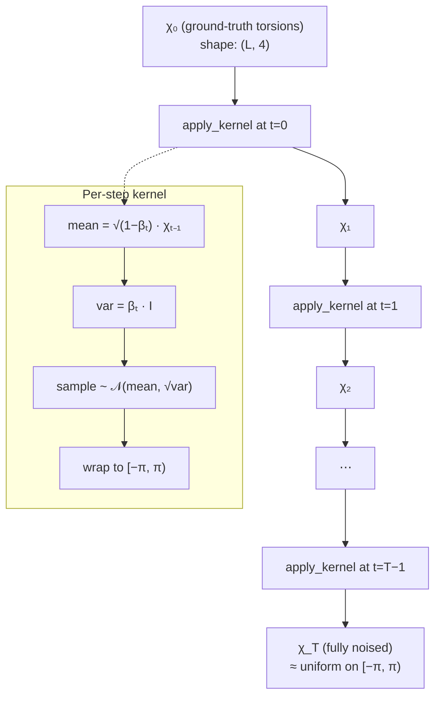
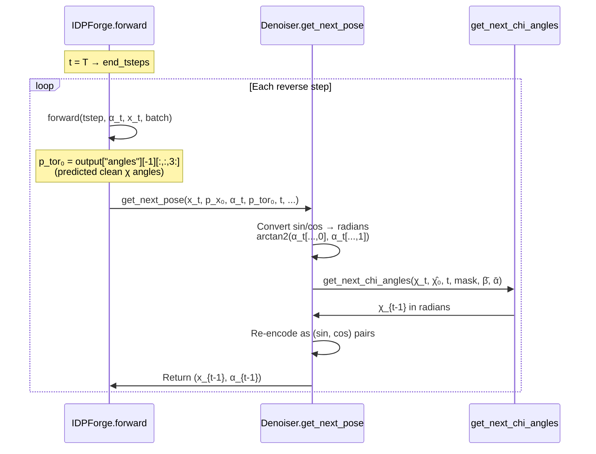

Torsion angle diffusion governs how IDPForge progressively noises and recovers sidechain χ₁–χ₄ dihedral angles during its three-component diffusion framework. Unlike the [SE(3) Backbone Diffusion](6-se-3-backbone-diffusion) and [SO(3) Rotational Diffusion](7-so-3-rotational-diffusion) channels that operate on Cartesian coordinates and rotation frames, torsion diffusion operates directly on the angular domain—making it the component that most intimately controls sidechain rotamer identity and, by extension, the local structural diversity critical for intrinsically disordered protein ensembles.

## Mathematical Foundation

IDPForge adopts a **variance-preserving (VP) diffusion** process for torsion angles, mirroring the classical DDPM formulation but adapted to the circular domain $[-\pi, \pi)$. The forward process at each discrete timestep $t$ applies a Gaussian noising kernel whose mean contracts toward zero and whose variance grows according to a linear $\beta$-schedule:

$$q(\chi_t \mid \chi_{t-1}) = \mathcal{N}\!\left(\chi_t;\; \sqrt{1 - \beta_t}\,\chi_{t-1},\; \beta_t \mathbf{I}\right)$$

After $t$ steps of marginalization, this yields the standard closed-form:

$$q(\chi_t \mid \chi_0) = \mathcal{N}\!\left(\chi_t;\; \sqrt{\bar\alpha_t}\,\chi_0,\; (1 - \bar\alpha_t)\mathbf{I}\right)$$

where $\bar\alpha_t = \prod_{s=1}^{t}(1 - \beta_s)$. After sampling from this Gaussian, the result is **wrapped** into $[-\pi, \pi)$ via the modular mapping `wrap_rad(x) = mod(x + π, 2π) − π`, ensuring the noised angles remain on the circle. This wrapping is the key departure from Euclidean diffusion—without it, angles could drift outside the valid domain, corrupting the geometric meaning of the dihedrals.

Sources: [diff_utils.py](idpforge/utils/diff_utils.py#L20-L22), [diff_utils.py](idpforge/utils/diff_utils.py#L257-L299)

## Forward Diffusion: TorsionDiffuser

The `TorsionDiffuser` class encapsulates the entire forward noising trajectory for sidechain torsion angles. It is constructed with a total timestep count `T` and a linear $\beta$-schedule bounded by `b_0=0.01` and `b_T=0.06`—deliberately narrower than the Euclidean diffuser's upper bound (0.08), reflecting the fact that torsion angles require less noise to reach a near-uniform distribution on the circle compared to unbounded translations in $\mathbb{R}^3$.

The `apply_kernel` method executes a single noising step. It computes the contracting mean `sqrt(1 - b_t) * x`, samples from the Gaussian with per-element variance `b_t`, then wraps the result. Two masking mechanisms control which residues participate: **`diffusion_mask`** (boolean, shape `(L, 4)`) freezes residues that should not be noised (e.g., template-held regions during IDR sampling), and **`exists_mask`** (boolean, shape `(L, 4)`) sets non-existent chi angles to $-\pi$ as a sentinel value—for instance, alanine has only $\chi_1$ so $\chi_2$–$\chi_4$ are masked out.

The `diffuse_torsions` method iteratively calls `apply_kernel` for `T` steps, returning the full trajectory as an array of shape `(T+1, L, 4)`. This trajectory is consumed by the training dataloader to produce paired noised/clean samples.

Sources: [diff_utils.py](idpforge/utils/diff_utils.py#L257-L299), [diff_utils.py](idpforge/utils/diff_utils.py#L56-L76)

## Angular Representation: Sin/Cos Unit-Circle Encoding

A critical implementation detail is that torsion angles are **not** stored as raw radians throughout the pipeline. Instead, they are encoded as `(sin(χ), cos(χ))` pairs—a unit-circle parameterization that eliminates the discontinuity at $\pm\pi$ and provides a representation naturally suited for neural network consumption. This encoding appears at three key points:

| Pipeline Stage | Representation | Shape | Conversion |
|---|---|---|---|
| Forward diffusion (internal) | Raw radians | `(L, 4)` | — |
| Stored in diffused trajectory | Sin/cos pairs | `(L, 4, 2)` | `stack(sin(χ), cos(χ), axis=-1)` |
| Model input (`alpha_t`) | Sin/cos pairs | `(B, L, 8)` | Reshaped from `(L, 4, 2)` → `(L, 8)` |
| Reverse diffusion (internal) | Raw radians | `(L, 4)` | `arctan2(sin, cos)` |
| Denoiser output | Sin/cos pairs | `(L, 4, 2)` | `stack(sin(χ_next), cos(χ_next))` |

During initialization (`init_sample`), torsion angles are sampled from $\mathcal{N}(0, 1)$ and wrapped to $[-\pi, \pi)$, then immediately converted to sin/cos pairs. During reverse diffusion, the `Denoiser.get_next_pose` method converts sin/cos pairs back to raw radians via `arctan2(tor_t[..., 0], tor_t[..., 1])`, applies the denoising update, then re-encodes the result. This round-trip is necessary because the Gaussian posterior used in reverse diffusion operates on the linear (radian) domain.

Sources: [diff_utils.py](idpforge/utils/diff_utils.py#L187-L202), [diff_utils.py](idpforge/utils/diff_utils.py#L666-L679), [model.py](idpforge/model.py#L110-L111)

## Reverse Diffusion: Analytic Posterior Sampling

The reverse step `get_next_chi_angles` implements the standard DDPM analytic posterior. Given the current noised state $\chi_t$, the model's prediction $\hat\chi_0$, and the precomputed $\bar\alpha$ schedule, it computes:

$$\mu = \frac{\sqrt{\bar\alpha_{t-2}}\,\beta_{t-1}}{1 - \bar\alpha_{t-1}}\,\hat\chi_0 + \frac{\sqrt{1 - \beta_{t-1}}\,(1 - \bar\alpha_{t-2})}{1 - \bar\alpha_{t-1}}\,\chi_t$$

$$\sigma^2 = \frac{(1 - \bar\alpha_{t-2})}{(1 - \bar\alpha_{t-1})}\,\beta_{t-1}$$

The next state is sampled as $\chi_{t-1} \sim \mathcal{N}(\mu, \sigma \cdot \text{noise\_scale})$ and wrapped to $[-\pi, \pi)$. The `noise_scale` parameter (tied to the CA noise schedule) allows **deterministic annealing**—reducing stochasticity as the reverse process approaches $t=0$, yielding sharper final structures.

A compound **torsion diffusion mask** combines residue-level diffusion masking with per-angle existence masking: `torsion_mask & diffusion_mask[..., None]`. This ensures that: (1) template-held residues are never updated, and (2) non-existent chi angles for a given residue type remain frozen at their sentinel value.

Sources: [diff_utils.py](idpforge/utils/diff_utils.py#L162-L185), [diff_utils.py](idpforge/utils/diff_utils.py#L666-L679)

## Chi Angle Extraction and Masking

Before diffusion can begin, ground-truth chi angles must be extracted from atomic coordinates. The `get_chi_angles` function computes dihedral angles from the heavy-atom positions using the standard atom quadruples defined in OpenFold's `chi_angles_atoms` constant:

| Chi Angle | Atom Sequence | Applicable Residues |
|---|---|---|
| χ₁ | N, CA, CB, CG (or equivalent) | All non-Gly, non-Ala |
| χ₂ | CA, CB, CG, CD (or equivalent) | Asp, Asn, Leu, Ile, etc. |
| χ₃ | CB, CG, CD, CE (or equivalent) | Glu, Gln, Met, Lys, Arg |
| χ₄ | CG, CD, CE, NZ (or equivalent) | Lys, Arg |

A special case handles isoleucine's χ₂, which uses atoms N, CA, CB, CG2 (atom index 7 rather than 6) due to its branched gamma carbon. The returned `torsion_mask` (shape `(L, 4)`) is boolean, indicating which of the four chi angles are defined for each residue. This mask propagates through the entire diffusion pipeline to prevent noising or denoising of non-existent angles.

Sources: [np_utils.py](idpforge/utils/np_utils.py#L239-L285), [tensor_utils.py](idpforge/utils/tensor_utils.py#L5-L7)

## Integration with the Reverse Diffusion Loop

The `IDPForge.recon` method orchestrates the full reverse diffusion from $t = T$ down to $t = 0$. At each step, the model predicts clean torsion angles from the current noised state, then the `Denoiser.get_next_pose` method applies the analytic posterior update across all three diffusion channels simultaneously. The torsion-specific portion of this loop proceeds as follows:

The model predicts **all seven angle pairs** (ω, φ, ψ, χ₁, χ₂, χ₃, χ₄) via `output["angles"][-1]`, but only the chi angles (indices 3 onward) are fed to the torsion denoiser. The backbone angles (ω, φ, ψ) are implicitly recovered through the SE(3) and SO(3) backbone diffusion channels. This separation of concerns—backbone geometry via frame diffusion, sidechain rotamers via torsion diffusion—is a core architectural principle of IDPForge.

When template constraints are active (for IDR sampling with folded regions), the loop overrides both coordinates and torsion angles for template-held residues at each step, setting their timestep to 0 and replacing their noised values with the template's clean values. This ensures that folded domains remain structurally fixed while disordered regions are freely generated.

Sources: [model.py](idpforge/model.py#L155-L208), [diff_utils.py](idpforge/utils/diff_utils.py#L622-L684)

## Training Data Noising

During training, the `DiffDataset` applies the full forward diffusion to each training structure via `Diffuser.diffuse_pose`. This method sequences the three diffusion components in order: (1) IGSO(3) frame noising, (2) Euclidean translation noising, (3) torsion angle noising. The torsion portion extracts chi angles from the input coordinates, applies `TorsionDiffuser.diffuse_torsions` with the combined diffusion and existence masks, and encodes the result as sin/cos pairs.

The dataset samples a random timestep $T$ with probability proportional to $\frac{1}{Z}(t)$ (linearly increasing weights favoring later timesteps), then returns both $\alpha_t$ and $\alpha_{t+1}$ (the latter for training the next-step prediction objective). The collated batch feeds these as `alpha_t` (shape `(B, L, 4, 2)`) into the model alongside the noised coordinates `x_t`.

Sources: [loader.py](idpforge/utils/../loader.py#L48-L99), [diff_utils.py](idpforge/utils/diff_utils.py#L519-L570)

## Loss Supervision

The torsion diffusion is supervised by the `torsion_loss` function, which computes two terms: (1) a **normalized angular error** $\|\hat{a}_{\text{norm}} - a_{\text{true}}\|$ between predicted and ground-truth sin/cos pairs, masked by the per-angle existence mask; and (2) a small **norm regularization** penalty ($\lambda = 0.02$) encouraging the unnormalized angle predictions to lie on the unit circle ($\|\hat{a}\| \approx 1$). This combined loss ensures both directional accuracy and geometric consistency of the predicted torsion angles.

The torsion mask used in loss computation is constructed by concatenating the backbone angle masks (3 angles, always present for valid residues) with the chi angle existence mask from `get_chi_mask`, then selecting only the chi portion for the sidechain FAPE loss. This ensures the loss weights each angle proportionally to its relevance for the given residue type.

Sources: [loss.py](idpforge/loss.py#L159-L164), [loss.py](idpforge/loss.py#L42-L52)

## Schedule Comparison Across Diffusion Channels

The three diffusion channels use distinct noise schedules tuned to their respective geometries:

| Channel | Class | β₀ | β_T | Domain | Schedule |
|---|---|---|---|---|---|
| Translations | `EuclideanDiffuser` | 0.01 | 0.08 | ℝ³ | Linear |
| Rotations | `IGSO3` | — | — | SO(3) | Quadratic σ(t) |
| **Torsions** | **`TorsionDiffuser`** | **0.01** | **0.06** | **[−π, π)⁴** | **Linear** |

The torsion schedule's lower $\beta_T$ (0.06 vs. 0.08 for translations) reflects the compactness of the angular domain: less noise is needed to reach a near-uniform distribution on the circle compared to spreading points across unbounded 3D space. This calibration prevents over-noising, which would collapse the angular distribution into a degenerate state rather than achieving the desired uniform prior.

> [!TIP]
> The sin/cos encoding is not merely a convenience—it is architecturally essential. Without it, the discontinuity at ±π would create gradient pathologies during backpropagation, since a small angular perturbation crossing the boundary produces a large numerical jump in raw radians. The unit-circle parameterization eliminates this boundary entirely.

> [!TIP]
> When adapting the torsion diffusion for new residue types or modified backbones, ensure that `get_chi_mask_np` (NumPy, for forward diffusion) and `get_chi_mask` (PyTorch, for loss computation) remain consistent—both ultimately derive from OpenFold's `chi_angles_mask` constant, but divergent modifications could cause silent training failures where angles are noised but never supervised.

Sources: [diff_utils.py](idpforge/utils/diff_utils.py#L205-L263), [diff_utils.py](idpforge/utils/diff_utils.py#L491-L517)

## Next Steps

The torsion angle diffusion channel does not operate in isolation—it is tightly coupled with the backbone diffusion channels that determine the rigid frames onto which sidechains are grafted. To understand how these three channels compose into a unified SE(3)-equivariant diffusion process, continue with [SE(3) Backbone Diffusion](6-se-3-backbone-diffusion) and [SO(3) Rotational Diffusion](7-so-3-rotational-diffusion). For the training objective that jointly supervises all channels, see [Loss Functions](10-loss-functions).