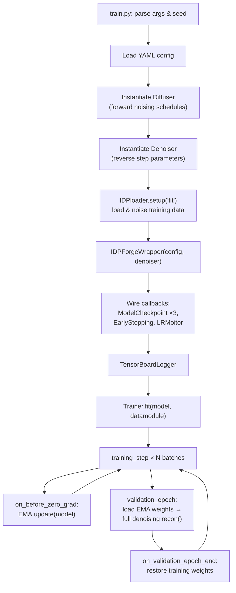

IDPForge trains a conditional diffusion denoiser that learns to reverse a three-factor noising process—SE(3) backbone translations, SO(3) backbone rotations, and side-chain torsion angles—so that at inference time the model can progressively denoise pure noise into physically plausible intrinsically disordered protein conformers. The entire training loop is orchestrated by PyTorch Lightning, with configuration driven by a single YAML file that governs data paths, diffusion schedules, loss weighting, optimizer settings, and model architecture hyperparameters.

## Training Entry Point and Lifecycle

The training script [`train.py`](train.py) serves as the canonical entry point. It parses command-line arguments, loads the YAML configuration, instantiates the forward diffuser and reverse denoiser, builds the data module, constructs the `IDPForgeWrapper` Lightning module, wires up checkpointing and logging callbacks, and finally delegates to `Trainer.fit()`. The overall lifecycle proceeds through four tightly coupled phases: **initialization → data loading → training loop → validation loop**, with Exponential Moving Average (EMA) weight tracking bridging the latter two.



Each call to `training_step` draws a uniformly random diffusion timestep (weighted toward higher noise), runs a single forward pass through `IDPForge`, computes the composite loss, and returns. Before gradients are zeroed, EMA parameters are updated. At validation, EMA weights are swapped in, a full reverse-diffusion trajectory is run via `model.recon()`, and composite validation metrics are logged before restoring the training weights.

Sources: [train.py](train.py#L1-L155), [idpforge/wrapper.py](idpforge/wrapper.py#L17-L36)

## Configuration File Anatomy

The training configuration lives in [`configs/train.yml`](configs/train.yml) and is divided into six top-level sections. Each section controls a distinct subsystem, and together they fully parameterize a training run without modifying source code.

| Section | Purpose | Key Fields |
|---|---|---|
| `general` | Output paths, PDB logging, run identity | `output`, `run_name`, `save_pdb`, `batch_save_freq`, `epoch_save_freq` |
| `data` | Dataset paths and batch sizes | `train_path`, `val_path`, `tr_batch_size`, `val_batch_size` |
| `training` | Optimizer, LR schedule, EMA, loss weights, trainer kwargs | `lr_scheduler`, `ema_decay`, `trainer`, `loss` |
| `validation` | Validation loss weights and metric toggles | `loss_weights`, `compute_cb_dist`, `compute_rg` |
| `diffuse` | Forward diffusion schedule boundaries | `n_tsteps`, `n_tsteps_inf`, `euclid_b0/bT`, `torsion_b0/bT` |
| `model` | Architecture hyperparameters | `t_embed_dim`, `t2d_params`, `self_condition`, `trunk`, `structure_module` |

### General Section

The `general` section controls where artifacts are written and how frequently PDB snapshots of training predictions are saved to disk. `output` sets the root directory for TensorBoard logs and checkpoints. `save_pdb` enables or disables PDB logging entirely; when enabled, predicted structures are written every `epoch_save_freq × 2` epochs at every `batch_save_freq × 10`th batch during training, and every `epoch_save_freq` epochs during validation.

Sources: [configs/train.yml](configs/train.yml#L1-L7), [idpforge/wrapper.py](idpforge/wrapper.py#L33-L36)

### Data Section

Training and validation data are specified as lists of directory or file paths, each containing pickled tuples of `(sequences, secondary_structure, coordinates[, radii_of_gyration])`. The `IDPloader` iterates over these paths, unpickles each, and wraps the contents in `DiffDataset` instances. Multiple paths are concatenated via `ConcatDataset`. Batch sizes for training and validation are set independently through `tr_batch_size` and `val_batch_size`.

Sources: [configs/train.yml](configs/train.yml#L8-L14), [idpforge/loader.py](idpforge/loader.py#L102-L143)

### Training Section

This is the most densely packed section. It contains four sub-blocks:

- **`lr_scheduler`**: Uses the `AlphaFoldLRScheduler` from OpenFold, which implements a linear warmup followed by cosine decay. `max_lr` is the peak learning rate, `warmup_no_steps` controls the warmup duration, and `start_decay_after_n_steps` / `decay_every_n_steps` govern the decay phase.
- **`ema_decay`**: The decay factor for the `ExponentialMovingAverage` that tracks shadow weights. A value of `0.99` means each EMA parameter is updated as `ema = 0.99 × ema + 0.01 × current`.
- **`trainer`**: Keyword arguments forwarded directly to `pytorch_lightning.Trainer`. Typical entries include `gradient_clip_val` (global gradient norm clipping), `accumulate_grad_batches` (effective batch size multiplier), `accelerator`, `devices`, and `max_epochs`.
- **`loss`**: Loss term weights and per-term hyperparameters, detailed in [Loss Functions](10-loss-functions).

Sources: [configs/train.yml](configs/train.yml#L15-L49), [idpforge/wrapper.py](idpforge/wrapper.py#L136-L166)

### Validation Section

Validation metrics differ from training losses. Rather than single-step denoising, validation runs a **full reverse-diffusion trajectory** (from `t = T` to `t = 0`) using EMA weights, then computes a configurable composite of four metrics: Cα dRMSD (`ca_drmsd`), structural violation penalty (`violation`), Cβ distance error (`dist`), and radius-of-gyration error (`rg_error`). The `loss_weights` dict controls their linear combination. `compute_cb_dist` and `compute_rg` are boolean toggles that must be `true` for the respective metrics to be evaluated at all.

Sources: [configs/train.yml](configs/train.yml#L47-L53), [idpforge/wrapper.py](idpforge/wrapper.py#L85-L131)

### Diffusion Section

The forward diffusion hyperparameters define the noising schedules applied to each geometric degree of freedom:

| Parameter | Domain | Default | Meaning |
|---|---|---|---|
| `n_tsteps` | Integer | 200 | Number of forward diffusion timesteps (training noise levels) |
| `n_tsteps_inf` | Integer | 40 | Number of reverse diffusion steps (inference/validatio stride) |
| `euclid_b0` | Float | 0.01 | Starting β for Euclidean (translation) noise schedule |
| `euclid_bT` | Float | 0.08 | Ending β for Euclidean noise schedule |
| `torsion_b0` | Float | 0.01 | Starting β for torsion angle noise schedule |
| `torsion_bT` | Float | 0.06 | Ending β for torsion angle noise schedule |

The SO(3) rotational diffusion is governed implicitly by the `IGSO3` class with its own internally calibrated σ schedule. The `Diffuser` class composes all three diffusers—`IGSO3`, `EuclideanDiffuser`, and `TorsionDiffuser`—into a single `diffuse_pose()` method that produces the full noised trajectory `(x_0, x_1, …, x_T)` along with noised torsion angles and rotation matrices.

> [!TIP]
> The relationship between `n_tsteps` (forward) and `n_tsteps_inf` (reverse) is critical: `n_tsteps` sets the resolution of the noise schedule during training, while `n_tsteps_inf` controls how many steps the denoiser takes during inference. A ratio of 200:40 means the model learns 200 noise levels but takes stride-5 jumps during reverse sampling.

Sources: [configs/train.yml](configs/train.yml#L54-L60), [idpforge/utils/diff_utils.py](idpforge/utils/diff_utils.py#L491-L570)

### Model Section

Model architecture parameters are passed as an `ml_collections.ConfigDict` to `IDPForge`. The key parameters are:

- **`t_embed_dim`**: Dimensionality of the sinusoidal timestep embedding (frozen, not learned).
- **`t2d_params`**: Bin boundaries for the pairwise geometric feature transform—`DMIN`/`DMAX` define the distance range, `DBINS` and `ABINS` set the number of distance and angle histogram bins.
- **`self_condition`**: When `true`, enables self-conditioning during training—50% of the time, the model receives its own prediction at timestep `t+1` as an additional input, following the RFdiffusion paradigm.
- **`trunk`**: Parameters for the `FoldingTrunk` (number of blocks, state dimensions, head widths, recycle count) and the nested `structure_module` (IPA heads, point counts, dropout, block depth).

Sources: [configs/train.yml](configs/train.yml#L61-L94), [idpforge/model.py](idpforge/model.py#L36-L69)

## Training Step Internals

The `training_step` method in `IDPForgeWrapper` implements several important mechanisms beyond a plain forward-and-loss pattern:

**Secondary structure dropout.** With 20% probability, the secondary structure label for the entire batch is replaced with a padding value (7), forcing the model to learn robust predictions without relying on SS annotations. This is critical for IDP sampling at inference time where SS labels are often unavailable.

**Self-conditioning.** When `self_condition` is enabled in the config and the random draw succeeds (50% chance), the model first runs a `torch.no_grad()` forward pass at timestep `t+1` to produce `prev` outputs. These are then fed as `prev_outputs` into the main forward pass at timestep `t`, allowing the model to refine its own earlier prediction—a technique borrowed from RFdiffusion that significantly improves sample quality.

**Timestep sampling.** During training, the diffusion timestep `T` is sampled with a linear weighting that favors higher timesteps (more noised inputs), using the probability distribution `p(t) ∝ t`. This ensures the model sees sufficient high-noise examples, which are harder to denoise but essential for the reverse process to start from near-random configurations.

Sources: [idpforge/wrapper.py](idpforge/wrapper.py#L56-L83), [idpforge/loader.py](idpforge/loader.py#L62-L99)

## Validation Step Internals

Validation diverges from training in two fundamental ways. First, **EMA weights are loaded** at the start of each validation epoch and **restored** at its end, ensuring validation metrics reflect the smoothed parameter trajectory rather than the noisy training-time weights. Second, instead of a single-step denoising prediction, validation runs `model.recon()`—a **complete reverse-diffusion loop** that iterates from `t = n_tsteps − 1` down to `t = 0` in strides of `n_tsteps / n_tsteps_inf`, at each step calling the model forward, then applying the `Denoiser.get_next_pose()` method to transition to `t − 1`.

The resulting fully denoised structure is then evaluated against ground truth using the validation-specific composite loss. The four available metrics and their default weights are:

| Metric | Default Weight | Description |
|---|---|---|
| `ca_drmsd` | 0.1 | Cα distance-RMSD between predicted and true structures |
| `violation` | 0.0 | Structural violation penalty (bond lengths, clashes) |
| `dist` | 0.05 | Cβ pseudo-distance error with CA connectivity regularization |
| `rg_error` | 1.0 | Radius-of-gyration error against experimental Rg values |

Sources: [idpforge/wrapper.py](idpforge/wrapper.py#L85-L131), [idpforge/loss.py](idpforge/loss.py#L176-L188)

## Optimizer and Learning Rate Schedule

The optimizer is standard `torch.optim.Adam` with `eps = 1e-5`, initialized at `max_lr` from the config. The learning rate schedule is `AlphaFoldLRScheduler`, which implements:

1. **Linear warmup** from 0 to `max_lr` over `warmup_no_steps` steps.
2. **Plateau hold** until `start_decay_after_n_steps`.
3. **Cosine decay** every `decay_every_n_steps` steps until convergence.

The schedule operates at **step-level granularity** (`interval: "step"`) rather than epoch-level, which matters because effective learning rate changes depend on the total number of optimizer steps (epochs × batches_per_epoch / accumulate_grad_batches).

Sources: [idpforge/wrapper.py](idpforge/wrapper.py#L136-L166)

## Checkpointing Strategy

Three independent `ModelCheckpoint` callbacks provide overlapping coverage:

| Callback | Trigger | Keeps | Filename Pattern |
|---|---|---|---|
| `mc_best` | Every epoch | Top 5 by `val_loss` (min) + last | `best-{epoch}-{step}` |
| `mc_recent` | Every epoch | Top 10 by `step` (max) | `latest-{epoch}-{step}` |
| `mc_periodic` | Every 10 epochs | All (unlimited) | `periodic-{epoch}-{step}` |

The **best checkpoint** is the primary artifact for downstream inference—it captures the five lowest-validation-loss snapshots. The **recent checkpoints** guard against late-stage overfitting by retaining the last 10 regardless of metric. The **periodic checkpoints** provide a complete historical record at coarse granularity for analysis or rollback.

EMA state is explicitly serialized into checkpoints via `on_save_checkpoint` / `on_load_checkpoint` hooks, ensuring that EMA shadow weights survive restart.

Sources: [train.py](train.py#L58-L98), [idpforge/wrapper.py](idpforge/wrapper.py#L171-L176)

## Early Stopping

Early stopping is **opt-in** via the `--early_stopping` CLI flag. When enabled, it monitors `val_loss` with a `min_delta` threshold and a `patience` counter (both configurable under `early_stopping` in the YAML). The implementation uses `EarlyStoppingVerbose` from OpenFold, which adds `check_finite=True` and `strict=True` safeguards—training halts if any NaN/Inf validation loss is observed, or if the monitored metric is missing from the log.

Sources: [train.py](train.py#L88-L98), [configs/train.yml](configs/train.yml#L47-L49)

## Resume and Weight-Only Loading

Two mutually exclusive resume modes are available via CLI arguments:

- **`--resume_from_ckpt`** (without `--load_weights_only`): Full training state resume. The global step is extracted from the checkpoint, the LR scheduler is rewound to that step via `resume_last_lr_step()`, and `ckpt_path` is passed to `Trainer.fit()` so that optimizer state, epoch counter, and callbacks are all restored.
- **`--resume_from_ckpt --load_weights_only`**: Only model weights are loaded via `load_state_dict()`. Optimizer state, epoch, and LR schedule start fresh. This is useful for fine-tuning or transfer learning scenarios where you want a clean optimizer trajectory on pre-trained weights.

Sources: [train.py](train.py#L42-L56), [idpforge/wrapper.py](idpforge/wrapper.py#L168-L169)

## Command-Line Interface

The complete argument set for `train.py`:

| Argument | Type | Default | Description |
|---|---|---|---|
| `--model_config_path` | str | `config.yml` | Path to the YAML configuration file |
| `--seed` | int | 42 | Global random seed (via `seed_everything`) |
| `--run_version` | int | None | TensorBoard log version number |
| `--early_stopping` | flag | False | Enable early stopping on `val_loss` |
| `--resume_from_ckpt` | str | None | Path to checkpoint for resume or weight loading |
| `--load_weights_only` | flag | False | Load weights only (ignore optimizer/LR state) |
| `--log_lr` | flag | True | Log actual learning rate each epoch |

Sources: [train.py](train.py#L122-L154)

## Launching a Training Run

A minimal training invocation requires only the configuration file:

```bash
python train.py --model_config_path configs/train.yml
```

A production run with all options:

```bash
python train.py \
    --model_config_path configs/train.yml \
    --seed 42 \
    --early_stopping \
    --log_lr
```

Resuming from a checkpoint:

```bash
python train.py \
    --model_config_path configs/train.yml \
    --resume_from_ckpt lightning_logs/test/version_0/checkpoints/best-epoch=50-step=10000.ckpt
```

Fine-tuning from pre-trained weights with a fresh optimizer:

```bash
python train.py \
    --model_config_path configs/train.yml \
    --resume_from_ckpt pretrained.ckpt \
    --load_weights_only
```

> [!TIP]
> Set `torch.set_float32_matmul_precision('medium')` is called at module level in `train.py` to allow TF32 operations on Ampere+ GPUs, which can yield ~2× throughput with negligible accuracy impact for diffusion training.

Sources: [train.py](train.py#L19-L20), [train.py](train.py#L122-L154)

## Configuration Quick Reference

The table below summarizes every field in [`configs/train.yml`](configs/train.yml) with its default value and role:

| Field | Default | Role |
|---|---|---|
| `general.output` | `local` | Root directory for logs and checkpoints |
| `general.run_name` | `test` | Subdirectory name under output |
| `general.save_pdb` | `true` | Whether to log predicted PDBs during training/validation |
| `general.batch_save_freq` | 2 | PDB logging frequency divisor (batches) |
| `general.epoch_save_freq` | 5 | PDB logging frequency divisor (epochs) |
| `data.train_path` | `["data/"]` | List of paths to pickled training data |
| `data.val_path` | `["data/"]` | List of paths to pickled validation data |
| `data.tr_batch_size` | 16 | Training batch size |
| `data.val_batch_size` | 64 | Validation batch size |
| `training.lr_scheduler.max_lr` | 0.001 | Peak learning rate |
| `training.lr_scheduler.warmup_no_steps` | 1000 | Linear warmup duration (steps) |
| `training.lr_scheduler.start_decay_after_n_steps` | 5000 | Step at which cosine decay begins |
| `training.lr_scheduler.decay_every_n_steps` | 5000 | Cosine decay period |
| `training.ema_decay` | 0.99 | Exponential moving average decay |
| `training.trainer.gradient_clip_val` | 0.1 | Global gradient norm clip |
| `training.trainer.accumulate_grad_batches` | 4 | Gradient accumulation (effective batch = 16×4 = 64) |
| `training.trainer.accelerator` | `gpu` | PyTorch Lightning accelerator |
| `training.trainer.devices` | 1 | Number of GPUs |
| `training.trainer.max_epochs` | 100 | Maximum training epochs |
| `training.loss.weights.fape` | 1 | Frame-aligned point error weight |
| `training.loss.weights.dist` | 0.005 | Distance loss weight |
| `training.loss.weights.angular` | 0.1 | Torsion angle loss weight |
| `training.loss.weights.violation` | 0.01 | Structural violation loss weight |
| `training.loss.dist.start_epoch` | 50 | Epoch at which distance loss activates |
| `training.loss.violation_cfg.start_epoch` | 80 | Epoch at which violation loss activates |
| `validation.loss_weights.ca_drmsd` | 0.1 | Validation Cα dRMSD weight |
| `validation.loss_weights.violation` | 0.0 | Validation violation weight |
| `validation.loss_weights.dist` | 0.05 | Validation distance weight |
| `validation.loss_weights.rg_error` | 1.0 | Validation Rg error weight |
| `diffuse.n_tsteps` | 200 | Forward diffusion timesteps |
| `diffuse.n_tsteps_inf` | 40 | Reverse diffusion steps (inference) |
| `diffuse.euclid_b0` | 0.01 | Translation noise schedule start |
| `diffuse.euclid_bT` | 0.08 | Translation noise schedule end |
| `diffuse.torsion_b0` | 0.01 | Torsion noise schedule start |
| `diffuse.torsion_bT` | 0.06 | Torsion noise schedule end |

Sources: [configs/train.yml](configs/train.yml#L1-L94)

## Loss Curriculum Schedule

A notable design pattern in the training configuration is the **delayed activation** of loss terms via `start_epoch` thresholds. The distance loss (`dist.start_epoch: 50`) and violation loss (`violation_cfg.start_epoch: 80`) are initially zero-weighted and only begin contributing after their respective epochs. This implements a curriculum that first trains the model to get frame alignments and torsion angles roughly correct (FAPE + angular losses), then refines inter-residue distances, and finally penalizes structural violations—progressively tightening the physical plausibility constraint.

Sources: [idpforge/loss.py](idpforge/loss.py#L70-L86), [configs/train.yml](configs/train.yml#L40-L45)

---

**Next steps**: For details on the individual loss terms and their mathematical formulations, see [Loss Functions](10-loss-functions). For how the data pipeline prepares and noises structures before they reach the training loop, see [Data Loading and Noising](11-data-loading-and-noising). For the full parameter reference including model architecture fields, see [Configuration Reference](22-configuration-reference).