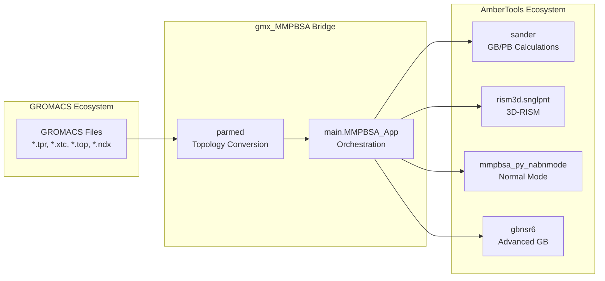
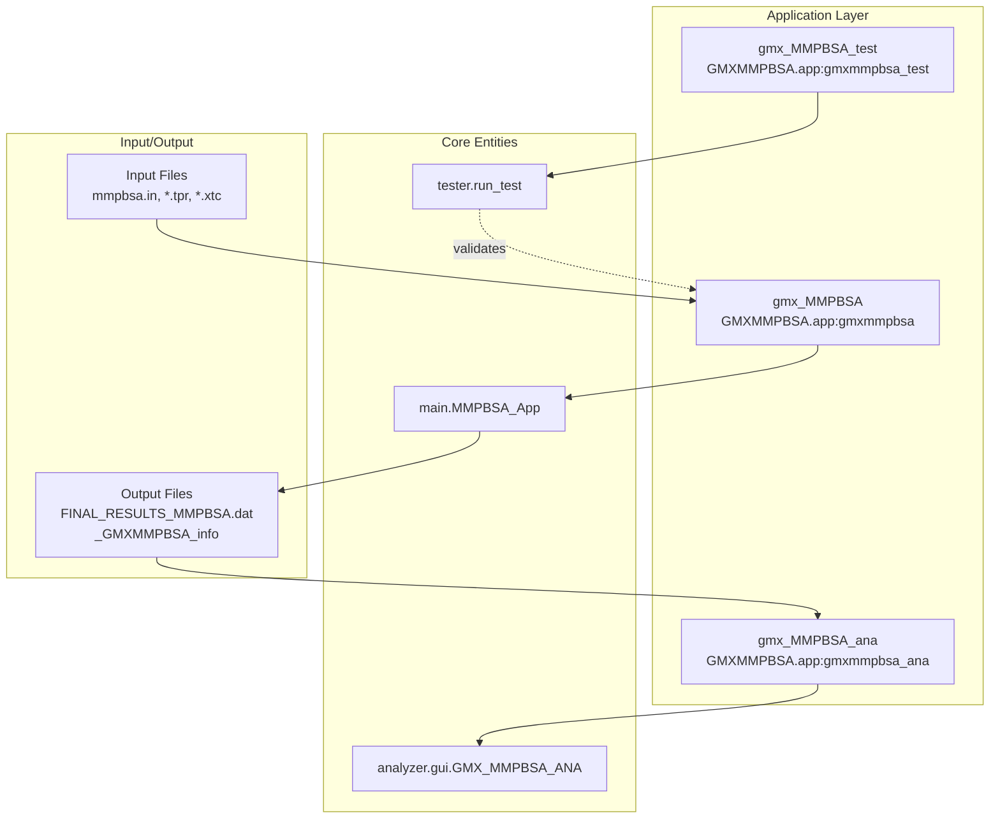

# Overview

Relevant source files

The following files were used as context for generating this wiki page:

- [GMXMMPBSA/__init__.py](GMXMMPBSA/__init__.py)
- [GMXMMPBSA/app.py](GMXMMPBSA/app.py)
- [README.md](README.md)
- [docs/getting-started.md](docs/getting-started.md)
- [docs/introduction.md](docs/introduction.md)
- [docs/support.md](docs/support.md)
- [setup.py](setup.py)

gmx_MMPBSA is a Python-based tool that performs end-state free energy calculations using GROMACS simulation files. It bridges the GROMACS molecular dynamics ecosystem with AMBER's MM/PB(GB)SA calculation engines, bringing powerful binding free energy analysis capabilities to GROMACS users. The tool is based on AMBER's `MMPBSA.py` but redesigned specifically for GROMACS workflows [README.md:14-16]().

**For detailed architecture information, see [System Architecture](#1.1). For feature enumeration, see [Key Features and Capabilities](#1.2).**

**Sources:** [README.md:14-16](), [docs/getting-started.md:21-24](), [setup.py:41-42]()

## Relationship to GROMACS and AmberTools

gmx_MMPBSA acts as a bridge between two major molecular dynamics software ecosystems:

| Ecosystem | Role | Components Used |
|-----------|------|----------------|
| **GROMACS** | Input provider | Structure files (`*.tpr`, `*.pdb`, `*.gro`), trajectories (`*.xtc`, `*.trr`), topology files (`*.top`), index files (`*.ndx`) [docs/getting-started.md:134-141]() |
| **AmberTools** | Calculation engine | `sander` (GB/PB), `rism3d.snglpnt` (3D-RISM), `mmpbsa_py_nabnmode` (NMODE), `gbnsr6` (GBNSR6), `ParmEd` (topology conversion) [docs/introduction.md:68-69](), [docs/getting-started.md:22-23]() |

The tool converts GROMACS topology files to AMBER format using `ParmEd`, then performs calculations using AmberTools executables. This design allows GROMACS users to access AMBER's MM/PB(GB)SA capabilities without learning AMBER workflows [README.md:49-50]().

### Bridge Architecture

**Diagram 1: gmx_MMPBSA as a Bridge Between Ecosystems**

**Sources:** [README.md:15-16](), [setup.py:54](), [GMXMMPBSA/app.py:53-63]()

## Three-Application Architecture

The gmx_MMPBSA package consists of three console script applications, defined in the project entry points [setup.py:56-61]():

### 1. gmx_MMPBSA (Core Calculation Tool)
The main application that performs all end-state free energy calculations. It supports both GROMACS and AMBER engines [GMXMMPBSA/app.py:116-121]().

**Key responsibilities:**
- Parse command-line arguments via `commandlineparser.parser` [GMXMMPBSA/app.py:117-118]()
- Orchestrate the calculation workflow through `main.MMPBSA_App` [GMXMMPBSA/app.py:60]()
- Manage parallel execution using `mpi4py` [GMXMMPBSA/app.py:53-55]()
- Execute the sequence: `read_input_file`, `make_prmtops`, `run_mmpbsa`, and `write_final_outputs` [GMXMMPBSA/app.py:90-113]()

### 2. gmx_MMPBSA_ana (Graphical Analyzer)
A PyQt-based GUI application for interactive result visualization and analysis [GMXMMPBSA/app.py:123-151]().

**Key responsibilities:**
- Load calculation results and metadata via `analyzer.utils.get_files` [GMXMMPBSA/app.py:148]()
- Provide a graphical interface using `analyzer.gui.GMX_MMPBSA_ANA` [GMXMMPBSA/app.py:138-149]()
- Support visualization of energy terms, decomposition, and correlation [docs/getting-started.md:128-129]()

### 3. gmx_MMPBSA_test (Testing Utility)
A validation tool designed to test if the installation was successful by running predefined examples [GMXMMPBSA/app.py:154-168]().

**Key responsibilities:**
- Parse test-specific arguments via `testparser` [GMXMMPBSA/app.py:164]()
- Execute the testing suite via `tester.run_test` [GMXMMPBSA/app.py:168]()

### Code Entity Mapping

**Diagram 2: Console Script Entry Points and Core Classes**

**Sources:** [setup.py:56-61](), [GMXMMPBSA/app.py:116-168](), [docs/getting-started.md:125-132]()

## Types of Calculations Supported

gmx_MMPBSA supports a comprehensive set of binding free energy calculation methods and specialized analyses [docs/getting-started.md:67-85]():

### Solvation Models
- **Generalized Born (GB):** Fast models for estimating polar solvation [docs/introduction.md:103-105]().
- **Poisson-Boltzmann (PB):** Numerical solver for the PB equation, supporting linear and non-linear solvers [docs/getting-started.md:69]().
- **3D-RISM:** Three-dimensional Reference Interaction Site Model for detailed solvation analysis [docs/getting-started.md:69]().
- **GBNSR6:** Advanced GB model using R6 numerical integration [docs/getting-started.md:72]().

### Entropy and Stability
- **Entropy Corrections:** Supports Interaction Entropy (IE), C2 Entropy, and Normal Mode Analysis (NMODE) [docs/getting-started.md:72]().
- **Alanine Scanning:** Systematic mutation analysis to identify hot-spot residues [docs/getting-started.md:70]().
- **Stability:** Calculations for single-molecule conformational stability [docs/getting-started.md:73]().
- **QM/MMGBSA:** Hybrid quantum mechanical/molecular mechanical calculations [docs/getting-started.md:74]().

### Specialized Analyses
- **Binding Free Energy Decomposition:** Per-residue and pairwise energy breakdown [docs/getting-started.md:71]().
- **Support for Diverse Systems:** Including Protein-ligand, Protein-protein, Protein-DNA, Metalloproteins, and Membrane proteins [docs/getting-started.md:92-100]().

**Sources:** [docs/getting-started.md:67-100](), [docs/introduction.md:99-120](), [setup.py:45]()

## System Requirements and Compatibility

- **Python:** Strictly requires **Python 3.11** [setup.py:26-27]().
- **AmberTools:** Requires version **>= 20** [README.md:16]().
- **GROMACS:** Compatible with **all GROMACS versions** [README.md:16]().
- **Core Dependencies:** `numpy`, `pandas`, `matplotlib`, `seaborn`, `scipy`, `mpi4py`, and `parmed` [setup.py:50-55]().

**Sources:** [setup.py:26-55](), [README.md:15-16](), [GMXMMPBSA/__init__.py:31-32]()

---