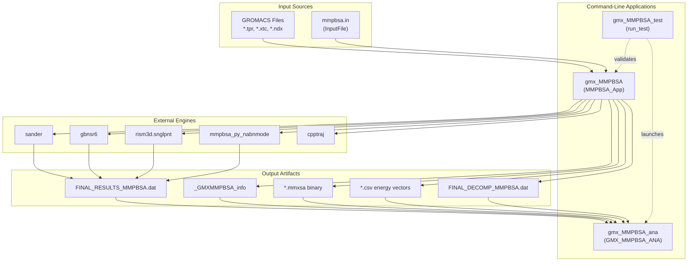
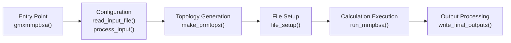
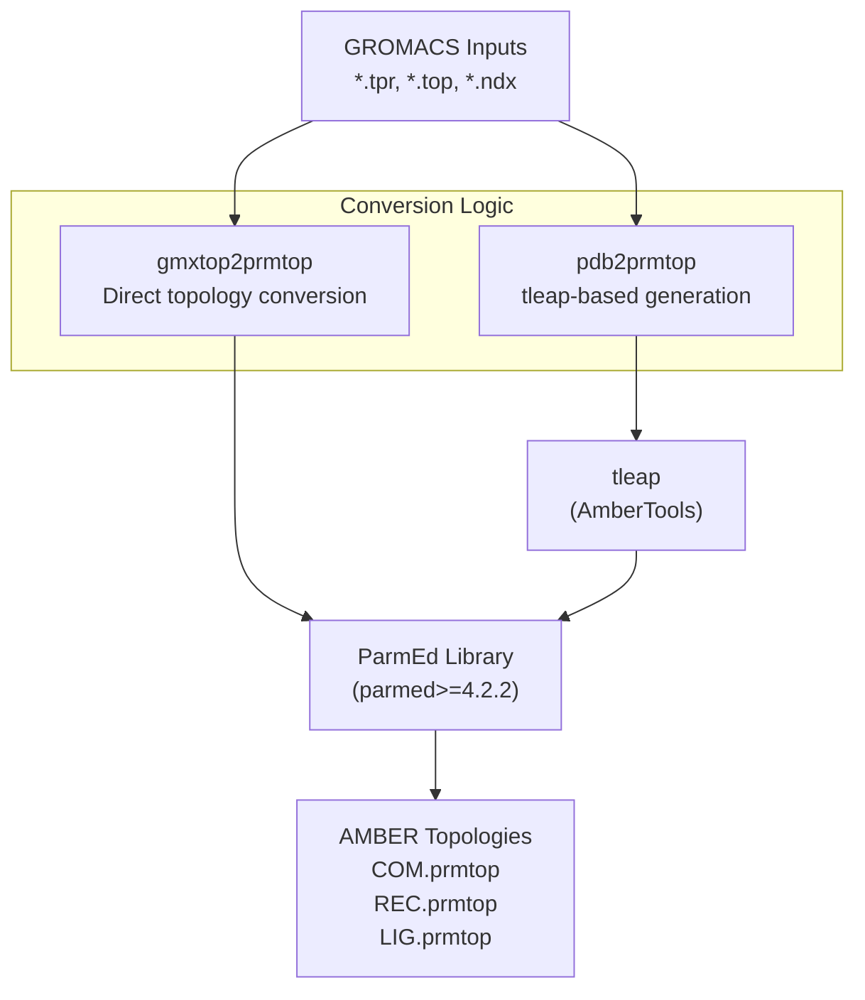
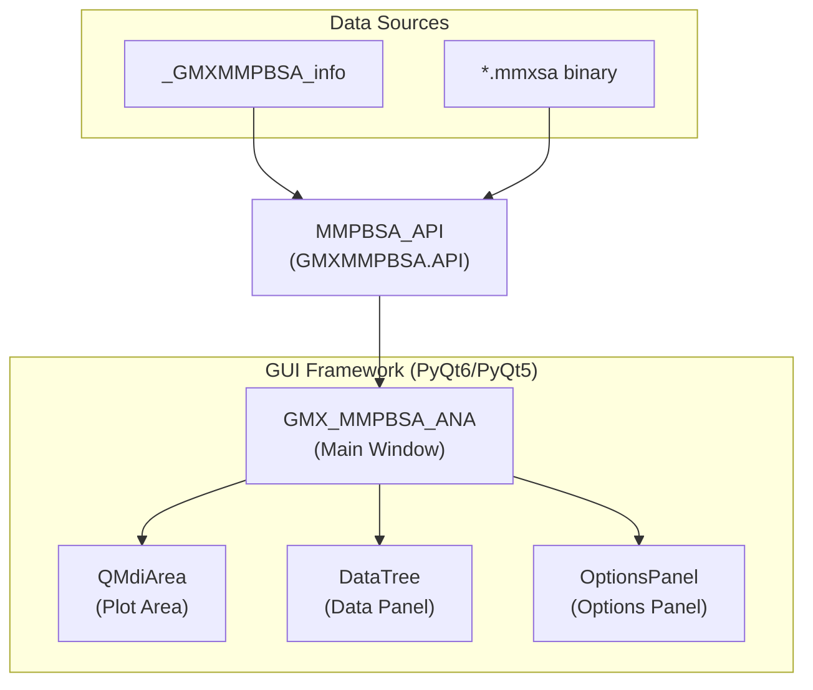

# System Architecture

Relevant source files

The following files were used as context for generating this wiki page:

- [GMXMMPBSA/__init__.py](GMXMMPBSA/__init__.py)
- [GMXMMPBSA/app.py](GMXMMPBSA/app.py)
- [README.md](README.md)
- [docs/analyzer.md](docs/analyzer.md)
- [docs/api.md](docs/api.md)
- [docs/getting-started.md](docs/getting-started.md)
- [docs/howworks.md](docs/howworks.md)
- [setup.py](setup.py)

This page describes the high-level architecture of gmx_MMPBSA, focusing on the three main applications and their relationships, the core calculation pipeline, and how components interact to transform GROMACS simulation outputs into MM/PB(GB)SA binding free energies.

---

## Three-Application System

gmx_MMPBSA comprises three independent command-line applications that work together to provide end-to-end MM/PB(GB)SA analysis capabilities. These applications are defined as entry points in the package configuration [setup.py:56-61]().

| Application | Purpose | Primary Classes | Entry Point |
|-------------|---------|-----------------|-------------|
| **gmx_MMPBSA** | Core calculation engine | `MMPBSA_App`, `CheckMakeTop`, `CalculationList` | `gmxmmpbsa()` in [GMXMMPBSA/app.py:116-118]() |
| **gmx_MMPBSA_ana** | Graphical result analyzer | `GMX_MMPBSA_ANA`, `MMPBSA_API` | `gmxmmpbsa_ana()` in [GMXMMPBSA/app.py:123-151]() |
| **gmx_MMPBSA_test** | Installation validator | N/A (functional) | `gmxmmpbsa_test()` in [GMXMMPBSA/app.py:154-168]() |

### Application Relationships

The following diagram illustrates how the three applications interact with input files, external calculation engines, and each other.

**Application Interaction Diagram**

**Sources:** [GMXMMPBSA/app.py:40-168](), [setup.py:56-61](), [docs/getting-started.md:124-132]()

---

## Core Application Pipeline

The `gmx_MMPBSA` application orchestrates all calculation workflows through the `MMPBSA_App` class. The application follows a defined execution sequence within the `_gmxmmpbsa_base` function [GMXMMPBSA/app.py:40-114]().

### Pipeline Overview

**Core Execution Flow**

**Sources:** [GMXMMPBSA/app.py:40-114]()

### Stage 1: Entry and Configuration
The application initializes by setting up logging and MPI communication. It handles command-line arguments and parses the `mmpbsa.in` input file [GMXMMPBSA/app.py:90-99]().

### Stage 2: Topology Generation
The `make_prmtops()` method [GMXMMPBSA/app.py:100]() handles the conversion of GROMACS topologies to AMBER format. This is a critical step where `ParmEd` is used to bridge the two software ecosystems [docs/howworks.md:84-90]().

**Topology Conversion Logic**

**Sources:** [GMXMMPBSA/app.py:100-101](), [docs/howworks.md:105-130](), [setup.py:54]()

### Stage 3: Calculation Execution
Calculations are managed by the `run_mmpbsa()` method [GMXMMPBSA/app.py:103](). This stage involves frame distribution across MPI ranks and the invocation of external engines like `sander` or `gbnsr6`.

**Calculation Engine Mapping**
| Calculation Class | External Engine | Source |
|-------------------|-----------------|--------|
| `EnergyCalculation` | `sander` | [docs/howworks.md:69]() |
| `ListEnergyCalculation` | `gbnsr6` | [docs/howworks.md:72]() |
| `NmodeCalc` | `mmpbsa_py_nabnmode` | [docs/howworks.md:72]() |
| `InteractionEntropy` | `cpptraj` | [docs/howworks.md:117-122]() |

**Sources:** [GMXMMPBSA/app.py:103](), [docs/howworks.md:67-85]()

---

## Analyzer Application Architecture

`gmx_MMPBSA_ana` is a PyQt-based graphical tool designed for high-performance visualization [docs/analyzer.md:9-15](). It leverages a specialized API for data access and implements multiprocessing to maintain GUI responsiveness [docs/analyzer.md:30-45]().

### GUI Components and Data Flow

**Analyzer System Architecture**

**Sources:** [GMXMMPBSA/app.py:123-151](), [docs/analyzer.md:47-60](), [docs/api.md:8-12]()

### Performance Optimizations
The analyzer includes several architectural improvements for handling large datasets:
- **Multiprocessing**: Reimplemented for reading systems [docs/analyzer.md:32]().
- **Multithreading**: Implemented for data processing [docs/analyzer.md:33]().
- **Hybrid Storage**: Option to store data on hard disk instead of RAM [docs/analyzer.md:41]().

---

## Technical Integration

### Parallelization Strategy
gmx_MMPBSA uses MPI for frame-level parallelism. When run with `mpirun`, `mpi4py` is used to distribute frames across available processors [GMXMMPBSA/app.py:51-55](). If a single process is detected, it falls back to a `fake_mpi` implementation to maintain code consistency.

### External Tool Integration
The system integrates several external toolsets:
- **AmberTools**: Used for the heavy lifting of energy calculations (`sander`, `cpptraj`, `tleap`) [docs/getting-started.md:22]().
- **GROMACS**: Source of trajectories and initial structures [docs/howworks.md:71-82]().
- **ParmEd**: Acts as the primary converter between GROMACS and AMBER topology formats [docs/howworks.md:86]().

**Sources:** [GMXMMPBSA/app.py:51-55](), [docs/getting-started.md:21-24](), [docs/howworks.md:84-90]()

---