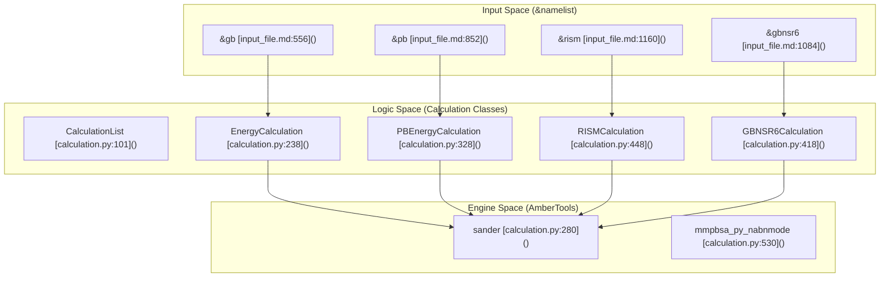
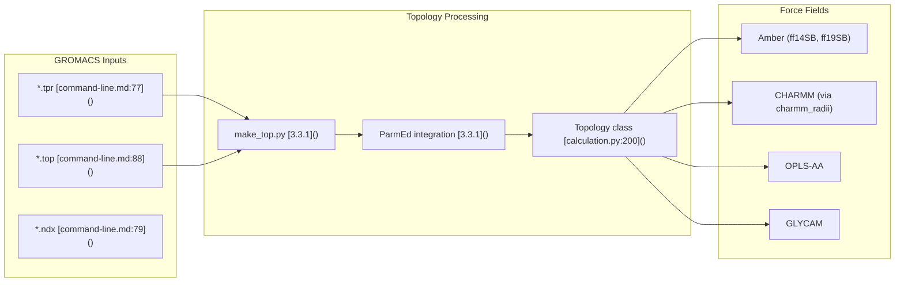

# Key Features and Capabilities

Relevant source files

The following files were used as context for generating this wiki page:

- [GMXMMPBSA/GMXMMPBSA.sh](GMXMMPBSA/GMXMMPBSA.sh)
- [README.md](README.md)
- [docs/env.yml](docs/env.yml)
- [docs/examples/README.md](docs/examples/README.md)
- [docs/getting-started.md](docs/getting-started.md)
- [docs/gmx_MMPBSA_ana_command-line.md](docs/gmx_MMPBSA_ana_command-line.md)
- [docs/gmx_MMPBSA_command-line.md](docs/gmx_MMPBSA_command-line.md)
- [docs/installation.md](docs/installation.md)
- [docs/summary.md](docs/summary.md)
- [docs/versus.md](docs/versus.md)
- [mkdocs.yml](mkdocs.yml)
- [notebooks/gmx_MMPBSA_Colab.ipynb](notebooks/gmx_MMPBSA_Colab.ipynb)

This document provides a comprehensive enumeration of gmx_MMPBSA's calculation methods, analysis capabilities, supported force fields, and system types. For architectural details of how these features are implemented, see [System Architecture](#1.1). For specific usage instructions, see [Core Application (gmx_MMPBSA)](#3).

gmx_MMPBSA performs end-state free energy calculations using MM/PB(GB)SA methodology, bridging GROMACS simulation outputs with AmberTools calculation engines [README.md:15-16](). The tool supports combinatorial workflows where multiple solvation models, entropy methods, and analysis types can be executed in a single run [docs/examples/README.md:6-10]().

---

## Solvation Models

gmx_MMPBSA implements four distinct solvation frameworks, each invoking different AmberTools executables. All models calculate the polar and non-polar contributions to solvation free energy.

**Generalized Born (GB) Models**

The `igb` parameter in the `&gb` namelist selects the model variant. GB-OBC2 (`igb=5`) with `mbondi2` radii is the default and recommended for most protein systems [docs/input_file.md:556-850]().

**Poisson-Boltzmann (PB) Models**

PB calculations solve the Poisson-Boltzmann equation numerically. The `inp` parameter controls solver type: `inp=1` (linear) is faster; `inp=2` (non-linear) is more rigorous [docs/input_file.md:852-1082](). Specialized radii sets handle halogenated compounds (`mbondi_pb2`, `mbondi_pb3`) and CHARMM force fields (`charmm_radii`). Membrane protein support via `memopt=1` implements a heterogeneous dielectric profile [docs/input_file.md:852-1082]().

**GBNSR6 Model**

GBNSR6 computes effective Born radii via numerical surface integration (R6 method), achieving near-PB accuracy at intermediate computational cost [docs/examples/README.md:52]().

**3D-RISM Model**

3D-RISM solves integral equations for solvent distribution around the solute. It is particularly valuable for protein-protein interfaces with explicit consideration of water structure [docs/input_file.md:1160-1356]().

**Solvation Model Entity Mapping**

Title: Solvation Model Configuration to Code Entities

Sources: [docs/input_file.md:556-1356](), [GMXMMPBSA/calculation.py:101-530]()

---

## Entropy Methods

Entropy contributions represent the system's loss of conformational freedom upon binding. gmx_MMPBSA provides four methods with different computational costs and physical assumptions [docs/summary.md:26-29]().

**Interaction Entropy (IE)**
Estimates entropy from interaction energy fluctuations via exponential averaging. The `ie_segment` parameter defines which trajectory portion to analyze (default: last 25%) [docs/input_file.md:395-424]().

**C2 Entropy**
Uses a second-order cumulant expansion. It shares IE's convergence criteria and computational efficiency [docs/input_file.md:434-459]().

**Quasi-Harmonic Analysis (QH)**
Computes entropy from the covariance matrix of atomic fluctuations using `cpptraj` [docs/input_file.md:382-393]().

**Normal Mode Analysis (NMODE)**
Performs full vibrational analysis after minimizing each snapshot. Parameters `nmstartframe`, `nmendframe`, and `nminterval` define which frames undergo analysis [docs/input_file.md:2106-2233]().

**Sources:** [docs/input_file.md:380-459](), [docs/input_file.md:2106-2233](), [docs/summary.md:26-29]()

---

## Trajectory Protocols

gmx_MMPBSA supports two protocols for obtaining receptor and ligand structures [docs/summary.md:15-19]().

**Single Trajectory (ST)**
The complex trajectory is provided via `-ct`. gmx_MMPBSA extracts receptor and ligand coordinates from complex frames. This assumes bound-state conformations approximate unbound states [docs/gmx_MMPBSA_command-line.md:74-89]().

**Multiple Trajectory (MT)**
Separate trajectories for complex (`-ct`), receptor (`-rt`), and ligand (`-lt`) are provided. This is physically more rigorous as each species is sampled independently [docs/gmx_MMPBSA_command-line.md:98-120]().

**Sources:** [docs/gmx_MMPBSA_command-line.md:74-120](), [docs/summary.md:15-19]()

---

## Specialized Analysis Methods

**Decomposition Analysis**
Partitions binding energy into per-residue (`idecomp=1,2`) or pairwise (`idecomp=3,4`) contributions. The `print_res` parameter defines the residues of interest [docs/input_file.md:1858-2104]().

**Alanine Scanning**
Systematically mutates residues to alanine (or glycine) to identify energetic hotspots. ΔΔG = ΔG_mutant - ΔG_WT is reported [docs/input_file.md:1358-1494]().

**Stability Calculation**
Analyzes a single molecule's conformational stability. Activated with the `-s` or `--stability` flag [docs/gmx_MMPBSA_command-line.md:62-67]().

**Sources:** [docs/input_file.md:1358-2104](), [docs/gmx_MMPBSA_command-line.md:62-67]()

---

## QM/MM Capabilities

The `&gb` namelist supports hybrid quantum mechanics/molecular mechanics (QM/MM) calculations where a subset of atoms is treated quantum mechanically (`ifqnt=1`) [docs/input_file.md:648-848]().

**Key Features:**
- **QM Region Selection:** Automatic via `qm_residues` or manual via `com_qmmask`.
- **Semi-Empirical Methods:** Supports PM3, AM1, PM6, DFTB, etc., via `qm_theory`.
- **Dispersion Corrections:** Supports AM1-D*, PM6-D, and DH+ variants.

**Sources:** [docs/input_file.md:648-848](), [docs/summary.md:33-34]()

---

## Force Field Support

gmx_MMPBSA converts GROMACS topologies to Amber format via ParmEd, supporting multiple force field families [docs/getting-started.md:110-115]().

**System to Code Mapping**

Title: Force Field and Topology Integration

Sources: [docs/getting-started.md:110-115](), [docs/gmx_MMPBSA_command-line.md:74-89](), [docs/input_file.md:145-275]()

---

## Supported System Types

gmx_MMPBSA processes diverse molecular systems [docs/getting-started.md:92-101]():
- **Protein-Protein / Protein-Ligand**
- **Protein-DNA / Protein-RNA**
- **Metalloprotein-Ligand**
- **Protein-Glycan**
- **Membrane Proteins** (with heterogeneous dielectric profiles)
- **Multicomponent systems** (e.g., Protein-DNA-RNA-Ions-Ligand)

**Sources:** [docs/getting-started.md:92-101](), [docs/examples/README.md:28-40]()

---

## Calculation Combinations

Multiple calculation types can execute in a single gmx_MMPBSA run [docs/examples/README.md:6-10]().

| Base Solvation | + Entropy | + Decomposition | + Alanine Scan | + QM/MM |
|---------------|-----------|-----------------|----------------|---------|
| GB | ✓ | ✓ | ✓ | ✓ |
| GBNSR6 | ✓ | ✓ | ✓ | ✗ |
| PB | ✓ | ✓ | ✓ | ✗ |
| 3D-RISM | ✓ | ✗ | ✗ | ✗ |

**Sources:** [docs/input_file.md:69-113](), [docs/examples/README.md:6-10]()

---

## Output Files and Data Formats

| File | Content | Flag |
|------|--------|------|
| `FINAL_RESULTS_MMPBSA.dat` | Main statistics summary | `-o` [command-line.md:48]() |
| `FINAL_DECOMP_MMPBSA.dat` | Decomposition statistics | `-do` [command-line.md:50]() |
| `*.csv` | Per-frame energy terms | `-eo` [command-line.md:52]() |
| `*_info` | Metadata for `gmx_MMPBSA_ana` | Automatic |

**Sources:** [docs/gmx_MMPBSA_command-line.md:42-67](), [docs/summary.md:44-45]()

---