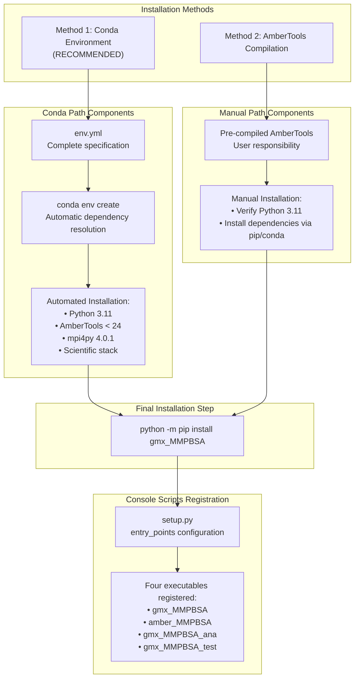
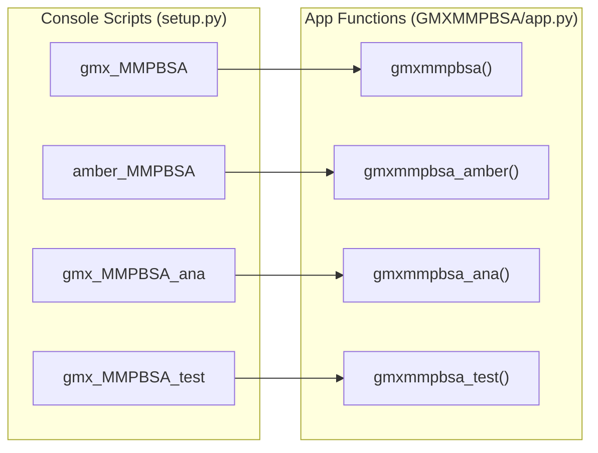

# Installation and Setup

<details>
<summary>Relevant source files</summary>

The following files were used as context for generating this wiki page:

- [GMXMMPBSA/GMXMMPBSA.sh](GMXMMPBSA/GMXMMPBSA.sh)
- [GMXMMPBSA/__init__.py](GMXMMPBSA/__init__.py)
- [GMXMMPBSA/app.py](GMXMMPBSA/app.py)
- [docs/env.yml](docs/env.yml)
- [docs/gmx_MMPBSA_ana_command-line.md](docs/gmx_MMPBSA_ana_command-line.md)
- [docs/gmx_MMPBSA_command-line.md](docs/gmx_MMPBSA_command-line.md)
- [docs/installation.md](docs/installation.md)
- [docs/summary.md](docs/summary.md)
- [docs/versus.md](docs/versus.md)
- [scripts/conda_pip_install.sh](scripts/conda_pip_install.sh)
- [setup.py](setup.py)

</details>


This page provides comprehensive instructions for installing gmx_MMPBSA and configuring it for use. It covers system requirements, multiple installation methods, dependency management, and validation procedures. For information about running calculations after installation, see [Core Application (gmx_MMPBSA)](#3). For testing your installation, see [Validation with gmx_MMPBSA_test](#2.2).

---

## System Requirements

gmx_MMPBSA has strict requirements that must be met before installation:

| Component | Version | Requirement Level | Notes |
|-----------|---------|-------------------|-------|
| **Python** | 3.11 | **STRICT** | Enforced in [setup.py:26-27]() |
| **GROMACS** | 4.x.x, 5.x.x, or 20xx.x | Required | Any version in PATH [docs/installation.md:8-11]() |
| **AmberTools** | 20 or 21 (up to 24 via conda) | Required | Provides calculation engines [docs/installation.md:9-9]() |
| **MPI Runtime** | Any (OpenMPI recommended) | Required | For parallel execution [setup.py:53-53]() |

**Python Version Enforcement**: The installation process will fail if Python is not exactly version 3.11. This is a hard requirement enforced by the setup script [setup.py:26-27]().

**GROMACS Compatibility**: gmx_MMPBSA has been tested with GROMACS `4.6.7`, `5.1.2`, `2018.3`, `2020.4` and `2022.4`, although it should run smoothly with any version present in the `PATH` [docs/installation.md:10-11]().

**AmberTools Role**: AmberTools provides core engines like `sander` (for GB/PB), `rism3d.snglpnt` (for 3D-RISM), and `mmpbsa_py_nabnmode` (for NMODE) [docs/summary.md:18-29]().

**Sources**: [setup.py:26-27](), [docs/installation.md:7-11](), [docs/summary.md:18-29]()

---

## Installation Architecture

The following diagram illustrates the two primary installation pathways and their relationship to system dependencies:



**Key Decision Point**: The conda environment method (Method 1) is recommended because it provides a clean, isolated environment and significantly reduces installation time by avoiding manual compilation of AmberTools or GROMACS [docs/installation.md:21-25]().

**Sources**: [docs/installation.md:19-32](), [setup.py:56-61]()

---

## Method 1: Conda Environment Installation (Recommended)

This method creates an isolated environment with all dependencies automatically managed.

### Option A: Using env.yml Configuration File

The `env.yml` file provides a complete environment specification [docs/env.yml:1-37]().

**Installation Steps**:
1. Download the [env.yml](env.yml) file.
2. Create the environment: `conda env create --file env.yml` [docs/installation.md:49-49]().
3. Activate the environment: `conda activate gmxMMPBSA` [docs/installation.md:52-52]().
4. The environment includes `python=3.11`, `ambertools<24`, `mpi4py=4.0.1`, and the scientific stack [docs/env.yml:6-30]().

### Option B: Manual Conda Package Installation

For users who prefer to construct the environment step-by-step using `pip` and `conda` [docs/installation.md:75-92]():

1. **Create environment**: `conda create -n gmxMMPBSA python=3.11 -y -q`
2. **Install core tools**: `conda install -c conda-forge "mpi4py=4.0.1" "ambertools<24" -y -q`
3. **Install scientific stack**: `conda install -c conda-forge "numpy=1.26.4" "matplotlib=3.7.3" "scipy=1.14.1" "pandas=1.5.3" "seaborn=0.11.2" -y -q`
4. **Install GUI support**: `python -m pip install "pyqt6==6.7.1"`
5. **Install gmx_MMPBSA**: `python -m pip install gmx_MMPBSA`

**Sources**: [docs/installation.md:34-127](), [docs/env.yml:1-37]()

---

## Method 2: AmberTools Compilation Installation

This method assumes you have AmberTools already compiled on your machine [docs/installation.md:27-31]().

**Installation Steps**:
1. Ensure your shell environment is correctly configured (e.g., `source amber.sh`) [GMXMMPBSA/app.py:33-37]().
2. Install via Amber's python: `amber.python -m pip install gmx_MMPBSA` [docs/installation.md:176-176]().

**Sources**: [docs/installation.md:166-184](), [GMXMMPBSA/app.py:31-37]()

---

## Dependency Management

### Python Package Dependencies

The `setup.py` defines strict version requirements for the scientific stack to ensure compatibility [setup.py:50-55]().

| Package | Version | Purpose |
|---------|---------|---------|
| `numpy` | 1.26.4 | Array processing and math [setup.py:50]() |
| `pandas` | 1.5.3 | Data manipulation [setup.py:50]() |
| `matplotlib` | 3.7.3 | Result plotting [setup.py:51]() |
| `seaborn` | 0.11.2 | Statistical visualization [setup.py:51]() |
| `scipy` | 1.14.1 | Scientific computing [setup.py:52]() |
| `mpi4py` | 4.0.1 | Parallel execution support [setup.py:53]() |
| `parmed` | >=4.2.2 | Topology handling [setup.py:54]() |

**GUI Requirement**: `PyQt5` or `PyQt6` is required for the `gmx_MMPBSA_ana` tool. If not present, the analyzer will be disabled [GMXMMPBSA/app.py:124-136]().

**Sources**: [setup.py:50-55](), [GMXMMPBSA/app.py:124-136]()

---

## Console Scripts Registration

The package registers four primary entry points as console scripts [setup.py:57-61]():



**Function Roles**:
- `gmxmmpbsa`: Main calculation engine for GROMACS files [GMXMMPBSA/app.py:116-118]().
- `gmxmmpbsa_amber`: Calculation engine for AMBER files [GMXMMPBSA/app.py:120-121]().
- `gmxmmpbsa_ana`: GUI Analyzer application [GMXMMPBSA/app.py:123-151]().
- `gmxmmpbsa_test`: Installation validation utility [GMXMMPBSA/app.py:154-168]().

**Sources**: [setup.py:56-61](), [GMXMMPBSA/app.py:116-168]()

---

## Post-Installation Configuration

### Bash Autocompletion
The `GMXMMPBSA.sh` script provides autocompletion for `gmx_MMPBSA`, `gmx_MMPBSA_ana`, and `gmx_MMPBSA_test` [GMXMMPBSA/GMXMMPBSA.sh:19-21]().

**Activation**:
1. Grant execution permissions: `chmod 755 GMXMMPBSA.sh` [GMXMMPBSA/GMXMMPBSA.sh:30-30]().
2. Source the script: `source /path/to/GMXMMPBSA.sh` [GMXMMPBSA/GMXMMPBSA.sh:34-34]().
3. Add to `.bashrc` for automatic activation [GMXMMPBSA/GMXMMPBSA.sh:39-39]().

**Sources**: [GMXMMPBSA/GMXMMPBSA.sh:1-111]()

---

## Validation with gmx_MMPBSA_test

The `gmx_MMPBSA_test` utility is used to verify that the installation is functional by running predefined examples [GMXMMPBSA/app.py:154-168]().

**Basic Usage**:
```console
$ gmx_MMPBSA_test -t 2 -n 4
```
- `-t`: Specifies the test set (e.g., `2` for the fast set) [GMXMMPBSA/GMXMMPBSA.sh:109-109]().
- `-n`: Number of processors for parallel execution [GMXMMPBSA/GMXMMPBSA.sh:104-105]().

For detailed instructions on verifying your setup, see [Validation with gmx_MMPBSA_test](#2.2).

**Sources**: [GMXMMPBSA/app.py:154-168](), [GMXMMPBSA/GMXMMPBSA.sh:99-111](), [docs/summary.md:46-47]()

---

## Next Steps

- **Dependencies**: For a deep dive into version compatibility and requirement levels, see [Dependencies and Requirements](#2.1).
- **Validation**: To run the full suite of tests and verify your installation, see [Validation with gmx_MMPBSA_test](#2.2).
- **First Run**: Once validated, proceed to the [Core Application (gmx_MMPBSA)](#3) guide to set up your first calculation.

---