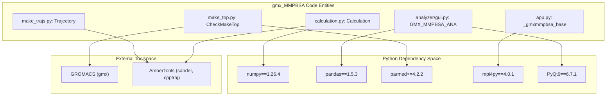
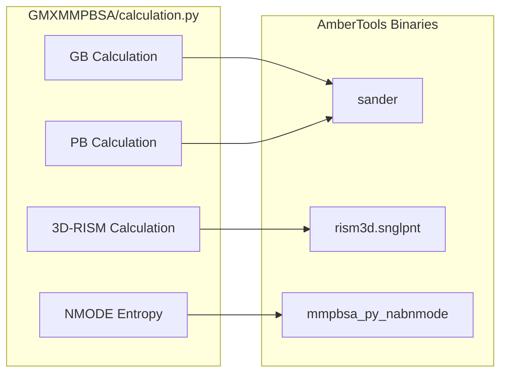

# Dependencies and Requirements

<details>
<summary>Relevant source files</summary>

The following files were used as context for generating this wiki page:

- [GMXMMPBSA/GMXMMPBSA.sh](GMXMMPBSA/GMXMMPBSA.sh)
- [GMXMMPBSA/__init__.py](GMXMMPBSA/__init__.py)
- [GMXMMPBSA/app.py](GMXMMPBSA/app.py)
- [docs/env.yml](docs/env.yml)
- [docs/examples/README.md](docs/examples/README.md)
- [docs/gmx_MMPBSA_ana_command-line.md](docs/gmx_MMPBSA_ana_command-line.md)
- [docs/gmx_MMPBSA_command-line.md](docs/gmx_MMPBSA_command-line.md)
- [docs/installation.md](docs/installation.md)
- [docs/summary.md](docs/summary.md)
- [docs/versus.md](docs/versus.md)
- [mkdocs.yml](mkdocs.yml)
- [notebooks/gmx_MMPBSA_Colab.ipynb](notebooks/gmx_MMPBSA_Colab.ipynb)
- [setup.py](setup.py)

</details>


This page provides a comprehensive reference of all dependencies required to install and run gmx_MMPBSA, including strict version requirements, optional components, and platform-specific considerations. gmx_MMPBSA is designed as a bridge between GROMACS molecular dynamics data and the AmberTools calculation suite, requiring specific versions of Python and scientific libraries to ensure numerical consistency.

---

## Core Requirements

gmx_MMPBSA has three fundamental dependencies that must be present before installation:

### Python Version Requirement

**Python 3.11 is strictly required.** This constraint is enforced at the package level in the installation script:

[setup.py:26-27]()
```python
if sys.version_info[:2] != (3, 11):
    raise RuntimeError("gmx_MMPBSA requires python == 3.11")
```

The system will refuse to install with any other Python version, including 3.10 or 3.12. This strict requirement ensures compatibility with the pinned scientific library versions used for energy calculations and statistical analysis.

### GROMACS

**Any GROMACS version is supported:** series 4.x.x, 5.x.x, or 20xx.x. The system has been tested with:
- GROMACS 4.6.7
- GROMACS 5.1.2
- GROMACS 2018.3
- GROMACS 2020.4
- GROMACS 2022.4

GROMACS must be accessible in the system `PATH` as gmx_MMPBSA invokes GROMACS utilities for processing trajectory and topology files.

Sources: [docs/installation.md:8-11](), [setup.py:41-42]()

### AmberTools

**AmberTools versions 20 or 21 (or newer via conda)** are required. AmberTools provides the core calculation engines that perform the actual MM/PB(GB)SA calculations. The following AmberTools components are critical:

- `sander`: Core engine for GB and PB energy calculations.
- `rism3d.snglpnt`: Used for 3D-RISM solvation model calculations.
- `mmpbsa_py_nabnmode`: Performs Normal Mode Analysis (NMODE) for entropy.
- `cpptraj`: Handles trajectory processing, fitting, and frame extraction.
- `antechamber`: Used for ligand parameterization via the `-lm` flag.

Sources: [docs/installation.md:9](), [GMXMMPBSA/app.py:33-37](), [GMXMMPBSA/__init__.py:31-32]()

---

## Python Scientific Stack

gmx_MMPBSA depends on a precisely versioned scientific Python stack to maintain reproducibility. All version numbers are strictly pinned in the installation configuration:

| Package | Version | Purpose |
|---------|---------|---------|
| `numpy` | 1.26.4 | Numerical arrays and linear algebra |
| `scipy` | 1.14.1 | Statistical analysis and scientific constants |
| `pandas` | 1.5.3 | Data manipulation and CSV export |
| `matplotlib` | 3.7.3 | Base charting and visualization |
| `seaborn` | 0.11.2 | Statistical data visualization |
| `mpi4py` | 4.0.1 | Parallel execution (MPI) |
| `parmed` | ≥4.2.2 | Topology conversion (GROMACS to Amber) |
| `tqdm` | (any) | Progress bars for trajectory processing |

### Key Dependencies by Subsystem

**Calculation Engine:**
- `mpi4py`: Orchestrates frame distribution across CPU cores. If run without `mpirun`, it falls back to serial mode using a internal wrapper [GMXMMPBSA/app.py:53-55]().
- `parmed`: Essential for converting GROMACS topologies to Amber format, which the `sander` engine requires [setup.py:54]().

**Statistical Analysis:**
- `scipy` and `numpy`: Used for calculating means, standard deviations, and standard errors of the mean (SEM) for binding free energies.
- `pandas`: Used to structure per-frame energy data for CSV export [setup.py:50]().

Sources: [setup.py:50-55](), [docs/env.yml:20-30](), [GMXMMPBSA/app.py:51-55]()

---

## Optional Dependencies

### GUI Components (gmx_MMPBSA_ana)

**PyQt6 (v6.7.1)** or **PyQt5** is required for the analyzer application (`gmx_MMPBSA_ana`). This is an optional dependency; the core calculation engine can run on headless HPC systems without it.

[GMXMMPBSA/app.py:124-136]()
```python
try:
    from PyQt6.QtWidgets import QApplication
    pyqt = True
except:
    try:
        from PyQt5.QtWidgets import QApplication
        pyqt = True
    except:
        pyqt = False
```

If PyQt is missing, the analyzer tool is disabled, but calculations remain functional.

Sources: [GMXMMPBSA/app.py:124-136](), [docs/env.yml:35](), [docs/installation.md:88-89]()

### Testing and Development

- **Git**: Required for `gmx_MMPBSA_test` to download example systems from the repository [docs/env.yml:32]().
- **versioneer**: Used during installation to manage version strings from Git tags [setup.py:20]().

---

## Dependency Architecture

The following diagram illustrates how the various dependencies interact with the core code entities and external tools.

**Dependency Mapping: Natural Language to Code Entities**



Sources: [setup.py:50-61](), [GMXMMPBSA/app.py:40-60](), [docs/installation.md:8-11]()

---

## AmberTools Calculation Engines

gmx_MMPBSA acts as a wrapper that prepares data for specific AmberTools binaries. The availability of these binaries in `AMBERHOME` is checked during runtime.

**Engine Orchestration Diagram**



### Binary Requirements by Feature

| Feature | Binary | Class/Function |
|---------|--------|----------------|
| **GB/PB Solvation** | `sander` | `calculation.py` |
| **3D-RISM** | `rism3d.snglpnt` | `calculation.py` |
| **Normal Modes** | `mmpbsa_py_nabnmode` | `calculation.py` |
| **Trajectory Prep** | `cpptraj` | `make_trajs.py` |
| **Topology Prep** | `tleap` / `parmed` | `make_top.py` |

Sources: [docs/summary.md:15-32](), [GMXMMPBSA/app.py:33-37](), [docs/installation.md:103-107]()

---

## Installation Method Summary

There are two primary ways to satisfy these dependencies, as detailed in the installation documentation:

1.  **Conda Environment (Recommended)**: Uses `env.yml` to automatically install Python 3.11, pinned scientific libraries, AmberTools, and GROMACS in an isolated environment.
2.  **AmberTools Compilation**: Relies on a pre-existing AmberTools installation. Users must ensure `amber.python` is used to install gmx_MMPBSA to inherit the correct environment.

Sources: [docs/installation.md:21-31](), [docs/env.yml:1-37](), [setup.py:26-27]()

---