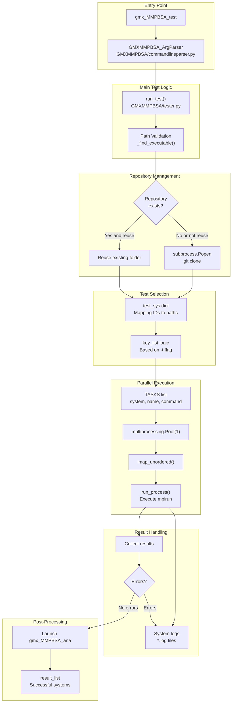
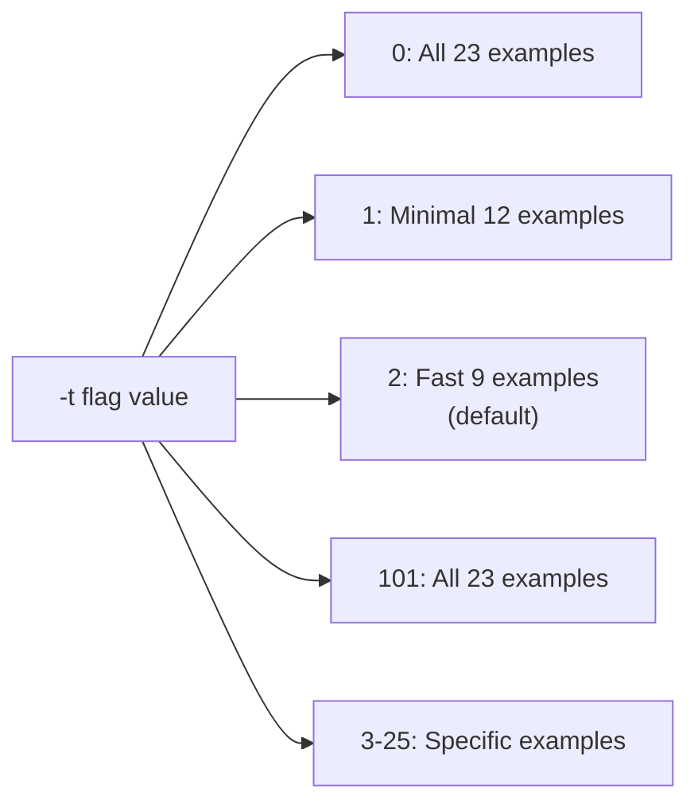

# Validation with gmx_MMPBSA_test

<details>
<summary>Relevant source files</summary>

The following files were used as context for generating this wiki page:

- [GMXMMPBSA/GMXMMPBSA.sh](GMXMMPBSA/GMXMMPBSA.sh)
- [GMXMMPBSA/commandlineparser.py](GMXMMPBSA/commandlineparser.py)
- [GMXMMPBSA/tester.py](GMXMMPBSA/tester.py)
- [docs/env.yml](docs/env.yml)
- [docs/examples/gmx_MMPBSA_test.md](docs/examples/gmx_MMPBSA_test.md)
- [docs/gmx_MMPBSA_ana_command-line.md](docs/gmx_MMPBSA_ana_command-line.md)
- [docs/gmx_MMPBSA_command-line.md](docs/gmx_MMPBSA_command-line.md)
- [docs/installation.md](docs/installation.md)
- [docs/summary.md](docs/summary.md)
- [docs/versus.md](docs/versus.md)

</details>


## Purpose and Scope

This page explains how to use the `gmx_MMPBSA_test` utility to validate your gmx_MMPBSA installation. The testing utility verifies correct installation by executing predefined calculation examples from the GitHub repository. For information about the installation process itself, see [Installation and Setup](). For details about the individual examples that can be run, see [Example Use Cases]().

`gmx_MMPBSA_test` serves as both a validation tool and a practical demonstration of gmx_MMPBSA capabilities across different molecular systems and calculation types.

---

## Overview

`gmx_MMPBSA_test` is one of three console script applications registered by gmx_MMPBSA (alongside `gmx_MMPBSA` and `gmx_MMPBSA_ana`). It automates the process of downloading example data, executing calculations, and optionally visualizing results to confirm that your installation is functioning correctly.

**Key capabilities:**

- Downloads and caches the gmx_MMPBSA repository examples.
- Executes calculations in parallel using multiprocessing.
- Automatically adapts CPU allocation based on frame count.
- Validates all calculation types (GB, PB, 3D-RISM, NMODE, decomposition, etc.).
- Launches `gmx_MMPBSA_ana` for visual result inspection.
- Provides flexible test selection (full, minimal, fast, or specific examples).

Sources: [docs/summary.md:40-48](), [docs/examples/gmx_MMPBSA_test.md:14-17](), [docs/installation.md:398-400]()

---

## Test Execution Architecture



**Diagram: Test Execution Flow**

The test utility follows a sequential workflow: command-line parsing, repository acquisition, test selection, parallel execution, and optional result visualization. Each test runs as an independent subprocess with its own log file.

Sources: [GMXMMPBSA/tester.py:80-183](), [GMXMMPBSA/commandlineparser.py:189-196](), [GMXMMPBSA/tester.py:36-44]()

---

## Command-Line Interface

The `gmx_MMPBSA_test` command-line interface provides the following options:

| Flag | Type | Default | Description |
|------|------|---------|-------------|
| `-t, --test` | list[int] | `[2]` | Test level or specific example IDs [GMXMMPBSA/commandlineparser.py:279-282]() |
| `-f, --folder` | Path | `.` | Directory to store cloned repository [GMXMMPBSA/commandlineparser.py:284-285]() |
| `-r, --reuse` | flag | `False` | Reuse existing test folder without re-cloning [GMXMMPBSA/commandlineparser.py:286-287]() |
| `-ng, --nogui` | flag | `False` | Skip launching `gmx_MMPBSA_ana` [GMXMMPBSA/commandlineparser.py:288-289]() |
| `-n, --num_processors` | int | `1` | CPUs per calculation (auto-adjusted) [GMXMMPBSA/commandlineparser.py:290-293]() |
| `-j, --num_concurrent` | int | `1` | Number of examples to run concurrently [GMXMMPBSA/commandlineparser.py:294-297]() |

**Test level selection logic:**



**Diagram: Test Selection Modes**

The `-t` flag accepts either predefined levels (0, 1, 2, 101) or specific example numbers (3-25). Multiple specific examples can be combined, e.g., `-t 3 5 7`.

Sources: [GMXMMPBSA/tester.py:136-145](), [docs/examples/gmx_MMPBSA_test.md:21-56]()

---

## Available Test Examples

The test suite contains examples organized into molecular systems and analysis methods. The mapping is defined in the `test_sys` dictionary at [GMXMMPBSA/tester.py:109-134]().

### System Examples (IDs 3-11)

| ID | System Type | Path | Frames | Slow? |
|----|-------------|------|--------|-------|
| 3 | Protein-Ligand (ST) | `examples/Protein_ligand/ST` | 10 | No |
| 4 | Protein-Protein | `examples/Protein_protein` | 10 | No |
| 5 | Protein-DNA | `examples/Protein_DNA` | 10 | No |
| 6 | Protein-Membrane | `examples/Protein_membrane` | 4 | Yes |
| 7 | Protein-Glycan | `examples/Protein_glycan` | 10 | No |
| 8 | Metalloprotein-Ligand | `examples/Metalloprotein_ligand` | 4 | Yes |
| 9 | Multicomponent | `examples/Comp_receptor` | 10 | No |
| 10 | Protein-Ligand (CHARMM) | `examples/Protein_ligand_CHARMMff` | 4 | Yes |
| 11 | Membrane (CHARMM) | `examples/Protein_membrane_CHARMMff` | 4 | Yes |

### Analysis and Advanced Examples (IDs 12-25)

| ID | Analysis/Approximation Type | Path | Slow? |
|----|-----------------------------|------|-------|
| 12 | Alanine Scanning | `examples/Alanine_scanning` | No |
| 13 | Stability | `examples/Stability` | No |
| 14 | Decomposition | `examples/Decomposition_analysis` | No |
| 15 | Interaction Entropy | `examples/Entropy_calculations/Interaction_Entropy` | No |
| 16 | Protein-Ligand (MT) | `examples/Protein_ligand/MT` | No |
| 17 | NMODE Entropy | `examples/Entropy_calculations/nmode` | Yes |
| 18 | 3D-RISM | `examples/3D-RISM` | Yes |
| 19 | C2 Entropy | `examples/Entropy_calculations/C2_Entropy` | No |
| 20 | Linear PB | `examples/Linear_PB_solver` | No |
| 21 | NonLinear PB | `examples/NonLinear_PB_solver` | No |
| 22 | CHARMM LPH atoms | `examples/Protein_ligand_LPH_atoms_CHARMMff` | No |
| 23 | QM/MMGBSA | `examples/QM_MMGBSA` | No |
| 24 | GBNSR6 | `examples/GBNSR6` | No |
| 25 | AMBER input files | `examples/AMBER` | No |

Sources: [GMXMMPBSA/tester.py:109-134](), [docs/examples/gmx_MMPBSA_test.md:30-56]()

---

## Execution Workflow Details

```mermaid
graph TB
    subgraph "Initialization Phase"
        CHECK_PATHS["_find_executable()<br/>git, gmx_MMPBSA, gmx_MMPBSA_ana"]
        CHECK_FOLDER["Validate folder<br/>parser.folder.exists()"]
    end
    
    subgraph "Repository Acquisition"
        FOLDER_CHECK{"Test folder<br/>exists?"}
        REUSE_FLAG{"-r flag<br/>set?"}
        DELETE["shutil.rmtree()<br/>Remove existing"]
        CLONE["subprocess.Popen<br/>git clone"]
        USE_EXISTING["Use existing files"]
    end
    
    subgraph "Test Preparation"
        GET_FRAMES["_get_frames()<br/>Parse mmpbsa.in"]
        BUILD_TASKS["Build TASKS list<br/>mpirun command"]
        ADAPT_CPUS["Adapt CPU count<br/>min(frames, -n)"]
    end
    
    subgraph "Parallel Execution"
        POOL_INIT["multiprocessing.Pool(parser.num_concurrent)"]
        CALCULATESTAR["calculatestar()<br/>Worker function"]
        RUN_PROCESS_FUNC["run_process()<br/>Execute subprocess"]
        WAIT["g_p.wait()<br/>Block until complete"]
    end
    
    subgraph "Result Collection"
        IMAP_COLLECT["imap_unordered()<br/>Collect results"]
        CHECK_EXIT{"exitcode<br/>!= 0?"}
        LOG_ERROR["Log ERROR with path"]
        LOG_SUCCESS["Log DONE"]
        ADD_RESULT["Append to result_list"]
    end
    
    subgraph "Finalization"
        CHECK_GUI{"nogui flag<br/>or errors?"}
        LAUNCH_ANA["subprocess.Popen<br/>gmx_MMPBSA_ana -f"]
    end
    
    CHECK_PATHS --> CHECK_FOLDER
    CHECK_FOLDER --> FOLDER_CHECK
    FOLDER_CHECK -->|Exists| REUSE_FLAG
    FOLDER_CHECK -->|Not exists| CLONE
    REUSE_FLAG -->|Yes| USE_EXISTING
    REUSE_FLAG -->|No| DELETE
    DELETE --> CLONE
    CLONE --> GET_FRAMES
    USE_EXISTING --> GET_FRAMES
    GET_FRAMES --> ADAPT_CPUS
    ADAPT_CPUS --> BUILD_TASKS
    BUILD_TASKS --> POOL_INIT
    POOL_INIT --> CALCULATESTAR
    CALCULATESTAR --> RUN_PROCESS_FUNC
    RUN_PROCESS_FUNC --> WAIT
    WAIT --> IMAP_COLLECT
    IMAP_COLLECT --> CHECK_EXIT
    CHECK_EXIT -->|Yes| LOG_ERROR
    CHECK_EXIT -->|No| LOG_SUCCESS
    LOG_SUCCESS --> ADD_RESULT
    LOG_ERROR --> CHECK_GUI
    ADD_RESULT --> CHECK_GUI
    CHECK_GUI -->|Launch| LAUNCH_ANA
    CHECK_GUI -->|Skip| END[End]
    LAUNCH_ANA --> END
```



**Diagram: Detailed Execution Workflow**

### Key Implementation Details

**Frame-based CPU allocation** ([GMXMMPBSA/tester.py:149-166]()):
The system parses each `mmpbsa.in` to determine the number of frames using `_get_frames()` [GMXMMPBSA/tester.py:58-71](). If the requested processors (`-n`) exceed the number of frames, the CPU count is capped at the frame count for that specific example.

**Concurrent Execution** ([GMXMMPBSA/tester.py:168-171]()):
`gmx_MMPBSA_test` uses a `multiprocessing.Pool` with size defined by `-j` (number of concurrent examples). Within each task, `mpirun` is used to launch `gmx_MMPBSA` with `-n` processors.

**Subprocess execution** ([GMXMMPBSA/tester.py:36-44]()):
```python
def run_process(system, sys_name, args):
    time.sleep(0.1)
    logging.info(f"{system[1]:60}{'RUNNING':>10}")
    os.chdir(system[0])
    system_log = open(f'{sys_name}.log', 'a')
    g_p = subprocess.Popen(args, stdout=system_log, stderr=system_log)
    if g_p.wait():
        return sys_name, True
    return sys_name, False
```
Each test executes in its own directory with output redirected to a log file named after the system ID.

Sources: [GMXMMPBSA/tester.py:36-183](), [GMXMMPBSA/commandlineparser.py:290-297]()

---

## Running Tests

### Basic Usage Examples

**Default (Fast test):**
```bash
gmx_MMPBSA_test -f /path/to/test_folder
```
Executes 9 fast examples sequentially using 1 CPU per calculation by default.

**Parallel examples and MPI ranks:**
```bash
gmx_MMPBSA_test -f /path/to/test_folder -t 3 5 7 -n 4 -j 2
```
Runs examples 3, 5, and 7. Executes up to 2 examples concurrently (`-j 2`), using 4 MPI ranks per example (`-n 4`).

**Minimal validation:**
```bash
gmx_MMPBSA_test -f /path/to/test_folder -t 1 -n 10
```
Runs 12 examples covering essential functionality using 10 CPUs per test.

Sources: [docs/examples/gmx_MMPBSA_test.md:82-132]()

---

## Understanding Test Output

### Console Output Format
The utility provides real-time progress updates. If a test fails, it logs an `ERROR` status and points to the specific log file [GMXMMPBSA/tester.py:175-177]().

### Log Files
Each test generates an individual log file (e.g., `3.log`) in the example's directory. This log contains the complete stdout and stderr from the `gmx_MMPBSA` run [GMXMMPBSA/tester.py:40-41]().

### Special Error Checks
The utility includes specific logic to detect known environment issues, such as `_has_known_rism_fortran_runtime_error()` [GMXMMPBSA/tester.py:47-55](), which checks for common Fortran runtime errors in 3D-RISM calculations.

### Post-Test Visualization
Unless `-ng` is specified, `gmx_MMPBSA_test` will automatically launch `gmx_MMPBSA_ana` [GMXMMPBSA/tester.py:186-191]() with all successfully completed `_info` files:
```python
if not parser.nogui and not exitcode:
    logging.info('Opening gmx_MMPBSA_ana...')
    g_p = subprocess.Popen([gmx_mmpbsa_ana_path, '-f'] + result_list,
                           stdout=subprocess.PIPE,
                           stderr=subprocess.PIPE)
```

Sources: [GMXMMPBSA/tester.py:47-55](), [GMXMMPBSA/tester.py:186-191](), [docs/examples/gmx_MMPBSA_test.md:65-119]()

---