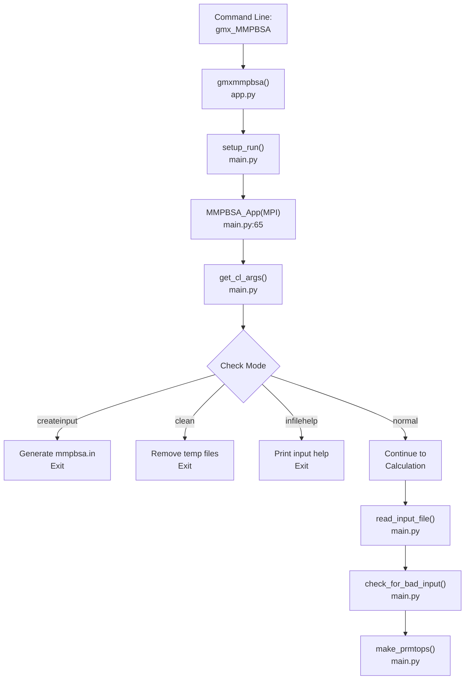
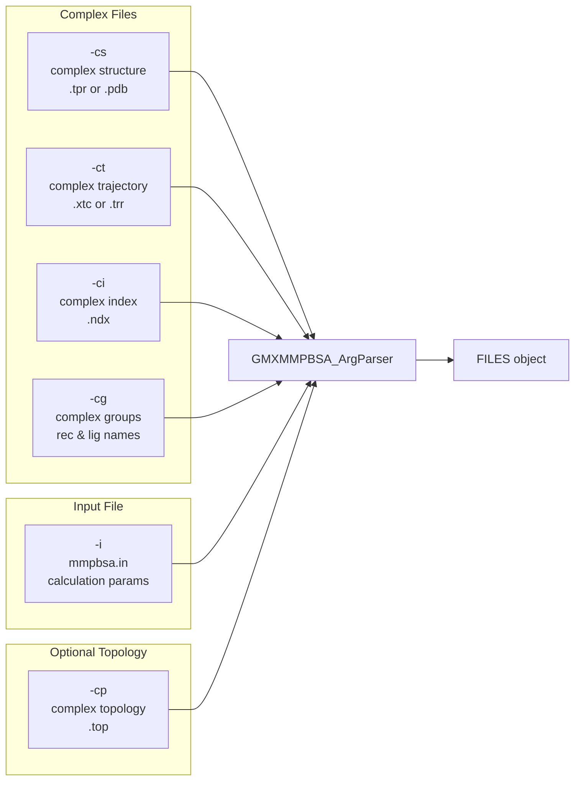
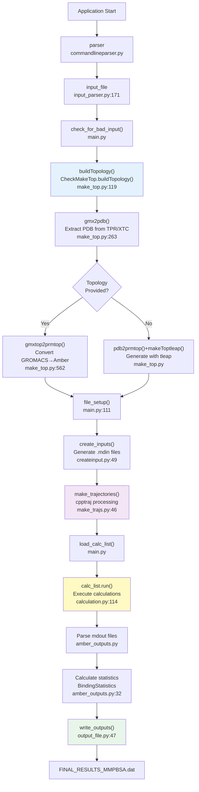
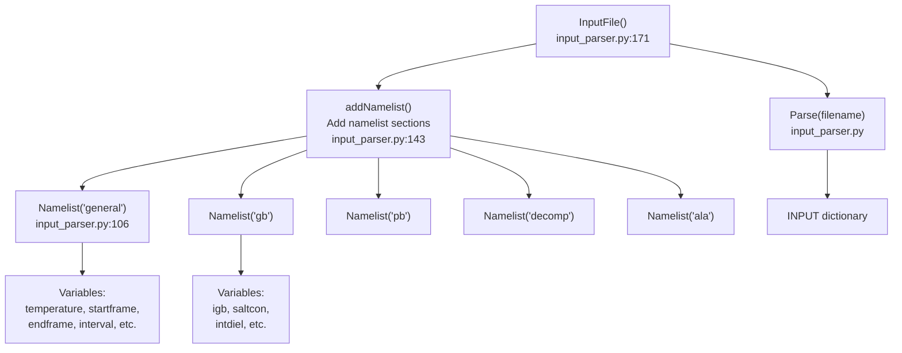
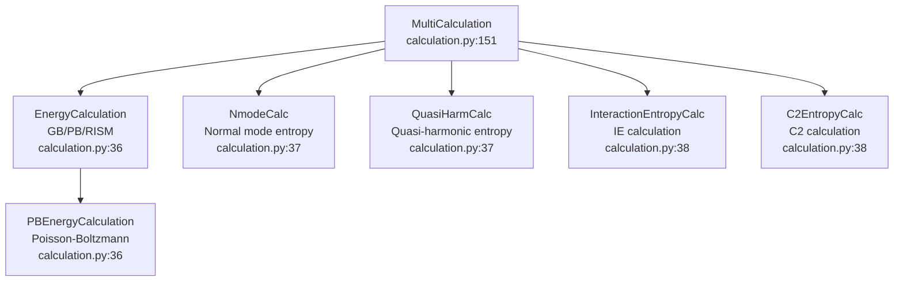

# Core Application (gmx_MMPBSA)

Relevant source files

The following files were used as context for generating this wiki page:

- [GMXMMPBSA/calculation.py](GMXMMPBSA/calculation.py)
- [GMXMMPBSA/createinput.py](GMXMMPBSA/createinput.py)
- [GMXMMPBSA/input_parser.py](GMXMMPBSA/input_parser.py)
- [GMXMMPBSA/main.py](GMXMMPBSA/main.py)
- [GMXMMPBSA/make_top.py](GMXMMPBSA/make_top.py)
- [GMXMMPBSA/utils.py](GMXMMPBSA/utils.py)
- [docs/changelog.md](docs/changelog.md)
- [docs/compatibility.md](docs/compatibility.md)
- [docs/gmx_MMPBSA_running.md](docs/gmx_MMPBSA_running.md)
- [docs/input_file.md](docs/input_file.md)
- [docs/news.json](docs/news.json)

## Purpose and Scope

This page documents the core calculation engine of `gmx_MMPBSA`, which orchestrates the end-to-end workflow from GROMACS input files to binding free energy results. The core application performs topology conversion, trajectory preparation, calculation execution using AmberTools engines, and statistical analysis of results.

For installation procedures, see [Installation and Setup](#2). For the graphical analyzer application, see [Analyzer Application (gmx_MMPBSA_ana)](#4). For input file configuration details, see [Input File Configuration](#3.2).

---

## Application Entry Point and Initialization

The `gmx_MMPBSA` application begins execution through the `gmxmmpbsa()` function, which serves as the main entry point after command-line invocation.

### Entry Flow

**Sources:** [GMXMMPBSA/main.py:65-110]()

### MMPBSA_App Class

The `MMPBSA_App` class in [GMXMMPBSA/main.py:65-110]() is the central orchestrator that manages:

- **MPI Communication**: Coordinates parallel execution across multiple processes via `mpi4py` or a `FakeMPI` fallback [GMXMMPBSA/main.py:58-60]().
- **Timing**: Tracks execution time for profiling via `Timer` objects [GMXMMPBSA/main.py:103-104]().
- **File Management**: Maintains `FILES` object with all input/output file paths.
- **Input Configuration**: Stores parsed input in `INPUT` dictionary [GMXMMPBSA/main.py:81]().

| Attribute | Type | Purpose |
|-----------|------|---------|
| `MPI` | MPI object | MPI communication handler [GMXMMPBSA/main.py:79]() |
| `mpi_rank` | int | Process rank (0 = master) [GMXMMPBSA/main.py:93]() |
| `mpi_size` | int | Total number of MPI processes [GMXMMPBSA/main.py:95]() |
| `INPUT` | dict | Parsed input file parameters [GMXMMPBSA/main.py:81]() |
| `master` | bool | True if rank == 0 [GMXMMPBSA/main.py:94]() |

**Sources:** [GMXMMPBSA/main.py:65-110]()

---

## Command-Line Interface

The command-line interface is defined by `GMXMMPBSA_ArgParser` in `commandlineparser.py`, which parses arguments into a `FILES` object.

### Required Arguments

**Sources:** [GMXMMPBSA/main.py:68-69](), [GMXMMPBSA/make_top.py:114-118]()

---

## Calculation Workflow

The core application follows a linear pipeline from input processing to result generation, orchestrated by the `MMPBSA_App` class.

### Workflow Diagram

**Sources:** [GMXMMPBSA/main.py:111-150](), [GMXMMPBSA/make_top.py:119-261](), [GMXMMPBSA/calculation.py:88-148](), [GMXMMPBSA/createinput.py:49-61]()

---

## Input File Parsing

Input file parsing converts the AMBER-style namelist format into a Python dictionary structure.

### InputFile Class Architecture

The `Namelist` class [GMXMMPBSA/input_parser.py:106-160]() holds many different `Variable` instances. Each `Variable` object [GMXMMPBSA/input_parser.py:30-104]() has a name, datatype, default value, and description.

**Sources:** [GMXMMPBSA/input_parser.py:30-171](), [docs/input_file.md:116-142]()

---

## Topology Generation

The `CheckMakeTop` class [GMXMMPBSA/make_top.py:76-112]() manages the conversion from GROMACS topology files to AMBER prmtop format.

### Force Field Handling

The topology generation supports multiple force fields and assigns `PBRadii` [GMXMMPBSA/make_top.py:55]():

| ID | PBRadii Set | Source |
|----|-------------|--------|
| 1 | bondi | AmberTools |
| 2 | mbondi | AmberTools |
| 3 | mbondi2 | AmberTools |
| 7 | charmm_radii | CHARMM |

**Sources:** [GMXMMPBSA/make_top.py:55](), [GMXMMPBSA/make_top.py:562-606]()

---

## Calculation Execution

The `CalculationList` class [GMXMMPBSA/calculation.py:88-148]() manages sequential execution of all calculations.

### Calculation Type Hierarchy

**Sources:** [GMXMMPBSA/calculation.py:36-151]()

---

## Output Processing and Statistics

Output processing parses raw calculation results and computes binding statistics using the `EnergyVector` system.

### EnergyVector Class

The `EnergyVector` class [GMXMMPBSA/utils.py:52-151]() extends `np.ndarray` to store per-frame energies with statistical methods:

| Method | Description | Implementation |
|--------|-------------|---------|
| `avg()` | Average energy | `np.average(self)` [GMXMMPBSA/utils.py:98-99]() |
| `stdev()` | Propagated SD | `self.com_std or self.std()` [GMXMMPBSA/utils.py:86-87]() |
| `sem()` | Standard error | `self.std() / sqrt(len(self))` [GMXMMPBSA/utils.py:89-90]() |
| `corr_add()` | Correlated sum | `get_corrstd()` [GMXMMPBSA/utils.py:101-107]() |

**Sources:** [GMXMMPBSA/utils.py:52-159]()

### Final Output Generation

The `write_outputs()` function [GMXMMPBSA/output_file.py:47]() generates final result files, including `FINAL_RESULTS_MMPBSA.dat` and binary `.mmxsa` files for the GUI.

**Sources:** [GMXMMPBSA/output_file.py:47](), [GMXMMPBSA/main.py:47]()

---

## MPI Parallelization

The core application supports MPI-based parallelization for frame-parallel calculations.

### Frame Distribution Strategy

Each MPI rank processes a subset of trajectory frames. The `CalculationList.run()` method [GMXMMPBSA/calculation.py:114-148]() iterates through calculations, where each rank executes the `calc.run(rank)` command [GMXMMPBSA/calculation.py:142]().

The progress is tracked via `tqdm` in a separate thread for PB/GB calculations [GMXMMPBSA/calculation.py:53-87]().

**Sources:** [GMXMMPBSA/calculation.py:53-148](), [GMXMMPBSA/main.py:92-101]()

---

## Error Handling

Custom exceptions are defined in `exceptions.py` to handle various failure modes:

- `GMXMMPBSA_ERROR`: General failure exit [GMXMMPBSA/exceptions.py:45]().
- `InputError`: Raised during namelist/variable parsing [GMXMMPBSA/input_parser.py:25]().
- `CalcError`: Raised when a subprocess calculation fails [GMXMMPBSA/calculation.py:41]().

**Sources:** [GMXMMPBSA/exceptions.py:25-45](), [GMXMMPBSA/calculation.py:41]()

---