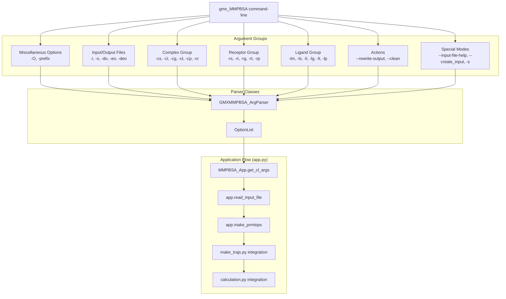
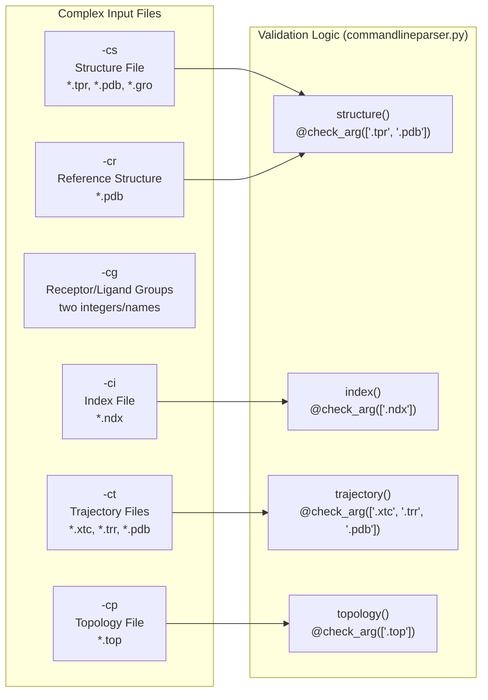
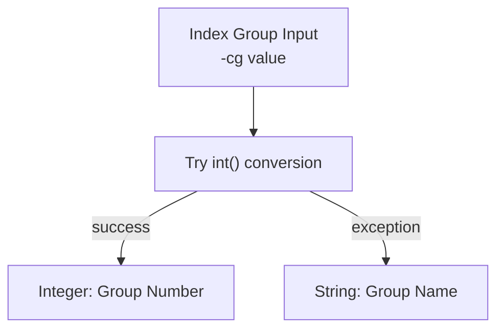
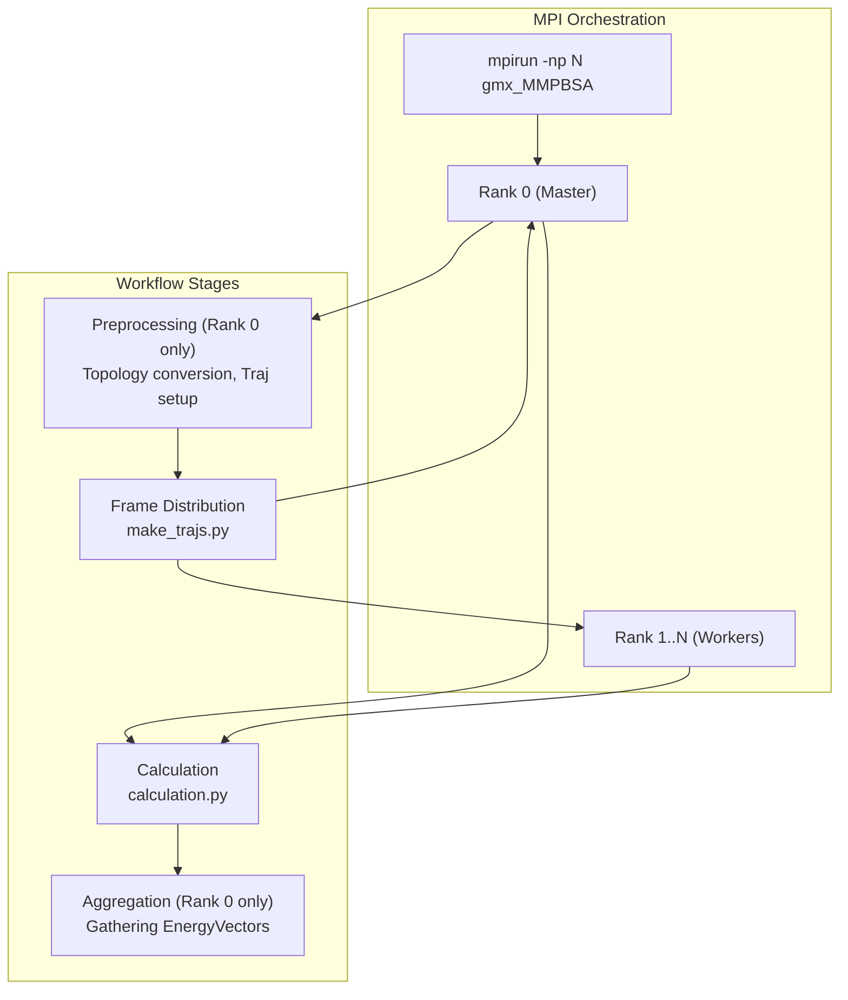

# Command-Line Interface

<details>
<summary>Relevant source files</summary>

The following files were used as context for generating this wiki page:

- [GMXMMPBSA/GMXMMPBSA.sh](GMXMMPBSA/GMXMMPBSA.sh)
- [GMXMMPBSA/commandlineparser.py](GMXMMPBSA/commandlineparser.py)
- [GMXMMPBSA/tester.py](GMXMMPBSA/tester.py)
- [docs/env.yml](docs/env.yml)
- [docs/examples/gmx_MMPBSA_test.md](docs/examples/gmx_MMPBSA_test.md)
- [docs/gmx_MMPBSA_ana_command-line.md](docs/gmx_MMPBSA_ana_command-line.md)
- [docs/gmx_MMPBSA_command-line.md](docs/gmx_MMPBSA_command-line.md)
- [docs/installation.md](docs/installation.md)
- [docs/summary.md](docs/summary.md)
- [docs/versus.md](docs/versus.md)

</details>


This page documents the command-line interface for the core `gmx_MMPBSA` calculation application. It covers all available flags, required and optional input files, file format requirements, and execution modes (serial vs MPI parallel).

For information about the analyzer GUI application command-line, see [4.1](). For information about the testing utility command-line, see [2.2]().

## Overview

The `gmx_MMPBSA` command-line interface is defined in [GMXMMPBSA/commandlineparser.py:189-204]() using the `GMXMMPBSA_ArgParser` class, which extends Python's `ArgumentParser`. The application entry point in [GMXMMPBSA/app.py:40-112]() processes these arguments through the `MMPBSA_App` class.

Title: Command-Line Processing Architecture

**Sources:** [GMXMMPBSA/commandlineparser.py:189-204](), [GMXMMPBSA/app.py:40-112]()

## Argument Groups and Options

The command-line arguments are organized into logical groups. The following sections detail each group and its options.

### Miscellaneous Options

| Flag | Type | Default | Description |
|------|------|---------|-------------|
| `-O`, `--overwrite` | boolean | `False` | Allow output files to be overwritten |
| `-prefix` | string | `'_GMXMMPBSA_'` | Prefix for intermediate temporary files |
| `-sys_name` | string | `None` | System name. Overrides `sys_name` in the input file. |

**Sources:** [docs/gmx_MMPBSA_command-line.md:35-40]()

### Input and Output Files

| Flag | Type | Default | Required | Description |
|------|------|---------|----------|-------------|
| `-i` | file path | `None` | Yes | MM/PBSA input file containing calculation parameters |
| `-xvvfile` | file path | auto-detected | No | XVV solvent susceptibility file for 3D-RISM calculations |
| `-o` | file path | `'FINAL_RESULTS_MMPBSA.dat'` | No | Main output file with statistics |
| `-do` | file path | `'FINAL_DECOMP_MMPBSA.dat'` | No | Decomposition statistics output |
| `-eo` | file path | `None` | No | CSV-format per-frame energy output |
| `-deo` | file path | `None` | No | CSV-format per-residue decomposition output |
| `-nogui` | boolean | `True` | No | If True, does not open `gmx_MMPBSA_ana` after finish |
| `-s`, `--stability` | boolean | `False` | No | Perform stability calculation |

The `-xvvfile` default is determined at runtime in [GMXMMPBSA/commandlineparser.py:44-53]() by searching for the TIP3P XVV file in `$AMBERHOME` or falling back to the bundled file.

**Sources:** [GMXMMPBSA/commandlineparser.py:44-53](), [docs/gmx_MMPBSA_command-line.md:42-67]()

### Complex Group (Required)

The complex group contains the primary system files. At minimum, `-cs`, `-ci`, and `-cg` must be provided unless performing a stability calculation.

Title: Complex Input Validation Flow


| Flag | Format | Required | Description |
|------|--------|----------|-------------|
| `-cs` | `*.tpr`, `*.pdb`, `*.gro` | Yes | Complex structure file |
| `-ci` | `*.ndx` | Yes | GROMACS index file for the complex |
| `-cg` | `int int` | Yes | Receptor and ligand group numbers/names from index file |
| `-ct` | `*.xtc`, `*.trr`, `*.pdb` | Yes | Complex trajectory (multiple files allowed) |
| `-cp` | `*.top` | No | Complex Topology file. If defined, `-lm` is not needed. |
| `-cr` | `*.pdb` | No | Complex Reference Structure file for chain ID assignment. |

The argument type validators are implemented as decorators in [GMXMMPBSA/commandlineparser.py:56-66](). For example, the `structure()` validator at [GMXMMPBSA/commandlineparser.py:69-71]() ensures files exist and match required extensions.

**Sources:** [GMXMMPBSA/commandlineparser.py:56-71](), [docs/gmx_MMPBSA_command-line.md:69-95]()

### Receptor and Ligand Groups (Optional)

Required for multiple trajectory (MT) approach. If not provided, receptor and ligand info is generated from the complex.

| Flag | Format | Description |
|------|--------|-------------|
| `-rs` | `*.tpr`, `*.pdb` | Unbound receptor structure file |
| `-ri` | `*.ndx` | Receptor index file |
| `-rg` | `int` | Receptor group in receptor index file |
| `-rt` | `*.xtc`, `*.trr`, `*.pdb` | Receptor trajectory files |
| `-rp` | `*.top` | Receptor topology file |
| `-lm` | `*.mol2` | MOL2 file of unbound ligand (required for small molecules without topology) |
| `-ls` | `*.tpr`, `*.pdb` | Unbound ligand structure file |
| `-li` | `*.ndx` | Ligand index file |
| `-lg` | `int` | Ligand group in ligand index file |
| `-lt` | `*.xtc`, `*.trr`, `*.pdb` | Ligand trajectory files |
| `-lp` | `*.top` | Ligand topology file |

The `-lm` option is critical for small molecule ligands not parameterized in standard force fields [docs/gmx_MMPBSA_command-line.md:117-120]().

**Sources:** [docs/gmx_MMPBSA_command-line.md:97-133]()

### Special Actions and Modes

| Flag | Description |
|------|-------------|
| `--input-file-help` | Print all available options in the input file and exit |
| `--create_input` | Create a new input file with selected calculation type (`gb`, `pb`, `rism`, `ala`, `decomp`, `nmode`, `all`) |
| `--rewrite-output` | Skip calculations and reparse existing output files |
| `--clean` | Remove temporary files and exit |

**Sources:** [docs/gmx_MMPBSA_command-line.md:28-33](), [docs/gmx_MMPBSA_command-line.md:136-142]()

## Index Group Specification

The `-cg`, `-rg`, and `-lg` flags accept either **integer indices** or **group names** from the index file. This is handled by the `index_groups()` function:

Title: Group Index Parsing Logic


The conversion logic is defined in [GMXMMPBSA/commandlineparser.py:112-117]():
```python
def index_groups(value):
    try:
        return int(value)
    except Exception:
        return value
```

**Sources:** [GMXMMPBSA/commandlineparser.py:112-117]()

## Execution Modes

### Serial Execution

The basic serial execution runs all preprocessing and calculations on a single process:

```bash
gmx_MMPBSA -O -i mmpbsa.in -cs com.tpr -ci index.ndx -cg 1 13 -ct com_traj.xtc
```

### MPI Parallel Execution

`gmx_MMPBSA` supports MPI for parallel frame processing. The application detects the MPI environment at startup in [GMXMMPBSA/app.py:53-55]().

Title: Parallel Execution Data Flow


**Key characteristics of MPI execution:**
- Preprocessing (topology generation) is performed by Rank 0.
- Trajectory frames are distributed across available MPI ranks.
- If the number of frames is less than the number of CPUs, the number of processors used will be equal to the number of frames [docs/examples/gmx_MMPBSA_test.md:61-64]().
- Normal mode calculations (`NMODE`) require significant memory per rank.

**Sources:** [GMXMMPBSA/app.py:53-55](), [docs/examples/gmx_MMPBSA_test.md:61-64]()

## Error Handling

Custom error handling is implemented through the `GMXMMPBSA_ArgParser.exit()` method at [GMXMMPBSA/commandlineparser.py:191-195]():

```python
def exit(self, status=0, message=None):
    if message:
        GMXMMPBSA_ERROR(message)
    sys.exit(status)
```

This ensures that command-line errors are logged via the `GMXMMPBSA_ERROR` exception before the application exits.

**Sources:** [GMXMMPBSA/commandlineparser.py:191-195](), [GMXMMPBSA/exceptions.py:28]()

## Testing Utility (gmx_MMPBSA_test)

The `gmx_MMPBSA_test` utility provides its own CLI for running validation examples.

| Flag | Description |
|------|-------------|
| `-t` | Test level (0=All, 1=Minimal, 2=Fast) or specific test numbers (3-25) |
| `-f` | Folder to store data |
| `-r` | Reuse existing test folder |
| `-n` | Number of processors for MPI per calculation |
| `-j` | Number of examples to run concurrently |

The mapping of test numbers to systems (e.g., 3: Protein-Ligand ST, 4: Protein-Protein) is defined in [GMXMMPBSA/tester.py:109-134]().

**Sources:** [GMXMMPBSA/tester.py:109-134](), [docs/examples/gmx_MMPBSA_test.md:10-68]()

---