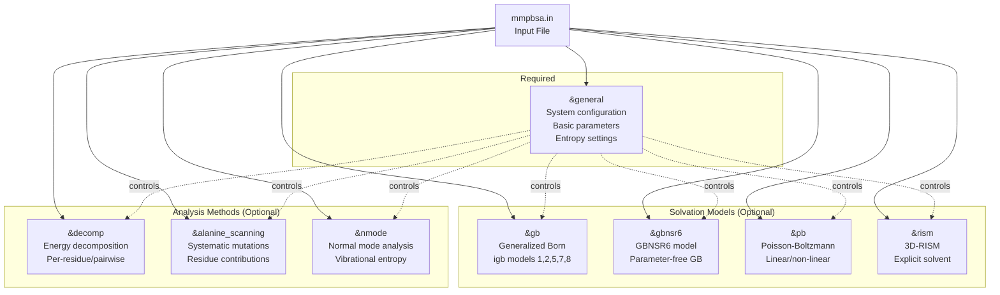
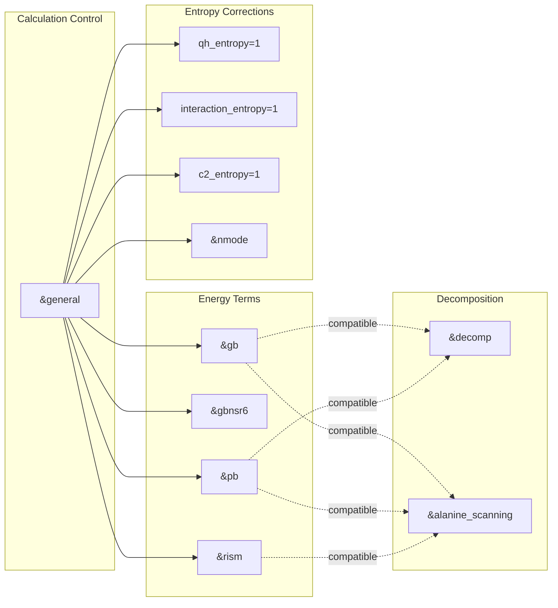
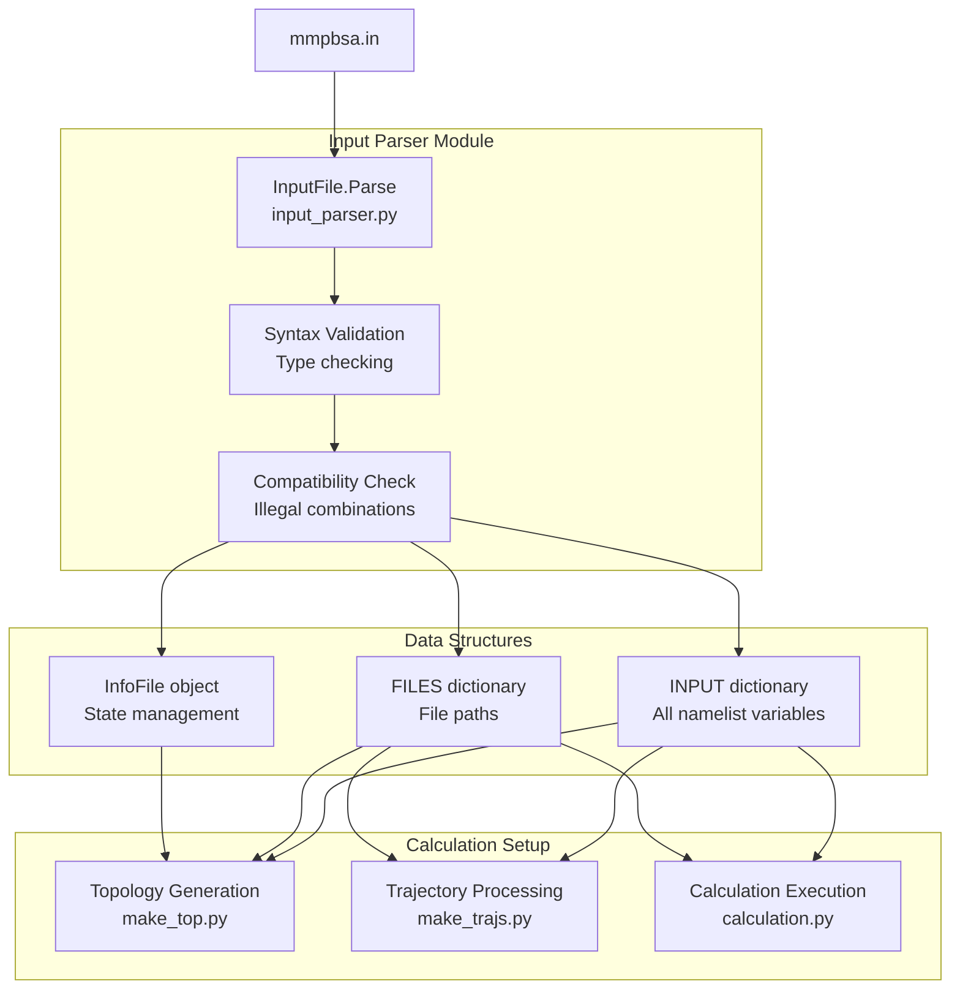

# Input File Configuration

<details>
<summary>Relevant source files</summary>

The following files were used as context for generating this wiki page:

- [GMXMMPBSA/calculation.py](GMXMMPBSA/calculation.py)
- [GMXMMPBSA/createinput.py](GMXMMPBSA/createinput.py)
- [GMXMMPBSA/input_parser.py](GMXMMPBSA/input_parser.py)
- [docs/changelog.md](docs/changelog.md)
- [docs/compatibility.md](docs/compatibility.md)
- [docs/gmx_MMPBSA_running.md](docs/gmx_MMPBSA_running.md)
- [docs/input_file.md](docs/input_file.md)
- [docs/news.json](docs/news.json)

</details>


## Purpose and Scope

The input file (conventionally named `mmpbsa.in`) is the primary configuration interface for gmx_MMPBSA calculations. This file uses an AMBER-style namelist format with GROMACS-inspired syntax improvements to specify all calculation parameters, solvation models, entropy methods, and analysis options. This document describes the structure, syntax, and organization of the input file.

For command-line options and execution modes, see [Command-Line Interface](3.1). For information about how the input file drives the calculation workflow, see [Calculation Workflow](3.3).

---

## Input File Format and Syntax

The input file uses a **namelist-based structure** derived from AMBER's MMPBSA.py, but with syntax enhancements that make it more familiar to GROMACS users. Each namelist groups related parameters for specific calculation types or general settings.

### Basic Syntax Rules

```yaml
# Comments start with hash
&namelist_name
variable_name = value       # Individual assignment
variable2 = value2          # Comma optional on separate lines
variable3 = value3, variable4 = value4  # Comma required on same line
/                          # Namelist terminator
```

**Key syntax features:**

- Variables can be on separate lines (no comma needed) or same line (comma required) [docs/input_file.md:67-69]()
- Strings must be quoted (single or double quotes) [docs/input_file.md:67-68]()
- Integers and floats are typed as-is [docs/input_file.md:66-67]()
- Comments use `#` character [docs/input_file.md:79-81]()
- Each namelist ends with `/` [docs/input_file.md:86-93]()

### Format Comparison

gmx_MMPBSA supports both traditional AMBER format and a more readable GROMACS-style format:

**New Format (Recommended):**
```yaml
&general
  sys_name             = "MySystem"
  startframe           = 1
  endframe             = 100
  interval             = 5
/
```

**Traditional Format:**
```yaml
&general
  sys_name = "MySystem", startframe = 1,
  endframe = 100, interval = 5
/
```

Both formats are equivalent and can be mixed within the same file [docs/input_file.md:73-74]().

**Sources:** [docs/input_file.md:64-113]()

---

## Namelist Architecture

The input file is organized into **eight primary namelists**, each controlling a distinct aspect of the calculation. The `&general` namelist is always required, while others are optional and determine which calculations are performed.

### Namelist Organization Diagram



**Sources:** [docs/input_file.md:10-26]()

### Namelist Interaction Model



**Multiple calculations** can be performed in the same run by including multiple namelists. For example, a single input file can specify both `&gb` and `&pb` calculations, with or without `&decomp` analysis [docs/input_file.md:70-71]().

**Sources:** [docs/input_file.md:70-71]()

---

## Available Namelists

### `&general` - System Configuration

**Purpose:** Contains variables applicable to all calculations, including basic parameters, force field specification, entropy settings, and file management options [docs/input_file.md:15-16]().

**Key variable categories:**

| Category | Example Variables | Purpose |
|----------|------------------|---------|
| Frame selection | `startframe`, `endframe`, `interval` | Define trajectory subset [docs/input_file.md:131-141]() |
| Force fields | `forcefields`, `PBRadii`, `ions_parameters` | Topology generation [docs/input_file.md:145-424]() |
| Entropy methods | `qh_entropy`, `interaction_entropy`, `c2_entropy` | Entropy approximations [docs/input_file.md:435-467]() |
| System metadata | `sys_name`, `exp_ki`, `temperature` | Analysis and correlation [docs/input_file.md:120-123]() |
| File management | `keep_files`, `netcdf`, `solvated_trajectory` | Output control [docs/input_file.md:470-520]() |

**Sources:** [docs/input_file.md:116-555]()

### `&gb` - Generalized Born Calculations

**Purpose:** Parameters specific to GB implicit solvent calculations [docs/input_file.md:17]().

**Key parameters:**
- `igb`: GB model selection (1=GB-HCT, 2=GB-OBC1, 5=GB-OBC2, 7=GB-Neck, 8=GB-Neck2) [docs/input_file.md:559-573]()
- `alpb`: Analytical Linearized Poisson-Boltzmann approximation [docs/input_file.md:586-590]()
- `saltcon`: Salt concentration (M) [docs/input_file.md:575-577]()
- `intdiel`/`extdiel`: Internal/external dielectric constants [docs/input_file.md:579-584]()
- `ifqnt`: Enable QM/MM calculations [docs/input_file.md:642-644]()

**QM/MM support:** The `&gb` namelist uniquely supports quantum mechanics via `ifqnt=1`, enabling QM/MMGBSA calculations [docs/input_file.md:642]().

**Sources:** [docs/input_file.md:556-811]()

### `&gbnsr6` - GBNSR6 Model

**Purpose:** Parameter-free GB model using numerical "R6" integration over molecular surface [docs/input_file.md:18]().

**Key features:**
- Parameter-free (accuracy unaffected by atomic radii choice)
- Numerically computed Born radii
- More accurate relative to PB standard [docs/changelog.md:69-72]()

**Main parameters:**
- `istrng`: Ionic strength (M) [docs/input_file.md:818-821]()
- `indi`/`exdi`: Internal/external dielectric [docs/input_file.md:823-828]()
- `surften`/`offset`: Non-polar solvation [docs/input_file.md:851-857]()

**Sources:** [docs/input_file.md:813-982](), [docs/changelog.md:69-72]()

### `&pb` - Poisson-Boltzmann Calculations

**Purpose:** Parameters for finite-difference Poisson-Boltzmann calculations [docs/input_file.md:19]().

**Key parameters:**
- `ipb`: PB solver (1=boundary, 2=focusing) [docs/input_file.md:987-991]()
- `inp`: Non-polar solvation (1=cavity+dispersion, 2=SASA-based) [docs/input_file.md:1001-1006]()
- `indi`/`exdi`: Dielectric constants [docs/input_file.md:1016-1025]()
- `istrng`: Ionic strength [docs/input_file.md:1033-1036]()
- `fillratio`: Grid fill ratio [docs/input_file.md:1052-1055]()
- `radiopt`: Atomic radii set (0=parse from prmtop) [docs/input_file.md:1086-1090]()
- `sander_apbs`: Use APBS solver [docs/input_file.md:1396-1398]()

**Membrane proteins:** PB supports heterogeneous dielectric profiles for membrane systems via `memopt` and related parameters [docs/input_file.md:1316-1376]().

**Sources:** [docs/input_file.md:984-1398]()

### `&rism` - 3D-RISM Calculations

**Purpose:** Three-dimensional Reference Interaction Site Model for explicit solvent effects [docs/input_file.md:20]().

**Key parameters:**
- `closure`: Closure approximation ("kh"=Kovalenko-Hirata, "hnc", "pse-n") [docs/input_file.md:1403-1409]()
- `tolerance`: Convergence criterion [docs/input_file.md:1434-1437]()
- `polardecomp`: Polar/non-polar decomposition [docs/input_file.md:1425-1428]()
- `rism_verbose`: Output verbosity [docs/input_file.md:1416-1419]()
- `buffer`: Solvent buffer distance [docs/input_file.md:1447-1450]()

**Sources:** [docs/input_file.md:1400-1817]()

### `&alanine_scanning` - Systematic Mutations

**Purpose:** Perform computational alanine/glycine scanning to identify critical residues [docs/input_file.md:21-22]().

**Key parameters:**
- `mutant`: Target amino acid (ALA or GLY) [docs/input_file.md:1822-1825]()
- `mutant_res`: Residues to mutate (selection syntax) [docs/input_file.md:1827-1831]()
- `cas_intdiel`: Adaptive internal dielectric for charged residues [docs/input_file.md:1840-1845]()

**Selection syntax:** Supports `CHAIN/RESNUM` notation and ranges, e.g., `"A/5-10,15,B/23"` [docs/input_file.md:1827-1831]().

**Sources:** [docs/input_file.md:1819-1954]()

### `&decomp` - Energy Decomposition

**Purpose:** Decompose binding energy into per-residue or per-residue-pairwise contributions [docs/input_file.md:23]().

**Key parameters:**
- `idecomp`: Decomposition scheme (1=per-residue, 2=per-residue with 1-4, 3=pairwise, 4=pairwise with 1-4) [docs/input_file.md:1959-1971]()
- `dec_verbose`: Output verbosity (0-3) [docs/input_file.md:1973-1976]()
- `print_res`: Residue selection for output [docs/input_file.md:1978-2016]()
- `csv_format`: CSV output format [docs/input_file.md:2131-2134]()

**Selection schemes:**

| Syntax | Example | Description |
|--------|---------|-------------|
| Individual | `"5,10,15"` | Specific residue numbers [docs/input_file.md:1995-1996]() |
| Ranges | `"5-10"` | Residue range (inclusive) [docs/input_file.md:1998-1999]() |
| By distance | `"within 5"` | Residues within 5Å of interface [docs/input_file.md:2004-2005]() |
| Chains | `"A/5-10"` | Chain-specific selection [docs/input_file.md:2001-2002]() |

**Sources:** [docs/input_file.md:1956-2134]()

### `&nmode` - Normal Mode Analysis

**Purpose:** Calculate vibrational entropy via normal mode analysis [docs/input_file.md:24-25]().

**Key parameters:**
- `nmstartframe`, `nmendframe`, `nminterval`: Frame subset for NMODE [docs/input_file.md:2139-2155]()
- `maxcyc`: Maximum minimization cycles [docs/input_file.md:2157-2160]()
- `drms`: Convergence criterion (kcal/mol/Å) [docs/input_file.md:2162-2165]()
- `dielc`: Distance-dependent dielectric constant [docs/input_file.md:2172-2175]()

**Sources:** [docs/input_file.md:2136-2254]()

---

## Variable Types and Organization

### &general Namelist Categories

```mermaid
graph TB
    General["&general Namelist"]
    
    subgraph "Basic Input"
        Frame["Frame Selection<br/>startframe<br/>endframe<br/>interval"]
        System["System Naming<br/>sys_name<br/>exp_ki"]
    end
    
    subgraph "Topology Parameters"
        FF["Force Fields<br/>forcefields<br/>PBRadii<br/>ions_parameters"]
        Temp["Temperature<br/>temperature"]
    end
    
    subgraph "Entropy Options"
        QH["qh_entropy"]
        IE["interaction_entropy<br/>ie_segment"]
        C2["c2_entropy"]
    end
    
    subgraph "File Management"
        Keep["keep_files"]
        NetCDF["netcdf"]
        Solv["solvated_trajectory"]
        Verb["verbose"]
    end
    
    subgraph "Advanced"
        Chain["assign_chainID"]
        GMXPath["gmx_path"]
        Full["full_traj"]
    end
    
    General --> Frame
    General --> System
    General --> FF
    General --> Temp
    General --> QH
    General --> IE
    General --> C2
    General --> Keep
    General --> NetCDF
    General --> Solv
    General --> Verb
    General --> Chain
    General --> GMXPath
    General --> Full
```



**Sources:** [docs/input_file.md:118-555]()

### Force Field Specification

The `forcefields` variable in `&general` uses a **comma-separated list** of force field leaprc files [docs/input_file.md:145-149]():

```yaml
&general
forcefields="leaprc.protein.ff14SB,leaprc.DNA.bsc1,leaprc.gaff2"
/
```

**Supported force field families:**

| Family | Example | Purpose |
|--------|---------|---------|
| Protein | `leaprc.protein.ff14SB` | Protein force fields [docs/input_file.md:165]() |
| DNA | `leaprc.DNA.bsc1` | DNA-specific parameters [docs/input_file.md:165]() |
| Ligands | `leaprc.gaff2` | General Amber Force Field [docs/input_file.md:177]() |
| Glycans | `leaprc.GLYCAM_06j-1` | Carbohydrate force fields [docs/input_file.md:195]() |

**Sources:** [docs/input_file.md:145-234]()

---

## Input File Processing

The input file is parsed by the `InputFile` class in the `input_parser` module, which validates syntax and populates data structures.

### Parsing Flow Diagram



**Sources:** [GMXMMPBSA/input_parser.py]()

### Key Parsing Classes and Methods

**`Variable` class** [GMXMMPBSA/input_parser.py:30-103]():
- Handles individual parameter types (int, float, str, list).
- `SetValue()`: Casts raw input strings to the appropriate Python data type.

**`Namelist` class** [GMXMMPBSA/input_parser.py:106-174]():
- Groups variables into sections (e.g., `&gb`).
- `addVariable()`: Defines expected variables for a specific namelist.

**`InputFile` class** [GMXMMPBSA/input_parser.py:177-405]():
- `Parse()`: The core method that reads the physical file and populates namelists.
- Implements compatibility checks (e.g., verifying `igb` values are valid).

**Sources:** [GMXMMPBSA/input_parser.py]()

### Error Handling

Invalid input files trigger specific exceptions:

| Exception | Trigger |
|-----------|---------|
| `InputError` | Syntax errors, unknown variables, or duplicate definitions [GMXMMPBSA/input_parser.py:154]() |
| `InternalError` | Developer errors like duplicated variable definitions in a namelist [GMXMMPBSA/input_parser.py:148]() |

---

## Input File Generation

gmx_MMPBSA can generate template input files using the `--create_input` option [docs/input_file.md:30-33]():

```bash
# Generate specific calculation types
gmx_MMPBSA --create_input gb          # GB only
gmx_MMPBSA --create_input pb decomp   # PB with decomposition
gmx_MMPBSA --create_input all         # All calculation types
```

**Sources:** [docs/input_file.md:29-62]()

---