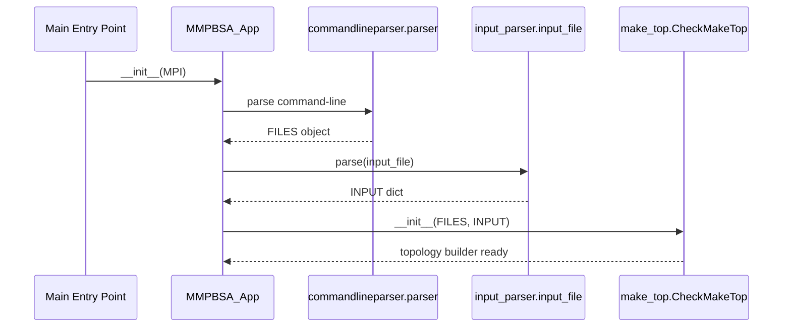
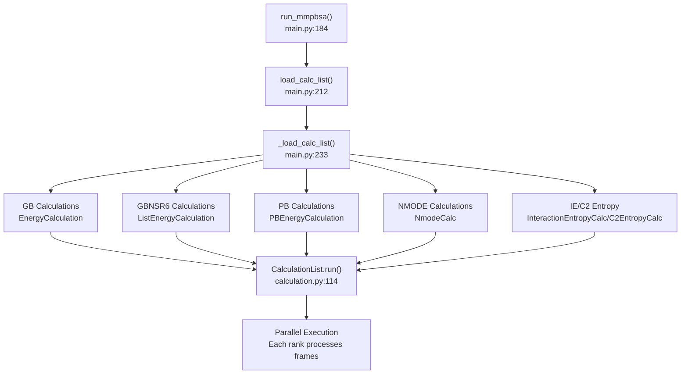
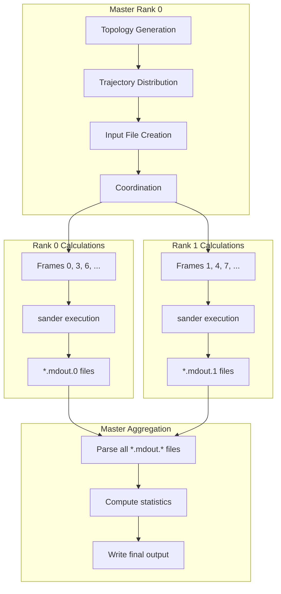
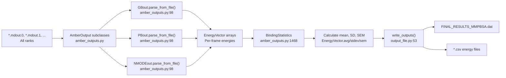
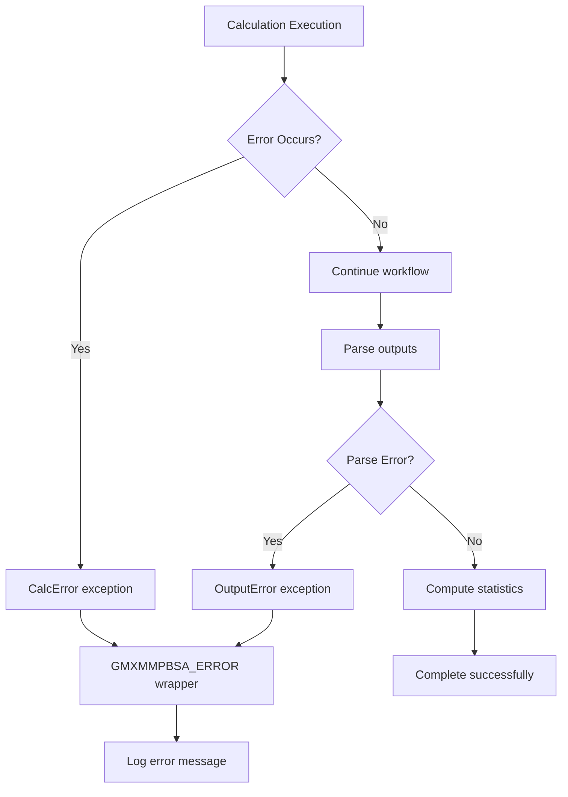

# Calculation Workflow

Relevant source files

The following files were used as context for generating this wiki page:

- [GMXMMPBSA/API.py](GMXMMPBSA/API.py)
- [GMXMMPBSA/amber_outputs.py](GMXMMPBSA/amber_outputs.py)
- [GMXMMPBSA/calculation.py](GMXMMPBSA/calculation.py)
- [GMXMMPBSA/createinput.py](GMXMMPBSA/createinput.py)
- [GMXMMPBSA/exceptions.py](GMXMMPBSA/exceptions.py)
- [GMXMMPBSA/input_parser.py](GMXMMPBSA/input_parser.py)
- [GMXMMPBSA/main.py](GMXMMPBSA/main.py)
- [GMXMMPBSA/make_top.py](GMXMMPBSA/make_top.py)
- [GMXMMPBSA/make_trajs.py](GMXMMPBSA/make_trajs.py)
- [GMXMMPBSA/output_file.py](GMXMMPBSA/output_file.py)
- [GMXMMPBSA/parm_setup.py](GMXMMPBSA/parm_setup.py)
- [GMXMMPBSA/timer.py](GMXMMPBSA/timer.py)
- [GMXMMPBSA/utils.py](GMXMMPBSA/utils.py)

This page describes the end-to-end calculation workflow in gmx_MMPBSA, from initial GROMACS input files through final statistical results. The workflow encompasses topology conversion, trajectory processing, calculation execution, and output generation. For detailed information about individual phases, see [Topology Generation (make_top.py)](#3.3.1), [Trajectory Processing (make_trajs.py)](#3.3.2), [Calculation Execution (calculation.py)](#3.3.3), and [Output Processing (amber_outputs.py)](#3.3.4).

## Workflow Overview

The calculation workflow in gmx_MMPBSA is orchestrated by the `MMPBSA_App` class in [GMXMMPBSA/main.py:65-663](). The workflow proceeds through five distinct phases, each with specific responsibilities and outputs. The entire process is coordinated by the master MPI rank, while calculations can be distributed across multiple ranks for parallel execution.

```mermaid
graph TB
    subgraph "Phase 1: Initialization"
        A1["commandlineparser.py<br/>parser"]
        A2["input_parser.py<br/>input_file"]
        A3["Configuration Complete<br/>FILES, INPUT dicts"]
    end
    
    subgraph "Phase 2: Topology Generation"
        B1["make_top.py<br/>CheckMakeTop.buildTopology()"]
        B2["PDB Extraction<br/>gmx trjconv/editconf"]
        B3["Topology Conversion<br/>ParmEd integration"]
        B4["*.prmtop files<br/>Complex, Receptor, Ligand"]
    end
    
    subgraph "Phase 3: Trajectory Processing"
        C1["make_trajs.py<br/>make_trajectories()"]
        C2["cpptraj<br/>Strip, RMS fit"]
        C3["MPI Distribution<br/>Frame splitting"]
        C4["*.nc or *.mdcrd<br/>Per-rank trajectories"]
    end
    
    subgraph "Phase 4: Calculation Execution"
        D1["createinput.py<br/>create_inputs()"]
        D2["calculation.py<br/>CalculationList.run()"]
        D3["External Programs<br/>sander, gbnsr6, etc."]
        D4["*.mdout files<br/>Raw energy outputs"]
    end
    
    subgraph "Phase 5: Output Processing"
        E1["amber_outputs.py<br/>Parse mdout files"]
        E2["Statistics Calculation<br/>EnergyVector operations"]
        E3["output_file.py<br/>write_outputs()"]
        E4["FINAL_RESULTS_MMPBSA.dat<br/>CSV files"]
    end
    
    A1 --> A2
    A2 --> A3
    A3 --> B1
    B1 --> B2
    B2 --> B3
    B3 --> B4
    B4 --> C1
    C1 --> C2
    C2 --> C3
    C3 --> C4
    C4 --> D1
    D1 --> D2
    D2 --> D3
    D3 --> D4
    D4 --> E1
    E1 --> E2
    E2 --> E3
    E3 --> E4
```

**Sources:** [GMXMMPBSA/main.py:65-663](), [GMXMMPBSA/make_top.py:119-129](), [GMXMMPBSA/make_trajs.py:43-142](), [GMXMMPBSA/calculation.py:114-149](), [GMXMMPBSA/amber_outputs.py:98-110]()

## Workflow Execution Sequence

The `MMPBSA_App` class coordinates workflow execution through several key methods that are called in sequence by the main application entry point.

### Initialization Phase

The initialization phase configures the application state and validates all input parameters:

The `MMPBSA_App.__init__()` method at [GMXMMPBSA/main.py:72-110]() initializes MPI communication, sets up timers, and establishes output streams. Command-line parsing occurs via the `parser` in [GMXMMPBSA/commandlineparser.py](), which populates the `FILES` object with input file paths. Input file parsing via `_input_file` at [GMXMMPBSA/input_parser.py:25-300]() creates the `INPUT` dictionary containing all calculation parameters organized by namelists (`&general`, `&gb`, `&pb`, etc.).

**Sources:** [GMXMMPBSA/main.py:72-110](), [GMXMMPBSA/commandlineparser.py](), [GMXMMPBSA/input_parser.py:25-300]()

### Topology and Trajectory Preparation

The `file_setup()` method at [GMXMMPBSA/main.py:111-183]() orchestrates topology generation and trajectory processing:

```mermaid
graph LR
    A["file_setup()<br/>main.py:111"] --> B["CheckMakeTop.buildTopology()<br/>make_top.py:119"]
    B --> C["CheckMakeTop.gmx2pdb()<br/>make_top.py:123"]
    C --> D1["gmx trjconv/editconf<br/>Extract PDB frames"]
    D1 --> E["Topology Conversion<br/>gmxtop2prmtop() or makeToptleap()"]
    E --> F["*.prmtop files created"]
    F --> G["create_inputs()<br/>createinput.py:49"]
    G --> H["*.mdin files created"]
    H --> I["make_trajectories()<br/>make_trajs.py:43"]
    I --> J["cpptraj execution<br/>Trajectory class"]
    J --> K["Per-rank *.nc/*.mdcrd files"]
```

The `CheckMakeTop.buildTopology()` method at [GMXMMPBSA/make_top.py:119-150]() extracts PDB structures from GROMACS files using `gmx trjconv` or `gmx editconf`. If a GROMACS topology file is provided, `gmxtop2prmtop()` at [GMXMMPBSA/make_top.py:125]() performs topology conversion. Otherwise, `makeToptleap()` uses `tleap` to generate topologies from PDB files at [GMXMMPBSA/make_top.py:128]().

The `make_trajectories()` function at [GMXMMPBSA/make_trajs.py:43-178]() uses the `Trajectory` class to interface with `cpptraj` for trajectory processing. This includes stripping solvent, RMS fitting, and distributing frames across MPI ranks. Frame distribution is calculated at [GMXMMPBSA/make_trajs.py:84-89](), ensuring each rank receives an approximately equal number of frames.

**Sources:** [GMXMMPBSA/main.py:111-183](), [GMXMMPBSA/make_top.py:119-150](), [GMXMMPBSA/make_trajs.py:43-178]()

### Calculation Execution

The `run_mmpbsa()` method at [GMXMMPBSA/main.py:184-211]() executes all calculations by first calling `load_calc_list()` at [GMXMMPBSA/main.py:212-232]():

The `_load_calc_list()` method at [GMXMMPBSA/main.py:233-659]() constructs a `CalculationList` object that contains all required calculations. For GB calculations, it creates `EnergyCalculation` instances at [GMXMMPBSA/main.py:295-306]() for complex, receptor, and ligand. Each calculation specifies the external program (`sander`), topology file, input trajectory, `.mdin` input file, and output `.mdout` file.

For GBNSR6 calculations, the workflow uses `ListEnergyCalculation` at [GMXMMPBSA/main.py:404-406]() to process multiple frames in batch mode using the `gbnsr6` executable. The outputs are merged via `MergeOut` at [GMXMMPBSA/main.py:408-411]().

The `CalculationList.run()` method at [GMXMMPBSA/calculation.py:114-149]() iterates through all calculations, calling `calc.setup()` followed by `calc.run(rank)`. The `Calculation.run()` method (base for others) uses `subprocess.Popen` to execute external programs like `sander`, passing appropriate command-line arguments and redirecting output.

**Sources:** [GMXMMPBSA/main.py:184-232](), [GMXMMPBSA/main.py:233-659](), [GMXMMPBSA/calculation.py:88-149](), [GMXMMPBSA/calculation.py:151-170]()

### MPI Parallelization Pattern

Frame-level parallelism is the primary parallelization strategy in gmx_MMPBSA:

Frame distribution is implemented in `make_trajectories()` at [GMXMMPBSA/make_trajs.py:84-89](). The function calculates `frames_per_rank = traj.processed_frames // size` and assigns extra frames incrementally. Each rank receives a separate trajectory file with the pattern `{prefix}complex.nc.{rank}`.

MPI synchronization occurs at specific workflow points via `self.MPI.COMM_WORLD.Barrier()` calls at [GMXMMPBSA/main.py:148]() and [GMXMMPBSA/main.py:160](). This ensures all ranks complete trajectory processing before calculations begin. The calculation phase requires no explicit synchronization since ranks process independent frame subsets.

**Sources:** [GMXMMPBSA/make_trajs.py:84-89](), [GMXMMPBSA/main.py:148](), [GMXMMPBSA/main.py:160](), [GMXMMPBSA/calculation.py:114-149]()

## Output Processing and Aggregation

Output processing occurs exclusively on the master rank after all calculations complete:

The `AmberOutput` base class at [GMXMMPBSA/amber_outputs.py:65-110]() provides the parsing infrastructure. Each calculation type has a specialized subclass (e.g., `GBout`, `PBout`, `NMODEout`, `GBNSR6out`).

The `parse_from_file()` method at [GMXMMPBSA/amber_outputs.py:98-110]() reads all `.mdout.*` files sequentially, extracting energy values into `EnergyVector` arrays. The `EnergyVector` class at [GMXMMPBSA/utils.py:52-151]() extends `numpy.ndarray` with methods for statistical analysis including `avg()`, `stdev()`, and `sem()` (standard error of the mean).

The `BindingStatistics` class (and related statistics classes in [GMXMMPBSA/amber_outputs.py:32-35]()) aggregates energies from complex, receptor, and ligand calculations to compute binding free energies. It handles propagation of uncertainties through addition and subtraction operations using `get_std()` at [GMXMMPBSA/utils.py:153-154]().

Finally, `write_outputs()` at [GMXMMPBSA/output_file.py:53-150]() formats all results into human-readable `.dat` files and exports per-frame data to CSV files via the `_print_vectors()` method at [GMXMMPBSA/amber_outputs.py:111-127]().

**Sources:** [GMXMMPBSA/amber_outputs.py:65-110](), [GMXMMPBSA/utils.py:52-154](), [GMXMMPBSA/output_file.py:53-150]()

## Error Handling and Recovery

The workflow implements error handling at multiple levels:

The `CalcError` exception at [GMXMMPBSA/exceptions.py:55-57]() is raised when external program execution fails. The `GMXMMPBSA_ERROR` function at [GMXMMPBSA/exceptions.py:168-172]() is the centralized error handler. It logs the error message and raises the exception, which is caught by the main application logic to ensure a clean exit.

**Sources:** [GMXMMPBSA/exceptions.py:55-172](), [GMXMMPBSA/calculation.py:41-42]()

---