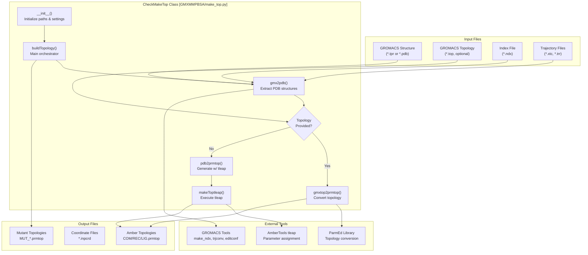
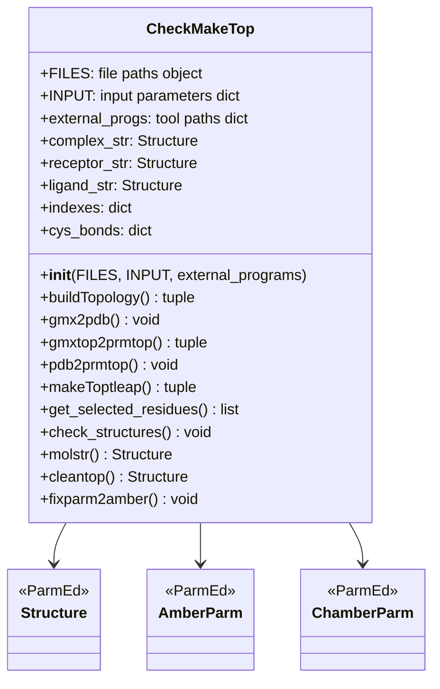
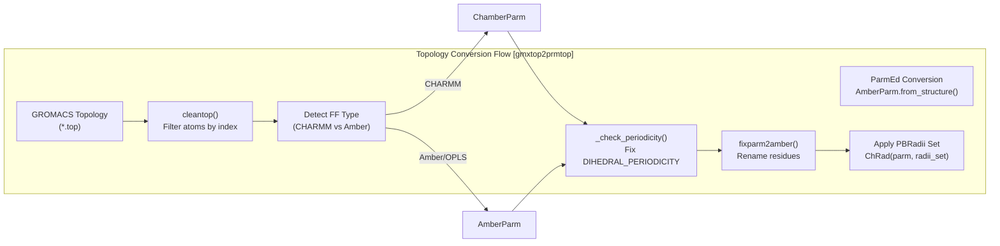
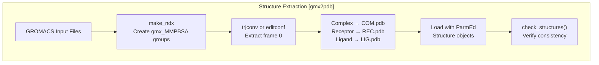

# Topology Generation (make_top.py)

Relevant source files

The following files were used as context for generating this wiki page:

- [GMXMMPBSA/main.py](GMXMMPBSA/main.py)
- [GMXMMPBSA/make_top.py](GMXMMPBSA/make_top.py)
- [GMXMMPBSA/make_top_amber.py](GMXMMPBSA/make_top_amber.py)
- [GMXMMPBSA/utils.py](GMXMMPBSA/utils.py)

## Purpose and Scope

This document describes the topology generation system in `gmx_MMPBSA`, which converts GROMACS molecular structures and topologies into Amber-format topology files (`.prmtop`) required for MM/PBSA calculations. This is the first major step in the calculation workflow after input parsing.

The module is primarily implemented in the `CheckMakeTop` class [GMXMMPBSA/make_top.py:76](), which manages the conversion process, force field assignment, and coordinate extraction.

**Sources:** [GMXMMPBSA/make_top.py:1-3](), [GMXMMPBSA/make_top.py:76-112]()

## Overview

The topology generation system bridges the GROMACS and AmberTools ecosystems by converting molecular structures into a format compatible with Amber's MM/PBSA calculation engines (sander, rism3d.snglpnt, etc.). The system handles three molecular components:

- **Complex (COM)**: The complete system (receptor + ligand) [GMXMMPBSA/make_top.py:100]()
- **Receptor (REC)**: The larger molecule (protein, DNA, etc.) [GMXMMPBSA/make_top.py:101]()
- **Ligand (LIG)**: The smaller molecule binding partner [GMXMMPBSA/make_top.py:102]()

The module also generates mutant topologies when alanine scanning calculations are requested [GMXMMPBSA/make_top.py:104-106]().

**Sources:** [GMXMMPBSA/make_top.py:76-112](), [GMXMMPBSA/main.py:48-49]()

## System Architecture

The following diagram illustrates the flow from GROMACS input files to Amber-compatible topologies.

**Sources:** [GMXMMPBSA/make_top.py:76-112](), [GMXMMPBSA/make_top.py:119-165](), [GMXMMPBSA/main.py:698-705]()

## CheckMakeTop Class Structure

The `CheckMakeTop` class is the central coordinator for topology generation, encapsulating all conversion logic and external tool interactions.

**Key attributes:**
- `FILES`: Contains paths to input/output files [GMXMMPBSA/make_top.py:78]()
- `INPUT`: Parsed input parameters from `mmpbsa.in` [GMXMMPBSA/make_top.py:79]()
- `external_progs`: Dictionary of GROMACS and AmberTools executable paths [GMXMMPBSA/make_top.py:80]()
- `cys_bonds`: Disulfide bond tracking for correct protonation states [GMXMMPBSA/make_top.py:89]()

**Sources:** [GMXMMPBSA/make_top.py:76-112](), [GMXMMPBSA/make_top.py:263-526]()

## Topology Generation Pathways

The system supports two distinct pathways for generating Amber topologies, chosen based on whether a GROMACS topology file is provided in `buildTopology()` [GMXMMPBSA/make_top.py:119-165]().

### Pathway 1: Topology Conversion (gmxtop2prmtop)

Used when a GROMACS topology file (`*.top`) is available. This pathway converts existing topology directly using `parmed` [GMXMMPBSA/make_top.py:562]().

**Key characteristics:**
- Detects CHARMM vs Amber/OPLS based on impropers/Urey-Bradley terms [GMXMMPBSA/make_top.py:580-591]().
- Handles special CHARMM atom naming (LP, LPH atoms for lone pairs) [GMXMMPBSA/make_top.py:612-632]().
- Fixes periodicity issues where `DIHEDRAL_PERIODICITY` might be 0 [GMXMMPBSA/make_top.py:652-661]().

**Sources:** [GMXMMPBSA/make_top.py:562-713](), [GMXMMPBSA/make_top.py:634-649]()

### Pathway 2: Parameter Assignment (pdb2prmtop + makeToptleap)

Used when no GROMACS topology is provided. Generates topology from PDB structures using AmberTools `tleap` [GMXMMPBSA/make_top.py:1297]().

**Key characteristics:**
- Requires force field specification via `forcefields` variable [GMXMMPBSA/make_top.py:1440]().
- Automatically detects and bonds disulfide bridges [GMXMMPBSA/make_top.py:1466-1487]().
- Assigns protonation states for titratable residues (HID, HIE, HIP, etc.) [GMXMMPBSA/make_top.py:1321-1364]().

**Sources:** [GMXMMPBSA/make_top.py:1297-1599](), [GMXMMPBSA/make_top.py:1601-1772]()

## PDB Structure Extraction (gmx2pdb)

Before topology generation, the system extracts PDB structures from GROMACS files using native GROMACS tools like `trjconv` or `editconf` [GMXMMPBSA/make_top.py:263]().

**Sources:** [GMXMMPBSA/make_top.py:263-526](), [GMXMMPBSA/make_top.py:527-543]()

## Force Field and Radii Handling

### PBRadii Sets

Atomic radii are assigned based on the `PBRadii` dictionary [GMXMMPBSA/make_top.py:55]().

| PBRadii Value | Radii Set | Recommended For |
|--------------|-----------|-----------------|
| 1 | bondi | igb=7 |
| 2 | mbondi | igb=1 |
| 3 | mbondi2 | igb=2, igb=5 |
| 4 | mbondi3 | igb=8 |
| 7 | charmm_radii | CHARMM topologies |

**Sources:** [GMXMMPBSA/make_top.py:55-56](), [GMXMMPBSA/make_top.py:601-608]()

### Ion Parameter Assignment

When metal ions are detected, appropriate parameter files are loaded via `ions_para_files` [GMXMMPBSA/make_top.py:63-68](). Supported ions include AG, CA, CL, MG, NA, ZN, and others listed in the `ions` list [GMXMMPBSA/make_top.py:70-74]().

**Sources:** [GMXMMPBSA/make_top.py:63-74]()

## Residue Selection System

The topology module includes a residue selection system for decomposition and QM/MM calculations, utilizing the `get_selected_residues` function [GMXMMPBSA/make_top.py:167]().

**Selection Logic:**
- Supports distance-based selection using `within` [GMXMMPBSA/make_top.py:132-149]().
- Uses `selector()` and `get_dist()` utilities to identify interface residues [GMXMMPBSA/make_top.py:30]().
- Maps residues between complex, receptor, and ligand using `res2map()` [GMXMMPBSA/make_top.py:30]().

**Sources:** [GMXMMPBSA/make_top.py:130-182](), [GMXMMPBSA/utils.py:593-639]()

## Output Files and Validation

### Generated Topology Files

The process results in the following Amber-format files:
- `COM.prmtop`, `REC.prmtop`, `LIG.prmtop` [GMXMMPBSA/make_top.py:100-102]().
- `MUT_COM.prmtop`, `MUT_REC.prmtop`, `MUT_LIG.prmtop` (for Alanine Scanning) [GMXMMPBSA/make_top.py:104-106]().

### Validation Checks

The `check_structures()` method [GMXMMPBSA/make_top.py:718]() performs consistency checks:
- Verifies that the number of atoms in the topology matches the PDB structure [GMXMMPBSA/make_top.py:567-575]().
- Ensures receptor and ligand atom counts sum up to the complex atom count [GMXMMPBSA/make_top.py:768-780]().
- Validates that no water or ions are present in the final extracted structures [GMXMMPBSA/make_top.py:840-856]().

**Sources:** [GMXMMPBSA/make_top.py:545-560](), [GMXMMPBSA/make_top.py:718-856]()

---