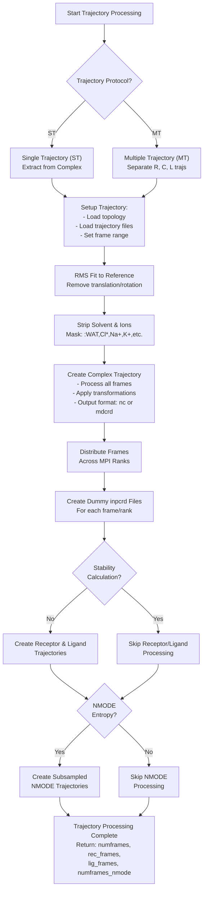
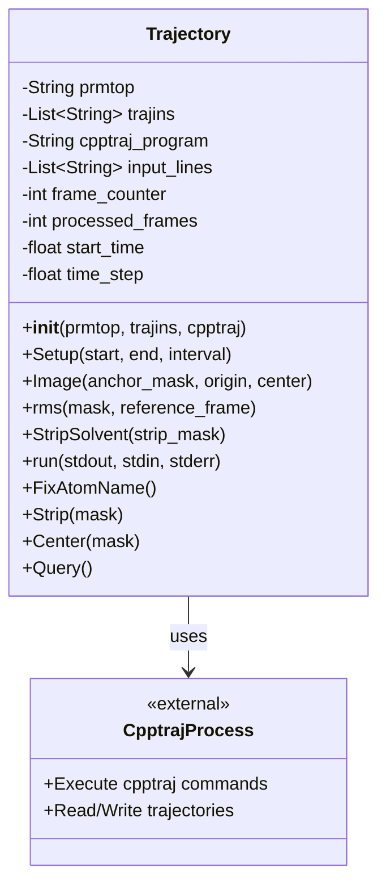
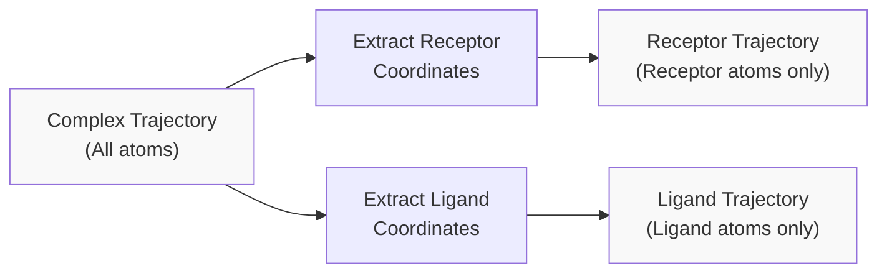
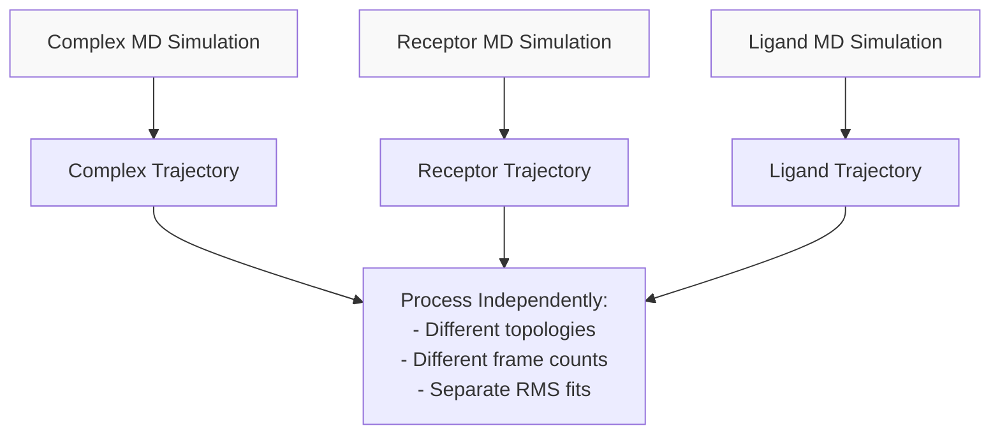
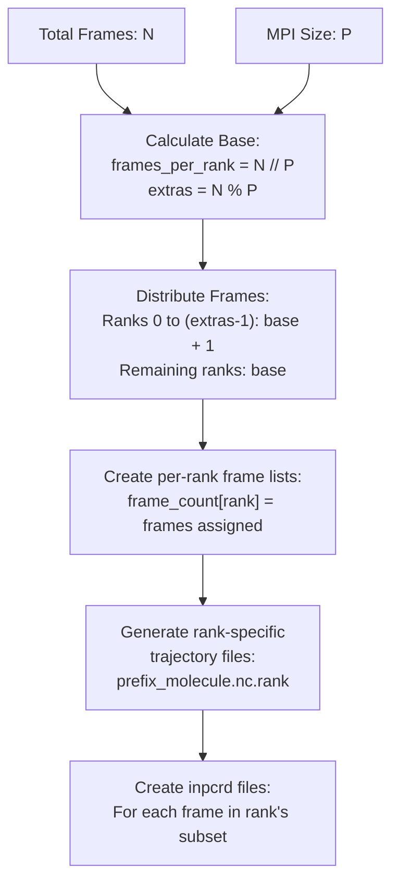
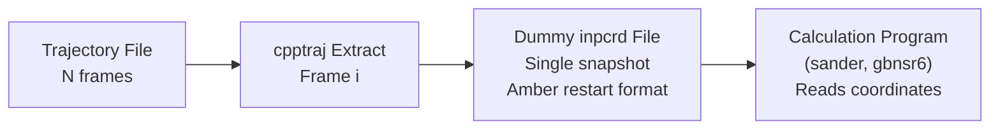
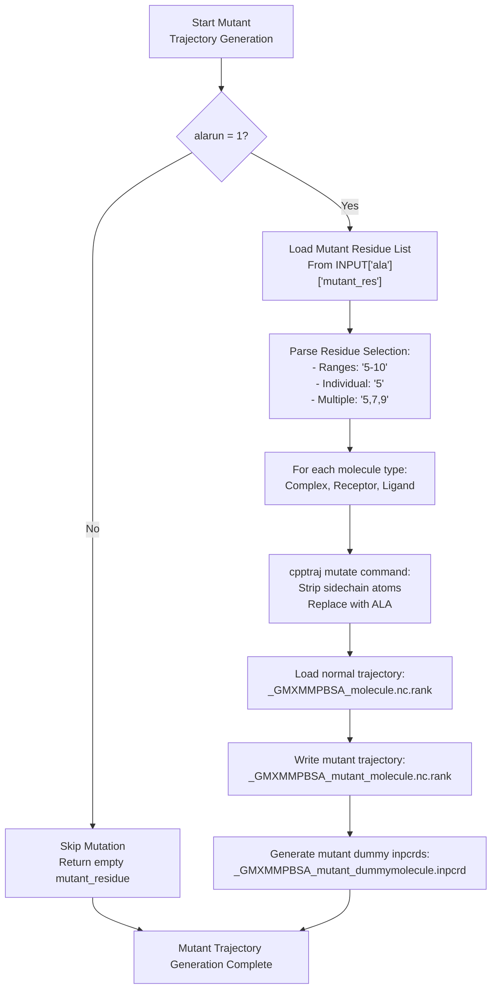
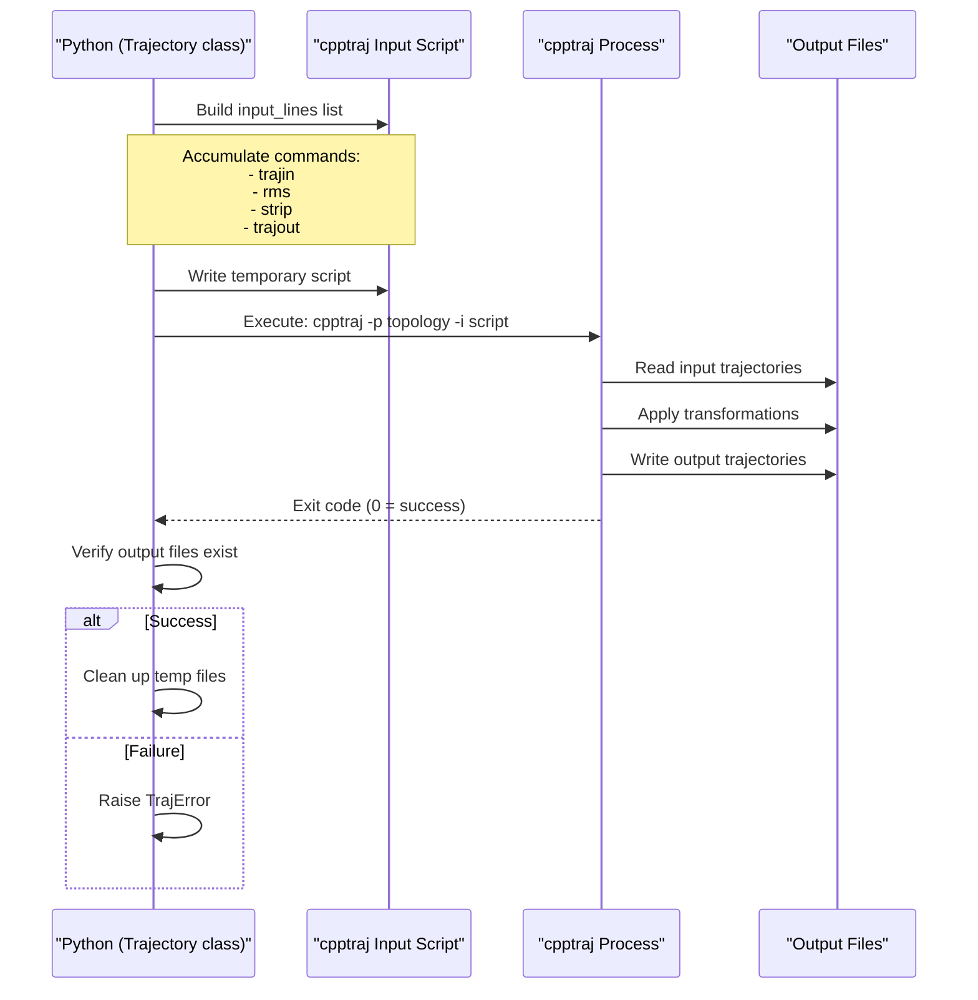

# Trajectory Processing (make_trajs.py)

<details>
<summary>Relevant source files</summary>

The following files were used as context for generating this wiki page:

- [GMXMMPBSA/alamdcrd.py](GMXMMPBSA/alamdcrd.py)
- [GMXMMPBSA/make_trajs.py](GMXMMPBSA/make_trajs.py)
- [GMXMMPBSA/parm_setup.py](GMXMMPBSA/parm_setup.py)
- [GMXMMPBSA/timer.py](GMXMMPBSA/timer.py)

</details>


## Purpose and Scope

This page documents the trajectory processing subsystem within gmx_MMPBSA, which prepares molecular dynamics trajectories for free energy calculations. The module [GMXMMPBSA/make_trajs.py]() converts GROMACS trajectories into Amber-compatible format, performs structural manipulations (RMS fitting, solvent stripping), and distributes frames across MPI processes for parallel computation.

For information about topology generation that precedes this step, see [Topology Generation (make_top.py)](#3.3.1). For information about how these processed trajectories are used in calculations, see [Calculation Execution (calculation.py)](#3.3.3).

---

## Overview

The trajectory processing phase transforms raw GROMACS simulation trajectories into analysis-ready trajectory files suitable for MM/PBSA calculations. This involves several critical operations performed by the `cpptraj` program from AmberTools:

1. **Frame selection**: Extract frames based on `startframe`, `endframe`, and `interval` parameters [GMXMMPBSA/make_trajs.py:69-69]().
2. **Structural alignment**: RMS fit to remove translational and rotational motion [GMXMMPBSA/make_trajs.py:71-71]().
3. **Solvent removal**: Strip water molecules and ions not part of the complex [GMXMMPBSA/make_trajs.py:40-40]().
4. **Format conversion**: Convert from GROMACS formats (xtc, trr) to Amber formats (mdcrd, NetCDF) [GMXMMPBSA/make_trajs.py:52-55]().
5. **MPI distribution**: Split frames across processor ranks for parallel calculation [GMXMMPBSA/make_trajs.py:84-89]().
6. **Coordinate extraction**: Generate dummy inpcrd files for each frame [GMXMMPBSA/make_trajs.py:94-94]().

Sources: [GMXMMPBSA/make_trajs.py:1-44]()

---

## Trajectory Processing Workflow



**Diagram: Trajectory processing workflow from input trajectories to analysis-ready frame files**

Sources: [GMXMMPBSA/make_trajs.py:43-244]()

---

## The Trajectory Class

The `Trajectory` class provides a Python interface to `cpptraj` functionality, encapsulating trajectory manipulation operations.

### Class Structure



**Diagram: Trajectory class structure and its interface to cpptraj**

The `Trajectory` class maintains state through several key attributes [GMXMMPBSA/make_trajs.py:246-277]():

| Attribute | Type | Purpose |
|-----------|------|---------|
| `prmtop` | String | Path to Amber topology file |
| `trajins` | List[String] | Input trajectory file paths |
| `input_lines` | List[String] | Accumulated cpptraj commands |
| `processed_frames` | int | Number of frames after filtering |
| `start_time` | float | Starting time in ps |
| `time_step` | float | Time between frames in ps |

Sources: [GMXMMPBSA/make_trajs.py:246-495]()

### Key Methods

**Setup Method**

The `Setup()` method configures frame selection and initializes timing information [GMXMMPBSA/make_trajs.py:296-320]():

```python
def Setup(self, start, end, offset)
```

- Adds `trajin` commands with frame range: `[start:end:offset]`
- Queries the trajectory to determine `processed_frames`
- Calculates `start_time` and `time_step` for frame indexing

**RMS Fitting**

The `rms()` method performs least-squares structural alignment [GMXMMPBSA/make_trajs.py:346-353]():

```python
def rms(self, mask, reference_frame=1)
```

- Aligns trajectory frames to remove translation/rotation
- Uses mask to specify atoms for alignment (typically backbone or heavy atoms)
- Default reference is frame 1 after initial processing

**Solvent Stripping**

The `StripSolvent()` method removes unwanted molecules [GMXMMPBSA/make_trajs.py:355-359]():

```python
def StripSolvent(self, strip_mask)
```

- Removes water, ions, and other solvent molecules
- Default mask defined in [GMXMMPBSA/make_trajs.py:40-40]()
- Critical for reducing system size and focusing on protein-ligand complex

Sources: [GMXMMPBSA/make_trajs.py:296-427]()

---

## Single vs Multiple Trajectory Protocols

gmx_MMPBSA supports two trajectory protocols with different performance/accuracy tradeoffs:

### Single Trajectory (ST) Protocol



**Diagram: Single trajectory protocol - all components extracted from one trajectory**

The ST protocol:
- Processes only the complex trajectory [GMXMMPBSA/make_trajs.py:68-69]().
- Extracts receptor and ligand frames from complex coordinates [GMXMMPBSA/make_trajs.py:114-130]().
- **Advantages**: Faster, fewer input files required, maintains complex conformations.
- **Disadvantages**: Receptor and ligand conformations are bound-state only.

Implementation logic:
```python
if not stability and not FILES.receptor_trajs:
    traj.Strip(INPUT['general']['ligand_mask'])
    # Output receptor trajectory...
```
Sources: [GMXMMPBSA/make_trajs.py:113-130]()

### Multiple Trajectory (MT) Protocol



**Diagram: Multiple trajectory protocol - independent simulations for each component**

The MT protocol:
- Requires separate simulations of complex, receptor, and ligand.
- Each trajectory processed independently with its own topology [GMXMMPBSA/make_trajs.py:165-185]().
- **Advantages**: Captures unbound-state conformational changes, more rigorous.
- **Disadvantages**: 3x computational cost, more complex setup.

Detection logic in [GMXMMPBSA/make_trajs.py:165-185]():
```python
if FILES.receptor_trajs:
    traj = Trajectory(FILES.receptor_prmtop, FILES.receptor_trajs, cpptraj)
    # Process receptor independently...
```

Sources: [GMXMMPBSA/make_trajs.py:43-244]()

---

## Frame Distribution for MPI Parallelization

gmx_MMPBSA distributes trajectory frames across MPI ranks to enable parallel calculation. Each rank processes a subset of frames independently.

### Distribution Algorithm



**Diagram: Frame distribution algorithm across MPI ranks**

### Implementation Details

The distribution ensures load balancing [GMXMMPBSA/make_trajs.py:84-89]():

```python
frames_per_rank = traj.processed_frames // size
extras = traj.processed_frames - frames_per_rank * size
frame_count = [frames_per_rank for i in range(size)]
for i in range(size):
    if i < extras: frame_count[i] += 1
```

Each rank processes its frames independently by writing rank-indexed trajectory files [GMXMMPBSA/make_trajs.py:98-101]():
```python
for i in range(size):
    frame_string = '%d-%d' % (last_frame, last_frame + frame_count[i] - 1)
    traj.Outtraj(pre + 'complex.%s.%d' % (trj_suffix, i),
                 frames=frame_string, filetype=INPUT['general']['netcdf'])
```

Sources: [GMXMMPBSA/make_trajs.py:78-127]()

---

## Dummy Inpcrd File Generation

For each frame assigned to a rank, gmx_MMPBSA creates "dummy" inpcrd (coordinate) files that contain a single snapshot from the trajectory. These files are required by AmberTools programs (sander, PBSA) which expect restart/coordinate files as input.

### Purpose and Structure



**Diagram: Dummy inpcrd file generation for single-frame calculations**

The generation process:

1. For each frame `i` in rank's subset:
   - `cpptraj` extracts frame `i` from trajectory.
   - Outputs as Amber restart format (`.inpcrd`) [GMXMMPBSA/make_trajs.py:94-94]().
   - If using `gbnsr6`, stored in rank-specific directory: `inpcrd_{rank}/` [GMXMMPBSA/make_trajs.py:103-107]().

2. File naming: `{pre}dummy{molecule}.inpcrd` or `{pre}{molecule}.inpcrd`.

Sources: [GMXMMPBSA/make_trajs.py:130-244]()

---

## Mutant Trajectory Generation

For alanine scanning calculations, gmx_MMPBSA generates mutant trajectories by modifying amino acid sidechains to alanine while preserving backbone geometry.

### Mutation Workflow



**Diagram: Mutant trajectory generation workflow for alanine scanning**

### Mutation Implementation

The `make_mutant_trajectories()` function uses `cpptraj`'s mutation capability [GMXMMPBSA/make_trajs.py:497-624](). It identifies the residue to mutate using the `MutantMdcrd` class which compares original and mutant topologies [GMXMMPBSA/alamdcrd.py:168-191]().

Key features:
1. **Mutation Command**: Uses `cpptraj`'s `mutate` action to strip sidechains and replace with ALA [GMXMMPBSA/make_trajs.py:539-540]().
2. **Backbone Preservation**: The `MutantMdcrd.MutateTraj` method handles the coordinate scaling and translation to fit the new sidechain [GMXMMPBSA/alamdcrd.py:193-234]().

Sources: [GMXMMPBSA/make_trajs.py:497-624](), [GMXMMPBSA/alamdcrd.py:152-234]()

---

## Integration with cpptraj

gmx_MMPBSA relies on `cpptraj` (AmberTools) for trajectory processing. The integration is handled through subprocess execution of `cpptraj` with dynamically generated input scripts.

### cpptraj Execution Model



**Diagram: Sequence of cpptraj execution from Python**

### Command Generation

The `Trajectory` class accumulates `cpptraj` commands in `input_lines` [GMXMMPBSA/make_trajs.py:273-273]():

| Method | cpptraj Command | Purpose |
|--------|----------------|---------|
| `__init__()` | `parm {prmtop}` | Load topology [GMXMMPBSA/make_trajs.py:284-284]() |
| `Setup()` | `trajin {traj} {start} {end} {interval}` | Define input [GMXMMPBSA/make_trajs.py:302-302]() |
| `rms()` | `rms {mask} first mass` | Structural alignment [GMXMMPBSA/make_trajs.py:352-352]() |
| `StripSolvent()` | `strip {mask}` | Remove molecules [GMXMMPBSA/make_trajs.py:358-358]() |
| `Outtraj()` | `trajout {output} {format}` | Write output [GMXMMPBSA/make_trajs.py:381-381]() |

Sources: [GMXMMPBSA/make_trajs.py:246-495]()

---

## Error Handling

The trajectory processing module implements error checking at multiple stages:

### Common Error Conditions

Validation checks ensure system integrity:
- **Frame Count**: Ensures enough frames exist for the requested MPI size [GMXMMPBSA/make_trajs.py:79-81]().
- **File Existence**: Verifies that `cpptraj` successfully generated output files [GMXMMPBSA/make_trajs.py:465-470]().
- **Mutation Integrity**: `MutantMdcrd` checks that the mutant topology has exactly one ALA mutation [GMXMMPBSA/alamdcrd.py:176-191]().

Error types defined in [GMXMMPBSA/exceptions.py:37-37]():
- `TrajError`: Raised for trajectory processing failures.
- `MutantResError`: Raised for invalid alanine scanning residue selections.
- `MMPBSA_Error`: Base exception class for general failures.

Sources: [GMXMMPBSA/make_trajs.py:37-37](), [GMXMMPBSA/alamdcrd.py:26-26](), [GMXMMPBSA/exceptions.py:37-37]()

---