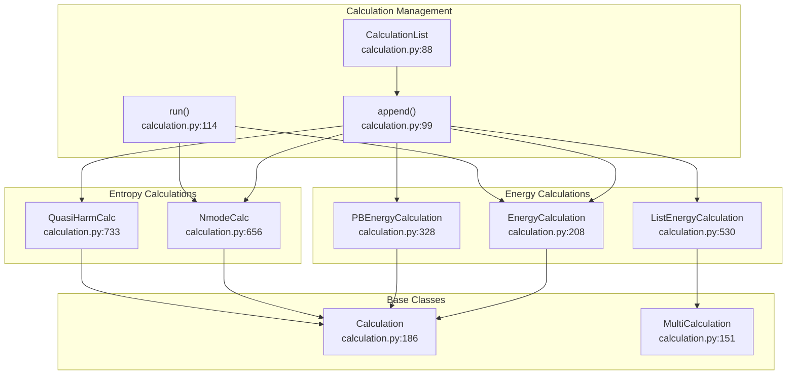
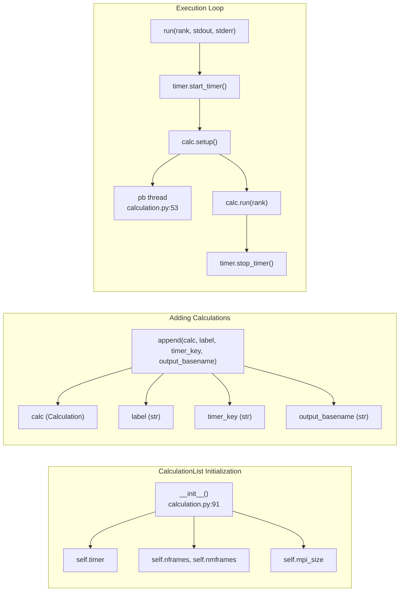
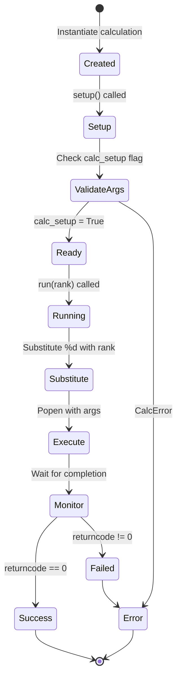
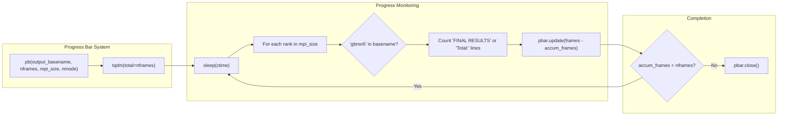

# Calculation Execution (calculation.py)

Relevant source files

The following files were used as context for generating this wiki page:

- [GMXMMPBSA/calculation.py](GMXMMPBSA/calculation.py)
- [GMXMMPBSA/createinput.py](GMXMMPBSA/createinput.py)
- [GMXMMPBSA/fake_mpi.py](GMXMMPBSA/fake_mpi.py)
- [GMXMMPBSA/input_parser.py](GMXMMPBSA/input_parser.py)

This page describes the calculation orchestration system implemented in [GMXMMPBSA/calculation.py](). This module manages the execution of all MM/PBSA calculations, including GB, PB, 3D-RISM, normal mode, and entropy calculations. For topology generation, see [3.3.1](). For trajectory processing, see [3.3.2](). For output processing, see [3.3.4]().

## Overview

The calculation system follows a command pattern where each calculation type is encapsulated in a class that knows how to set itself up and execute. The `CalculationList` class manages the queue of calculations and orchestrates their parallel execution across MPI ranks. Each calculation wraps calls to external programs (sander, gbnsr6, cpptraj, mmpbsa_py_nabnmode) with input files prepared by [GMXMMPBSA/createinput.py]().

Sources: [GMXMMPBSA/calculation.py:1-48](), [GMXMMPBSA/createinput.py:49-62]()

## Calculation Architecture

**Calculation Type Hierarchy**

The system defines multiple calculation classes that inherit from either `Calculation` or `MultiCalculation`. Each calculation type handles a specific computational task and knows how to invoke the appropriate external program with the correct arguments.

Sources: [GMXMMPBSA/calculation.py:88-151](), [GMXMMPBSA/calculation.py:186-208](), [GMXMMPBSA/calculation.py:656-733]()

## CalculationList Management

**CalculationList Workflow**

The `CalculationList` class acts as a container and executor for calculations. It maintains parallel lists of calculations, labels, timer keys, and output file patterns [GMXMMPBSA/calculation.py:91-97](). During execution, it iterates through all calculations, optionally starting timers and progress bars, then invokes each calculation's `setup()` and `run()` methods [GMXMMPBSA/calculation.py:123-146]().

Sources: [GMXMMPBSA/calculation.py:88-149]()

## Calculation Lifecycle

**Calculation Execution States**

Each calculation follows a strict lifecycle. The `setup()` method must be called before `run()` to set the `calc_setup` flag [GMXMMPBSA/calculation.py:163-164](). The `run()` method handles the substitution of MPI rank placeholders in file names (e.g., using `%d` to distinguish per-rank output), executes the external program via `subprocess.Popen`, and monitors the return code for errors [GMXMMPBSA/calculation.py:155-184]().

Sources: [GMXMMPBSA/calculation.py:151-206]()

## Calculation Types

| Class | Purpose | External Program | Key Features |
|-------|---------|------------------|--------------|
| `EnergyCalculation` | GB/PB energy calculations | `sander` | Base class for typical binding FE calculations [GMXMMPBSA/calculation.py:11]() |
| `PBEnergyCalculation` | PB-specific calculations | `sander` or `sander.APBS` | Extends EnergyCalculation for PB models [GMXMMPBSA/calculation.py:328]() |
| `ListEnergyCalculation` | Batch GBNSR6 calculations | `gbnsr6` | Inherits from MultiCalculation to handle multiple files [GMXMMPBSA/calculation.py:530]() |
| `NmodeCalc` | Normal mode entropy | `mmpbsa_py_nabnmode` | Handles expensive entropy computations [GMXMMPBSA/calculation.py:656]() |
| `QuasiHarmCalc` | Quasi-harmonic entropy | `cpptraj` | Uses cpptraj for covariance analysis [GMXMMPBSA/calculation.py:733]() |
| `RISMCalculation` | 3D-RISM calculations | `sander` | Handles RISM binding FE [GMXMMPBSA/calculation.py:12]() |

Sources: [GMXMMPBSA/calculation.py:9-15](), [GMXMMPBSA/calculation.py:328-733]()

## Progress Tracking

**Real-Time Progress Tracking**

For energy and normal mode calculations, the system spawns a daemon thread running the `pb()` function [GMXMMPBSA/calculation.py:137-139](). This function monitors output files across all MPI ranks [GMXMMPBSA/calculation.py:61-76](). It searches for specific strings like "FINAL RESULTS" or "Total:" to count completed frames and updates a `tqdm` progress bar [GMXMMPBSA/calculation.py:73-80]().

Sources: [GMXMMPBSA/calculation.py:50-87](), [GMXMMPBSA/calculation.py:130-140]()

## Variable and Namelist Parsing

The calculation execution is driven by parameters defined in the `mmpbsa.in` file, which are parsed using the `Variable` and `Namelist` classes in [GMXMMPBSA/input_parser.py]().

- **`Variable`**: Represents a single input parameter with a specific data type (int, float, str, list) and default value [GMXMMPBSA/input_parser.py:30-60]().
- **`Namelist`**: Groups related variables together, mimicking Fortran namelist behavior [GMXMMPBSA/input_parser.py:106-128](). It uses a `trigger` to determine if a specific calculation type (like `&gb` or `&pb`) should be executed [GMXMMPBSA/input_parser.py:127-130]().

Sources: [GMXMMPBSA/input_parser.py:30-150]()

## MPI and Serial Execution

The system supports both MPI and serial execution. To maintain a clean codebase, [GMXMMPBSA/fake_mpi.py]() provides a `Communicator` class that mimics `mpi4py` behavior when running in serial mode.

- **`Get_rank()`**: Always returns 0 in serial mode [GMXMMPBSA/fake_mpi.py:35-37]().
- **`Get_size()`**: Always returns 1 in serial mode [GMXMMPBSA/fake_mpi.py:41-43]().
- **`Barrier()`**: Acts as a no-op in serial mode [GMXMMPBSA/fake_mpi.py:53-55]().

This allows the calculation classes to use standard MPI calls without checking for MPI availability constantly.

Sources: [GMXMMPBSA/fake_mpi.py:28-71]()

## Error Handling

The calculation system uses a hierarchy of exceptions to handle different failure modes:

- **`CalcError`**: Raised when a calculation is run without proper setup or when external programs fail [GMXMMPBSA/calculation.py:164]().
- **`InputError`**: Raised when the input parser encounters invalid variable types or open namelists [GMXMMPBSA/input_parser.py:42-44](), [GMXMMPBSA/input_parser.py:154]().
- **`InternalError`**: Raised when duplicated variables are added to a namelist [GMXMMPBSA/input_parser.py:148]().

Sources: [GMXMMPBSA/calculation.py:41-42](), [GMXMMPBSA/input_parser.py:25]()

---