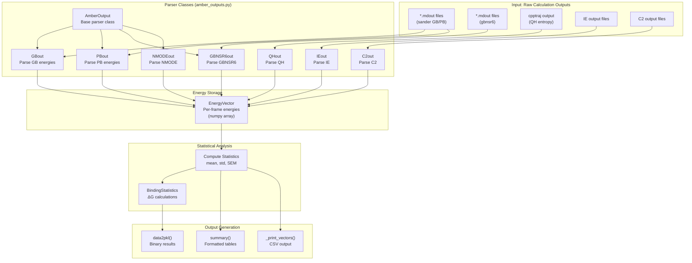
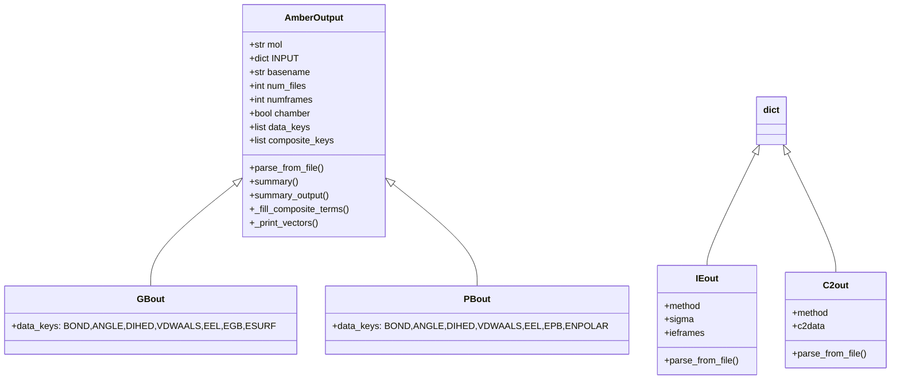
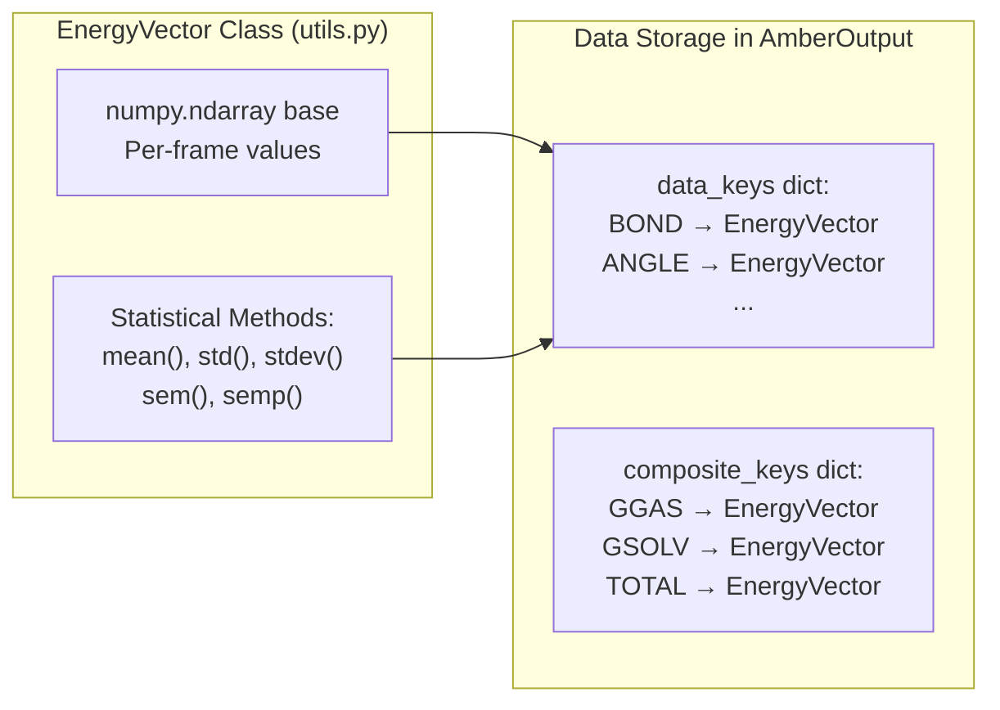
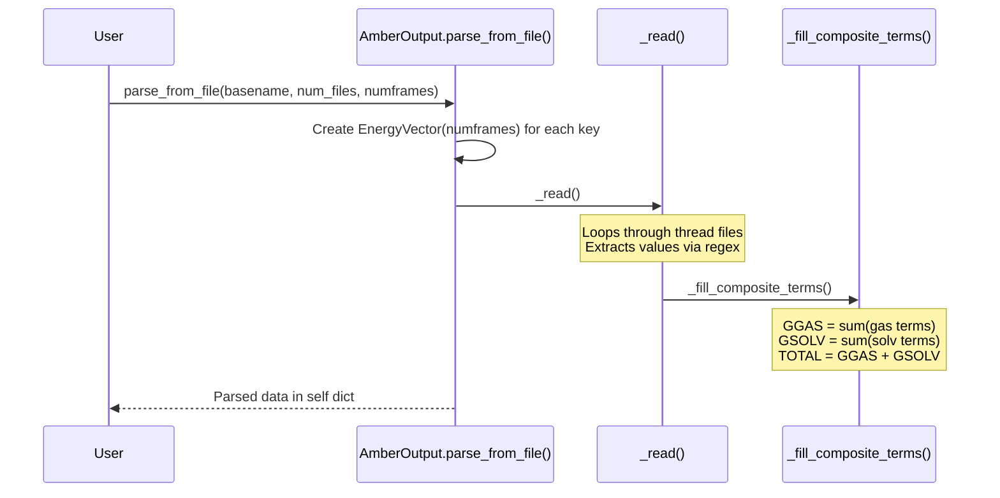

# Output Processing (amber_outputs.py)

<details>
<summary>Relevant source files</summary>

The following files were used as context for generating this wiki page:

- [GMXMMPBSA/API.py](GMXMMPBSA/API.py)
- [GMXMMPBSA/amber_outputs.py](GMXMMPBSA/amber_outputs.py)
- [GMXMMPBSA/exceptions.py](GMXMMPBSA/exceptions.py)
- [GMXMMPBSA/infofile.py](GMXMMPBSA/infofile.py)
- [GMXMMPBSA/output_file.py](GMXMMPBSA/output_file.py)

</details>


## Purpose and Scope

This document describes the output processing system in gmx_MMPBSA, which is responsible for parsing calculation results from AmberTools programs (sander, gbnsr6, cpptraj, etc.), computing statistics, and generating final output files. The module `amber_outputs.py` contains all parser classes and statistical analysis functionality that transforms raw calculation outputs into human-readable results.

The system relies on the `EnergyVector` class for numerical storage and the `AmberOutput` hierarchy for file parsing. Final results are consolidated into formatted `.dat` files and structured `.mmxsa` binary files for the GUI analyzer.

**Sources:** [GMXMMPBSA/amber_outputs.py:1-8](), [GMXMMPBSA/output_file.py:1-4]()

## System Overview

The output processing system operates as the final stage of the calculation pipeline, consuming raw output files from AmberTools programs and producing statistical summaries and formatted result files.



**Diagram: Output Processing Pipeline**

The system uses specialized parser classes derived from `AmberOutput` to extract energy terms, stores them in `EnergyVector` objects for efficient numerical processing, and generates formatted summaries.

**Sources:** [GMXMMPBSA/amber_outputs.py:65-108](), [GMXMMPBSA/output_file.py:31-52]()

## Parser Class Hierarchy

### Base Class: AmberOutput

The `AmberOutput` class serves as the base for all output parsers. It implements the common parsing infrastructure and data storage mechanisms. It inherits from `dict` to store energy terms as key-value pairs where values are `EnergyVector` instances.



**Diagram: Parser Class Hierarchy**

Each parser class is specialized for a specific calculation type and knows how to extract the relevant energy terms from that calculation's output format.

**Sources:** [GMXMMPBSA/amber_outputs.py:65-97](), [GMXMMPBSA/amber_outputs.py:227-235](), [GMXMMPBSA/amber_outputs.py:307-315]()

### Key Parser Classes

| Class | Purpose | Energy Terms Extracted |
|-------|---------|----------------------|
| `GBout` | Generalized Born calculations | BOND, ANGLE, DIHED, VDWAALS, EEL, 1-4 VDW, 1-4 EEL, EGB, ESURF |
| `PBout` | Poisson-Boltzmann calculations | BOND, ANGLE, DIHED, VDWAALS, EEL, 1-4 VDW, 1-4 EEL, EPB, ENPOLAR, EDISPER |
| `NMODEout` | Normal mode entropy | TRANSLATIONAL, ROTATIONAL, VIBRATIONAL, TOTAL |
| `IEout` | Interaction entropy | Per-frame interaction energies, sigma (SD) |
| `C2out` | C2 entropy | C2 value, standard deviation, confidence intervals |

**Sources:** [GMXMMPBSA/amber_outputs.py:89-91](), [GMXMMPBSA/amber_outputs.py:227-260](), [GMXMMPBSA/amber_outputs.py:307-330]()

## Energy Vector System

The `EnergyVector` class (from `utils.py`) provides the foundation for storing and manipulating per-frame energy data. It extends NumPy's `ndarray` with specialized methods for statistical analysis.



**Diagram: EnergyVector Storage**

### EnergyVector Features

**Statistical Methods:**
- `mean()`: Computes average over all frames.
- `std()`: Standard deviation (population).
- `sem()`: Standard error of mean = `std() / sqrt(N)`.
- `semp()`: Propagated standard error based on standard deviation.

**Sources:** [GMXMMPBSA/amber_outputs.py:30](), [GMXMMPBSA/utils.py:52-151]()

## Parsing Workflow

### File-Based Parsing

The standard parsing workflow for AmberTools output files follows this pattern:



**Diagram: File Parsing Sequence**

### Key Parsing Steps

1. **Initialization** ([GMXMMPBSA/amber_outputs.py:98-107]()):
   - Set `basename`, `num_files`, `numframes`.
   - Create empty `EnergyVector` objects for all `data_keys` and `composite_keys`.

2. **File Reading** ([GMXMMPBSA/amber_outputs.py:108]()):
   - The `_read()` method iterates through thread-specific output files (`basename.0`, `basename.1`, ...).

3. **Composite Term Calculation** ([GMXMMPBSA/amber_outputs.py:212-224]()):
   - Components are aggregated into `GGAS` (Gas phase), `GSOLV` (Solvation), and `TOTAL` based on the `data_key_owner` mapping.

**Sources:** [GMXMMPBSA/amber_outputs.py:44-62](), [GMXMMPBSA/amber_outputs.py:98-110](), [GMXMMPBSA/amber_outputs.py:212-224]()

## Statistical Analysis

### Computing Statistics

Each `AmberOutput` instance computes statistics for all energy terms via the `summary()` method:

| Statistic | Method | Formula | Purpose |
|-----------|--------|---------|---------|
| **Average** | `mean()` | `Σ(xi) / N` | Mean energy value |
| **SD** | `std()` | `sqrt(Σ(xi - μ)² / N)` | Standard deviation |
| **SEM** | `sem()` | `SD / sqrt(N)` | Standard error of mean |

**Sources:** [GMXMMPBSA/amber_outputs.py:155-186]()

### Binding Statistics

The `BindingStatistics` class computes binding free energies from complex, receptor, and ligand energy data:

1. **Delta Calculation**: Subtracts receptor and ligand terms from complex terms: `ΔX = X_complex - X_receptor - X_ligand`.
2. **Error Propagation**: Uses `EnergyVector` subtraction which automatically propagates uncertainties.
3. **Entropy Integration**: Adds `-TΔS` contributions from NMODE, QH, IE, or C2 methods.

**Sources:** [GMXMMPBSA/amber_outputs.py:1228-1525]()

## Output Generation

### Result Summaries

The `summary_output()` method generates formatted text suitable for the `FINAL_RESULTS_MMPBSA.dat` file. It includes:
- Component names.
- Average values.
- Standard Deviation (SD) and Propagated SD.
- Standard Error of the Mean (SEM) and Propagated SEM.

**Sources:** [GMXMMPBSA/amber_outputs.py:135-153]()

### Binary and Info Files

The system generates two key files for post-processing and the GUI:
- **_GMXMMPBSA_info**: A text file containing calculation metadata and editable variables (e.g., `exp_ki`, `sys_name`).
- **COMPACT_MMXSA_RESULTS.mmxsa**: A binary pickle file containing the entire application state, input parameters, and parsed energy vectors for the `gmx_MMPBSA_ana` tool.

**Sources:** [GMXMMPBSA/infofile.py:86-112](), [GMXMMPBSA/output_file.py:31-52]()

### CSV Export

The `_print_vectors()` method writes per-frame energy values to a CSV file. This is triggered if `FILES.energyout` is defined.

```python
# GMXMMPBSA/amber_outputs.py:120-121
csvwriter.writerow(['Frame #'] + print_keys)
# GMXMMPBSA/amber_outputs.py:124-125
for i in range(self.numframes):
    csvwriter.writerow([c] + [round(self[key][i], 2) for key in print_keys])
```

**Sources:** [GMXMMPBSA/amber_outputs.py:111-127](), [GMXMMPBSA/output_file.py:64-67]()

## Summary

The `amber_outputs.py` module serves as the central hub for data interpretation in gmx_MMPBSA. By abstracting raw AmberTools output into a consistent `EnergyVector` based system, it enables robust statistical analysis, complex binding energy calculations, and seamless integration with the visualization suite.

**Sources:** [GMXMMPBSA/amber_outputs.py:1-7](), [GMXMMPBSA/API.py:1-6](), [GMXMMPBSA/output_file.py:53-118]()

---