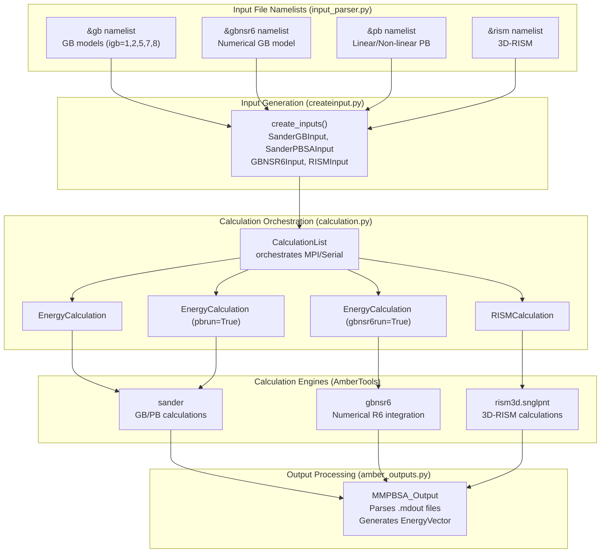
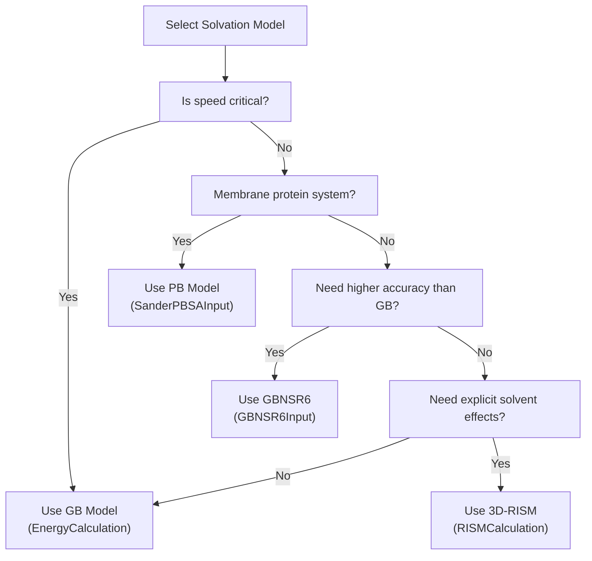

# Solvation Models

<details>
<summary>Relevant source files</summary>

The following files were used as context for generating this wiki page:

- [GMXMMPBSA/calculation.py](GMXMMPBSA/calculation.py)
- [GMXMMPBSA/createinput.py](GMXMMPBSA/createinput.py)
- [GMXMMPBSA/input_parser.py](GMXMMPBSA/input_parser.py)
- [docs/changelog.md](docs/changelog.md)
- [docs/compatibility.md](docs/compatibility.md)
- [docs/gmx_MMPBSA_running.md](docs/gmx_MMPBSA_running.md)
- [docs/input_file.md](docs/input_file.md)
- [docs/news.json](docs/news.json)

</details>


## Purpose and Scope

This page provides a comprehensive overview of the four solvation models supported in gmx_MMPBSA: Generalized Born (GB), Poisson-Boltzmann (PB), GBNSR6, and 3D-RISM. It covers the fundamental differences between these models, their configuration in the input file, computational considerations, and guidance on when to use each model. For detailed parameter documentation and model-specific considerations, see the sub-pages: [Generalized Born (GB) Models](#3.4.1), [Poisson-Boltzmann (PB) Models](#3.4.2), [GBNSR6 Model](#3.4.3), and [3D-RISM Model](#3.4.4). For entropy calculations that can be combined with these models, see [Entropy Calculations](#3.5).

## Overview

Solvation models calculate the free energy contribution from transferring a solute from vacuum to solvent. gmx_MMPBSA supports four distinct approaches, each with different computational costs and accuracy trade-offs. The choice of solvation model significantly impacts calculation speed, memory requirements, and the physical accuracy of binding free energy predictions.

All solvation models in gmx_MMPBSA are executed through AmberTools calculation engines (primarily `sander`, `gbnsr6`, and `rism3d.snglpnt`), with input files generated by gmx_MMPBSA and outputs parsed back into the analysis framework [GMXMMPBSA/calculation.py:10-15]().

## Solvation Model Architecture

The following diagram illustrates how user input in the `mmpbsa.in` file maps to specific code entities and external AmberTools engines.


**Sources:** [GMXMMPBSA/input_parser.py:106-121](), [GMXMMPBSA/createinput.py:49-61](), [GMXMMPBSA/calculation.py:88-100](), [GMXMMPBSA/calculation.py:11-13]()

## Solvation Model Comparison

| Feature | GB | GBNSR6 | PB | 3D-RISM |
|---------|----|---------|----|---------|
| **Namelist** | `&gb` | `&gbnsr6` | `&pb` | `&rism` |
| **Calculation Speed** | Fast | Moderate | Slow | Very Slow |
| **Solvent Treatment** | Implicit (continuum) | Implicit (continuum) | Implicit (continuum) | Explicit (distribution) |
| **Decomposition** | Yes (per-residue/pairwise) | Yes (per-residue/pairwise) | Yes (per-residue) | Limited |
| **Salt Effects** | `saltcon` | `istrng` | `istrng` | `buffer` |

**Sources:** [docs/input_file.md:15-20](), [docs/changelog.md:69-72]()

## Configuration in Input File

Each solvation model is configured through its dedicated namelist in the `mmpbsa.in` input file. Input files can be generated automatically using the `--create_input` flag [docs/input_file.md:32-36]().

### GB Model Configuration
The GB model is controlled by the `igb` variable, with `igb=5` (OBC2) being the common default [docs/input_file.md:88-90]().
```yaml
&gb
  igb                  = 5                       # GB model to use
  saltcon              = 0.150                   # Salt concentration (M)
  intdiel              = 1.0                     # Internal dielectric
/
```

### GBNSR6 Model Configuration
GBNSR6 uses numerical integration of the R6 equation [docs/changelog.md:69-72]().
```yaml
&gbnsr6
  istrng               = 0.15                    # Ionic strength (M)
  roh                  = 1                       # Solvent radius (1: 0.586, 2: 0.699, etc)
/
```
**Sources:** [GMXMMPBSA/createinput.py:46-46](), [GMXMMPBSA/createinput.py:54-61]()

### PB Model Configuration
PB calculations support linear and non-linear solvers [docs/compatibility.md:52-55]().
```yaml
&pb
  inp                  = 1                       # Solver type (1: non-linear, 2: linear)
  istrng               = 0.150                   # Ionic strength
  fillratio            = 4.0                     # Grid fill ratio
/
```

### 3D-RISM Model Configuration
3D-RISM is the most computationally intensive model, treating solvent with distribution functions [GMXMMPBSA/calculation.py:12-12]().
```yaml
&rism
  tolerance            = 0.00001                 # Convergence tolerance
  closure              = "kh"                    # Kovalenko-Hirata closure
/
```

## Model Selection Flowchart


**Sources:** [GMXMMPBSA/calculation.py:10-15](), [GMXMMPBSA/createinput.py:49-145]()

## PBRadii Selection

The `PBRadii` parameter in the `&general` namelist is critical for all solvation models. It defines the atomic radii set used for the calculations [docs/compatibility.md:40-41]().

| PBRadii Value | Radii Set | Recommended For |
|---------------|-----------|-----------------|
| 2 | mbondi | GB-HCT (igb=1) |
| 3 | mbondi2 | GB-OBC (igb=2, 5) |
| 4 | mbondi3 | GB-Neck2 (igb=8) |
| 7 | charmm_radii | CHARMM force fields |

**Important:** For CHARMM force fields, `PBRadii=7` is mandatory when performing PB calculations [docs/changelog.md:31-31]().

## Computational Considerations

### Parallel Execution
`gmx_MMPBSA` uses MPI to parallelize calculations at the frame level [docs/gmx_MMPBSA_running.md:83-90](). This is managed by the `CalculationList` in `calculation.py` [GMXMMPBSA/calculation.py:114-149]().

```bash
# Example MPI run with 4 processors
mpirun -np 4 gmx_MMPBSA -i mmpbsa.in -cs com.tpr -ct traj.xtc -ci index.ndx -cg 1 13
```

### Memory Requirements
NMODE calculations combined with solvation models require significant RAM [docs/gmx_MMPBSA_running.md:131-136](). The total RAM usage scales with the number of MPI threads:
`RAM_total = RAM_per_frame * NUM_of_Threads`.

**Sources:** [docs/gmx_MMPBSA_running.md:131-136](), [GMXMMPBSA/calculation.py:130-139]()

## Energy Terms and Output

The solvation models contribute to the total binding free energy ($\Delta G_{bind}$) through the polar solvation term ($\Delta G_{solv,polar}$) and non-polar solvation term ($\Delta G_{solv,nonpolar}$). These are parsed from Amber `.mdout` files by the `amber_outputs.py` module [GMXMMPBSA/calculation.py:43-43]().

- **GB:** $\Delta G_{solv,polar}$ is the `EGB` term.
- **PB:** $\Delta G_{solv,polar}$ is the `EPB` term.
- **GBNSR6:** $\Delta G_{solv,polar}$ is calculated numerically via R6.
- **3D-RISM:** Calculates excess chemical potential [GMXMMPBSA/calculation.py:12-12]().

**Sources:** [GMXMMPBSA/calculation.py:43-43](), [GMXMMPBSA/createinput.py:10-16]()

## Next Steps

- For detailed GB model parameters and variants, see [Generalized Born (GB) Models](#3.4.1)
- For PB solver options and membrane proteins, see [Poisson-Boltzmann (PB) Models](#3.4.2)
- For parameter-free numerical GB, see [GBNSR6 Model](#3.4.3)
- For explicit solvent distribution functions, see [3D-RISM Model](#3.4.4)

---