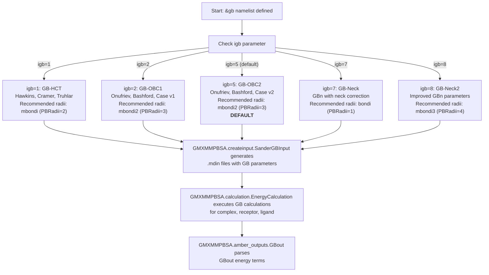
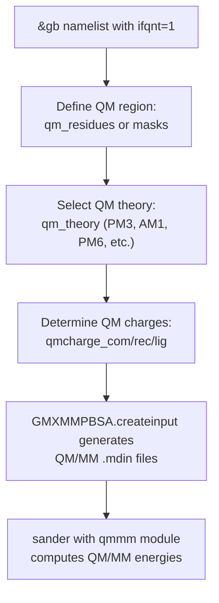
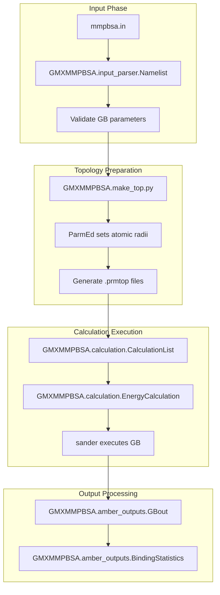

# Generalized Born (GB) Models

<details>
<summary>Relevant source files</summary>

The following files were used as context for generating this wiki page:

- [GMXMMPBSA/calculation.py](GMXMMPBSA/calculation.py)
- [GMXMMPBSA/createinput.py](GMXMMPBSA/createinput.py)
- [GMXMMPBSA/input_parser.py](GMXMMPBSA/input_parser.py)
- [docs/changelog.md](docs/changelog.md)
- [docs/compatibility.md](docs/compatibility.md)
- [docs/gmx_MMPBSA_running.md](docs/gmx_MMPBSA_running.md)
- [docs/input_file.md](docs/input_file.md)
- [docs/news.json](docs/news.json)

</details>


## Purpose and Scope

This page provides comprehensive documentation of Generalized Born (GB) implicit solvation models available in gmx_MMPBSA. GB models offer a computationally efficient alternative to Poisson-Boltzmann (PB) calculations for estimating solvation free energies in MM/PBSA calculations. This page covers the five GB model variants (igb values 1, 2, 5, 7, 8), their associated parameters, system-specific recommendations, and implementation details.

For information about other solvation models, see [Poisson-Boltzmann (PB) Models](#3.4.2), [GBNSR6 Model](#3.4.3), and [3D-RISM Model](#3.4.4). For general calculation workflow, see [Calculation Workflow](#3.3).

## Overview

GB models approximate the electrostatic solvation free energy by calculating effective Born radii for each atom, which represent the distance from the atom to the dielectric boundary. These models are significantly faster than PB calculations while maintaining reasonable accuracy for many systems.

In gmx_MMPBSA, GB calculations are performed using the `sander` program from AmberTools. The `&gb` namelist in the input file controls all GB-specific parameters [docs/input_file.md:17-17]().

### GB Model Selection Workflow


**Sources:** [docs/input_file.md:88-93](), [GMXMMPBSA/createinput.py:11-12](), [GMXMMPBSA/calculation.py:11-11](), [GMXMMPBSA/amber_outputs.py:1-20]()

## GB Model Variants

gmx_MMPBSA supports five GB models through the `igb` parameter [docs/input_file.md:90-90]():

| igb Value | Model Name | Description | Recommended PBRadii |
|-----------|-----------|-------------|---------------------|
| 1 | GB-HCT | Hawkins, Cramer, Truhlar pairwise GB model | mbondi (PBRadii=2) |
| 2 | GB-OBC1 | Onufriev, Bashford, Case modified GB v1 | mbondi2 (PBRadii=3) |
| 5 | GB-OBC2 | Onufriev, Bashford, Case modified GB v2 | mbondi2 (PBRadii=3) |
| 7 | GB-Neck | GBn with neck correction for interstitial spaces | bondi (PBRadii=1) |
| 8 | GB-Neck2 | Improved GBn with optimized parameters | mbondi3 (PBRadii=4) |

**Sources:** [docs/input_file.md:90-90](), [docs/compatibility.md:41-41]()

## Essential GB Parameters

### Basic Input File Structure

```yaml
&general
startframe=1,
endframe=9999999,
PBRadii=3,          # Radii set selection
/
&gb
igb=5,              # GB model selection
saltcon=0.150,      # Salt concentration in M
intdiel=1.0,        # Internal dielectric
/
```
**Sources:** [docs/input_file.md:79-94]()

### Core Parameters

#### igb (Default: 5)
Selects the GB model as described in the table above [docs/input_file.md:90-90]().

#### saltcon (Default: 0.0)
Salt concentration in Molarity (M). Affects the Debye-Hückel screening of electrostatic interactions. Typical physiological salt concentration is 0.15 M.

#### intdiel (Default: 1.0)
Internal dielectric constant of the solute. For standard protein calculations, 1.0 is appropriate. For highly charged interfaces (protein-DNA, protein-RNA), higher values may be used.

#### extdiel (Default: 78.5)
External dielectric constant representing the solvent. 78.5 corresponds to water at 298.15 K. Changed to 78.5 in gmx_MMPBSA v1.5.0 [docs/compatibility.md:28-28]().

### Surface Area Parameters

GB models include a non-polar solvation term based on solvent-accessible surface area (SASA).

#### surften (Default: 0.0072)
Surface tension value in kcal/mol/Ų. This parameter scales the SASA contribution to the non-polar solvation free energy.

#### surfoff (Default: 0.0)
Offset value (in kcal/mol) added to the non-polar solvation free energy.

#### molsurf (Default: 0)
Algorithm for surface area calculation:
- 0: LCPO (Linear Combination of Pairwise Overlaps)
- 1: molsurf algorithm

#### probe (Default: 1.4)
Radius of the solvent probe sphere in Å [docs/input_file.md:92-92]().

### Advanced Parameters

#### alpb (Default: 0)
Enable Analytical Linearized Poisson-Boltzmann (ALPB) approximation [GMXMMPBSA/createinput.py:78-78]().

#### arad_method (Default: 1)
Method for estimating effective electrostatic size A in ALPB calculations [GMXMMPBSA/createinput.py:84-84]().

## QM/MMGBSA - Quantum Mechanics Hybrid

GB calculations can be combined with quantum mechanical treatment of selected residues through the `ifqnt` parameter. This is only supported with GB models, not PB.

### QM/MMGBSA Configuration



**Sources:** [GMXMMPBSA/createinput.py:10-18]()

## GB Calculation Workflow in gmx_MMPBSA

### Internal Processing Pipeline



### Key Code Components

**Input Parsing:**
- `GMXMMPBSA.input_parser.Variable`: Base class for namelist variables [GMXMMPBSA/input_parser.py:30-30]().
- `GMXMMPBSA.input_parser.Namelist`: Handles the `&gb` section [GMXMMPBSA/input_parser.py:106-106]().

**Input File Creation:**
- `GMXMMPBSA.createinput.SanderGBInput`: Writes input files for sander GB calculations [GMXMMPBSA/createinput.py:11-11]().
- `GMXMMPBSA.createinput.SanderGBDecomp`: Handles decomposition with GB [GMXMMPBSA/createinput.py:15-15]().

**Calculation Execution:**
- `GMXMMPBSA.calculation.CalculationList`: Orchestrates the sequence of calculations [GMXMMPBSA/calculation.py:88-88]().
- `GMXMMPBSA.calculation.EnergyCalculation`: Manages the calls to `sander` for GB/PB [GMXMMPBSA/calculation.py:11-11]().

**Output Parsing:**
- `GMXMMPBSA.amber_outputs.GBout`: Specialized class for parsing GB-specific `sander` outputs [GMXMMPBSA/amber_outputs.py:1-20]().

**Sources:** [GMXMMPBSA/input_parser.py](), [GMXMMPBSA/createinput.py](), [GMXMMPBSA/calculation.py](), [GMXMMPBSA/amber_outputs.py]()

## Energy Terms in GB Calculations

GB calculations produce several energy components parsed by the `GBout` class:

| Term | Description |
|------|-------------|
| VDWAALS | van der Waals energy |
| EEL | Electrostatic energy (gas phase) |
| EGB | Generalized Born solvation energy (polar) |
| ESURF | Non-polar solvation energy (SASA-based) |
| GBSOL | Total GB solvation (EGB + ESURF) |
| GGAS | Gas phase energy (VDWAALS + EEL) |
| GBTOT | Total GB energy (GGAS + GBSOL) |

**Sources:** [GMXMMPBSA/amber_outputs.py:1-20]()

## Performance Considerations

### Parallelization

GB calculations in gmx_MMPBSA parallelize efficiently via MPI using the `CalculationList` and `EnergyCalculation` classes [GMXMMPBSA/calculation.py:114-114]().
- Each MPI rank processes a subset of frames independently.
- `GMXMMPBSA.calculation.pb` function provides a progress bar for the calculation [GMXMMPBSA/calculation.py:53-53]().

### Computational Cost
- GB is typically 5 times faster than PB [docs/gmx_MMPBSA_running.md:161-162]().
- Scaling is near-linear until the number of threads reaches the number of frames [docs/gmx_MMPBSA_running.md:143-143]().

**Sources:** [GMXMMPBSA/calculation.py](), [docs/gmx_MMPBSA_running.md]()

---