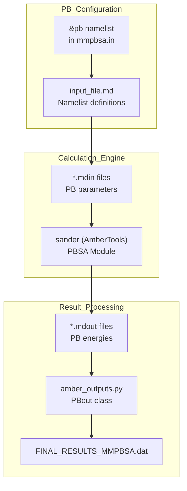
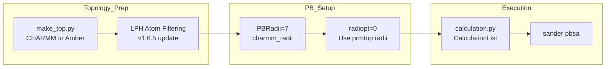

# Poisson-Boltzmann (PB) Models

<details>
<summary>Relevant source files</summary>

The following files were used as context for generating this wiki page:

- [docs/changelog.md](docs/changelog.md)
- [docs/compatibility.md](docs/compatibility.md)
- [docs/examples/Entropy_calculations/C2_Entropy/README.md](docs/examples/Entropy_calculations/C2_Entropy/README.md)
- [docs/examples/Linear_PB_solver/README.md](docs/examples/Linear_PB_solver/README.md)
- [docs/examples/NonLinear_PB_solver/README.md](docs/examples/NonLinear_PB_solver/README.md)
- [docs/gmx_MMPBSA_running.md](docs/gmx_MMPBSA_running.md)
- [docs/input_file.md](docs/input_file.md)
- [docs/news.json](docs/news.json)

</details>


## Purpose and Scope

This page describes the Poisson-Boltzmann (PB) solvation model in `gmx_MMPBSA`, including configuration through the `&pb` namelist, solver options (linear vs non-linear), PB radii set selection, and special considerations for membrane proteins and CHARMM force fields. For information about other solvation models, see Generalized Born Models ([3.4.1]()), GBNSR6 Model ([3.4.3]()), and 3D-RISM Model ([3.4.4]()).

## Overview of PB Calculations

The Poisson-Boltzmann model solves the PB equation numerically to calculate electrostatic solvation free energies. PB calculations are generally more accurate than GB models but computationally more expensive. In `gmx_MMPBSA`, PB calculations are performed using the `sander` program from AmberTools [docs/input_file.md:153-157]().

The PB approach treats the solute as a low-dielectric cavity embedded in a high-dielectric continuum solvent. The electrostatic potential is calculated by solving the PB equation on a finite-difference grid, accounting for ionic strength effects through a linearized or non-linear Boltzmann distribution of mobile ions [docs/examples/NonLinear_PB_solver/README.md:63-68]().

**Key characteristics:**

- More physically rigorous than GB models.
- Available in both linear and non-linear formulations [docs/examples/NonLinear_PB_solver/README.md:7-10]().
- Supports complex geometries including membrane proteins [docs/input_file.md:30-32]().
- Requires specification of atomic radii via `PBRadii` sets [docs/input_file.md:273-277]().

### PB Calculation Data Flow

Title: Poisson-Boltzmann Calculation Logic

Sources: [docs/input_file.md:19](), [docs/examples/NonLinear_PB_solver/README.md:41-45]()

## Configuration via &pb Namelist

PB calculations are configured in the input file using the `&pb` namelist [docs/input_file.md:19](). This namelist must be present in the `mmpbsa.in` file for PB calculations to be performed.

### Basic Input Structure
```yaml
&general
  sys_name             = "PB_System"
  PBRadii              = 3
/
&pb
  istrng               = 0.150   # Ionic strength (M)
  inp                  = 1       # Non-polar solvation model
  radiopt              = 0       # Atomic radii source
/
```
Sources: [docs/input_file.md:79-94](), [docs/examples/Linear_PB_solver/README.md:57-66]()

### Essential Parameters

| Parameter | Default | Description | Recommended Usage |
|-----------|---------|-------------|-------------------|
| `istrng` | 0.0 | Ionic strength (M) | Match experimental conditions (e.g., 0.150) [docs/examples/Linear_PB_solver/README.md:81]() |
| `inp` | 1 | Non-polar solvation model | 1 or 2 for most calculations [docs/input_file.md:30-32]() |
| `radiopt` | 1 | Atomic radii source | 0 (use prmtop radii) for CHARMM [docs/examples/NonLinear_PB_solver/README.md:66]() |
| `fillratio` | 4.0 | Grid fill ratio | 1.25 for membrane systems [docs/input_file.md:30-32]() |
| `indi` | 1.0 | Internal dielectric constant | 1.0 for standard binding [docs/examples/NonLinear_PB_solver/README.md:88-89]() |
| `exdi` | 80.0 | External dielectric constant | 80.0 for water [docs/input_file.md:29]() |

Sources: [docs/input_file.md:29-32](), [docs/examples/NonLinear_PB_solver/README.md:63-68]()

## PB Radii Sets

The `PBRadii` parameter in the `&general` namelist determines which atomic radii set is used for PB calculations [docs/input_file.md:41](). This is critical as radii affect both PB solvation energies and non-polar surface area calculations.

### Available PB Radii Sets

| PBRadii Value | Radii Set | Recommended For |
|---------------|-----------|-----------------|
| 1 | bondi | GB: igb=7 |
| 2 | mbondi | GB: igb=1 |
| 3 | mbondi2 | GB: igb=2 or 5 (default) |
| 4 | mbondi3 | GB: igb=8 (GB-Neck2) |
| 5 | mbondi_pb2 | GAFF halogens without EP |
| 6 | mbondi_pb3 | GAFF halogens without EP |
| 7 | charmm_radii | **CHARMM force fields only** |

Sources: [docs/input_file.md:41](), [docs/compatibility.md:30-32]()

## Linear vs Non-Linear PB Solvers

`gmx_MMPBSA` supports both linear and non-linear PB solvers through the `npbopt` parameter [docs/examples/NonLinear_PB_solver/README.md:88-90]().

### Linear PB (npbopt=0)
The linearized PB equation is suitable for most protein-ligand systems where electrostatic potentials are relatively low [docs/examples/Linear_PB_solver/README.md:6-7]().

### Non-Linear PB (npbopt=1)
Implemented in v1.5.0, the full non-linear PB equation is solved iteratively [docs/examples/NonLinear_PB_solver/README.md:10]().

**Considerations for Non-Linear PB:**
- **Energy Term Merger**: When `npbopt=1`, `eneopt` is set to 1. The total electrostatic energy and forces are computed with the P3M procedure [docs/examples/NonLinear_PB_solver/README.md:92-94]().
- **Decomposition**: In the output, the `EPB` term is set to zero, and `EEL` includes both reaction field and Coulombic energy [docs/examples/NonLinear_PB_solver/README.md:94-97]().
- **Total Energy**: While `ΔGGAS` and `ΔGSOLV` are no longer properly separated, the `ΔTOTAL` remains accurate [docs/examples/NonLinear_PB_solver/README.md:99-101]().

Sources: [docs/examples/NonLinear_PB_solver/README.md:88-101](), [docs/compatibility.md:52-55]()

## Membrane Protein Support

PB calculations for membrane proteins require an implicit membrane region defined as a low-dielectric slab.

### Membrane-Specific Parameters
The following parameters were added or updated in v1.5.0 to provide control over PB calculations in heterogeneous environments [docs/compatibility.md:29-32]():
- `mthick`: Membrane thickness.
- `mctrdz`: Membrane center z-coordinate.
- `emem`: Membrane dielectric constant.
- `poretype`: Detection of solvent-filled channels.

### Key Considerations
- **Dielectric Profile**: The internal dielectric (`indi`) must be configured appropriately relative to the membrane dielectric (`emem`).
- **Grid Setup**: `fillratio` is typically reduced (e.g., 1.25) to manage memory for the larger grids required by membrane systems [docs/input_file.md:30-32]().

Sources: [docs/compatibility.md:29-32](), [docs/input_file.md:30-32]()

## CHARMM Force Field Integration

Systems prepared with CHARMM force fields require special handling, including specific radii and atom filtering.

### Required Settings
- **PBRadii**: Set to 7 (`charmm_radii`) [docs/changelog.md:31]().
- **radiopt**: Set to 0 to use radii defined in the topology file [docs/examples/NonLinear_PB_solver/README.md:66]().

### LPH Atom Handling
Stricter rules for detecting Lone Pair (LP) atoms were implemented in v1.6.5 [docs/changelog.md:16](). These atoms must be filtered out to prevent calculation failures in `sander`.

Title: CHARMM-PB Calculation Workflow

Sources: [docs/changelog.md:16-18](), [docs/changelog.md:31](), [docs/examples/NonLinear_PB_solver/README.md:63-68]()

## Advanced PB Parameters

The following parameters (introduced in v1.5.0) allow fine-tuning of the numerical solver [docs/compatibility.md:29-32]():

| Parameter | Description |
|-----------|-------------|
| `smoothopt` | Surface smoothing option |
| `arcres` | Resolution for arc calculations |
| `npbgrid` | Grid type selection |
| `fscale` | Force scaling factor |
| `maxsph` | Maximum number of spheres for surface area |
| `npbverb` | PB verbosity level |

Sources: [docs/compatibility.md:29-32](), [docs/input_file.md:30-32]()

---