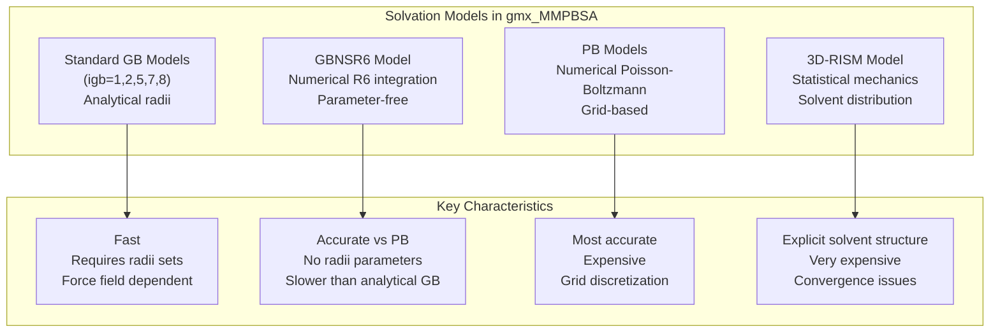
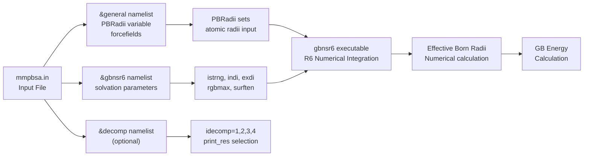

# GBNSR6 Model

<details>
<summary>Relevant source files</summary>

The following files were used as context for generating this wiki page:

- [docs/changelog.md](docs/changelog.md)
- [docs/compatibility.md](docs/compatibility.md)
- [docs/examples/GBNSR6/README.md](docs/examples/GBNSR6/README.md)
- [docs/gmx_MMPBSA_running.md](docs/gmx_MMPBSA_running.md)
- [docs/input_file.md](docs/input_file.md)
- [docs/news.json](docs/news.json)
- [examples/GBNSR6/README.md](examples/GBNSR6/README.md)
- [examples/GBNSR6/com.pdb](examples/GBNSR6/com.pdb)
- [examples/GBNSR6/com.tpr](examples/GBNSR6/com.tpr)
- [examples/GBNSR6/com_traj.xtc](examples/GBNSR6/com_traj.xtc)
- [examples/GBNSR6/index.ndx](examples/GBNSR6/index.ndx)
- [examples/GBNSR6/mmpbsa.in](examples/GBNSR6/mmpbsa.in)

</details>


## Purpose and Scope

This page documents the GBNSR6 (Generalized Born with Numerical Surface integration via R6 method) solvation model available in `gmx_MMPBSA`. GBNSR6 is an advanced implicit solvent model that computes effective Born radii numerically rather than using analytical approximations. This page covers the theoretical basis, configuration parameters, calculation workflow, and practical usage of GBNSR6.

For standard analytical GB models (igb=1,2,5,7,8), see [Generalized Born (GB) Models](#3.4.1). For Poisson-Boltzmann calculations, see [Poisson-Boltzmann (PB) Models](#3.4.2). For 3D-RISM solvation, see [3D-RISM Model](#3.4.4).

**Sources:** [docs/input_file.md:15-20](), [docs/examples/GBNSR6/README.md:1-110]()

## GBNSR6 Overview

GBNSR6 is a Generalized Born implementation where effective Born radii are computed numerically via R6 integration over the molecular surface of the solute [docs/examples/GBNSR6/README.md:82-84](). Unlike standard analytical GB models (igb=1,2,5,7,8), GBNSR6 is parameter-free in the same sense as numerical PB solvers—it does not require empirical radii parameters optimized for specific atom types or force fields [docs/examples/GBNSR6/README.md:85-87]().

### Solvation Model Comparison
The following diagram maps the high-level solvation models to their conceptual roles in the `gmx_MMPBSA` ecosystem.

| Diagram 1: Solvation Model Architecture |
| :--- |


**Key Differences from Standard GB:**

| Aspect | Standard GB (igb=1-8) | GBNSR6 |
|--------|----------------------|---------|
| Born radii calculation | Analytical approximations | Numerical R6 integration |
| Parameter dependence | Requires radii sets (mbondi, mbondi2, etc.) | Parameter-free (uses input radii as-is) |
| Accuracy vs PB | Moderate, radii-dependent | High, virtually unaffected by radii choice |
| Computational cost | Fast | Slower than analytical, faster than PB |
| Force field sensitivity | Sensitive to radii parameters | Insensitive to radii choice |

**Sources:** [docs/examples/GBNSR6/README.md:82-89](), [examples/GBNSR6/README.md:82-89]()

## The &gbnsr6 Namelist

GBNSR6 calculations are configured using the `&gbnsr6` namelist in the input file [docs/input_file.md:18](). This namelist shares some parameters with the standard `&gb` namelist but has distinct behavior for radii handling.

| Diagram 2: Input Flow to GBNSR6 Code Entities |
| :--- |


**Sources:** [docs/input_file.md:18](), [examples/GBNSR6/mmpbsa.in:16-18]()

### Essential GBNSR6 Parameters

#### Basic Electrostatics Parameters

**`istrng`** (Default = 0.0)
:   Ionic strength in molarity (M). Equivalent to `saltcon` in standard GB calculations. Defines the salt concentration for Debye-Hückel screening [examples/GBNSR6/mmpbsa.in:17]().

**`indi`** (Default = 1.0)
:   Internal dielectric constant. Typically set to 1.0 for the solute interior.

**`exdi`** (Default = 78.5)
:   External dielectric constant. Represents the solvent (water) dielectric.

**Sources:** [examples/GBNSR6/mmpbsa.in:16-18](), [docs/input_file.md:18]()

#### Surface Area Parameters

**`rgbmax`** (Default = 999.0)
:   Distance cutoff in Ångströms for computing effective GB radii. Values beyond this distance are not included in the R6 integration.

**`surften`** (Default = 0.0072)
:   Surface tension coefficient in kcal/mol/Ų. Used for calculating the non-polar solvation contribution based on solvent-accessible surface area (SASA).

**Sources:** [docs/input_file.md:18]()

### Sample Input File

```yaml
# GBNSR6 calculation with decomposition
&general
sys_name="GBNSR6",
startframe=1,
endframe=10,
forcefields="leaprc.protein.ff14SB"
/

&gbnsr6
istrng=0.15
/
```

**Sources:** [examples/GBNSR6/mmpbsa.in:1-18](), [docs/examples/GBNSR6/README.md:45-65]()

## GBNSR6 Calculation Workflow

GBNSR6 was officially implemented in `gmx_MMPBSA` v1.6.0 [docs/changelog.md:69](). It follows a workflow similar to standard GB calculations but uses the specialized `gbnsr6` executable from AmberTools for the energy computation.

### Execution Engine

GBNSR6 calculations use the `gbnsr6` executable from AmberTools. Unlike standard GB which often uses `sander`, `gbnsr6` is a standalone program designed for numerical integration [docs/examples/GBNSR6/README.md:82-84]().

**Command-line invocation example:**
```bash
mpirun -np 2 gmx_MMPBSA -O -i mmpbsa.in -cs com.tpr -ct com_traj.xtc -ci index.ndx -cg 3 4 -cp topol.top -o FINAL_RESULTS_MMPBSA.dat -eo FINAL_RESULTS_MMPBSA.csv
```

**Sources:** [docs/examples/GBNSR6/README.md:37-41](), [docs/changelog.md:69-72]()

### Energy Terms Calculated

GBNSR6 calculations produce the following energy components:
*   **Enthalpy:** Total enthalpy of binding [docs/changelog.md:70]().
*   **Decomposition:** Per-residue and pairwise energy contributions [docs/changelog.md:71]().

## Decomposition Analysis with GBNSR6

GBNSR6 supports per-residue and pairwise energy decomposition using the `&decomp` namelist [docs/changelog.md:71](). This allows users to identify specific residues that drive the binding affinity.

### Decomposition Modes

The `idecomp` parameter in the `&decomp` namelist controls the type of decomposition:
*   **Per-residue:** Individual residue contributions.
*   **Pairwise:** Interactions between pairs of residues.

**Sources:** [docs/changelog.md:71](), [docs/input_file.md:23]()

## GBNSR6 vs Other Solvation Models

### Accuracy Comparison

*   **Accuracy:** GBNSR6 accuracy relative to the PB standard is virtually unaffected by the choice of input atomic radii [docs/examples/GBNSR6/README.md:86-87]().
*   **Parameters:** In contrast to most GB practical models, GBNSR6 model is parameter-free in the same sense as the numerical PB framework is [docs/examples/GBNSR6/README.md:85-86]().

### When to Use GBNSR6

Use GBNSR6 when:
*   Higher accuracy than standard GB is required but PB is computationally prohibitive.
*   The system is sensitive to the choice of atomic radii (e.g., highly charged interfaces).
*   Performing detailed per-residue decomposition where numerical stability is preferred.

**Sources:** [docs/examples/GBNSR6/README.md:82-89]()

## Usage Example

### Complete Workflow

1.  **Preparation:** Ensure trajectory is centered and fitted with PBC removed [docs/gmx_MMPBSA_running.md:30-34]().
2.  **Input File:** Define the `&gbnsr6` namelist [examples/GBNSR6/mmpbsa.in:16-18]().
3.  **Execution:** Run using `gmx_MMPBSA` in serial or MPI mode [docs/examples/GBNSR6/README.md:35-41]().

**Sources:** [docs/gmx_MMPBSA_running.md:30-34](), [docs/examples/GBNSR6/README.md:35-41]()

## References

*   **GBNSR6 Theory:** Nguyen et al., J. Chem. Theory Comput. 2012, 8, 2868-2876 (Ref. [222] in [docs/examples/GBNSR6/README.md:91]()).
*   **Amber Manual:** Chapter 5 for a thorough description of the GBNSR6 model and its parameters [docs/examples/GBNSR6/README.md:88-89]().
*   **Implementation:** Added to `gmx_MMPBSA` in version 1.6.0 [docs/changelog.md:69]().

---