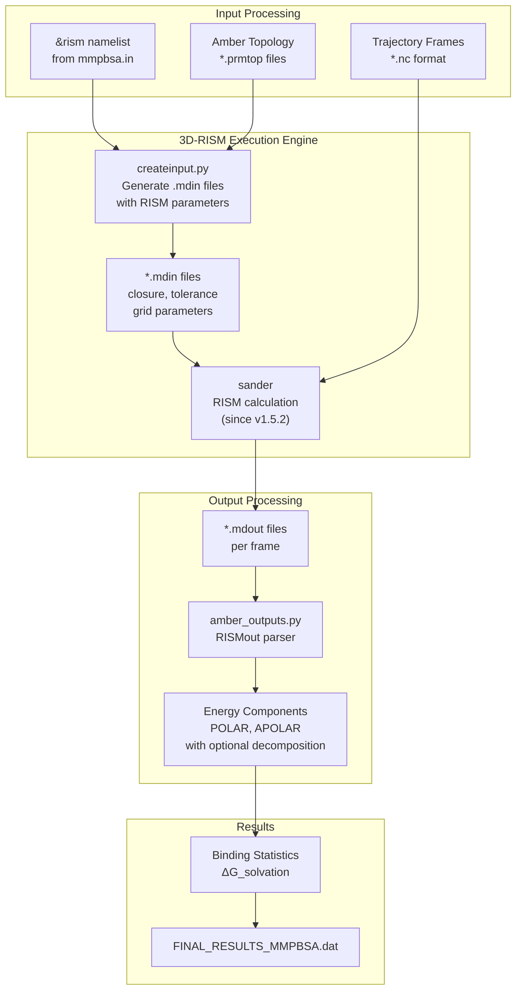
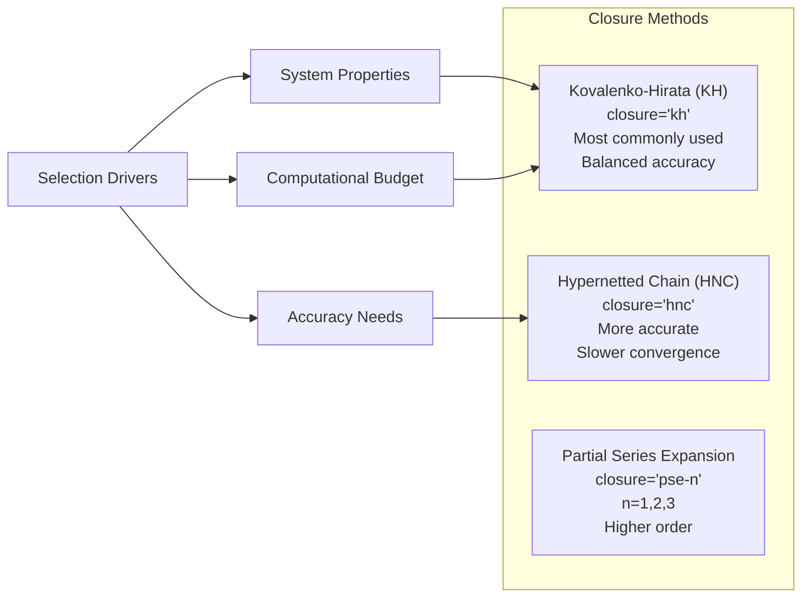

# 3D-RISM Model

<details>
<summary>Relevant source files</summary>

The following files were used as context for generating this wiki page:

- [GMXMMPBSA/data/xvv_files/spc-nacl-3.xvv](GMXMMPBSA/data/xvv_files/spc-nacl-3.xvv)
- [GMXMMPBSA/data/xvv_files/spc.xvv](GMXMMPBSA/data/xvv_files/spc.xvv)
- [GMXMMPBSA/data/xvv_files/spc_mmpbsa_py.xvv](GMXMMPBSA/data/xvv_files/spc_mmpbsa_py.xvv)
- [GMXMMPBSA/data/xvv_files/tip3p.xvv](GMXMMPBSA/data/xvv_files/tip3p.xvv)
- [docs/changelog.md](docs/changelog.md)
- [docs/compatibility.md](docs/compatibility.md)
- [docs/examples/3D-RISM/README.md](docs/examples/3D-RISM/README.md)
- [docs/examples/Alanine_scanning/README.md](docs/examples/Alanine_scanning/README.md)
- [docs/examples/Protein_glycan/README.md](docs/examples/Protein_glycan/README.md)
- [docs/examples/Protein_membrane/README.md](docs/examples/Protein_membrane/README.md)
- [docs/gmx_MMPBSA_running.md](docs/gmx_MMPBSA_running.md)
- [docs/input_file.md](docs/input_file.md)
- [docs/news.json](docs/news.json)

</details>


## Purpose and Scope

This page documents the 3D Reference Interaction Site Model (3D-RISM) solvation approach in `gmx_MMPBSA`. 3D-RISM is a statistical mechanics-based method that provides an alternative to implicit solvent models like GB and PB by treating solvent molecules through spatial correlation functions. For information about other solvation models, see [Generalized Born (GB) Models](#3.4.1), [Poisson-Boltzmann (PB) Models](#3.4.2), and [GBNSR6 Model](#3.4.3).

## Overview

The 3D-RISM model calculates solvation free energies by solving three-dimensional integral equations that describe solvent distribution around the solute. Unlike continuum models (GB/PB), 3D-RISM retains molecular-level detail of the solvent structure while avoiding explicit solvent molecular dynamics simulations. This makes it particularly useful for systems where specific solvent interactions are important, such as protein-protein interfaces.

**Key characteristics:**

- Molecular-level solvent representation through correlation functions.
- No need for explicit water molecules in trajectories.
- Captures specific solvation effects (hydrogen bonding, hydrophobic hydration).
- Computationally more expensive than GB, but faster than explicit solvent MD.
- Particularly effective for protein-protein systems.

**Sources:** [docs/input_file.md:20](), [docs/examples/3D-RISM/README.md:93-100]()

## Calculation Architecture

The following diagram shows how 3D-RISM calculations are executed within `gmx_MMPBSA`:

### 3D-RISM Execution Logic


**Implementation notes:**

- As of version 1.5.2, 3D-RISM calculations use `sander` instead of the standalone `rism3d.snglpnt` executable [docs/changelog.md:214]().
- Input file generation occurs in the `createinput.py` module.
- Output parsing is handled by specialized classes in `amber_outputs.py`.
- Each MPI rank processes independent frames in parallel.

**Sources:** [docs/changelog.md:214](), [docs/examples/3D-RISM/README.md:36-44]()

## Input File Configuration

3D-RISM calculations are configured through the `&rism` namelist in the input file. The namelist is defined separately from `&general`, `&gb`, and `&pb` namelists [docs/input_file.md:15-26]().

### Basic Input Structure

```
&general
sys_name="MySystem",
startframe=1,
endframe=100,
/
&rism
tolerance=0.00001,
closure="kh",
rism_verbose=2,
/
```

### Minimal Required Parameters

The `&rism` namelist has sensible defaults for most parameters. At minimum, you only need to include the namelist itself to activate 3D-RISM calculations:

```
&rism
/
```

However, commonly adjusted parameters include:
- `tolerance`: Convergence criterion (default: 0.00001).
- `closure`: Closure approximation (default: "kh").
- `rism_verbose`: Output verbosity level (default: 0).

**Sources:** [docs/input_file.md:20](), [docs/examples/3D-RISM/README.md:80-82]()

## Namelist Variables Reference

The following table summarizes the key parameters in the `&rism` namelist:

| Parameter | Type | Default | Description |
|-----------|------|---------|-------------|
| `polardecomp` | integer | 1 | Decompose solvation free energy into polar/non-polar (0=no, 1=yes) |
| `thermo` | string | "std" | Thermodynamic equation: "std", "gf", "both" |
| `closure` | string | "kh" | Closure approximation: "kh", "hnc", "pse-n" |
| `tolerance` | float | 0.00001 | Convergence tolerance (residual norm) |
| `ljTolerance` | float | -1 | Lennard-Jones convergence tolerance [docs/compatibility.md:34]() |
| `grdspc` | float array | 0.5, 0.5, 0.5 | Grid spacing in Angstroms (x, y, z) |
| `buffer` | float | 14.0 | Buffer distance around solute (Angstroms) |
| `rism_verbose` | integer | 0 | Output verbosity (0-2) |
| `noasympcorr` | integer | 1 | Disable asymptotic correction (0=no, 1=yes) [docs/compatibility.md:34]() |
| `entropicDecomp` | integer | 0 | Enable entropic decomposition [docs/compatibility.md:37]() |

**Sources:** [docs/input_file.md:20](), [docs/compatibility.md:33-37]()

## Closure Approximations

The `closure` parameter determines which integral equation closure is used. This is one of the most important algorithmic choices in 3D-RISM:

### Closure Selection Model


### Closure Details

**Kovalenko-Hirata (KH):**
- Default and most widely used.
- Good balance of accuracy and convergence.
- Recommended for most protein systems.
- `closure="kh"`.

**Hypernetted Chain (HNC):**
- More rigorous thermodynamically.
- Can be more accurate but slower to converge.
- May fail to converge for some systems.
- `closure="hnc"`.

**Sources:** [docs/examples/3D-RISM/README.md:81-100]()

## Computational Parameters

### Grid Configuration

3D-RISM solves integral equations on a 3D grid. Grid parameters significantly affect both accuracy and computational cost:

**Grid spacing (`grdspc`):**
- Smaller values = higher resolution, more accuracy, higher cost.
- Default: 0.5 Å in each dimension.
- Affects memory usage cubically.

**Buffer distance (`buffer`):**
- Minimum distance from solute to box edge.
- Default: 14.0 Å.
- Must be large enough to accommodate solvent correlation decay.

### Convergence Control

**Tolerance (`tolerance`):**
- Residual norm for convergence check.
- Default: 0.00001 (tight convergence).
- Can be relaxed to 0.001 or 0.0001 for faster calculations [docs/examples/3D-RISM/README.md:99]().

**Sources:** [docs/examples/3D-RISM/README.md:98-100](), [docs/compatibility.md:34-36]()

## Performance and Convergence Considerations

### Computational Cost

3D-RISM is more expensive than GB models but significantly faster than explicit solvent simulations.

### Parallel Scaling

Important note from the documentation regarding MPI parallelization:

> At a certain level, running RISM in parallel may actually hurt performance, since previous solutions are used as an initial guess for the next frame, hastening convergence. Running in parallel loses this advantage [docs/gmx_MMPBSA_running.md:140-143]().

**Sources:** [docs/gmx_MMPBSA_running.md:139-144]()

## Example Usage: Protein-Protein Binding

This example demonstrates a minimal 3D-RISM calculation for a protein-protein complex:

```yaml
# Sample input file for MM/3D-RISM
&general
sys_name="3D-RISM",
startframe=5,
endframe=8,
/
&rism
polardecomp=0, tolerance=0.001, rism_verbose=2, closure="kh"
/
```

**Command-line execution:**

```bash
# Serial
gmx_MMPBSA -O -i mmpbsa.in -cs com.tpr -ct com_traj.xtc -ci index.ndx -cg 3 4 -cp topol.top -o FINAL_RESULTS_MMPBSA.dat -eo FINAL_RESULTS_MMPBSA.csv

# MPI
mpirun -np 2 gmx_MMPBSA -O -i mmpbsa.in -cs com.tpr -ct com_traj.xtc -ci index.ndx -cg 3 4 -cp topol.top -o FINAL_RESULTS_MMPBSA.dat -eo FINAL_RESULTS_MMPBSA.csv
```

**Sources:** [docs/examples/3D-RISM/README.md:36-83]()

## Troubleshooting: AmberTools Compatibility

The 3D-RISM calculation is run by AmberTools. Some conda AmberTools builds linked with newer Fortran runtime libraries can abort before the RISM calculation starts with a `Fortran runtime error: Missing comma between descriptors` [docs/examples/3D-RISM/README.md:46-53]().

**Tested workaround:**
Use a specific environment with compatible GCC runtime libraries:
```bash
conda create -n gmxMMPBSA_rism -c conda-forge python=3.9 ambertools=23 "libgfortran5<13" "libgcc-ng<13"
conda activate gmxMMPBSA_rism
python -m pip install "gmx_MMPBSA==1.6.4"
```

**Sources:** [docs/examples/3D-RISM/README.md:55-63]()

## Solvent Data (XVV Files)

3D-RISM requires site-site susceptibility functions (XVV files) for the solvent. `gmx_MMPBSA` provides several standard water models:

- **SPC:** [GMXMMPBSA/data/xvv_files/spc.xvv:1-100]()
- **TIP3P:** [GMXMMPBSA/data/xvv_files/tip3p.xvv:1-100]()
- **SPC with NaCl:** [GMXMMPBSA/data/xvv_files/spc-nacl-3.xvv]()

These files define thermodynamic parameters like temperature (298.15 K), dielectric constant (78.497), and atom-specific parameters (mass, charge, sigma, epsilon) [GMXMMPBSA/data/xvv_files/spc.xvv:9-49]().

**Sources:** [GMXMMPBSA/data/xvv_files/spc.xvv:1-50](), [GMXMMPBSA/data/xvv_files/tip3p.xvv:1-50]()

---