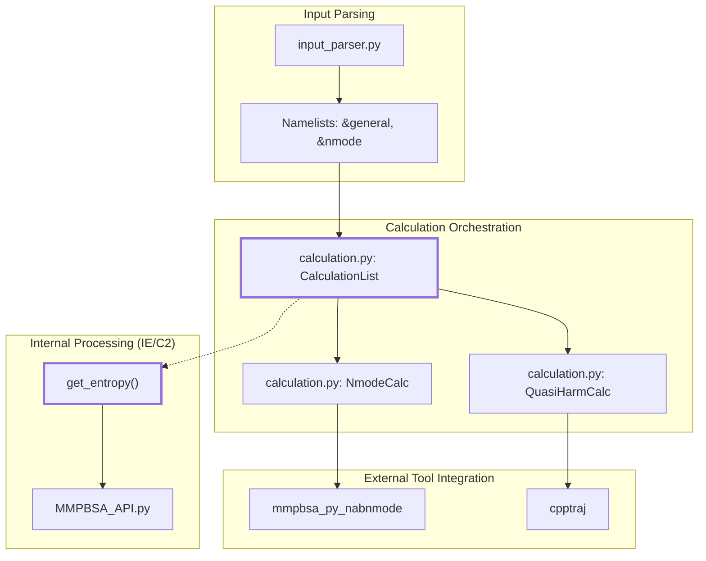

# Entropy Calculations

<details>
<summary>Relevant source files</summary>

The following files were used as context for generating this wiki page:

- [docs/changelog.md](docs/changelog.md)
- [docs/compatibility.md](docs/compatibility.md)
- [docs/examples/Decomposition_analysis/README.md](docs/examples/Decomposition_analysis/README.md)
- [docs/examples/Entropy_calculations/Interaction_Entropy/README.md](docs/examples/Entropy_calculations/Interaction_Entropy/README.md)
- [docs/examples/Entropy_calculations/nmode/README.md](docs/examples/Entropy_calculations/nmode/README.md)
- [docs/gmx_MMPBSA_running.md](docs/gmx_MMPBSA_running.md)
- [docs/input_file.md](docs/input_file.md)
- [docs/news.json](docs/news.json)

</details>


This page provides an overview of entropy calculation methods available in gmx_MMPBSA and their role in binding free energy calculations. For detailed information about specific methods, see [Normal Mode Analysis (NMODE)](#3.5.1), [Interaction Entropy (IE)](#3.5.2), and [Quasi-Harmonic and C2 Entropy](#3.5.3).

## Purpose and Scope

In MM/PB(GB)SA calculations, the binding free energy is typically decomposed into enthalpic ($\Delta H$) and entropic ($-T\Delta S$) contributions. While the enthalpic component can be readily computed from molecular mechanics energies and solvation free energies, the entropic contribution requires additional calculations. This page describes the four entropy estimation methods available in gmx_MMPBSA: Normal Mode Analysis (NMODE), Quasi-Harmonic (QH) approximation, Interaction Entropy (IE), and C2 Entropy. Each method represents different tradeoffs between computational cost, accuracy, and applicability to various systems.

Sources: [docs/input_file.md:24-25](), [docs/input_file.md:116-123]()

## Entropy in Binding Free Energy Calculations

The binding free energy ($\Delta G_{bind}$) is calculated as:

$$\Delta G_{bind} = \Delta H - T\Delta S$$

Where:
- $\Delta H$ represents the enthalpy change (obtained from MM/PB(GB)SA energies).
- $-T\Delta S$ represents the entropy contribution at temperature $T$.
- $\Delta S$ includes conformational, translational, and rotational entropy changes upon binding.

### Entropy Calculation Architecture

The following diagram illustrates how entropy methods are integrated into the core calculation logic, specifically within the `CalculationList` and the internal API.

**Figure 1. Entropy Calculation Logic and Code Entities**



Sources: [docs/input_file.md:15-25](), [docs/changelog.md:150-155](), [docs/gmx_MMPBSA_running.md:140-144]()

## Available Entropy Methods

gmx_MMPBSA implements four distinct approaches for estimating the entropic contribution:

| Method | Configuration Variable | Computational Cost | Typical Use Case |
|--------|------------------|-------------------|------------------|
| **NMODE** | `&nmode` namelist | Very High | Small systems, high accuracy required |
| **Quasi-Harmonic (QH)** | `qh_entropy=1` | High | Medium systems, covariance analysis |
| **Interaction Entropy (IE)** | `interaction_entropy=1` | Low | Most systems, fast screening |
| **C2 Entropy** | `c2_entropy=1` | Low | Alternative to IE, improved theory |

Sources: [docs/input_file.md:24-25](), [docs/compatibility.md:26-27](), [docs/compatibility.md:69-73]()

### Method Characteristics

#### Normal Mode Analysis (NMODE)
- **Approach**: Calculates vibrational frequencies from the Hessian matrix of minimized structures.
- **Cost**: Requires energy minimization and diagonalization (scales as $O(N^3)$).
- **Configuration**: Managed via the `&nmode` namelist with parameters like `maxcyc` and `drms`.
- **Note**: Now experimentally supports CHARMM topologies [docs/changelog.md:12-12]().

For details, see [Normal Mode Analysis (NMODE)](#3.5.1).

#### Quasi-Harmonic Approximation (QH)
- **Approach**: Constructs a covariance matrix from trajectory snapshots using `cpptraj`.
- **Requirement**: Needs sufficient sampling to converge the covariance matrix.
- **Configuration**: Set `qh_entropy=1` in the `&general` namelist.

For details, see [Quasi-Harmonic and C2 Entropy](#3.5.3).

#### Interaction Entropy (IE)
- **Approach**: Estimates entropy from gas-phase interaction energy fluctuations.
- **Cost**: Negligible overhead as it uses already-calculated energy terms.
- **Limitation**: Reliable only when the standard deviation $\sigma_{IE} < 3.6$ kcal/mol.
- **Configuration**: `interaction_entropy=1` and `ie_segment` (to select the equilibrated portion).

For details, see [Interaction Entropy (IE)](#3.5.2).

#### C2 Entropy
- **Approach**: An alternative formulation to IE based on cumulant expansion theory.
- **Configuration**: Set `c2_entropy=1` in the `&general` namelist.

For details, see [Quasi-Harmonic and C2 Entropy](#3.5.3).

Sources: [docs/input_file.md:116-160](), [docs/examples/Entropy_calculations/nmode/README.md:71-76](), [docs/examples/Entropy_calculations/Interaction_Entropy/README.md:57-67]()

## Input File Configuration

Entropy calculations are primarily defined in the `&general` and `&nmode` namelists.

```yaml
&general
  sys_name            = "Entropy_Study"
  temperature         = 298.15
  qh_entropy          = 1        # Enable QH
  interaction_entropy = 1        # Enable IE
  ie_segment          = 50       # Use last 50% of frames for IE
  c2_entropy          = 1        # Enable C2
/

&nmode
  nmstartframe = 1
  nmendframe   = 10
  nminterval   = 1
  maxcyc       = 50000
  drms         = 0.001
/
```

**Figure 2. Decision Matrix for Entropy Methods**

```mermaid
graph TD
    "System Size" --> SMALL["Small (< 500 atoms)"]
    "System Size" --> LARGE["Large (> 2000 atoms)"]
    
    SMALL --> RIGOR["Priority: Rigor"]
    SMALL --> FAST["Priority: Speed"]
    
    RIGOR --> USE_NMODE["Use NMODE<br/>(&nmode)"]
    FAST --> USE_IE["Use IE/C2<br/>(interaction_entropy=1)"]
    
    LARGE --> USE_IE
    
    "Sampling" --> COVAR["Covariance Analysis"]
    COVAR --> USE_QH["Use QH<br/>(qh_entropy=1)"]

    subgraph "Code Implementation"
        USE_NMODE -.-> NAB["mmpbsa_py_nabnmode"]
        USE_IE -.-> IE_CALC["internal calculation"]
        USE_QH -.-> CPPTRAJ["cpptraj"]
    end
```

Sources: [docs/input_file.md:116-160](), [docs/examples/Entropy_calculations/nmode/README.md:71-76](), [docs/examples/Entropy_calculations/Interaction_Entropy/README.md:57-67]()

## Computational Considerations

### Performance and RAM
- **NMODE**: Extremely memory-intensive. Total RAM $\approx$ RAM per frame $\times$ Number of Threads [docs/gmx_MMPBSA_running.md:132-137]().
- **Parallelization**: NMODE and MM/GBSA benefit from MPI, but RISM may see diminished returns due to loss of initial guess advantages [docs/gmx_MMPBSA_running.md:139-144]().

### Convergence Metrics
For IE and C2, the standard deviation of interaction energies ($\sigma_{IE}$) is a critical metric. It is reported in the `FINAL_RESULTS_MMPBSA.dat` file. If $\sigma_{IE} > 3.6$ kcal/mol, the entropy estimate may not be converged.

Sources: [docs/gmx_MMPBSA_running.md:132-144](), [docs/examples/Entropy_calculations/Interaction_Entropy/README.md:87-89]()

## Output and Visualization

Entropy results are integrated into:
1. **FINAL_RESULTS_MMPBSA.dat**: Summary statistics for all enabled methods.
2. **FINAL_RESULTS_MMPBSA.csv**: Per-frame energy data used for IE/C2.
3. **gmx_MMPBSA_ana**: The GUI allows for interactive recalculation of IE and C2 parameters (like `ie_segment`) without rerunning the entire simulation [docs/changelog.md:20-20](), [docs/changelog.md:190-190]().

Sources: [docs/examples/Entropy_calculations/nmode/README.md:98-101](), [docs/changelog.md:150-155]()

---