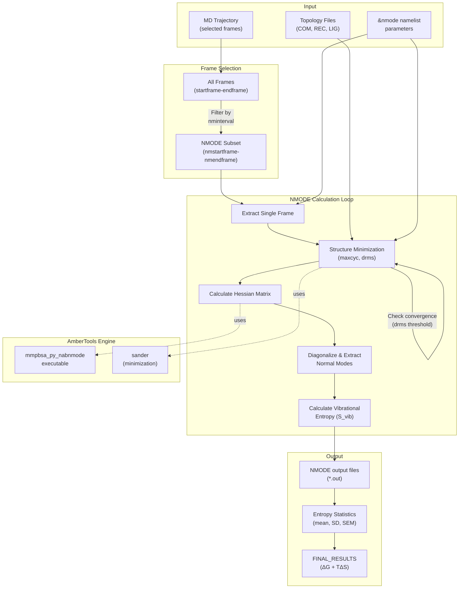
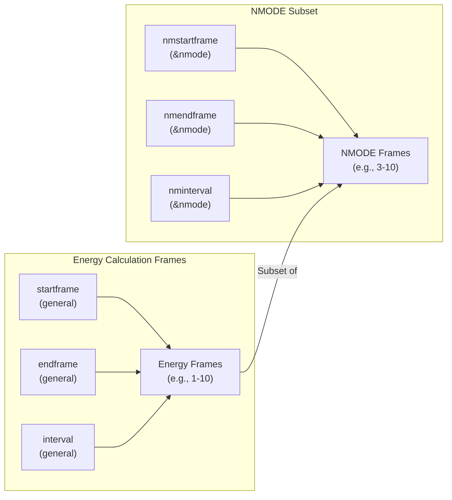
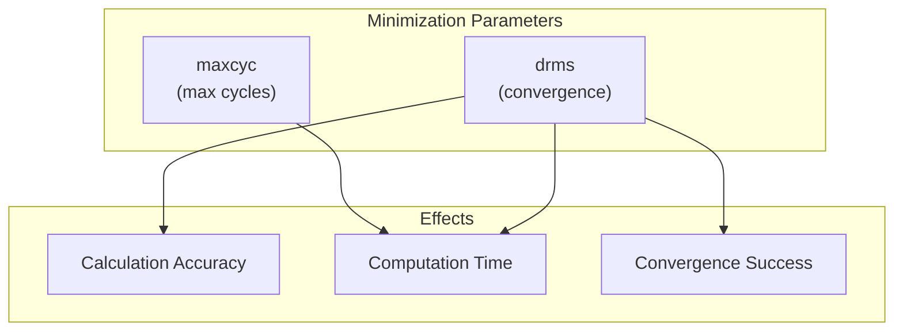
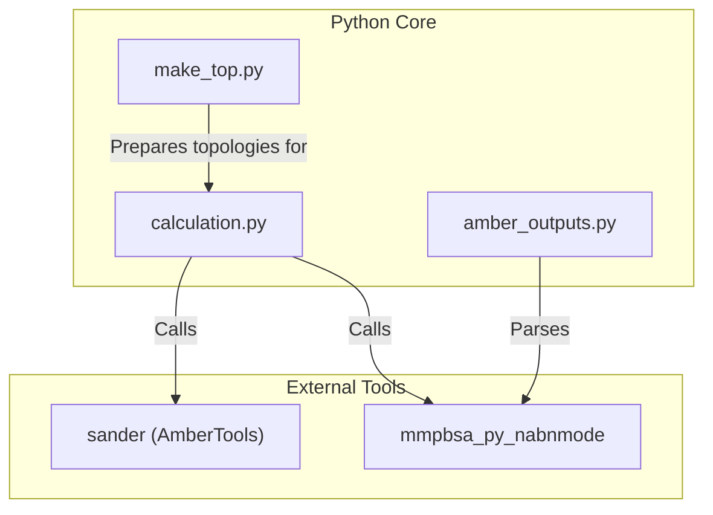

# Normal Mode Analysis (NMODE)

<details>
<summary>Relevant source files</summary>

The following files were used as context for generating this wiki page:

- [docs/changelog.md](docs/changelog.md)
- [docs/compatibility.md](docs/compatibility.md)
- [docs/examples/Decomposition_analysis/README.md](docs/examples/Decomposition_analysis/README.md)
- [docs/examples/Entropy_calculations/Interaction_Entropy/README.md](docs/examples/Entropy_calculations/Interaction_Entropy/README.md)
- [docs/examples/Entropy_calculations/nmode/README.md](docs/examples/Entropy_calculations/nmode/README.md)
- [docs/gmx_MMPBSA_running.md](docs/gmx_MMPBSA_running.md)
- [docs/input_file.md](docs/input_file.md)
- [docs/news.json](docs/news.json)

</details>


Normal Mode Analysis (NMODE) is one of the entropy calculation methods available in gmx_MMPBSA for estimating vibrational entropies in binding free energy calculations. This page details the NMODE implementation, its parameters, computational considerations, and practical usage guidelines.

For information about other entropy methods, see [Entropy Calculations](#3.5). For details on Interaction Entropy, see [Interaction Entropy (IE)](#3.5.2), and for Quasi-Harmonic and C2 Entropy, see [Quasi-Harmonic and C2 Entropy](#3.5.3).

## Overview

NMODE calculates vibrational entropies by performing normal mode analysis on minimized structures extracted from MD trajectories. Unlike the simpler Interaction Entropy (IE) or C2 methods, NMODE computes the full vibrational spectrum by diagonalizing the mass-weighted Hessian matrix, providing a rigorous thermodynamic treatment of entropic contributions to binding.

**Key Characteristics:**

- **Computational Cost**: Significantly more expensive than IE or C2 methods [docs/examples/Entropy_calculations/nmode/README.md:95-96]()
- **Physical Rigor**: Direct calculation of vibrational modes from the potential energy surface [docs/examples/Entropy_calculations/nmode/README.md:95-97]()
- **Memory Requirements**: High RAM consumption (scales with system size) [docs/gmx_MMPBSA_running.md:131-138]()
- **Convergence**: Requires structure minimization before mode calculation [docs/examples/Entropy_calculations/nmode/README.md:68-70]()
- **Frame Selection**: Typically uses a subset of MD frames due to computational expense [docs/examples/Entropy_calculations/nmode/README.md:66-67]()

Sources: [docs/examples/Entropy_calculations/nmode/README.md:1-114](), [docs/gmx_MMPBSA_running.md:131-138]()

## NMODE Calculation Workflow

The following diagram illustrates how NMODE integrates into the gmx_MMPBSA calculation pipeline:



**NMODE Calculation Process:**

1. **Frame Selection**: A subset of frames is selected based on `nmstartframe`, `nmendframe`, and `nminterval` parameters [docs/examples/Entropy_calculations/nmode/README.md:71-74]().
2. **Minimization**: Each selected structure is energy-minimized until convergence criteria (`maxcyc`, `drms`) are met [docs/examples/Entropy_calculations/nmode/README.md:75]().
3. **Hessian Calculation**: The second derivative matrix (Hessian) is computed using AmberTools utilities.
4. **Mode Extraction**: The Hessian is diagonalized to obtain normal mode frequencies.
5. **Entropy Calculation**: Vibrational entropy is calculated from the mode frequencies [docs/examples/Entropy_calculations/nmode/README.md:95-97]().

Sources: [docs/examples/Entropy_calculations/nmode/README.md:66-102](), [docs/input_file.md:24-25]()

## Input Parameters (&nmode namelist)

NMODE calculations are configured through the `&nmode` namelist in the input file [docs/input_file.md:24-25]().

### Parameter Reference Table

| Parameter | Type | Default | Description |
|-----------|------|---------|-------------|
| `nmstartframe` | integer | 1 | First frame to use for NMODE calculation [docs/examples/Entropy_calculations/nmode/README.md:72]() |
| `nmendframe` | integer | 1000000 | Last frame to use for NMODE calculation [docs/examples/Entropy_calculations/nmode/README.md:73]() |
| `nminterval` | integer | 1 | Offset between frames used in NMODE [docs/examples/Entropy_calculations/nmode/README.md:74]() |
| `maxcyc` | integer | 10000 | Maximum number of minimization cycles [docs/examples/Entropy_calculations/nmode/README.md:75]() |
| `drms` | float | 0.001 | Convergence criterion for minimization (kcal/mol-Å) [docs/examples/Entropy_calculations/nmode/README.md:75]() |

### Frame Selection Parameters



**Frame Selection Logic:**

- `nmstartframe` and `nmendframe` define the range **within** the frames selected by `startframe` and `endframe` [docs/examples/Entropy_calculations/nmode/README.md:66-67]().
- `nminterval` controls the spacing between NMODE frames.
- Example: If `startframe=1, endframe=10` and `nmstartframe=3, nmendframe=10, nminterval=1`, NMODE will process 8 frames (3rd to 10th) [docs/examples/Entropy_calculations/nmode/README.md:66-77]().

Sources: [docs/examples/Entropy_calculations/nmode/README.md:66-77]()

### Minimization Parameters

The minimization convergence directly impacts both accuracy and computational cost:



**Critical Considerations:**

- **Production runs**: Typical values are `maxcyc=50000, drms=0.001` [docs/examples/Entropy_calculations/nmode/README.md:68-70]().
- **Test runs**: Relaxed criteria (e.g., `maxcyc=5, drms=2`) allow faster testing but sacrifice accuracy [docs/examples/Entropy_calculations/nmode/README.md:71-76]().
- **Convergence failures**: Stricter convergence (smaller `drms`) increases computation time significantly.

Sources: [docs/examples/Entropy_calculations/nmode/README.md:68-77]()

## Sample Input File

```yaml
# NMODE Entropy Calculation Example
&general
sys_name="NMode",
startframe=1,
endframe=10,
forcefields="leaprc.protein.ff14SB",
PBRadii=2,
/

&gb
igb=1, saltcon=0.150,
/

# NMODE parameters
&nmode
nmstartframe=3,       # Start NMODE from frame 3
nmendframe=10,        # End NMODE at frame 10
nminterval=1,         # Use every frame in range
maxcyc=5,             # Test quality minimization
drms=2,               # Relaxed convergence for testing
/
```

Sources: [docs/examples/Entropy_calculations/nmode/README.md:48-77]()

## Computational Considerations

### Memory Requirements

NMODE calculations are memory-intensive, with RAM usage scaling with system size and number of parallel processes.

**RAM Requirement Formula:**
`RAM_total = RAM_per_frame * NUM_of_Threads` [docs/gmx_MMPBSA_running.md:134]()

**Memory Management Guidelines:**
- For NMODE calculations, it is recommended to have > 5GB pmem in HPC environments [docs/gmx_MMPBSA_running.md:118]().
- If RAM consumption exceeds system limits, it can cause crashes or instability [docs/gmx_MMPBSA_running.md:136]().

Sources: [docs/gmx_MMPBSA_running.md:118-138]()

### Computational Cost Comparison

NMODE is significantly slower than Interaction Entropy (IE) or C2 methods [docs/examples/Entropy_calculations/nmode/README.md:95-96]().

- **NMODE**: Rigorous but slow; scales as O(N³) for Hessian diagonalization.
- **IE**: Faster; reports average for a segment (e.g., `ie_segment=50`) [docs/examples/Entropy_calculations/Interaction_Entropy/README.md:87-89]().

Sources: [docs/examples/Entropy_calculations/nmode/README.md:95-96](), [docs/examples/Entropy_calculations/Interaction_Entropy/README.md:87-89]()

### Parallel Execution Considerations

NMODE with MPI has specific behavior patterns:

- **MPI Efficiency**: Running RISM or NMODE in parallel can sometimes hurt performance because serial runs use previous solutions as initial guesses for the next frame [docs/gmx_MMPBSA_running.md:140-144]().
- **Overhead**: Parallel scaling falls off as the number of threads reaches the number of frames due to topology loading overhead [docs/gmx_MMPBSA_running.md:142-143]().

Sources: [docs/gmx_MMPBSA_running.md:140-144]()

## Output Files and Results

NMODE results are integrated into the standard gmx_MMPBSA output files:

- `FINAL_RESULTS_MMPBSA.dat`: Contains the statistics for the entropic contribution [docs/examples/Entropy_calculations/nmode/README.md:98]().
- `FINAL_RESULTS_MMPBSA.csv`: Contains energy and entropy terms for every frame [docs/examples/Entropy_calculations/nmode/README.md:99-100]().

**Binding Free Energy Formula:**
`ΔG = ΔH - TΔS`
Where `TΔS` is the vibrational entropy contribution calculated via NMODE.

Sources: [docs/examples/Entropy_calculations/nmode/README.md:98-101]()

## Best Practices and Recommendations

1. **Equilibration**: Ensure the trajectory used for NMODE is well-equilibrated and PBC is removed [docs/gmx_MMPBSA_running.md:30-34]().
2. **Topology Consistency**: Ensure the structure defined in `-cs` is consistent and not "broken" [docs/gmx_MMPBSA_running.md:11-15]().
3. **MPI Usage**: MPI is recommended to decrease computation time, but monitor RAM carefully [docs/gmx_MMPBSA_running.md:81-82, 132]().
4. **Experimental Topologies**: NMODE is now experimentally implemented for CHARMM topologies as of v1.6.5 [docs/changelog.md:12]().

Sources: [docs/gmx_MMPBSA_running.md:11-138](), [docs/changelog.md:12]()

## Code Entity Association



Sources: [docs/compatibility.md:16-21](), [docs/changelog.md:18-23]()

---