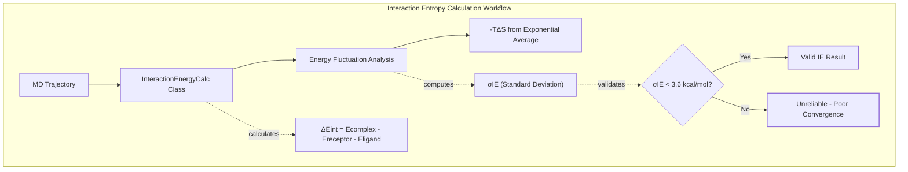
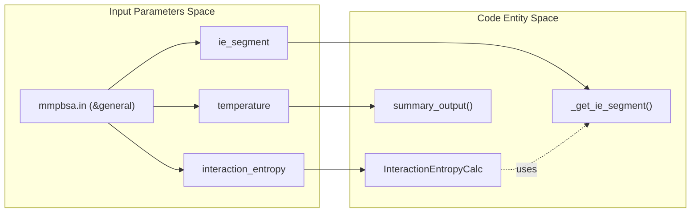
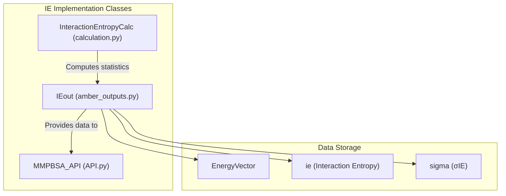

# Interaction Entropy (IE)

<details>
<summary>Relevant source files</summary>

The following files were used as context for generating this wiki page:

- [GMXMMPBSA/API.py](GMXMMPBSA/API.py)
- [GMXMMPBSA/amber_outputs.py](GMXMMPBSA/amber_outputs.py)
- [GMXMMPBSA/exceptions.py](GMXMMPBSA/exceptions.py)
- [GMXMMPBSA/output_file.py](GMXMMPBSA/output_file.py)
- [docs/examples/Decomposition_analysis/README.md](docs/examples/Decomposition_analysis/README.md)
- [docs/examples/Entropy_calculations/Interaction_Entropy/README.md](docs/examples/Entropy_calculations/Interaction_Entropy/README.md)
- [docs/examples/Entropy_calculations/nmode/README.md](docs/examples/Entropy_calculations/nmode/README.md)

</details>


## Purpose and Scope

This page describes the Interaction Entropy (IE) method for estimating entropic contributions in binding free energy calculations within `gmx_MMPBSA`. The IE method provides a computationally efficient alternative to Normal Mode Analysis (NMODE) and Quasi-Harmonic (QH) entropy calculations.

The Interaction Entropy approximation is based on the fluctuation of interaction energies between receptor and ligand during MD simulations, offering significant computational advantages while maintaining reasonable accuracy for many systems.

---

## Overview of Interaction Entropy

The Interaction Entropy method estimates the entropic contribution to binding free energy by analyzing the fluctuations in the interaction energy between the receptor and ligand. Unlike NMODE, which requires energy minimization and normal mode analysis for each frame, IE derives entropy directly from the interaction energy distribution sampled during the MD trajectory.

### Key Characteristics

| Property | Description |
|----------|-------------|
| **Computational Cost** | Low - uses existing interaction energy terms |
| **Solvent Model Independence** | Works with GB, PB, GBNSR6, and 3D-RISM |
| **Frame Requirements** | Moderate - typically uses a segment of frames |
| **Convergence Metric** | $\sigma_{IE}$ (standard deviation of interaction energy) |
| **Recommended $\sigma_{IE}$ Threshold** | < ~3.6 kcal/mol |

### Theoretical Foundation



**Sources:** [GMXMMPBSA/calculation.py:535-565](), [docs/examples/Entropy_calculations/Interaction_Entropy/README.md:87-89]()

---

## Configuration and Parameters

### Basic Setup

The IE calculation is controlled by variables in the `&general` namelist of the `gmx_MMPBSA` input file. The `interaction_entropy` parameter enables the calculation, while `ie_segment` defines the window of frames analyzed.



**Sources:** [GMXMMPBSA/calculation.py:535-538](), [GMXMMPBSA/output_file.py:85-87]()

### Input File Parameters

| Parameter | Type | Default | Description |
|-----------|------|---------|-------------|
| `interaction_entropy` | Integer | 0 | Enable (1) or disable (0) IE calculation |
| `ie_segment` | Integer | 25 | Percentage of trajectory frames from the end to use for IE |
| `temperature` | Float | 298.15 | Temperature in Kelvin for entropy calculation |

**Example Input File Snippet:**

```yaml
&general
sys_name="IE_Calculation",
startframe=1,
endframe=100,
interaction_entropy=1,
ie_segment=50,
temperature=303.15
/
```

**Sources:** [docs/examples/Entropy_calculations/Interaction_Entropy/README.md:49-67](), [GMXMMPBSA/amber_outputs.py:101-101]()

---

## Implementation Details

### Data Flow and Classes

The Interaction Entropy calculation is orchestrated by the `InteractionEntropyCalc` class and its results are managed by the `IEout` class.

1.  **Calculation Orchestration**: `InteractionEntropyCalc` in `GMXMMPBSA/calculation.py` [535-565]() performs the exponential averaging of the interaction energy.
2.  **Frame Selection**: The calculation uses a subset of frames defined by `ie_segment`. If 100 frames are processed and `ie_segment=50`, only the last 50 frames are used for the entropy calculation.
3.  **Result Storage**: Results are stored in the `IEout` class in `GMXMMPBSA/amber_outputs.py` [1341-1405](), which inherits from the base `AmberOutput` class.



**Sources:** [GMXMMPBSA/calculation.py:535-565](), [GMXMMPBSA/amber_outputs.py:1341-1355](), [GMXMMPBSA/API.py:35-40]()

### Convergence Metrics ($\sigma_{IE}$)

The standard deviation of the interaction energy ($\sigma_{IE}$) is a critical metric for assessing the validity of the IE result. If $\sigma_{IE}$ exceeds approximately 3.6 kcal/mol, the exponential average becomes numerically unstable and the result is considered unreliable.

The `IEout` class handles the reporting of these values:
-   `self['ie']`: The calculated Interaction Entropy value.
-   `self['sigma']`: The standard deviation $\sigma_{IE}$.

**Sources:** [GMXMMPBSA/amber_outputs.py:1351-1355](), [GMXMMPBSA/output_file.py:85-87]()

---

## Output and Results

### Final Results File

In the `FINAL_RESULTS_MMPBSA.dat` file, IE results are printed under the entropy section. The `output_file.py` module handles the formatting of these comments.

```python
# From GMXMMPBSA/output_file.py
if INPUT['general']['interaction_entropy']:
    final_output.add_comment('Interaction Entropy calculations performed using last %s frames' %
                             ceil(app.numframes * (INPUT['general']['ie_segment'] / 100)))
```
[GMXMMPBSA/output_file.py:85-87]()

### Statistical Summary

The `IEout.summary()` method provides the structured data for the final output, including:
-   Average Interaction Energy
-   Interaction Entropy ($-T\Delta S$)
-   $\sigma_{IE}$ (Standard Deviation)

**Sources:** [GMXMMPBSA/amber_outputs.py:1372-1405](), [GMXMMPBSA/output_file.py:155-165]()

### Data Integration (API)

The `MMPBSA_API` allows programmatic access to IE results. The `_setup_data` function in `API.py` prepares IE data for visualization in the Analyzer (`gmx_MMPBSA_ana`).

```python
# From GMXMMPBSA/API.py
elif level == 1.5:
    options = {'iec2': True}
    line_plot_data = data[['AccIntEnergy', 'ie']][:-3]
    bar_plot_data = data[['ie', 'sigma']][-3:]
```
[GMXMMPBSA/API.py:159-163]()

---

## Computational Efficiency

Compared to Normal Mode Analysis (NMODE), Interaction Entropy is significantly faster because it:
1.  Does not require expensive energy minimizations of each frame.
2.  Does not require the calculation and diagonalization of the Hessian matrix.
3.  Uses interaction energy terms that are already calculated during the MM/PBSA enthalpy (ΔH) phase.

| Feature | NMODE | IE |
|---------|-------|----|
| **Code Class** | `NMODEout` | `IEout` |
| **Complexity** | $O(N^3)$ | $O(N)$ |
| **Input Namelist** | `&nmode` | `&general` |
| **Key Function** | `_run_nmode` | `InteractionEntropyCalc` |

**Sources:** [GMXMMPBSA/calculation.py:535-565](), [docs/examples/Entropy_calculations/nmode/README.md:95-97](), [docs/examples/Entropy_calculations/Interaction_Entropy/README.md:88-89]()

---