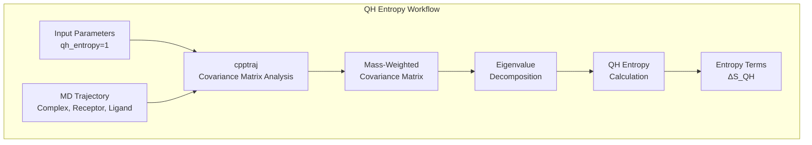
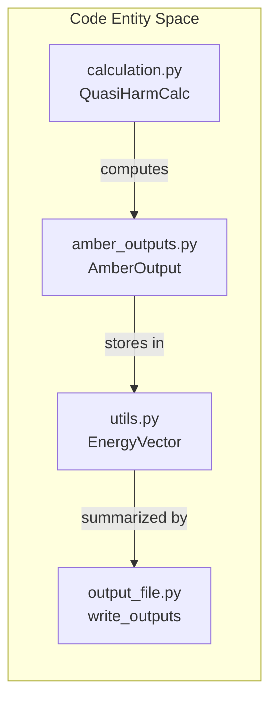
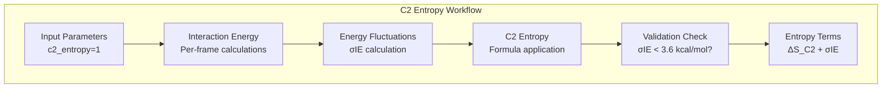
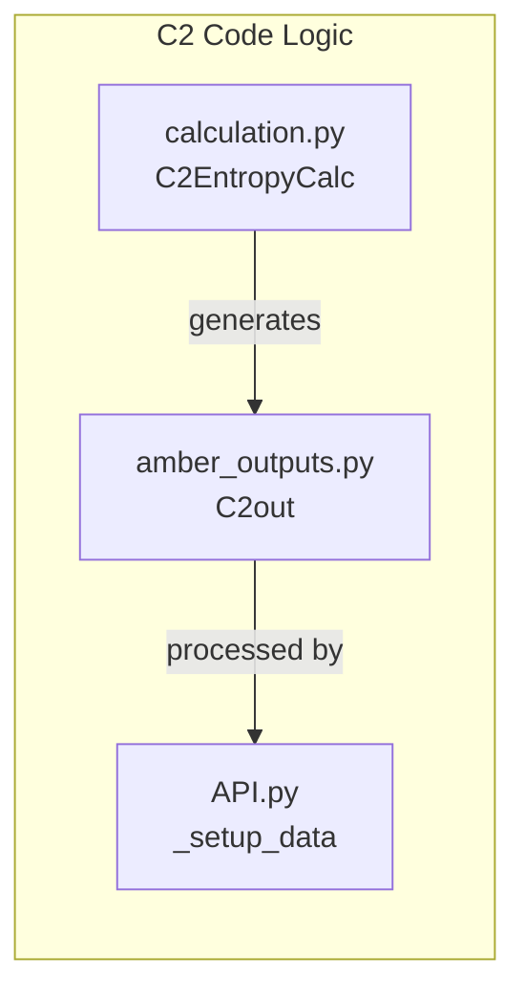

# Quasi-Harmonic and C2 Entropy

<details>
<summary>Relevant source files</summary>

The following files were used as context for generating this wiki page:

- [GMXMMPBSA/API.py](GMXMMPBSA/API.py)
- [GMXMMPBSA/amber_outputs.py](GMXMMPBSA/amber_outputs.py)
- [GMXMMPBSA/exceptions.py](GMXMMPBSA/exceptions.py)
- [GMXMMPBSA/output_file.py](GMXMMPBSA/output_file.py)
- [docs/examples/Entropy_calculations/C2_Entropy/README.md](docs/examples/Entropy_calculations/C2_Entropy/README.md)
- [docs/examples/Linear_PB_solver/README.md](docs/examples/Linear_PB_solver/README.md)
- [docs/examples/NonLinear_PB_solver/README.md](docs/examples/NonLinear_PB_solver/README.md)

</details>


This page documents the Quasi-Harmonic (QH) and C2 entropy calculation methods available in `gmx_MMPBSA` for estimating entropic contributions to binding free energy. These methods provide computationally efficient alternatives to Normal Mode Analysis (NMODE).

## Overview

Both Quasi-Harmonic and C2 entropy methods use trajectory-based approaches rather than minimization and vibrational analysis, making them significantly faster than NMODE calculations.

**Key Characteristics:**

| Feature | Quasi-Harmonic (QH) | C2 Entropy |
|---------|---------------------|------------|
| **Implementation** | v1.4.2 | v1.5.0 |
| **Calculation Engine** | `cpptraj` | Internal calculation |
| **Computational Cost** | Moderate | Low |
| **Frame Requirements** | > 3N frames (N = atoms) | Standard trajectory |
| **Primary Output** | Entropy from covariance matrix | C2-based entropy estimate |
| **Validation Metric** | Visual inspection | σIE (should be < 3.6 kcal/mol) |

Sources: [GMXMMPBSA/output_file.py:88-90](), [docs/examples/Entropy_calculations/C2_Entropy/README.md:9-11](), [docs/examples/Entropy_calculations/C2_Entropy/README.md:83-86]()

## Quasi-Harmonic (QH) Entropy

### Theory and Implementation

The Quasi-Harmonic approximation calculates entropy from the covariance matrix of atomic fluctuations observed in the MD trajectory. It uses `cpptraj` internally to compute the mass-weighted covariance matrix and extract eigenvalues for entropy calculation.


**Diagram: Quasi-Harmonic Entropy Calculation Pipeline**

The calculation occurs separately for complex, receptor, and ligand. The binding entropy is computed as:
**ΔS_binding = S_complex - (S_receptor + S_ligand)**

Sources: [GMXMMPBSA/output_file.py:120-143](), [GMXMMPBSA/amber_outputs.py:60-61]()

### Configuration

QH entropy is enabled in the `&general` namelist of the input file.

| Parameter | Type | Default | Description |
|-----------|------|---------|-------------|
| `qh_entropy` | Integer | 0 | 1: Perform QH entropy calculation |
| `temperature`| Float | 298.15 | Temperature in Kelvin |

Sources: [GMXMMPBSA/output_file.py:106-106](), [GMXMMPBSA/output_file.py:120-120]()

### Implementation Details

The `QuasiHarmCalc` class (managed within `calculation.py`) orchestrates the execution of `cpptraj` to generate the covariance matrix. The results are parsed by `AmberOutput` derivatives in `amber_outputs.py`.


**Diagram: QH Code Entities and Data Flow**

Sources: [GMXMMPBSA/amber_outputs.py:65-71](), [GMXMMPBSA/output_file.py:120-129]()

## C2 Entropy

### Theory and Implementation

Introduced in v1.5.0, the C2 entropy method calculates entropy from the fluctuations of the interaction energy between receptor and ligand. It is highly efficient and correlates well with experimental binding affinities.


**Diagram: C2 Entropy Calculation Pipeline**

Sources: [GMXMMPBSA/calculation.py:35-35](), [GMXMMPBSA/output_file.py:88-90](), [docs/examples/Entropy_calculations/C2_Entropy/README.md:83-86]()

### Configuration

C2 entropy is configured in the `&general` namelist.

| Parameter | Type | Default | Description |
|-----------|------|---------|-------------|
| `c2_entropy` | Integer | 0 | 1: Perform C2 entropy calculation |
| `ie_segment` | Integer | 25 | Percentage of frames (from end) used for averaging |

Sources: [GMXMMPBSA/output_file.py:88-90](), [docs/examples/Entropy_calculations/C2_Entropy/README.md:60-60]()

### Validation Criteria

The C2 method reports a standard deviation of the interaction energy (σIE). 
* **Reliable**: σIE < 3.6 kcal/mol.
* **Unreliable**: σIE > 3.6 kcal/mol. When this threshold is exceeded, the C2 method tends to give unrealistically large entropies.

Sources: [GMXMMPBSA/output_file.py:88-90](), [docs/examples/Entropy_calculations/C2_Entropy/README.md:83-86]()

### Implementation Details

The C2 calculation is handled by the `C2EntropyCalc` class in `calculation.py`. Data is processed into `C2out` objects defined in `amber_outputs.py`.


**Diagram: C2 Entropy Code Entities**

Sources: [GMXMMPBSA/API.py:35-40](), [GMXMMPBSA/output_file.py:151-160]()

## Comparison and Integration

### Output Processing

Both QH and C2 results are integrated into the final report via `write_outputs` in `output_file.py`.

* **QH Results**: Printed as "ENTROPY RESULTS (QH APPROXIMATION)".
* **C2 Results**: Printed as "ENTROPY RESULTS (C2 METHOD)".
* **Bootstrapping**: C2 results include confidence intervals obtained by bootstrapping with 2000 re-samplings.

Sources: [GMXMMPBSA/output_file.py:88-90](), [GMXMMPBSA/output_file.py:128-129](), [GMXMMPBSA/output_file.py:155-156]()

### Data Handling in API

The `API.py` module exposes C2 and QH data for custom analysis, utilizing `pandas` for data structuring.

```python
# API handling for C2 and Interaction Entropy
from GMXMMPBSA.calculation import InteractionEntropyCalc, C2EntropyCalc
from GMXMMPBSA.amber_outputs import IEout, C2out
```

Sources: [GMXMMPBSA/API.py:35-40](), [GMXMMPBSA/API.py:130-170]()

### Summary of Differences

| Method | Scaling | Accuracy | Implementation Class |
|--------|---------|----------|----------------------|
| **NMODE** | O(N³) | High | `NMODEout` |
| **QH** | O(N²) | Moderate | `QuasiHarmCalc` |
| **C2** | O(1) | Good | `C2EntropyCalc` |

Sources: [GMXMMPBSA/amber_outputs.py:60-62](), [GMXMMPBSA/API.py:35-35](), [docs/examples/Entropy_calculations/C2_Entropy/README.md:83-86]()

---