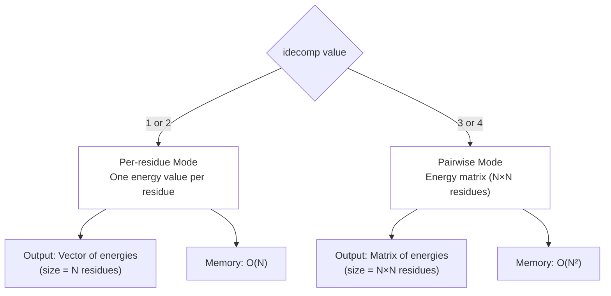
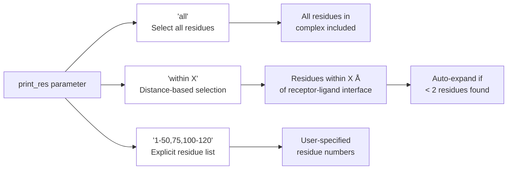
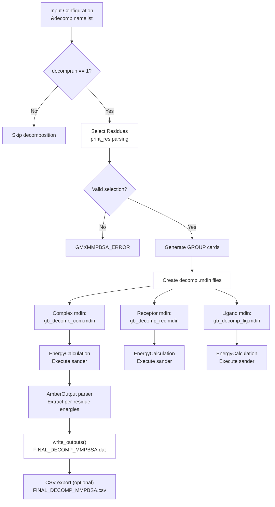
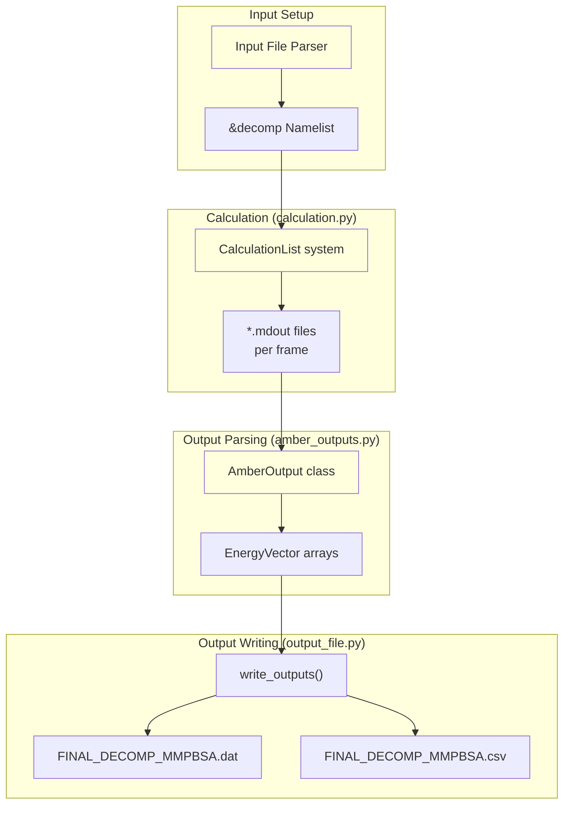
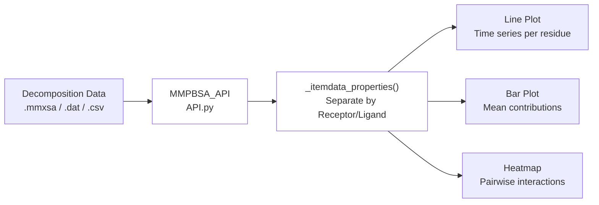

# Decomposition Analysis

Relevant source files

The following files were used as context for generating this wiki page:

- [GMXMMPBSA/API.py](GMXMMPBSA/API.py)
- [GMXMMPBSA/amber_outputs.py](GMXMMPBSA/amber_outputs.py)
- [GMXMMPBSA/exceptions.py](GMXMMPBSA/exceptions.py)
- [GMXMMPBSA/output_file.py](GMXMMPBSA/output_file.py)
- [docs/changelog.md](docs/changelog.md)
- [docs/compatibility.md](docs/compatibility.md)
- [docs/examples/Decomposition_analysis/README.md](docs/examples/Decomposition_analysis/README.md)
- [docs/examples/Entropy_calculations/Interaction_Entropy/README.md](docs/examples/Entropy_calculations/Interaction_Entropy/README.md)
- [docs/examples/Entropy_calculations/nmode/README.md](docs/examples/Entropy_calculations/nmode/README.md)
- [docs/gmx_MMPBSA_running.md](docs/gmx_MMPBSA_running.md)
- [docs/input_file.md](docs/input_file.md)
- [docs/news.json](docs/news.json)

Decomposition analysis in gmx_MMPBSA enables per-residue or pairwise energy decomposition to identify specific residues that contribute most to binding affinity. This analysis dissects the total binding free energy into contributions from individual residues or residue pairs, providing atomistic insights into molecular recognition mechanisms.

For information about alanine scanning (systematic mutation analysis), see [Alanine Scanning](#3.7). For output file formats containing decomposition data, see [Decomposition Output Files](#5.3).

## Purpose and Scope

Decomposition analysis calculates the energetic contribution of each residue (or residue pair) to the overall binding free energy. This is accomplished by partitioning the molecular mechanics energy terms (electrostatics, van der Waals, solvation) into residue-specific or pairwise components. The analysis is available for GB, PB, and GBNSR6 solvation models and can operate in per-residue (`idecomp=1,2`) or pairwise (`idecomp=3,4`) modes.

Sources: [docs/input_file.md:23](), [GMXMMPBSA/amber_outputs.py:37-41](), [docs/changelog.md:69-72]()

## Decomposition Modes

The `idecomp` parameter controls the decomposition scheme. Four modes are available, differing in how they handle 1-4 non-bonded interactions:

| Mode | Description | 1-4 Treatment | Use Case |
|------|-------------|---------------|----------|
| `idecomp=1` | Per-residue decomposition | Added to Internal (BOND+ANGLE+DIHED) | Standard per-residue analysis |
| `idecomp=2` | Per-residue decomposition | Added to EEL and VDW | Alternative per-residue analysis |
| `idecomp=3` | Pairwise decomposition | Added to Internal | Detailed residue-residue interactions |
| `idecomp=4` | Pairwise decomposition | Added to EEL and VDW | Alternative pairwise analysis |

**Performance Warning**: Pairwise decomposition (`idecomp=3,4`) generates approximately `6 × (number_of_terms) × (number_of_residues)²` data items. For large selections, this can consume significant memory and processing time.

**Diagram: Decomposition Mode Selection and Complexity**

Sources: [GMXMMPBSA/amber_outputs.py:37-41](), [GMXMMPBSA/amber_outputs.py:110-112]()

## Residue Selection System

The `print_res` variable controls which residues are included in decomposition analysis. Three selection methods are available:

### Selection Methods

**Diagram: Residue Selection Logic**

### Distance-Based Selection

When using `print_res = "within X"`, gmx_MMPBSA automatically identifies interface residues by calculating the minimum distance between all receptor and ligand atoms. If fewer than 2 residues are found, it automatically retries with an increased cutoff.

Sources: [docs/examples/Decomposition_analysis/README.md:67-74](), [docs/changelog.md:110-110]()

## Decomposition Workflow

**Diagram: Decomposition Analysis Pipeline**

Sources: [GMXMMPBSA/output_file.py:44-46](), [GMXMMPBSA/output_file.py:53-70](), [docs/examples/Decomposition_analysis/README.md:38-42]()

## Configuration Variables

The `&decomp` namelist in the input file controls decomposition behavior:

### Core Parameters

**`decomprun`** (Default: 0)
:   Activates decomposition analysis. Set to `1` to enable.

**`idecomp`** (Default: 0)
:   Decomposition scheme selector:
    - `0` = No decomposition
    - `1` = Per-residue, 1-4 added to Internal
    - `2` = Per-residue, 1-4 added to EEL/VDW
    - `3` = Pairwise, 1-4 added to Internal
    - `4` = Pairwise, 1-4 added to EEL/VDW

**`print_res`** (Default: "within 6.0")
:   Residue selection string. Supports `"all"`, `"within X"`, or explicit ranges like `"1-50,75"`.

**`dec_verbose`** (Default: 0)
:   Controls output detail level for pairwise decomposition (`idecomp=3,4`). Higher levels provide more granular energy component breakdowns.

**`csv_format`** (Default: 1)
:   Output format control. Generates CSV files with decomposition data when enabled.

Sources: [docs/input_file.md:23](), [docs/examples/Decomposition_analysis/README.md:71-74](), [docs/changelog.md:110-110]()

## Implementation Architecture

**Diagram: Decomposition Implementation Components**

### Key Classes and Methods

**AmberOutput** [GMXMMPBSA/amber_outputs.py:65-81]()
:   Base class for parsing Amber output files. It manages the collection of data across multiple threads and frames.

**EnergyVector** [GMXMMPBSA/amber_outputs.py:30-30]()
:   Specialized list-derived class used to store and manipulate per-frame energy data.

**write_outputs()** [GMXMMPBSA/output_file.py:53-118]()
:   Orchestrates the generation of final output files, including statistics, date headers, and system information.

**data2pkl()** [GMXMMPBSA/output_file.py:31-51]()
:   Serializes calculation results into a `.mmxsa` binary file for use in the GUI analyzer.

Sources: [GMXMMPBSA/amber_outputs.py:65-108](), [GMXMMPBSA/output_file.py:31-70]()

## Output Data Structure

Decomposition analysis produces two primary output files:

### FINAL_DECOMP_MMPBSA.dat
Text format containing statistical summaries including mean, standard deviation (SD), and standard error of the mean (SEM) for per-residue contributions.

### FINAL_DECOMP_MMPBSA.csv
Comma-separated format containing per-frame energy values for every printed residue.

Sources: [GMXMMPBSA/output_file.py:64-67](), [docs/examples/Decomposition_analysis/README.md:99-101]()

## Integration with Analysis Tools

Decomposition data flows into the analyzer application (`gmx_MMPBSA_ana`) via the API:

**Diagram: Decomposition Data Flow to Visualization**

The `MMPBSA_API` provides methods to extract decomposition energy and groups them by Receptor and Ligand residues [GMXMMPBSA/API.py:101-108](). The `_setup_data` function in the API prepares this data for the analyzer's plotting components [GMXMMPBSA/API.py:130-175]().

Sources: [GMXMMPBSA/API.py:101-108](), [GMXMMPBSA/API.py:130-175](), [docs/changelog.md:154-156]()

---