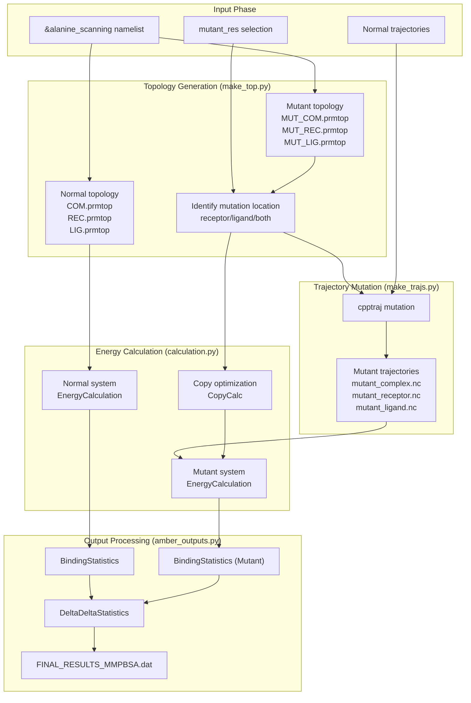
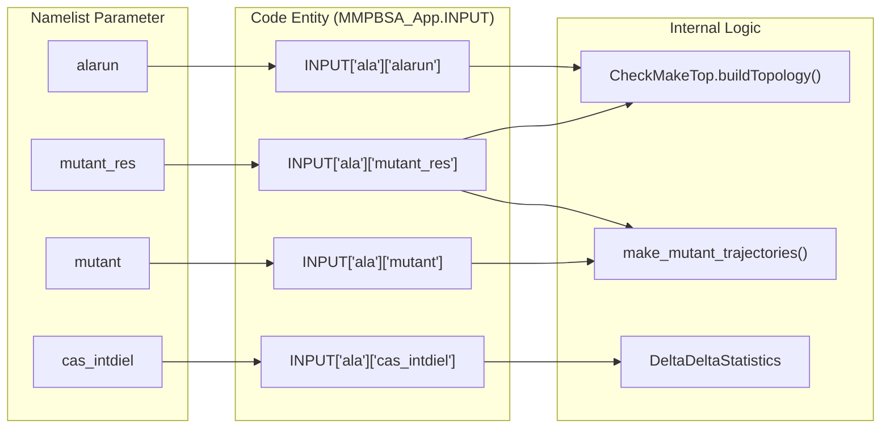
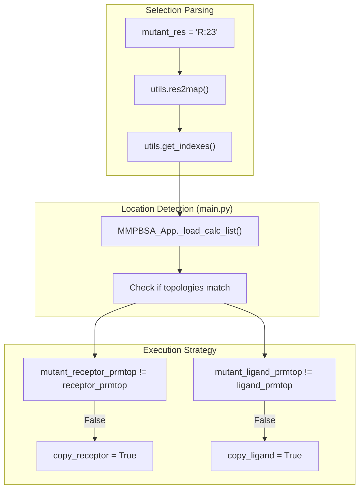
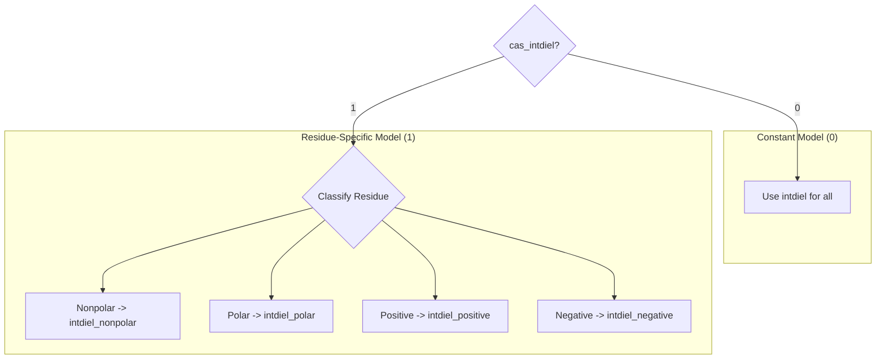

# Alanine Scanning

<details>
<summary>Relevant source files</summary>

The following files were used as context for generating this wiki page:

- [GMXMMPBSA/main.py](GMXMMPBSA/main.py)
- [GMXMMPBSA/make_top.py](GMXMMPBSA/make_top.py)
- [GMXMMPBSA/utils.py](GMXMMPBSA/utils.py)
- [docs/examples/3D-RISM/README.md](docs/examples/3D-RISM/README.md)
- [docs/examples/Alanine_scanning/README.md](docs/examples/Alanine_scanning/README.md)
- [docs/examples/Protein_glycan/README.md](docs/examples/Protein_glycan/README.md)
- [docs/examples/Protein_membrane/README.md](docs/examples/Protein_membrane/README.md)
- [examples/Alanine_scanning/README.md](examples/Alanine_scanning/README.md)
- [examples/Alanine_scanning/com.pdb](examples/Alanine_scanning/com.pdb)
- [examples/Alanine_scanning/mmpbsa.in](examples/Alanine_scanning/mmpbsa.in)

</details>


## Overview

Alanine scanning is a computational mutagenesis technique that systematically mutates residues to alanine (or another amino acid) to assess their contribution to binding free energy. In `gmx_MMPBSA`, this is implemented through the `&alanine_scanning` namelist, which enables automated calculation of ΔΔG values (mutant minus normal) to identify hotspot residues in protein-ligand or protein-protein interfaces.

For general input file configuration, see section 3.2. For output interpretation, see section 5.

**Sources:** [docs/examples/Alanine_scanning/README.md:7-13](), [GMXMMPBSA/main.py:155-165]()

---

## Purpose and Scope

Alanine scanning in `gmx_MMPBSA`:

- **Performs systematic mutations** of selected residues to alanine (or another amino acid) [GMXMMPBSA/make_trajs.py:152-160]()
- **Calculates binding free energies** for both normal and mutant systems [GMXMMPBSA/main.py:229-231]()
- **Computes ΔΔG values** (mutant - normal) to quantify residue contributions [GMXMMPBSA/amber_outputs.py:34-35]()
- **Supports flexible dielectric modeling** with residue-type-specific internal dielectric constants [GMXMMPBSA/make_top.py:50-53]()
- **Optimizes calculations** by copying unchanged receptor or ligand contributions when mutations are localized [GMXMMPBSA/main.py:256-260]()

This analysis is performed after the main MM/PB(GB)SA calculations on the normal system, using the same trajectory frames.

**Sources:** [GMXMMPBSA/main.py:153-165](), [GMXMMPBSA/main.py:229-231]()

---

## Calculation Architecture

### Data Flow and Logic

The alanine scanning workflow is orchestrated by the `MMPBSA_App` class, which manages the transition from topology generation to final statistical output.

Title: Alanine Scanning Calculation Flow


**Sources:** [GMXMMPBSA/make_top.py:100-112](), [GMXMMPBSA/make_trajs.py:135-298](), [GMXMMPBSA/main.py:226-260](), [GMXMMPBSA/calculation.py:36-38]()

---

## Input Configuration: The `&alanine_scanning` Namelist

### Key Variables and Implementation

The parameters for alanine scanning are parsed and stored in the `INPUT['ala']` dictionary.

Title: Alanine Scanning Configuration Mapping


**Sources:** [GMXMMPBSA/main.py:68-70](), [GMXMMPBSA/main.py:155-165](), [GMXMMPBSA/make_top.py:123-130]()

### Variable Descriptions

| Variable | Type | Default | Description |
|----------|------|---------|-------------|
| `alarun` | int | 0 | Enable alanine scanning (1 = yes, 0 = no) |
| `mutant_res` | str | None | Residue selection in Amber mask syntax (required if `alarun=1`) |
| `mutant` | str | 'ALA' | Target amino acid for mutation (three-letter code) |
| `mutant_only` | int | 0 | Calculate only mutant (1) or both normal and mutant (0) |
| `cas_intdiel` | int | 0 | Internal dielectric model (0: constant, 1: residue-type specific) |
| `intdiel` | float | 1.0 | Internal dielectric constant when `cas_intdiel=0` |
| `intdiel_nonpolar` | float | 1.0 | Dielectric for nonpolar residues when `cas_intdiel=1` |
| `intdiel_polar` | float | 1.0 | Dielectric for polar residues when `cas_intdiel=1` |
| `intdiel_positive` | float | 1.0 | Dielectric for positively charged residues when `cas_intdiel=1` |
| `intdiel_negative` | float | 1.0 | Dielectric for negatively charged residues when `cas_intdiel=1` |

**Sources:** [examples/Alanine_scanning/mmpbsa.in:16-18](), [docs/examples/Alanine_scanning/README.md:52-73]()

---

## Residue Selection with `mutant_res`

### Selection Logic

The `mutant_res` parameter uses Amber mask syntax. The code maps these selections to specific molecules (Receptor or Ligand) to determine if energy recalculation is necessary for both or if one can be copied.

Title: Residue Selection Processing Logic


**Sources:** [GMXMMPBSA/utils.py:30-31](), [GMXMMPBSA/main.py:256-260](), [GMXMMPBSA/make_top.py:100-106]()

### Molecule Prefix Convention

- `R:23` - Residue 23 in the **receptor** [examples/Alanine_scanning/mmpbsa.in:17]()
- `L:5` - Residue 5 in the **ligand**
- `:23` - Residue 23 in the complex (automatic assignment)

---

## Internal Dielectric Constants: The `cas_intdiel` Parameter

### Dielectric Assignment Models

When `cas_intdiel=1` is used, residues are classified into four categories to assign different `intdiel` values.

**Residue Classifications in `make_top.py`:**
- **Positive (`positive_aa`)**: LYS, ARG, HIP [GMXMMPBSA/make_top.py:50]()
- **Negative (`negative_aa`)**: GLU, ASP [GMXMMPBSA/make_top.py:51]()
- **Nonpolar (`nonpolar_aa`)**: PHE, TRP, VAL, ILE, LEU, MET, PRO, CYX, ALA, GLY [GMXMMPBSA/make_top.py:52]()
- **Polar (`polar_aa`)**: TYR, SER, THR, CYM, CYS, HIE, HID, GLN, ASN, ASH, GLH, LYN [GMXMMPBSA/make_top.py:53]()

Title: Dielectric Constant Logic


**Sources:** [GMXMMPBSA/make_top.py:50-53](), [docs/examples/Alanine_scanning/README.md:89-92]()

---

## Trajectory Mutation Process

### Mutation via cpptraj

The `make_mutant_trajectories` function in `make_trajs.py` handles the physical mutation of the trajectory frames.

**Implementation Details:**
- **Function**: `make_mutant_trajectories(INPUT, FILES, ...)` [GMXMMPBSA/make_trajs.py:135]()
- **Tool**: Uses `cpptraj` mutation command.
- **Backbone Preservation**: The command preserves `@CA,C,N,O,HA` atoms while replacing the sidechain [GMXMMPBSA/make_trajs.py:135-298]().
- **Output**: Generates `MUT_COM.nc`, `MUT_REC.nc`, and `MUT_LIG.nc` (or `.mdcrd`) [GMXMMPBSA/main.py:155-165]().

**Sources:** [GMXMMPBSA/make_trajs.py:135-298](), [GMXMMPBSA/main.py:155-165]()

---

## Interpretation of Results

### Statistical Processing

Results are processed using the `DeltaDeltaStatistics` class [GMXMMPBSA/amber_outputs.py:34-35]().

- **ΔΔG Calculation**: `ΔΔG = ΔG(mutant) - ΔG(normal)`
- **Energy Vectors**: Individual energy terms (VDWAALS, EEL, EGB, ESURF) are stored as `EnergyVector` objects for statistical operations [GMXMMPBSA/utils.py:52-63]().
- **Standard Deviation**: Propagated using `get_std` (square root of sum of squares) [GMXMMPBSA/utils.py:153-154]().

### ΔΔG Interpretation

| ΔΔG Value | Interpretation |
|-----------|----------------|
| **ΔΔG > 0** | Mutation **destabilizes** binding (residue is a hotspot) |
| **ΔΔG < 0** | Mutation **stabilizes** binding (residue unfavorable) |
| **ΔΔG ≈ 0** | Mutation has **minimal effect** |

**Sources:** [GMXMMPBSA/amber_outputs.py:1030-1184](), [GMXMMPBSA/utils.py:153-154](), [GMXMMPBSA/utils.py:161-180]()

---

## Example Input File

The following is a sample configuration for an alanine scanning run using GB-Neck2 (`igb=8`).

```yaml
Sample input file for Alanine scanning
&general
  sys_name="Alanine_Scanning",
  startframe=1,
  endframe=10,
  forcefields="leaprc.protein.ff14SB",
  PBRadii=4,
/
&gb
  igb=8, saltcon=0.150,
/
&alanine_scanning
  mutant='ALA', 
  mutant_res='R:23', 
  cas_intdiel=1
/
```

**Sources:** [examples/Alanine_scanning/mmpbsa.in:1-18](), [docs/examples/Alanine_scanning/README.md:52-73]()

---