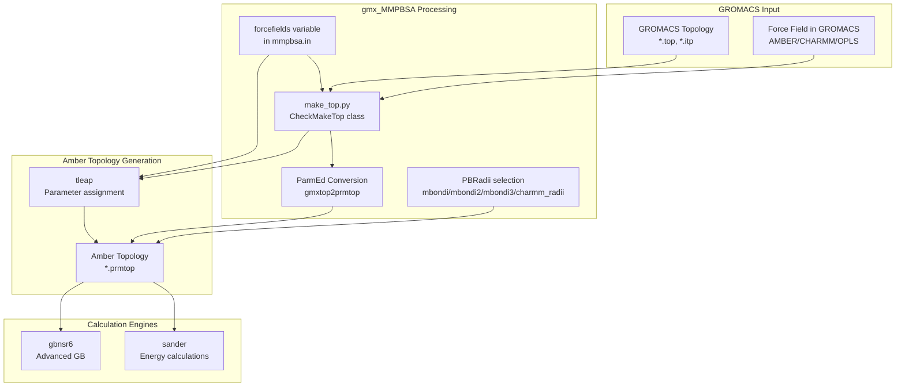
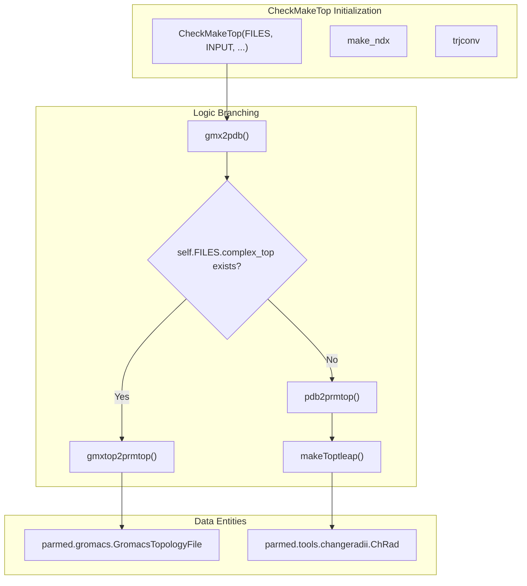

# Force Field Support

Relevant source files

The following files were used as context for generating this wiki page:

- [GMXMMPBSA/data/gmxMMPBSA/GLYCAM_aminont_06h.lib](GMXMMPBSA/data/gmxMMPBSA/GLYCAM_aminont_06h.lib)
- [GMXMMPBSA/data/gmxMMPBSA/leaprc.GLYCAM_06h-1](GMXMMPBSA/data/gmxMMPBSA/leaprc.GLYCAM_06h-1)
- [GMXMMPBSA/data/gmxMMPBSA/leaprc.zaa99SB](GMXMMPBSA/data/gmxMMPBSA/leaprc.zaa99SB)
- [GMXMMPBSA/data/gmxMMPBSA/original_zaa.off](GMXMMPBSA/data/gmxMMPBSA/original_zaa.off)
- [GMXMMPBSA/data/gmxMMPBSA/zaa99SB.frcmod](GMXMMPBSA/data/gmxMMPBSA/zaa99SB.frcmod)
- [GMXMMPBSA/data/gmxMMPBSA/zaa99SB.off](GMXMMPBSA/data/gmxMMPBSA/zaa99SB.off)
- [GMXMMPBSA/main.py](GMXMMPBSA/main.py)
- [GMXMMPBSA/make_top.py](GMXMMPBSA/make_top.py)
- [GMXMMPBSA/utils.py](GMXMMPBSA/utils.py)
- [docs/examples/Comp_receptor/README.md](docs/examples/Comp_receptor/README.md)
- [docs/examples/OPLS/protein_protein/README.md](docs/examples/OPLS/protein_protein/README.md)
- [docs/examples/Protein_ligand_CHARMMff/README.md](docs/examples/Protein_ligand_CHARMMff/README.md)
- [docs/examples/Protein_ligand_LPH_atoms_CHARMMff/README.md](docs/examples/Protein_ligand_LPH_atoms_CHARMMff/README.md)
- [docs/examples/Protein_membrane_CHARMMff/README.md](docs/examples/Protein_membrane_CHARMMff/README.md)
- [examples/Protein_ligand_LPH_atoms_CHARMMff/README.md](examples/Protein_ligand_LPH_atoms_CHARMMff/README.md)

## Purpose and Scope

This page documents the force field support in gmx_MMPBSA, covering the force fields that can be used for MM/PB(GB)SA calculations, how to specify them, and force field-specific considerations. The system supports AMBER, CHARMM, OPLS, and GLYCAM force fields, with appropriate parameter sets and radii optimized for different solvation models.

For information about solvation models themselves, see [Solvation Models](#3.4). For topology generation from GROMACS files, see [Topology Generation (make_top.py)](#3.3.1). For examples of systems using different force fields, see the examples in [Example Use Cases](#6).

## Force Field Support Architecture

gmx_MMPBSA bridges GROMACS molecular dynamics simulations with Amber's MM/PB(GB)SA calculation engines. Since GROMACS supports multiple force fields (AMBER, CHARMM, OPLS) while AmberTools primarily uses AMBER force fields, the system must convert topologies while preserving force field parameters. This is accomplished through the ParmEd library and careful radii set selection.

Sources: [GMXMMPBSA/make_top.py:120-129](), [GMXMMPBSA/main.py:111-142]()

## Supported Force Fields

gmx_MMPBSA supports major force field families through the `forcefields` variable in the `&general` namelist. Each force field is specified using the `tleap` notation referencing `leaprc` files.

### AMBER Force Fields
Standard Amber force fields (ff99SB, ff14SB, ff19SB) are supported for proteins and nucleic acids. 

### Small Molecule Force Fields
General Amber Force Field (GAFF and GAFF2) are supported for organic molecules.

### Carbohydrate Force Fields
GLYCAM force fields are supported for glycan systems.
- `GLYCAM-06j-1`
- `GLYCAM-06EPb`
- `GLYCAM-06h-1` (available as `gmxMMPBSA/leaprc.GLYCAM_06h-1`) [GMXMMPBSA/data/gmxMMPBSA/leaprc.GLYCAM_06h-1:1-1]()

### Special Force Fields
- **Zwitterionic amino acids**: Support for zwitterionic amino acids is provided via `gmxMMPBSA/leaprc.zaa99SB`, which loads parameters based on the 99SB force field [GMXMMPBSA/data/gmxMMPBSA/leaprc.zaa99SB:1-7](). This includes specific angle parameters for zwitterionic termini [GMXMMPBSA/data/gmxMMPBSA/zaa99SB.frcmod:1-5]().

Sources: [GMXMMPBSA/data/gmxMMPBSA/leaprc.zaa99SB:1-7](), [GMXMMPBSA/data/gmxMMPBSA/zaa99SB.frcmod:1-5]()

## CHARMM Force Field Support

CHARMM force fields require special handling due to differences in atom types and parameters. Support was enhanced in version 1.5.0 with specialized radii.

### Key Requirements
1. **Topology file required**: CHARMM systems must provide a GROMACS topology file (`-cp` flag) [docs/examples/Protein_ligand_CHARMMff/README.md:43-43]().
2. **PB model recommended**: PB calculations are recommended over GB for CHARMM systems [docs/examples/Protein_ligand_CHARMMff/README.md:7-9]().
3. **Special radii set**: `PBRadii=7` (`charmm_radii`) should be used for systems prepared with CHARMM force fields [docs/examples/Protein_ligand_CHARMMff/README.md:13-14]().

### CHARMM Radii Set (PBRadii=7)
The `charmm_radii` set provides atomic radii optimized for PB calculations [GMXMMPBSA/make_top.py:55-55]():
- Protein atoms: Nina, Belogv, and Roux radii [docs/examples/Protein_ligand_CHARMMff/README.md:20-21]().
- Nucleic acids: Banavali and Roux radii [docs/examples/Protein_ligand_CHARMMff/README.md:22-23]().
- Halogens: Fortuna and Costa radii (Cl: 1.86, Br: 1.98, I: 2.24) [docs/examples/Protein_ligand_LPH_atoms_CHARMMff/README.md:47-51]().

Sources: [GMXMMPBSA/make_top.py:55-55](), [docs/examples/Protein_ligand_CHARMMff/README.md:13-24]()

### LPH Atoms in CHARMM
CHARMM force fields may include LPH (Lone Pair on Halogen) particles. These virtual particles must be removed before running `gmx_MMPBSA` to avoid errors [docs/examples/Protein_ligand_LPH_atoms_CHARMMff/README.md:33-37](). This is typically done by generating a modified index file and trajectory that excludes these particles [docs/examples/Protein_ligand_LPH_atoms_CHARMMff/README.md:92-160]().

Sources: [docs/examples/Protein_ligand_LPH_atoms_CHARMMff/README.md:33-43]()

## OPLS Force Field Support

OPLS force field support allows systems prepared with OPLS in GROMACS to be processed. 
- **PB model recommended**: Like CHARMM, PB is recommended for OPLS systems [docs/examples/OPLS/protein_protein/README.md:7-9]().
- **Topology requirement**: A GROMACS topology file (`-cp`) is mandatory [docs/examples/OPLS/protein_protein/README.md:31-31]().

Sources: [docs/examples/OPLS/protein_protein/README.md:7-31]()

## PB Radii Sets

The `PBRadii` variable in the `&general` namelist selects the atomic radii set used to build the Amber topology.

| PBRadii Value | Radii Set Name | Recommended Usage |
|:--------------|:---------------|:------------------|
| 1 | bondi | General |
| 2 | mbondi | General |
| 3 | mbondi2 | General (Default) |
| 4 | mbondi3 | Recommended for GB-Neck2 (igb=8) |
| 5 | mbondi_pb2 | PB calculations |
| 6 | mbondi_pb3 | PB calculations |
| 7 | charmm_radii | CHARMM force fields only |

Sources: [GMXMMPBSA/make_top.py:55-55](), [docs/examples/Comp_receptor/README.md:87-88]()

## Ion Parameters

The `ions_parameters` variable specifies the parameter set for ions, mapped to Amber's `frcmod` files.

| Value | Parameter File | Description |
|:------|:---------------|:------------|
| 1 | frcmod.ions234lm_126_tip3p | Li/Merz 12-6 normal for TIP3P |
| 4 | frcmod.ions234lm_hfe_tip3p | Li/Merz 12-6 HFE for TIP3P |
| 7 | frcmod.ions234lm_iod_tip3p | Li/Merz 12-6 IOD for TIP3P |
| 10 | frcmod.ionslm_126_opc | Li/Merz for OPC water |

Sources: [GMXMMPBSA/make_top.py:63-68](), [docs/examples/Comp_receptor/README.md:91-92]()

## Topology Generation Workflow

The `CheckMakeTop` class in `make_top.py` handles the conversion logic based on input files.

Sources: [GMXMMPBSA/make_top.py:76-111](), [GMXMMPBSA/make_top.py:123-129]()

---