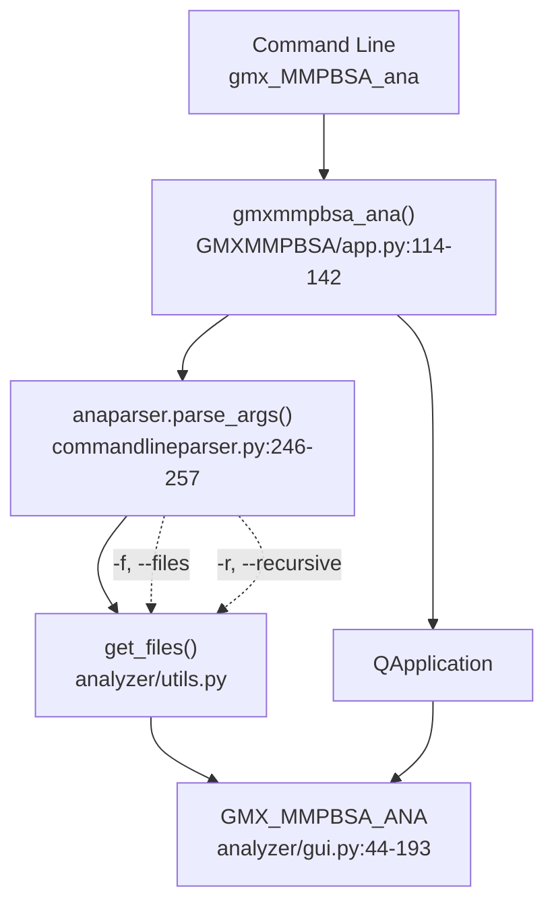
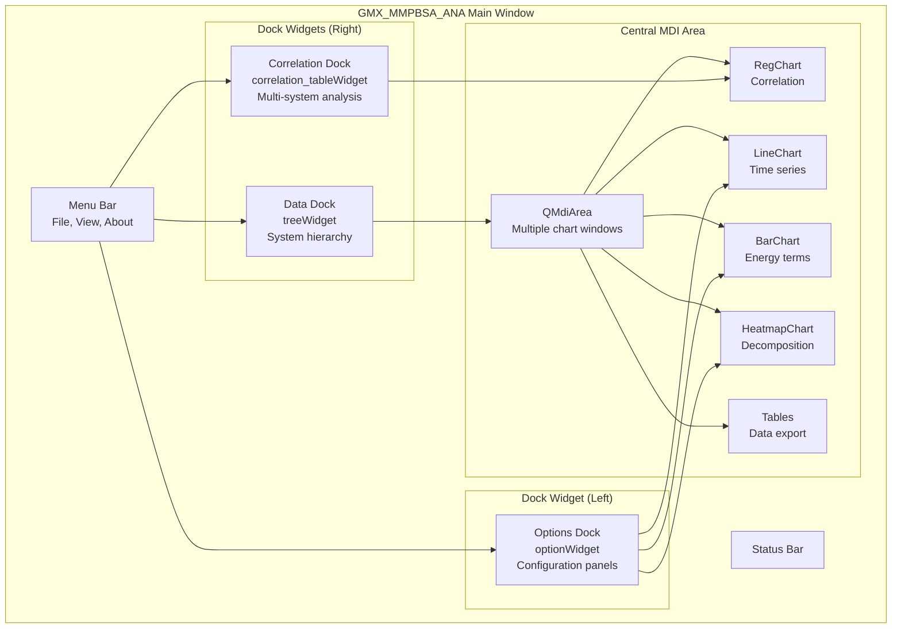
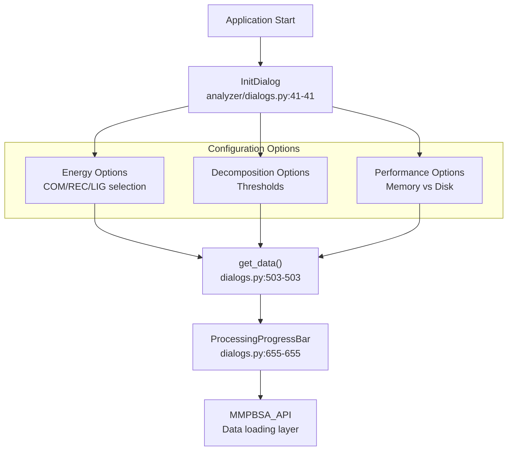

# Analyzer Application (gmx_MMPBSA_ana)

Relevant source files

The following files were used as context for generating this wiki page:

- [GMXMMPBSA/analyzer/chartsettings.py](GMXMMPBSA/analyzer/chartsettings.py)
- [GMXMMPBSA/analyzer/customitem.py](GMXMMPBSA/analyzer/customitem.py)
- [GMXMMPBSA/analyzer/dialogs.py](GMXMMPBSA/analyzer/dialogs.py)
- [GMXMMPBSA/analyzer/gui.py](GMXMMPBSA/analyzer/gui.py)
- [GMXMMPBSA/analyzer/plots.py](GMXMMPBSA/analyzer/plots.py)
- [GMXMMPBSA/analyzer/utils.py](GMXMMPBSA/analyzer/utils.py)
- [docs/analyzer.md](docs/analyzer.md)
- [docs/api.md](docs/api.md)
- [docs/howworks.md](docs/howworks.md)

The Analyzer Application (`gmx_MMPBSA_ana`) is a graphical user interface for visualizing and analyzing results from `gmx_MMPBSA` calculations. It provides interactive charts, statistical analysis, correlation tools, and export capabilities for binding free energy data. This application operates on output files generated by the core calculation engine and allows users to load multiple systems simultaneously for comparative analysis.

For information about installation and validation, see [Installation and Setup](#2). For details on the output file formats that `gmx_MMPBSA_ana` reads, see [Output Files and Data Formats](#5).

---

## Application Entry Point and Launch

The analyzer is launched via the `gmxmmpbsa_ana()` function, which initializes the PyQt application and main window:

**Sources:** [GMXMMPBSA/app.py:114-142](), [GMXMMPBSA/analyzer/gui.py:44-193]()

---

## Main Application Architecture

The analyzer implements a Multiple Document Interface (MDI) with three dockable panels and a central area for displaying multiple charts simultaneously.

**Architecture Details:**
The main window class `GMX_MMPBSA_ANA` [GMXMMPBSA/analyzer/gui.py:44-44]() manages the interface layout. It uses a `QMdiArea` [GMXMMPBSA/analyzer/gui.py:61-61]() for the central workspace and `QDockWidget` components for the side panels [GMXMMPBSA/analyzer/gui.py:65-74]().

For deep technical details on the component hierarchy and the configuration system, see [GUI Architecture and Components](#4.1).

**Sources:** [GMXMMPBSA/analyzer/gui.py:44-193]()

---

## Data Loading and Management

Upon launch, the application uses an `InitDialog` [GMXMMPBSA/analyzer/dialogs.py:41-41]() to configure how data is ingested. This includes selecting energy terms, decomposition options, and performance settings like memory vs. disk storage.

**Multiprocessing responsiveness:**
The analyzer has been optimized to prevent GUI freezing during heavy data processing by implementing multiprocessing for reading systems and multithreading for data processing [docs/analyzer.md:32-37]().

For details on the loading process and memory management, see [Data Loading and Management](#4.2).

**Sources:** [GMXMMPBSA/analyzer/dialogs.py:41-653](), [docs/analyzer.md:18-45]()

---

## Visualization Features

The application supports various plot types, all inheriting from a `ChartsBase` class [GMXMMPBSA/analyzer/plots.py:122-122]().

| Chart Type | Code Entity | Description |
|:---|:---|:---|
| **Line Plot** | `LineChart` | Visualizes per-frame energy components over time [GMXMMPBSA/analyzer/plots.py:193-193](). |
| **Bar Plot** | `BarChart` | Compares energy averages with SD/SEM error bars [GMXMMPBSA/analyzer/plots.py:251-251](). |
| **Heatmap** | `HeatmapChart` | Displays per-residue or pairwise decomposition data [GMXMMPBSA/analyzer/plots.py:374-374](). |
| **Regression** | `RegChart` | Shows correlation between experimental and calculated ΔG [GMXMMPBSA/analyzer/plots.py:716-716](). |

Charts are interactive and support custom palettes [GMXMMPBSA/analyzer/chartsettings.py:52-177](), PyMOL integration for 3D visualization [GMXMMPBSA/analyzer/customitem.py:456-456](), and high-quality image exports via a custom `NavigationToolbar` [GMXMMPBSA/analyzer/plots.py:60-60]().

For details on chart customization and PyMOL integration, see [Visualization Features](#4.3).

**Sources:** [GMXMMPBSA/analyzer/plots.py:122-949](), [GMXMMPBSA/analyzer/chartsettings.py:52-177]()

---

## Correlation Analysis

`gmx_MMPBSA_ana` allows for correlation analysis between multiple systems. This is particularly useful for validating the method against experimental binding affinities ($K_i$ or $\Delta G_{exp}$).

**Key metrics calculated:**
- **Pearson ($r$)** and **Spearman ($\rho$)** coefficients [GMXMMPBSA/analyzer/plots.py:44-44]().
- **$R^2$** and **RMSE** from linear regression [GMXMMPBSA/analyzer/plots.py:750-760]().
- **Predictive Index (PI)** [GMXMMPBSA/analyzer/plots.py:762-762]().

The analysis supports both $\Delta G$ and $\Delta \Delta G$ (alanine scanning) modes. For details, see [Correlation Analysis](#4.4).

**Sources:** [GMXMMPBSA/analyzer/plots.py:716-893](), [GMXMMPBSA/analyzer/customitem.py:52-102]()

---

## Frame Range Selection and Energy Recalculation

Users can dynamically modify the frame range used for analysis within the GUI. This triggers a recalculation of statistical averages and entropy terms (IE and C2) without needing to re-run the entire simulation.

**Recalculation Flow:**
1. User modifies frame spin boxes in the "Frames" tab [GMXMMPBSA/analyzer/gui.py:456-581]().
2. The application marks the data as "changed" via alert icons [GMXMMPBSA/analyzer/gui.py:483-483]().
3. Clicking "Update" triggers `get_energy()` and `calculate_statistics()` in the `MMPBSA_API` [GMXMMPBSA/API.py:466-480]().

For details on how recalculation works, see [Frame Range Selection and Energy Recalculation](#4.5).

**Sources:** [GMXMMPBSA/analyzer/gui.py:456-732](), [GMXMMPBSA/API.py:466-480]()

---