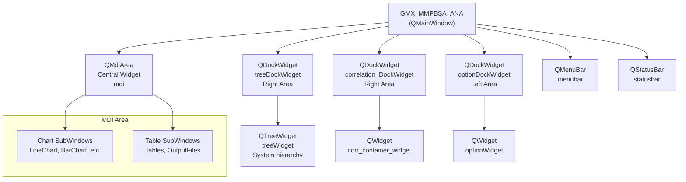
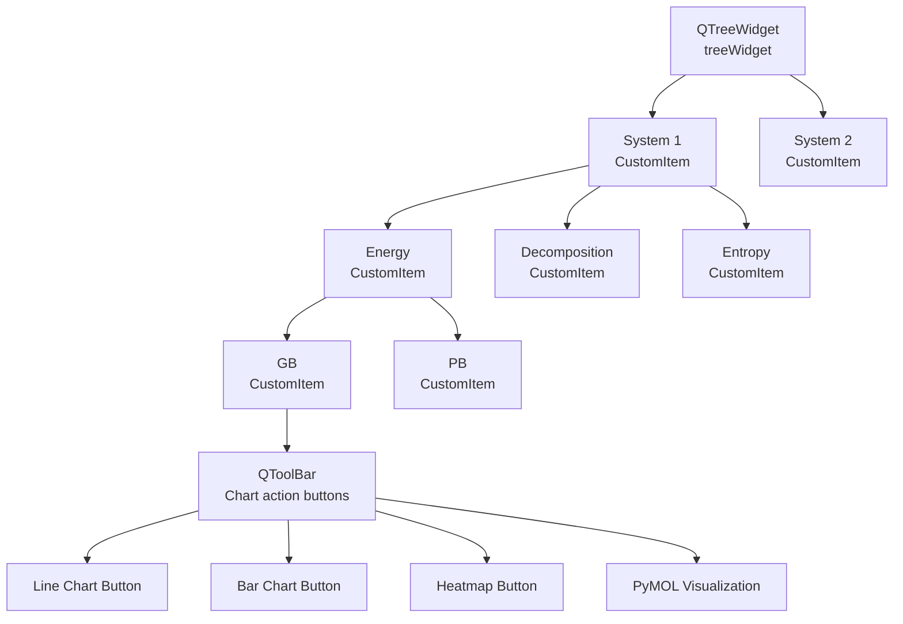
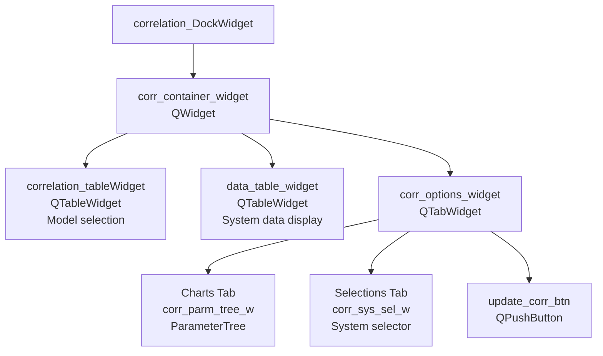
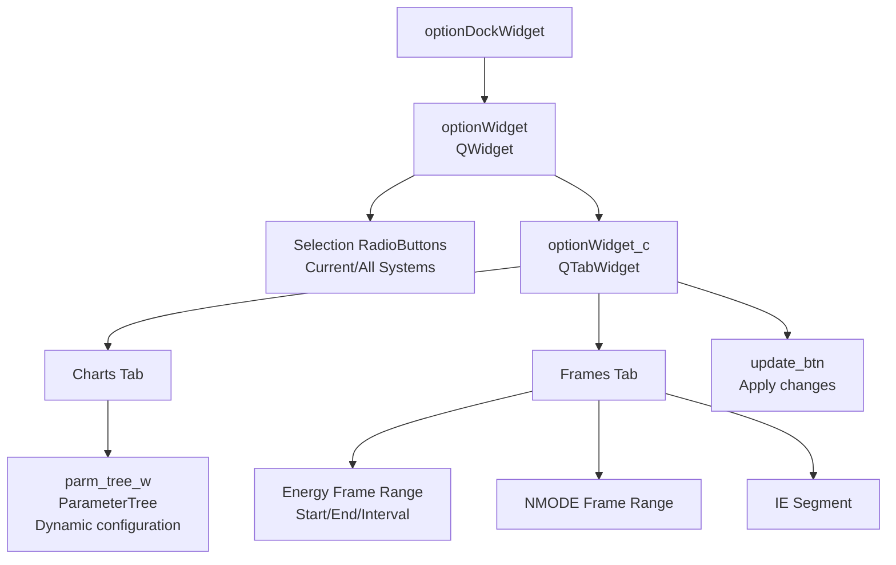
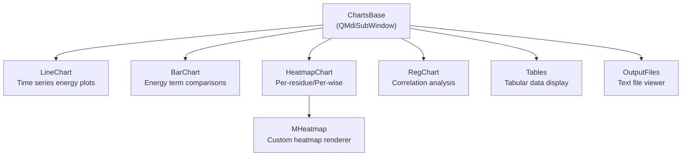
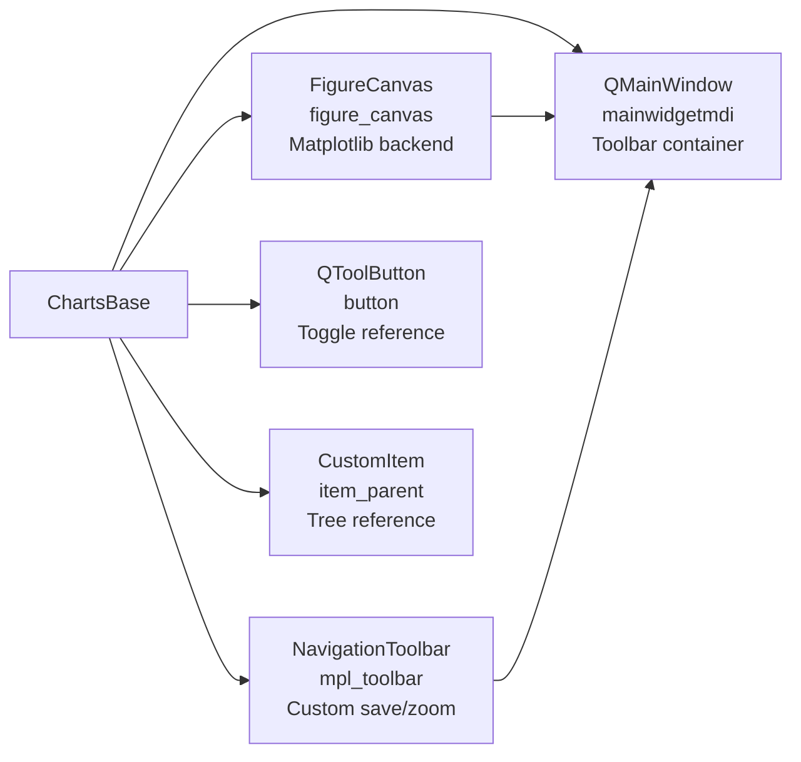
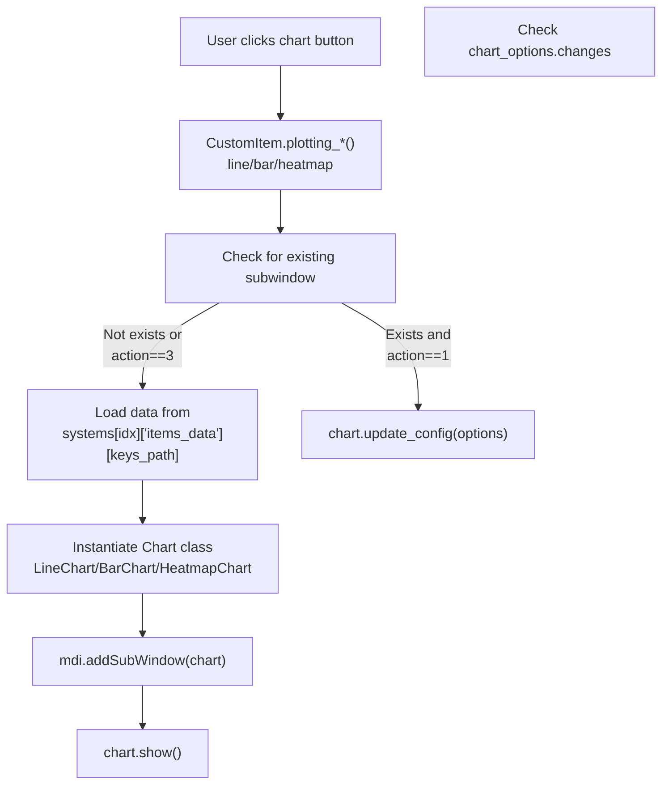
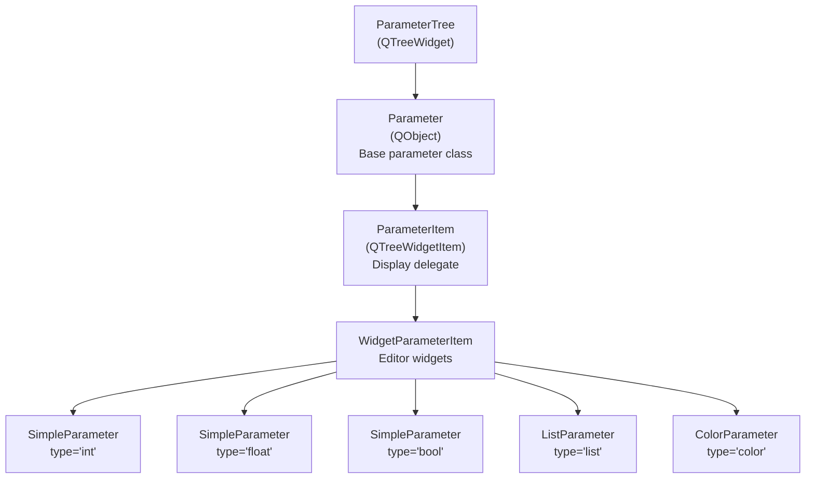
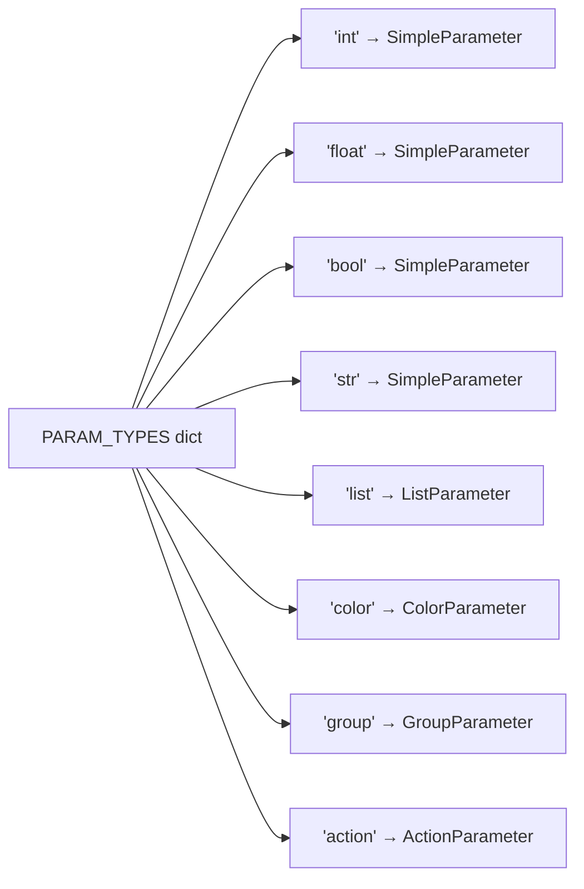
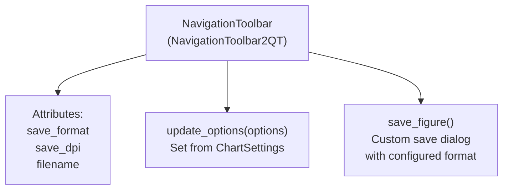

# GUI Architecture and Components

Relevant source files

The following files were used as context for generating this wiki page:

- [GMXMMPBSA/analyzer/chartsettings.py](GMXMMPBSA/analyzer/chartsettings.py)
- [GMXMMPBSA/analyzer/customitem.py](GMXMMPBSA/analyzer/customitem.py)
- [GMXMMPBSA/analyzer/dialogs.py](GMXMMPBSA/analyzer/dialogs.py)
- [GMXMMPBSA/analyzer/gui.py](GMXMMPBSA/analyzer/gui.py)
- [GMXMMPBSA/analyzer/items_delegate.py](GMXMMPBSA/analyzer/items_delegate.py)
- [GMXMMPBSA/analyzer/parametertree/Parameter.py](GMXMMPBSA/analyzer/parametertree/Parameter.py)
- [GMXMMPBSA/analyzer/parametertree/ParameterItem.py](GMXMMPBSA/analyzer/parametertree/ParameterItem.py)
- [GMXMMPBSA/analyzer/parametertree/ParameterTree.py](GMXMMPBSA/analyzer/parametertree/ParameterTree.py)
- [GMXMMPBSA/analyzer/parametertree/__init__.py](GMXMMPBSA/analyzer/parametertree/__init__.py)
- [GMXMMPBSA/analyzer/parametertree/parameterTypes.py](GMXMMPBSA/analyzer/parametertree/parameterTypes.py)
- [GMXMMPBSA/analyzer/plots.py](GMXMMPBSA/analyzer/plots.py)
- [GMXMMPBSA/analyzer/utils.py](GMXMMPBSA/analyzer/utils.py)

## Purpose and Scope

This page describes the internal architecture of the **gmx_MMPBSA_ana** graphical analyzer application, focusing on its GUI components, window management, and configuration system. The gmx_MMPBSA_ana application provides an interactive GUI for analyzing MM/PB(GB)SA calculation results through charts, tables, and 3D molecular visualization. It implements a Multiple Document Interface (MDI) architecture with dockable configuration panels.

---

## Main Window Architecture

### GMX_MMPBSA_ANA Class

The core application is implemented in the `GMX_MMPBSA_ANA` class, which inherits from `QMainWindow` and orchestrates all GUI components.

**Main Window Component Hierarchy**

**Key Attributes:**

| Attribute | Type | Purpose |
|-----------|------|---------|
| `mdi` | `QMdiArea` | Central widget hosting multiple chart/table subwindows [GMXMMPBSA/analyzer/gui.py:61]() |
| `treeDockWidget` | `QDockWidget` | Right dock containing system/data tree [GMXMMPBSA/analyzer/gui.py:65]() |
| `correlation_DockWidget` | `QDockWidget` | Right dock for correlation analysis [GMXMMPBSA/analyzer/gui.py:68]() |
| `optionDockWidget` | `QDockWidget` | Left dock for chart options [GMXMMPBSA/analyzer/gui.py:73]() |
| `systems` | `dict` | Stores loaded system data and configuration [GMXMMPBSA/analyzer/gui.py:53]() |
| `items_counter` | `dict` | Tracks chart instances [GMXMMPBSA/analyzer/gui.py:59]() |

Sources: [GMXMMPBSA/analyzer/gui.py:44-99]()

---

## Dockable Panel System

### Data Tree Dock

The data tree dock displays the hierarchical structure of loaded systems and their energy components. It uses a `QTreeWidget` with custom items (`CustomItem`) that provide chart generation buttons.

**Data Tree Structure**

Each `CustomItem` in the tree has:
- `buttons`: Tuple defining which chart types are available (1=Line, 2=Bar, 3=Heatmap, 4=Visualization) [GMXMMPBSA/analyzer/customitem.py:114]()
- `keys_path`: Tuple path to locate data in `systems[index]['items_data']` [GMXMMPBSA/analyzer/customitem.py:118]()
- `system_index`: Reference to parent system [GMXMMPBSA/analyzer/customitem.py:109]()
- Chart subwindow references: `lp_subw`, `bp_subw`, `hmp_subw` [GMXMMPBSA/analyzer/customitem.py:120-122]()

Sources: [GMXMMPBSA/analyzer/customitem.py:104-164](), [GMXMMPBSA/analyzer/gui.py:76-99]()

### Correlation Dock

The correlation dock enables multi-system correlation analysis, displaying correlation coefficients and regression plots.

**Correlation Dock Components**

The correlation system uses `CustomCorrItem` objects that generate `RegChart` visualizations when selected [GMXMMPBSA/analyzer/customitem.py:71]().

Sources: [GMXMMPBSA/analyzer/gui.py:100-168](), [GMXMMPBSA/analyzer/customitem.py:52-102]()

### Options Dock

The options dock provides real-time chart customization through a tabbed interface with ParameterTree widgets.

**Options Dock Structure**

Sources: [GMXMMPBSA/analyzer/gui.py:400-592]()

---

## Chart System Architecture

### Chart Class Hierarchy

All chart types inherit from `ChartsBase`, which provides common functionality for MDI subwindows and matplotlib integration [GMXMMPBSA/analyzer/plots.py:122]().

**Chart Type Hierarchy**

**ChartsBase Common Interface**

Key methods:
- `set_cw(fig)`: Initializes figure canvas and toolbar [GMXMMPBSA/analyzer/plots.py:137-150]()
- `setup_text(ax, options, ...)`: Configures axis labels and fonts [GMXMMPBSA/analyzer/plots.py:164-187]()
- `draw()`: Renders the figure [GMXMMPBSA/analyzer/plots.py:159-162]()

Sources: [GMXMMPBSA/analyzer/plots.py:122-191]()

### Chart Creation Flow

**Data-to-Chart Pipeline**

The `changes` dict tracks what needs updating: `action_type=1` for update existing, `action_type=3` for re-plot [GMXMMPBSA/analyzer/customitem.py:381-454]().

---

## ParameterTree Configuration System

The ParameterTree provides type-safe, hierarchical configuration with immediate visual feedback.

### ParameterTree Architecture

### Parameter Registration and Types

The system uses a global registry to map type names to Parameter classes:

Parameter creation: `Parameter.create(**opts)` looks up `opts['type']` in `PARAM_TYPES` and instantiates the appropriate class [GMXMMPBSA/analyzer/parametertree/Parameter.py:119-129]().

Sources: [GMXMMPBSA/analyzer/parametertree/Parameter.py:30-50](), [GMXMMPBSA/analyzer/parametertree/parameterTypes.py:120-160]()

### ChartSettings Configuration

The `ChartSettings` class wraps a nested dictionary structure that maps to ParameterTree nodes [GMXMMPBSA/analyzer/chartsettings.py:299](). Access pattern: `options[('Line Plot', 'line-width')]` returns the value [GMXMMPBSA/analyzer/chartsettings.py:1-21]().

Sources: [GMXMMPBSA/analyzer/chartsettings.py:299-800]()

---

## Widget Customization System

### Custom Widgets for Parameters

The ParameterTree system uses specialized widgets for different parameter types:

| Parameter Type | Widget Class | Purpose |
|----------------|--------------|---------|
| `int`, `float` | `QSpinBox`, `QDoubleSpinBox` | Numeric input with bounds [GMXMMPBSA/analyzer/parametertree/parameterTypes.py:130-132]() |
| `bool` | `QCheckBox` | Toggle options [GMXMMPBSA/analyzer/parametertree/parameterTypes.py:133]() |
| `str` | `QLineEdit` | Text input [GMXMMPBSA/analyzer/parametertree/parameterTypes.py:134]() |
| `color` | `ColorButton` | Color picker dialog [GMXMMPBSA/analyzer/parametertree/parameterTypes.py:135]() |

The `ColorButton` widget provides custom color selection via `QColorDialog` [GMXMMPBSA/analyzer/parametertree/parameterTypes.py:53]().

Sources: [GMXMMPBSA/analyzer/parametertree/parameterTypes.py:35-118]()

### NavigationToolbar Customization

The analyzer overrides matplotlib's `NavigationToolbar2QT` to control save behavior and DPI settings [GMXMMPBSA/analyzer/plots.py:60]().

Sources: [GMXMMPBSA/analyzer/plots.py:60-120]()

---

## Dialog System

### InitDialog Startup Configuration

The `InitDialog` class provides initial system configuration, including energy options and decomposition settings [GMXMMPBSA/analyzer/dialogs.py:41](). It also includes a performance slider to manage resource allocation [GMXMMPBSA/analyzer/dialogs.py:145]().

Sources: [GMXMMPBSA/analyzer/dialogs.py:36-266]()

### ProcessingProgressBar

The `ProcessingProgressBar` dialog displays progress during data recalculation using multiprocessing pools [GMXMMPBSA/analyzer/dialogs.py:578]().

Sources: [GMXMMPBSA/analyzer/dialogs.py:578-700]()

---

## Summary Table: Key Classes

| Class | Module | Purpose |
|-------|--------|---------|
| `GMX_MMPBSA_ANA` | `gui.py` | Main window, MDI orchestration [GMXMMPBSA/analyzer/gui.py:44]() |
| `ChartsBase` | `plots.py` | Base class for all chart types [GMXMMPBSA/analyzer/plots.py:122]() |
| `CustomItem` | `customitem.py` | Tree widget items with chart buttons [GMXMMPBSA/analyzer/customitem.py:104]() |
| `ParameterTree` | `parametertree/ParameterTree.py` | Configuration tree widget [GMXMMPBSA/analyzer/parametertree/ParameterTree.py:30]() |
| `Parameter` | `parametertree/Parameter.py` | Configuration node base class [GMXMMPBSA/analyzer/parametertree/Parameter.py:52]() |
| `InitDialog` | `dialogs.py` | Startup configuration dialog [GMXMMPBSA/analyzer/dialogs.py:41]() |

Sources: Multiple files cited above.

---