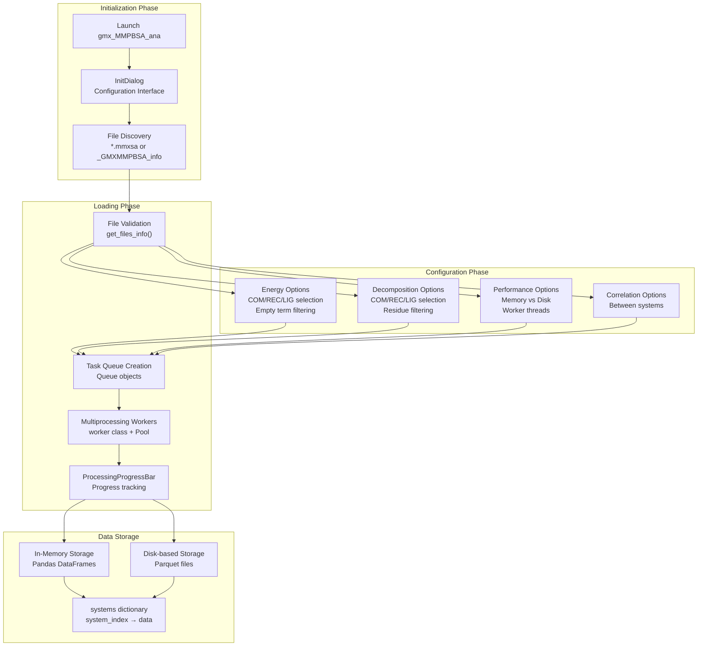
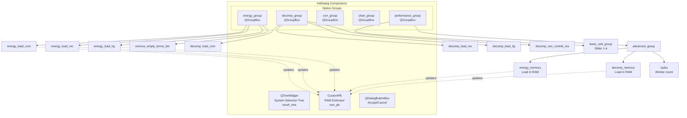
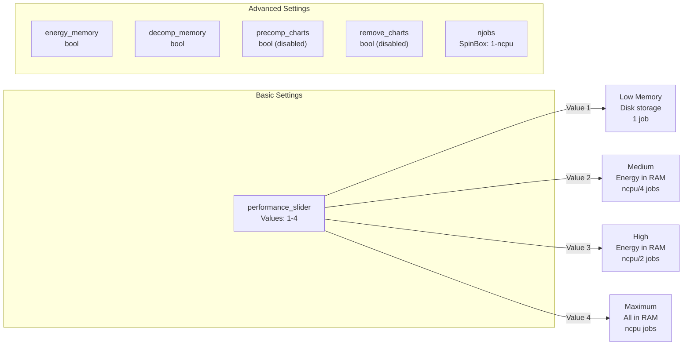
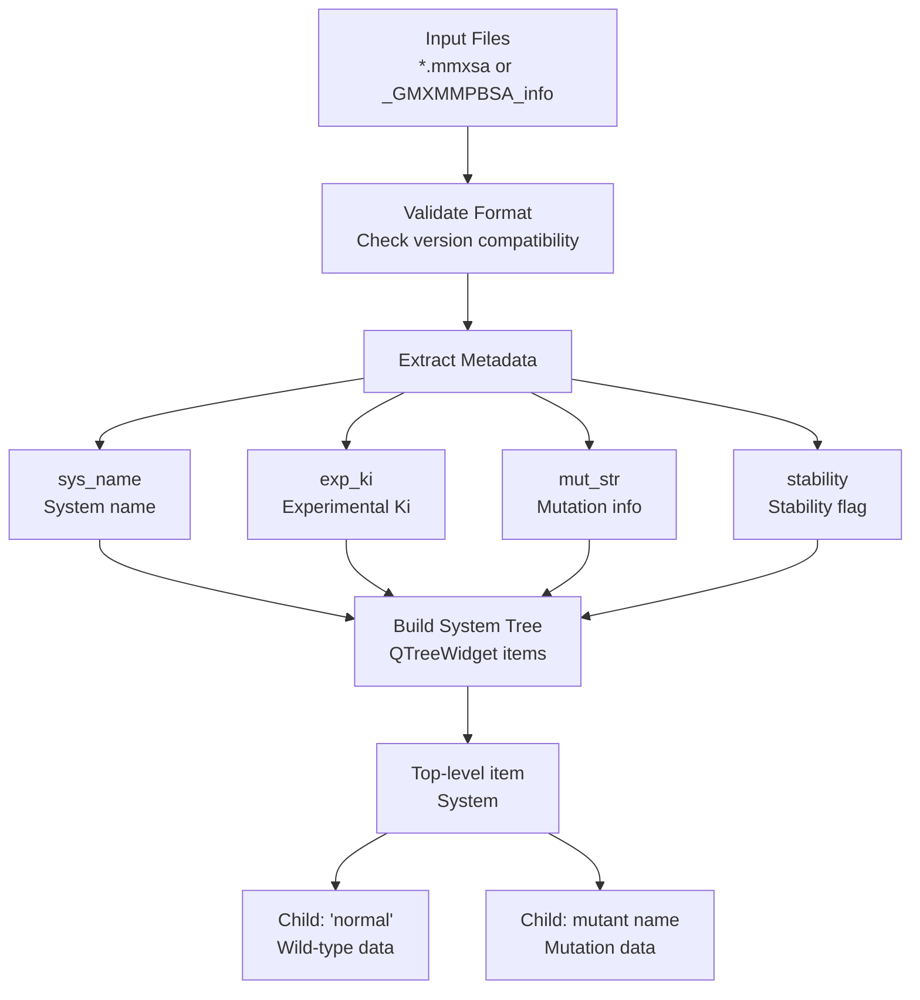
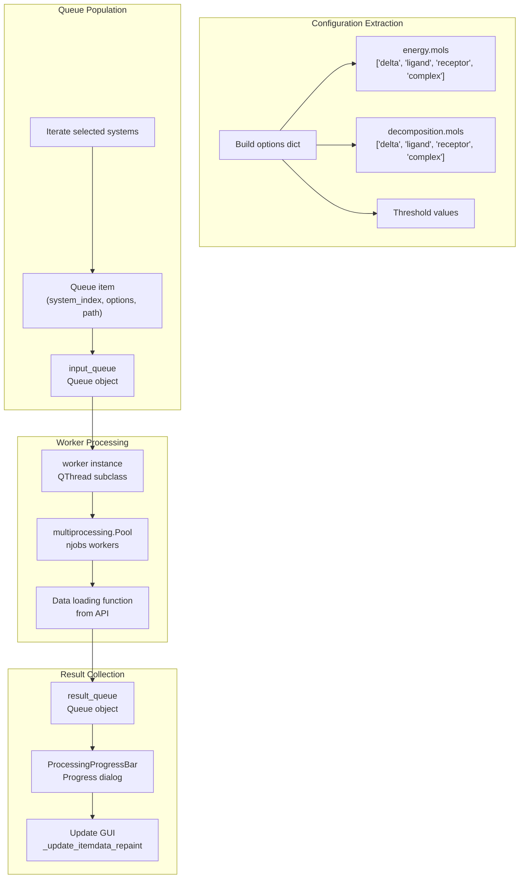
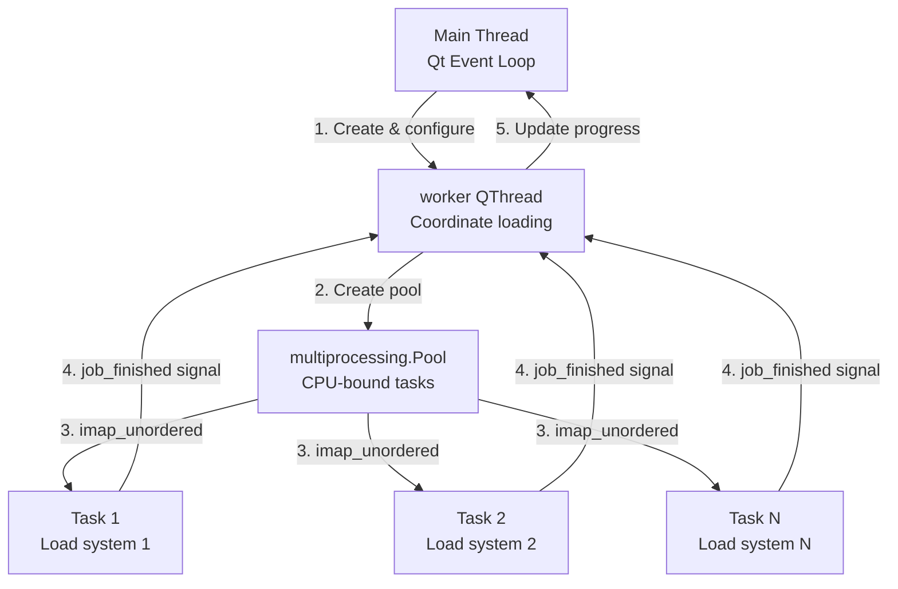
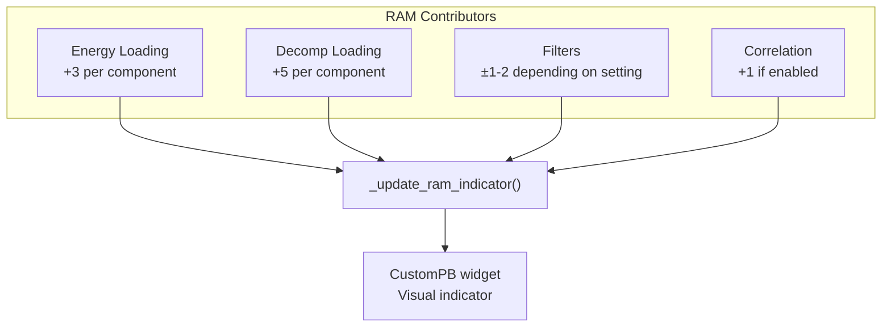
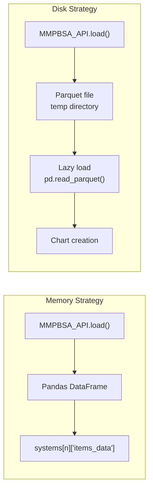
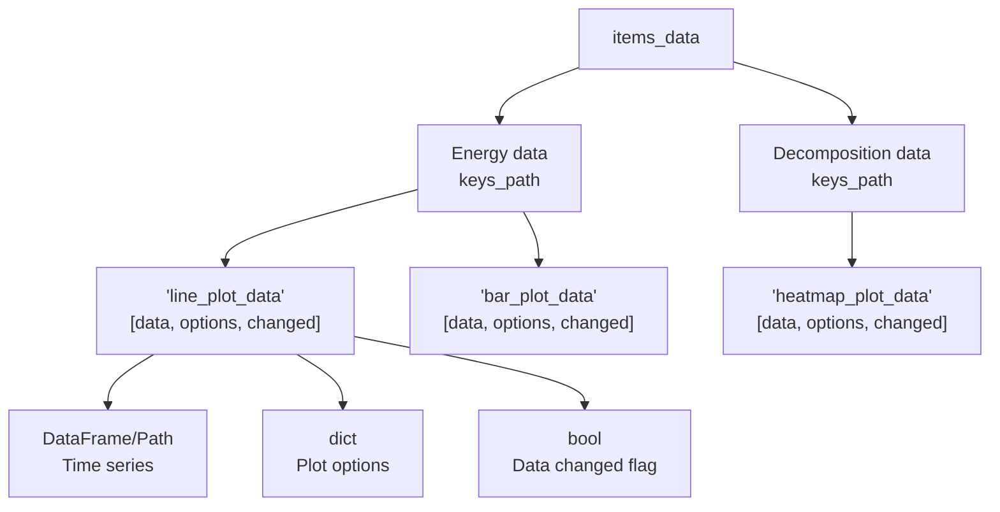
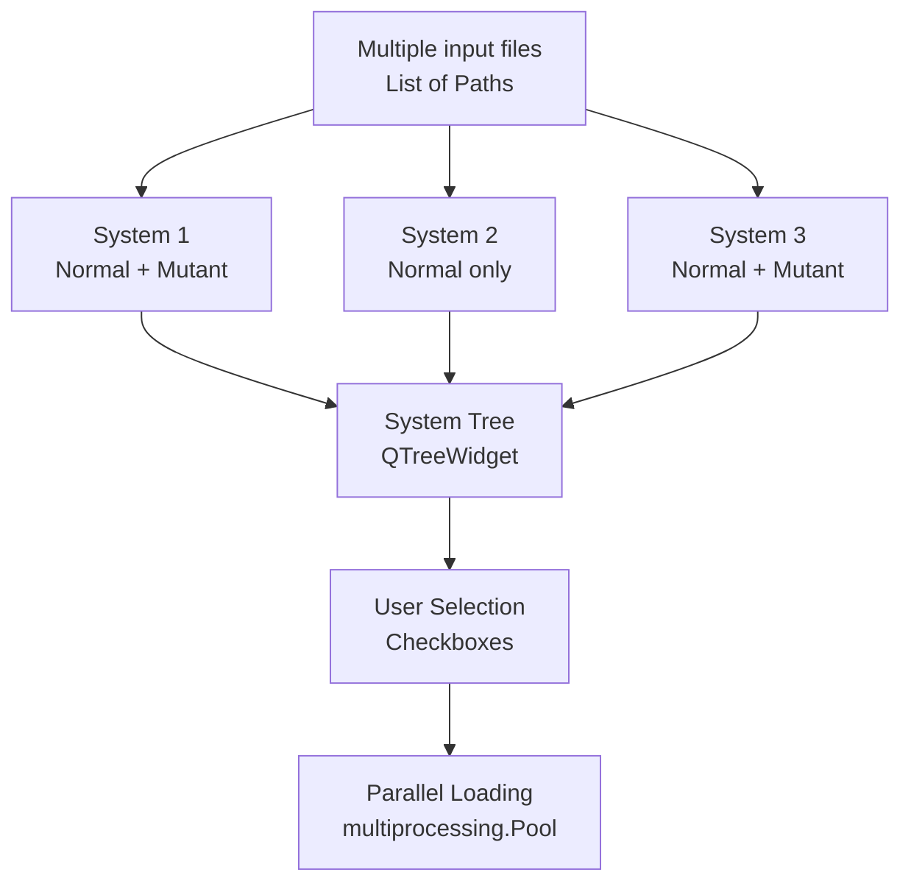

# Data Loading and Management

<details>
<summary>Relevant source files</summary>

The following files were used as context for generating this wiki page:

- [GMXMMPBSA/API.py](GMXMMPBSA/API.py)
- [GMXMMPBSA/amber_outputs.py](GMXMMPBSA/amber_outputs.py)
- [GMXMMPBSA/analyzer/chartsettings.py](GMXMMPBSA/analyzer/chartsettings.py)
- [GMXMMPBSA/analyzer/customitem.py](GMXMMPBSA/analyzer/customitem.py)
- [GMXMMPBSA/analyzer/dialogs.py](GMXMMPBSA/analyzer/dialogs.py)
- [GMXMMPBSA/analyzer/gui.py](GMXMMPBSA/analyzer/gui.py)
- [GMXMMPBSA/analyzer/plots.py](GMXMMPBSA/analyzer/plots.py)
- [GMXMMPBSA/analyzer/utils.py](GMXMMPBSA/analyzer/utils.py)
- [GMXMMPBSA/exceptions.py](GMXMMPBSA/exceptions.py)
- [GMXMMPBSA/infofile.py](GMXMMPBSA/infofile.py)
- [GMXMMPBSA/output_file.py](GMXMMPBSA/output_file.py)

</details>


This page describes how `gmx_MMPBSA_ana` loads and manages calculation results from `gmx_MMPBSA` runs. It covers the data loading pipeline, configuration options, memory management strategies, and the multiprocessing architecture used to ensure responsive performance.

For information about output file formats and contents, see [Output Files and Data Formats](). For details about the API for programmatic data access, see [API Reference]().

---

## Overview

The `gmx_MMPBSA_ana` application loads calculation results through a multi-stage pipeline that balances performance, memory usage, and user control. The system is designed to handle multiple calculation systems simultaneously while providing options to manage memory consumption.

**Data Loading Pipeline**



**Sources:** [GMXMMPBSA/analyzer/gui.py:44-71](), [GMXMMPBSA/analyzer/dialogs.py:41-53](), [GMXMMPBSA/analyzer/utils.py:253-273]()

---

## InitDialog: Configuration Interface

The `InitDialog` class provides the primary interface for configuring data loading behavior. Users interact with this dialog immediately after launching `gmx_MMPBSA_ana`.

### Dialog Structure



**Sources:** [GMXMMPBSA/analyzer/dialogs.py:41-208]()

### Energy Loading Options

The energy loading options control which molecular components are loaded and how data is filtered:

| Option | Checkbox Name | Description |
|--------|---------------|-------------|
| Load COM data | `energy_load_com` | Load complex (COM) energy terms [GMXMMPBSA/analyzer/dialogs.py:58-60]() |
| Load REC data | `energy_load_rec` | Load receptor energy terms [GMXMMPBSA/analyzer/dialogs.py:61-63]() |
| Load LIG data | `energy_load_lig` | Load ligand energy terms [GMXMMPBSA/analyzer/dialogs.py:64-66]() |
| Remove empty terms | `remove_empty_terms_btn` | Filter out terms below threshold [GMXMMPBSA/analyzer/dialogs.py:68-72]() |
| Term threshold | `empty_threshold` | Threshold value (default: 0.0100 kcal/mol) [GMXMMPBSA/analyzer/dialogs.py:74-80]() |

### Decomposition Loading Options

Decomposition options determine which per-residue decomposition data is loaded:

| Option | Checkbox Name | Description |
|--------|---------------|-------------|
| Load COM data | `decomp_load_com` | Load complex decomposition [GMXMMPBSA/analyzer/dialogs.py:93-95]() |
| Load REC data | `decomp_load_rec` | Load receptor decomposition [GMXMMPBSA/analyzer/dialogs.py:96-98]() |
| Load LIG data | `decomp_load_lig` | Load ligand decomposition [GMXMMPBSA/analyzer/dialogs.py:99-101]() |
| Remove non-contributing residues | `decomp_non_contrib_res` | Filter residues below threshold [GMXMMPBSA/analyzer/dialogs.py:103-107]() |
| Per-residue threshold | `decomp_res_threshold` | Threshold value (default: 0.5 kcal/mol) [GMXMMPBSA/analyzer/dialogs.py:108-113]() |

### Performance Options

Performance configuration balances speed against memory consumption:



The `slider_changed` method automatically configures memory and job settings based on the slider position.

**Sources:** [GMXMMPBSA/analyzer/dialogs.py:158-180]()

---

## Data Loading Process

### File Discovery and Validation

The `get_files_info` method processes input files and builds the system tree:



**File Format Detection:**

- **Binary format (*.mmxsa)**: Uses `pickle.load()` to read the `info_file` object [GMXMMPBSA/output_file.py:48-50]().
- **Text format (_GMXMMPBSA_info)**: Parsed by the `InfoFile` class [GMXMMPBSA/infofile.py:63-112]().

**Sources:** [GMXMMPBSA/analyzer/dialogs.py:372-491](), [GMXMMPBSA/output_file.py:31-50](), [GMXMMPBSA/infofile.py:86-112]()

### Queue-Based Data Loading

The `get_data` method orchestrates the actual data loading using a queue-based multiprocessing approach:

**Data Loading Architecture**



**Key Methods:**

- `get_data()`: [GMXMMPBSA/analyzer/dialogs.py:503-638]()
- `worker.run()`: [GMXMMPBSA/analyzer/utils.py:265-273]()

**Sources:** [GMXMMPBSA/analyzer/dialogs.py:503-638](), [GMXMMPBSA/analyzer/utils.py:253-273]()

---

## Multiprocessing Architecture

The analyzer uses a hybrid threading/multiprocessing model to maintain GUI responsiveness during intensive data loading operations.

### Worker Thread Pattern



**Worker Class Implementation:**

The `worker` class extends `QThread` and manages the multiprocessing pool.

**Sources:** [GMXMMPBSA/analyzer/utils.py:253-273]()

### Progress Tracking

The `ProcessingProgressBar` dialog displays loading progress and allows cancellation.

**Sources:** [GMXMMPBSA/analyzer/dialogs.py:716-745]()

---

## Memory Management

### RAM Consumption Estimation

The `InitDialog` includes a real-time RAM consumption estimator (`CustomPB`) that updates as users change loading options.

**RAM Calculation Logic:**



**Sources:** [GMXMMPBSA/analyzer/dialogs.py:282-315]()

### Memory vs Disk Storage

The analyzer supports two storage strategies via the `_setup_data` function in `API.py`:

**Memory Storage:**
- Data loaded into Pandas DataFrames.
- Controlled by `energy_memory` and `decomp_memory` checkboxes [GMXMMPBSA/analyzer/dialogs.py:184-189]().

**Disk Storage:**
- Data stored in Parquet format files using `to_parquet` [GMXMMPBSA/API.py:147-148]().
- Requires a parquet engine like `pyarrow` or `fastparquet` [GMXMMPBSA/API.py:65-76]().



**Sources:** [GMXMMPBSA/API.py:130-180](), [GMXMMPBSA/analyzer/dialogs.py:184-189]()

---

## Data Structures and Organization

### Systems Dictionary

The main GUI maintains a `systems` dictionary that stores all loaded data and metadata.

**Systems Dictionary Structure**

```python
systems = {
    system_index: {
        'name': str,                    # System name
        'path': Path,                   # Path to calculation directory
        'namespace': MMPBSA_API,        # API instance
        'chart_options': ChartSettings, # Visualization settings
        'items_data': dict,             # Hierarchical data structure
        'current_frames': dict,         # Energy frame range
        'current_nmode_frames': dict,   # NMODE frame range
        'current_ie_segment': int,      # IE segment percentage
    }
}
```

**Sources:** [GMXMMPBSA/analyzer/gui.py:53-58](), [GMXMMPBSA/analyzer/customitem.py:104-140]()

### items_data Hierarchy

Data in the `items_data` dictionary is organized into a hierarchical structure used for chart generation.



**Key Insight:** Each data entry is a 3-element list [GMXMMPBSA/API.py:145-148]():
1. **Data**: Either a Pandas DataFrame (memory) or Path to Parquet file (disk).
2. **Options**: Dictionary with plot-specific options (e.g., `iec2` flag).
3. **Changed**: Boolean flag indicating if data needs reprocessing.

**Sources:** [GMXMMPBSA/API.py:130-180](), [GMXMMPBSA/analyzer/customitem.py:116-137]()

### MMPBSA_API Integration

The `MMPBSA_API` class provides the interface for loading calculation results and recalculating entropy terms like Interaction Entropy [GMXMMPBSA/API.py:35]().

**Sources:** [GMXMMPBSA/API.py:1-47](), [GMXMMPBSA/analyzer/gui.py:33]()

---

## Data Filtering and Optimization

### Empty Term Removal

Energy terms with negligible contributions can be filtered.
- **Threshold**: Default 0.0100 kcal/mol [GMXMMPBSA/analyzer/dialogs.py:76]().
- **Method**: Terms where `|Average| < threshold` are excluded [GMXMMPBSA/API.py:79-85]().

### Non-Contributing Residue Removal

For decomposition data, residues with minimal energy contributions can be filtered.
- **Threshold**: Default 0.5 kcal/mol [GMXMMPBSA/analyzer/dialogs.py:112]().

### Frame Range Selection

After loading, users can modify frame ranges. This triggers a recalculation of the statistics (Average, SD, SEM) using the `set_frame_range` method in `AmberOutput` [GMXMMPBSA/amber_outputs.py:128-133]().

**Sources:** [GMXMMPBSA/amber_outputs.py:128-133](), [GMXMMPBSA/analyzer/dialogs.py:63-113]()

---

## Loading Multiple Systems

The analyzer supports loading and analyzing multiple calculation systems simultaneously.

### Multi-System Loading



**Sources:** [GMXMMPBSA/analyzer/dialogs.py:372-491](), [GMXMMPBSA/analyzer/gui.py:51-53]()

---