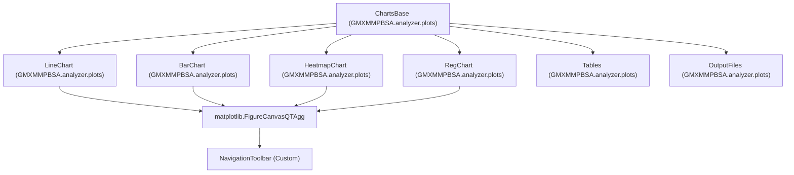
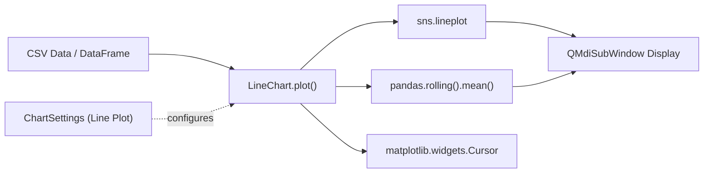
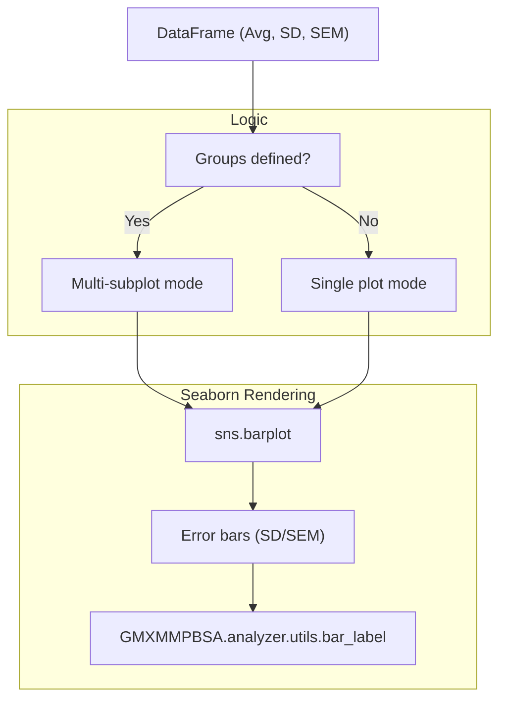
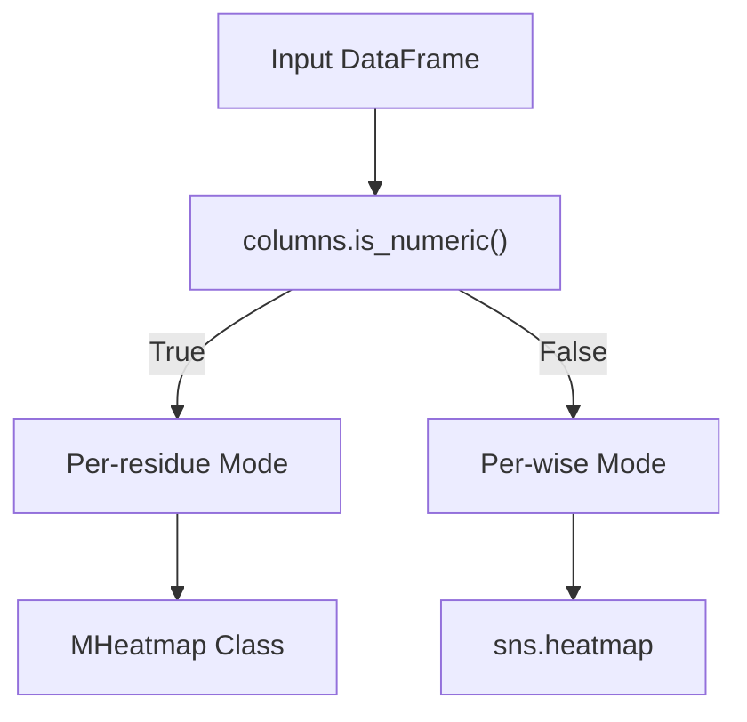
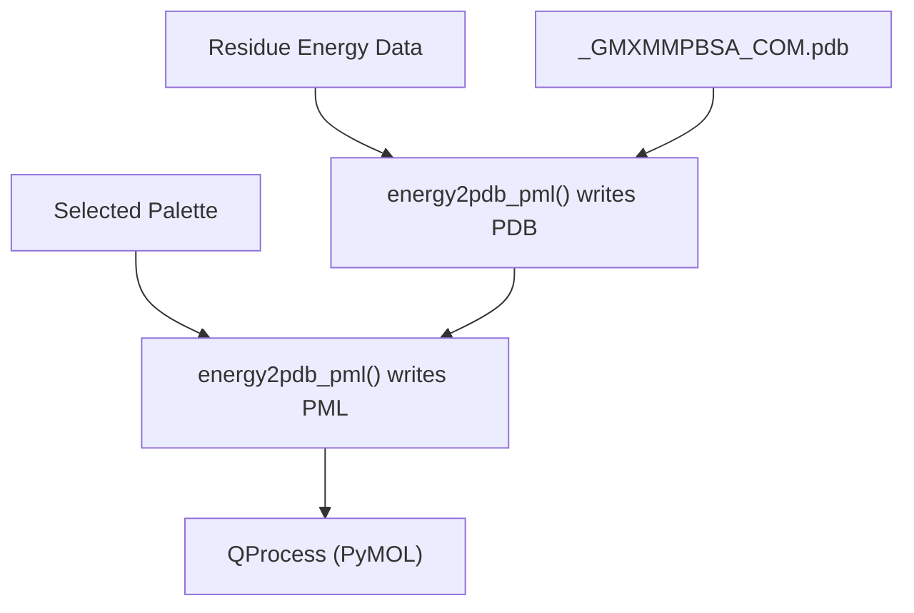
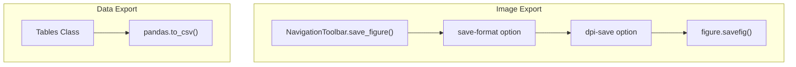

# Visualization Features

Relevant source files

The following files were used as context for generating this wiki page:

- [GMXMMPBSA/analyzer/chartsettings.py](GMXMMPBSA/analyzer/chartsettings.py)
- [GMXMMPBSA/analyzer/customitem.py](GMXMMPBSA/analyzer/customitem.py)
- [GMXMMPBSA/analyzer/dialogs.py](GMXMMPBSA/analyzer/dialogs.py)
- [GMXMMPBSA/analyzer/gui.py](GMXMMPBSA/analyzer/gui.py)
- [GMXMMPBSA/analyzer/plots.py](GMXMMPBSA/analyzer/plots.py)
- [GMXMMPBSA/analyzer/style/__init__.py](GMXMMPBSA/analyzer/style/__init__.py)
- [GMXMMPBSA/analyzer/style/alert.svg](GMXMMPBSA/analyzer/style/alert.svg)
- [GMXMMPBSA/analyzer/style/default_config.svg](GMXMMPBSA/analyzer/style/default_config.svg)
- [GMXMMPBSA/analyzer/style/save_default_config.svg](GMXMMPBSA/analyzer/style/save_default_config.svg)
- [GMXMMPBSA/analyzer/style/save_user_config.svg](GMXMMPBSA/analyzer/style/save_user_config.svg)
- [GMXMMPBSA/analyzer/style/user_config.svg](GMXMMPBSA/analyzer/style/user_config.svg)
- [GMXMMPBSA/analyzer/utils.py](GMXMMPBSA/analyzer/utils.py)
- [docs/assets/images/heatmap_plot.png](docs/assets/images/heatmap_plot.png)
- [docs/assets/images/heatmap_plot2.png](docs/assets/images/heatmap_plot2.png)
- [docs/assets/images/line_plot.png](docs/assets/images/line_plot.png)
- [docs/assets/images/line_plot_ie.png](docs/assets/images/line_plot_ie.png)
- [docs/assets/images/pymol.png](docs/assets/images/pymol.png)

This page documents the visualization features of `gmx_MMPBSA_ana`, the graphical analyzer application. It covers the chart types available, the customization system, PyMOL integration for 3D visualization, and export capabilities. For information about the overall GUI architecture, see [GUI Architecture and Components](#4.1). For details on how data is loaded and prepared for visualization, see [4.2 Data Loading and Management]().

---

## Chart Types Overview

The analyzer provides four primary chart types for visualizing MM/PB(GB)SA calculation results, plus tables for direct data inspection. All chart classes inherit from `ChartsBase` [GMXMMPBSA/analyzer/plots.py:122-135]() and are rendered using matplotlib with seaborn styling.

**Chart Type Hierarchy**

Sources: [GMXMMPBSA/analyzer/plots.py:122-191](), [GMXMMPBSA/analyzer/plots.py:193-248](), [GMXMMPBSA/analyzer/plots.py:251-371](), [GMXMMPBSA/analyzer/plots.py:374-491]()

---

## Line Charts

Line charts display per-frame energy values over the trajectory, useful for examining convergence and fluctuations. The `LineChart` class reads pandas DataFrame data and renders time series plots with optional rolling averages [GMXMMPBSA/analyzer/plots.py:193-248]().

**Line Chart Data Flow**

**Key Features**:
- **Main plot**: Single time series with configurable line width and color [GMXMMPBSA/analyzer/plots.py:207-210]().
- **Rolling average**: Optional moving average overlay with configurable window size [GMXMMPBSA/analyzer/plots.py:212-218]().
- **Interaction Entropy (IE) display**: Special handling for IE data showing accumulated and segment-specific values [GMXMMPBSA/analyzer/plots.py:221-232]().
- **Crosshair cursor**: Interactive cursor for precise frame identification [GMXMMPBSA/analyzer/plots.py:245-246]().

Sources: [GMXMMPBSA/analyzer/plots.py:193-248](), [GMXMMPBSA/analyzer/chartsettings.py:332-363]()

---

## Bar Charts

Bar charts display statistical summaries (average, standard deviation, standard error) for energy terms. They support both single-system and multi-system comparisons with component grouping [GMXMMPBSA/analyzer/plots.py:251-371]().

**Bar Chart Rendering Pipeline**

**Special Handling**:
1. **Component grouping**: Creates separate subplots for each energy term group (Complex, Receptor, Ligand) [GMXMMPBSA/analyzer/plots.py:269-278]().
2. **IE/C2 entropy coloring**: Applies color coding based on sigma reliability thresholds [GMXMMPBSA/analyzer/plots.py:355-364]().
3. **Symlog scaling**: Optional logarithmic scale for large value ranges [GMXMMPBSA/analyzer/plots.py:348-350]().
4. **Error representation**: User-selectable between Standard Deviation (SD) and Standard Error of the Mean (SEM) [GMXMMPBSA/analyzer/plots.py:284-285]().

Sources: [GMXMMPBSA/analyzer/plots.py:251-371](), [GMXMMPBSA/analyzer/chartsettings.py:424-528](), [GMXMMPBSA/analyzer/utils.py:40-193]()

---

## Heatmap Charts

Heatmap charts visualize decomposition data in two modes: per-residue (frames × residues) and pairwise (residue pairs matrix) [GMXMMPBSA/analyzer/plots.py:374-491]().

**Heatmap Decision Logic**

**MHeatmap Custom Implementation**:
The `MHeatmap` class [GMXMMPBSA/analyzer/plots.py:493-699]() provides enhanced features:
- **Component highlighting**: Color-coded bars identifying receptor vs ligand residues [GMXMMPBSA/analyzer/plots.py:586-614]().
- **Flexible layout**: GridSpec-based layout with optional legend and color bars [GMXMMPBSA/analyzer/plots.py:535-546]().
- **Custom color mapping**: Receptor color (`rec_color`) and ligand color (`lig_color`) options [GMXMMPBSA/analyzer/plots.py:521-522]().

Sources: [GMXMMPBSA/analyzer/plots.py:374-491](), [GMXMMPBSA/analyzer/plots.py:493-699](), [GMXMMPBSA/analyzer/chartsettings.py:529-658]()

---

## PyMOL Integration

The analyzer integrates with PyMOL to provide 3D visualization of per-residue energy contributions. This maps decomposition energies to residue B-factors [GMXMMPBSA/analyzer/utils.py:276-342]().

**PyMOL Visualization Workflow**

**Implementation Details**:
- **PDB modification**: Replaces B-factor values with normalized energy values [GMXMMPBSA/analyzer/utils.py:293-311]().
- **Color definition**: Writes `set_color gmxc{N}` commands for each palette color [GMXMMPBSA/analyzer/utils.py:317-320]().
- **Process Management**: PyMOL instances are launched as `QProcess` objects and tracked in `self.pymol_p_list` [GMXMMPBSA/analyzer/gui.py:56]().

Sources: [GMXMMPBSA/analyzer/utils.py:276-342](), [GMXMMPBSA/analyzer/customitem.py:456-531](), [GMXMMPBSA/analyzer/gui.py:229-241]()

---

## Export Capabilities

The analyzer provides multiple export options for both visual and data outputs.

**Export System Overview**

**Image Export**:
The custom `NavigationToolbar` [GMXMMPBSA/analyzer/plots.py:60-120]() respects user-configured settings for format (SVG, PNG, PDF, etc.) and DPI [GMXMMPBSA/analyzer/plots.py:115]().

**Data Export**:
- **Tables Display**: Displays pandas DataFrames in a `QTableWidget` [GMXMMPBSA/analyzer/plots.py:792-880]().
- **Output Files**: Displays text files (e.g., `FINAL_RESULTS_MMPBSA.dat`) in a `QPlainTextEdit` [GMXMMPBSA/analyzer/plots.py:701-790]().

Sources: [GMXMMPBSA/analyzer/plots.py:60-120](), [GMXMMPBSA/analyzer/plots.py:792-880](), [GMXMMPBSA/analyzer/plots.py:701-790]()

---