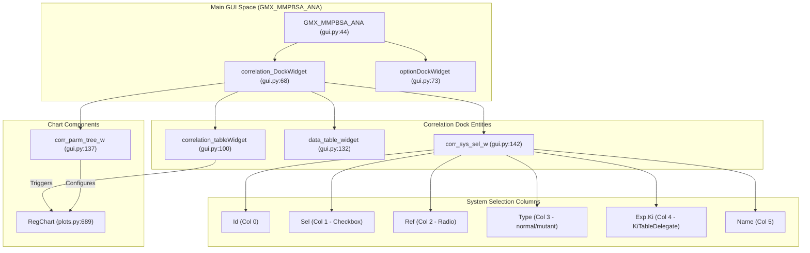
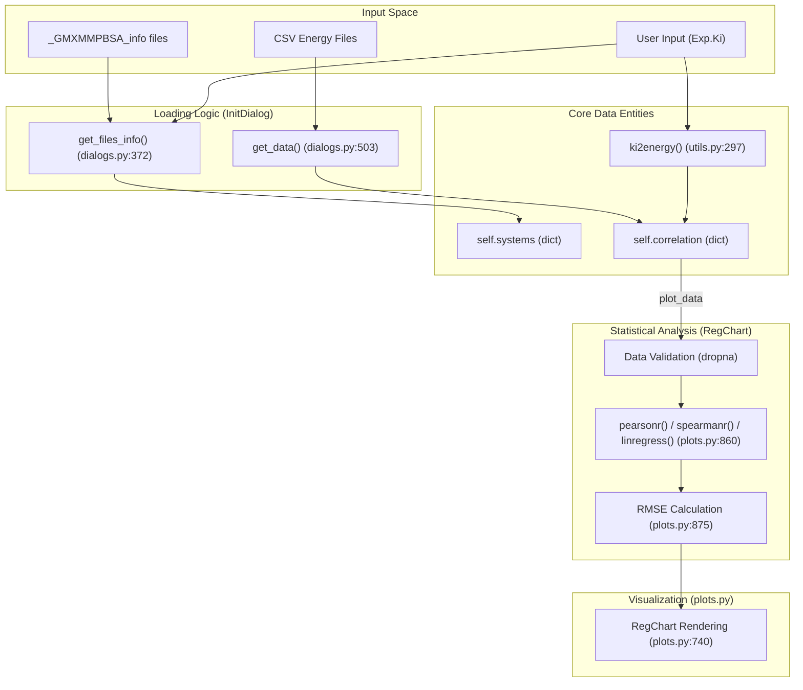
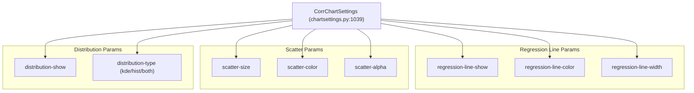

# Correlation Analysis

Relevant source files

The following files were used as context for generating this wiki page:

- [GMXMMPBSA/analyzer/chartsettings.py](GMXMMPBSA/analyzer/chartsettings.py)
- [GMXMMPBSA/analyzer/customitem.py](GMXMMPBSA/analyzer/customitem.py)
- [GMXMMPBSA/analyzer/dialogs.py](GMXMMPBSA/analyzer/dialogs.py)
- [GMXMMPBSA/analyzer/gui.py](GMXMMPBSA/analyzer/gui.py)
- [GMXMMPBSA/analyzer/plots.py](GMXMMPBSA/analyzer/plots.py)
- [GMXMMPBSA/analyzer/utils.py](GMXMMPBSA/analyzer/utils.py)
- [docs/examples/Correlation/README.md](docs/examples/Correlation/README.md)

## Purpose and Scope

This page documents the correlation analysis feature in `gmx_MMPBSA_ana`, which enables quantitative comparison of calculated binding free energies against experimental data across multiple molecular systems. The correlation module computes statistical relationships between theoretical predictions and experimental measurements (Ki/Kd values), helping validate computational methods and identify predictive models.

For general analyzer functionality, see [Analyzer Application (gmx_MMPBSA_ana)](#4). For individual system visualization without experimental comparison, see [Visualization Features](#4.3).

## Overview

The correlation analysis system was introduced to address the need for multi-system statistical validation. It supports two distinct correlation modes: **ΔG mode** (absolute binding energies) and **ΔΔG mode** (relative binding energies for mutant systems). Each mode can evaluate multiple energy models simultaneously, incorporating different entropy approximations.

**Key capabilities:**

- Compare up to 5 energy models per analysis (ΔGeff, ΔGie, ΔGc2, ΔGnm, ΔGqh)
- Calculate Pearson correlation coefficient, Spearman rank correlation, R², and RMSE
- Interactive system selection with experimental Ki/Kd input
- Reference system designation for ΔΔG calculations
- Exportable regression plots with bivariate/univariate distributions

**Minimum requirements:** At least 4 systems with valid experimental and calculated binding energies.

Sources: [GMXMMPBSA/analyzer/gui.py:49-169](), [GMXMMPBSA/analyzer/customitem.py:84-91]()

---

## Correlation Modes

### ΔG Mode (Absolute Energies)

In ΔG mode, the analyzer correlates absolute calculated binding free energies with absolute experimental binding free energies derived from Ki/Kd values. Each system is treated independently without requiring a reference structure.

**Conversion formula:** Experimental ΔG = RT ln(Ki), where R = 0.001987 kcal/(mol·K) and T is user-defined temperature (default 298.15 K).

**Use case:** Comparing binding affinities across different ligands binding to the same receptor, or different receptor-ligand pairs where absolute binding energies are measurable.

Sources: [GMXMMPBSA/analyzer/utils.py:33](), [GMXMMPBSA/analyzer/dialogs.py:127-133]()

### ΔΔG Mode (Relative Energies)

In ΔΔG mode, the analyzer computes relative binding free energies by subtracting a reference system's energy from each system's energy. This mode is designed for alanine scanning or systematic mutation studies where experimental data reports changes relative to wild-type.

**Calculation:** ΔΔGcalc = ΔGsystem - ΔGreference; ΔΔGexp = ΔGexp,system - ΔGexp,reference

**Use case:** Validating computational predictions of mutation effects against experimental mutagenesis data.

**UI behavior:** When ΔΔG mode is selected, a "Ref." column appears in the system selection table, allowing radio button selection of the reference system. The reference system must have both experimental and calculated energies defined.

Sources: [GMXMMPBSA/analyzer/gui.py:267-280](), [GMXMMPBSA/analyzer/dialogs.py:127-133]()

---

## Energy Models

The correlation analysis evaluates five energy models simultaneously, each incorporating different entropy approximations or omitting entropy entirely:

| Model ID | Energy Term | Entropy Method | Tooltip Description |
|----------|-------------|----------------|---------------------|
| ΔGeff | ΔH | None (neglected) | Effective energy, calculated as ΔGeff = ΔH |
| ΔGie | ΔH + (-TΔS_IE) | Interaction Entropy | Calculated as ΔGie = ΔH + -TΔS_IE |
| ΔGc2 | ΔH + (-TΔS_C2) | C2 Entropy | Calculated as ΔGc2 = ΔH + -TΔS_C2 |
| ΔGnm | ΔH + (-TΔS_NMODE) | Normal Mode Analysis | Calculated as ΔGnm = ΔH + -TΔS_NMODE |
| ΔGqh | ΔH + (-TΔS_QH) | Quasi-Harmonic | Calculated as ΔGqh = ΔH + -TΔS_QH |

Models are only available if the corresponding entropy calculation was performed during `gmx_MMPBSA` execution. ΔGeff is always available as it requires no entropy calculation.

Sources: [GMXMMPBSA/analyzer/gui.py:107-121](), [GMXMMPBSA/analyzer/customitem.py:52-62]()

---

## User Interface Architecture

**Correlation Analysis UI Component Hierarchy**

### Key UI Classes and Their Roles

**`correlation_DockWidget` (QDockWidget):** Top-level container for all correlation functionality, dockable on right side of main window alongside data tree dock. [GMXMMPBSA/analyzer/gui.py:68]()

**`correlation_tableWidget` (QTableWidget):** Displays available energy models as rows. Each row is a `CustomCorrItem` instance. Selecting a row triggers regression chart generation for that model. Only models with sufficient data (≥4 systems) are selectable. [GMXMMPBSA/analyzer/gui.py:100-131]()

**`data_table_widget` (QTableWidget):** 6-column table showing per-system energy data: System name, Type (normal/mutant), Experimental ΔG, Average calculated ΔG, Standard Deviation, Standard Error of Mean. Updates dynamically based on selected model. [GMXMMPBSA/analyzer/gui.py:132-135]()

**`corr_sys_sel_w` (QTableWidget):** System selection interface with custom `KiTableDelegate` for Ki value editing. [GMXMMPBSA/analyzer/gui.py:142-168]() Columns:
- **Id:** System index (read-only)
- **Sel.:** Checkbox to include/exclude system from correlation
- **Ref.:** Radio button for reference selection (ΔΔG mode only)
- **Type:** normal/mutant designation (editable)
- **Exp.Ki:** Experimental Ki in nM (editable with validation)
- **Name:** System name (read-only)

**`corr_parm_tree_w` (ParameterTree):** Hierarchical settings tree for customizing regression charts, using `CorrChartSettings` configuration object. [GMXMMPBSA/analyzer/gui.py:137-140]()

Sources: [GMXMMPBSA/analyzer/gui.py:68-168](), [GMXMMPBSA/analyzer/items_delegate.py:19-150]()

---

## Data Flow and Calculation Pipeline

**Correlation Analysis Data Flow from Input to Visualization**

### Data Processing Steps

1. **Initialization (dialogs.py):** `InitDialog.get_files_info()` [GMXMMPBSA/analyzer/dialogs.py:372-492]() parses multiple `_GMXMMPBSA_info` files, extracting system names, experimental Ki values, and mutation information.

2. **Data Extraction (dialogs.py):** `InitDialog.get_data()` [GMXMMPBSA/analyzer/dialogs.py:503-598]() builds the configuration, then launches multiprocessing workers to load energy data from CSV files.

3. **Energy Conversion (utils.py):** `ki2energy()` [GMXMMPBSA/analyzer/utils.py:297-303]() converts experimental Ki (nM) to ΔG (kcal/mol) using the formula ΔG = RT·ln(Ki), where R = 0.001987 and T defaults to 298.15 K.

4. **Storage (gui.py):** Main GUI stores loaded data in `self.systems` dict (per-system data) and `self.correlation` dict (cross-system correlation data). [GMXMMPBSA/analyzer/gui.py:49-56]()

5. **Validation (plots.py):** When `CustomCorrItem.plotting_reg()` [GMXMMPBSA/analyzer/customitem.py:70-101]() is triggered, `RegChart.__init__()` [GMXMMPBSA/analyzer/plots.py:689-892]() validates data by calling `dropna()` on the DataFrame. Minimum 4 valid systems required.

6. **Statistical Analysis (plots.py):** `RegChart.update_config()` [GMXMMPBSA/analyzer/plots.py:860-892]() computes Pearson (r), Spearman (ρ), Linear regression (R²), and Root Mean Square Error (RMSE).

7. **Rendering (plots.py):** Matplotlib/seaborn generate scatter plot, regression line, marginal distributions, and textbox with statistics. `RegChart` extends `ChartsBase` [GMXMMPBSA/analyzer/plots.py:122-191]().

Sources: [GMXMMPBSA/analyzer/plots.py:689-892](), [GMXMMPBSA/analyzer/customitem.py:70-101](), [GMXMMPBSA/analyzer/dialogs.py:503-598](), [GMXMMPBSA/analyzer/utils.py:297-303]()

---

## Statistical Metrics

### Pearson Correlation Coefficient (r)

Measures linear relationship strength between experimental and calculated ΔG values. Range: [-1, 1].

**Implementation:** `scipy.stats.pearsonr(exp_dg, calc_dg)` returns (r, p-value) tuple. [GMXMMPBSA/analyzer/plots.py:44](), [GMXMMPBSA/analyzer/plots.py:860-892]()

### Spearman Rank Correlation (ρ)

Non-parametric measure assessing monotonic relationship strength. Less sensitive to outliers than Pearson.

**Implementation:** `scipy.stats.spearmanr(exp_dg, calc_dg)` returns (ρ, p-value) tuple. [GMXMMPBSA/analyzer/plots.py:44](), [GMXMMPBSA/analyzer/plots.py:860-892]()

### Coefficient of Determination (R²)

Proportion of variance in experimental ΔG explained by the linear model.

**Implementation:** Obtained from `scipy.stats.linregress(exp_dg, calc_dg)`, which returns slope, intercept, r_value, p_value, std_err. R² = r_value². [GMXMMPBSA/analyzer/plots.py:44](), [GMXMMPBSA/analyzer/plots.py:860-892]()

### Root Mean Square Error (RMSE)

Average magnitude of prediction errors, in same units as ΔG (kcal/mol).

**Implementation:** Manual calculation after obtaining regression line: `RMSE = np.sqrt(np.mean((y_pred - y_true)**2))`. [GMXMMPBSA/analyzer/plots.py:860-892]()

---

## Configuration and Customization

### Chart Settings Structure

`CorrChartSettings` class [GMXMMPBSA/analyzer/chartsettings.py:1039-1192]() defines hierarchical settings for regression charts:

**Configuration Options Hierarchy**

### Key Configuration Parameters

**Scatter Plot:**
- `size`: Point diameter (default 50)
- `color`: RGBA color array
- `alpha`: Transparency (default 0.8)

**Regression Line:**
- `show`: Display fitted line (bool, default True)
- `color`: Line RGBA color
- `style`: solid/dashed/dotted/dashdot

**Distribution Plots (Marginal):**
- `show`: Display marginal plots (bool, default True)
- `type`: kde, hist, both, or none
- `bins`: Histogram bins (default 20)

Sources: [GMXMMPBSA/analyzer/chartsettings.py:1039-1192]()

---

## Data Requirements and Validation

### System Requirements

- **Minimum systems:** 4 (enforced in [GMXMMPBSA/analyzer/customitem.py:84-91]())
- **Valid experimental data:** Each system must have Exp.Ki > 0 or pre-computed experimental ΔG
- **Valid calculated data:** System must have completed energy calculation

### Validation Logic

**Data validation sequence** in `CustomCorrItem.plotting_reg()` [GMXMMPBSA/analyzer/customitem.py:84-91]():

1. Check DataFrame length: `len(plot_data.index) < 4`
2. Count non-null Average values: `plot_data['Average'].count() < 4`
3. Count non-null ExpΔG values: `plot_data['ExpΔG'].count() < 4`
4. If any condition true, display error dialog.

**ΔΔG mode additional validation** [GMXMMPBSA/analyzer/gui.py:248-264]():

- At least one system must be checked.
- If unchecking reference system, automatically selects nearest checked system as new reference.
- Reference cannot be unchecked while selected as reference.

Sources: [GMXMMPBSA/analyzer/customitem.py:84-91](), [GMXMMPBSA/analyzer/gui.py:248-264]()

---