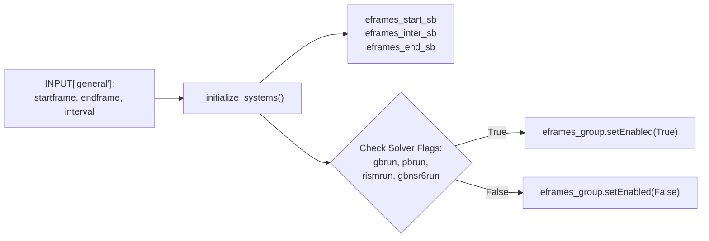
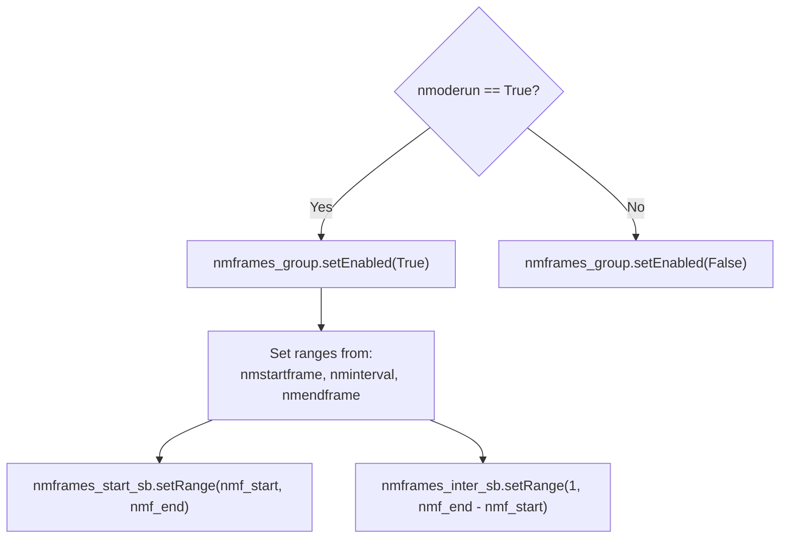
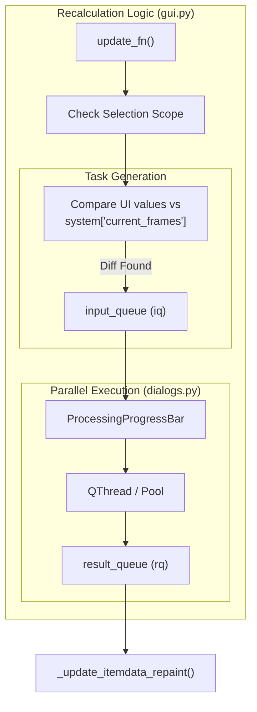

# Frame Range Selection and Energy Recalculation

<details>
<summary>Relevant source files</summary>

The following files were used as context for generating this wiki page:

- [GMXMMPBSA/API.py](GMXMMPBSA/API.py)
- [GMXMMPBSA/amber_outputs.py](GMXMMPBSA/amber_outputs.py)
- [GMXMMPBSA/analyzer/chartsettings.py](GMXMMPBSA/analyzer/chartsettings.py)
- [GMXMMPBSA/analyzer/customitem.py](GMXMMPBSA/analyzer/customitem.py)
- [GMXMMPBSA/analyzer/dialogs.py](GMXMMPBSA/analyzer/dialogs.py)
- [GMXMMPBSA/analyzer/gui.py](GMXMMPBSA/analyzer/gui.py)
- [GMXMMPBSA/analyzer/plots.py](GMXMMPBSA/analyzer/plots.py)
- [GMXMMPBSA/analyzer/utils.py](GMXMMPBSA/analyzer/utils.py)
- [GMXMMPBSA/exceptions.py](GMXMMPBSA/exceptions.py)
- [GMXMMPBSA/output_file.py](GMXMMPBSA/output_file.py)

</details>


## Purpose and Scope

This page documents the frame range selection and energy recalculation functionality in `gmx_MMPBSA_ana`. This feature allows users to modify the frame ranges used in energy calculations, NMODE entropy calculations, and Interaction Entropy calculations after the initial `gmx_MMPBSA` run, and recalculate statistics without re-running the entire analysis.

The frame selection interface provides three independent controls:
- **Energy Frame Range**: Modifies frames used for GB/PB/RISM/GBNSR6 calculations.
- **NMODE Frame Range**: Modifies frames used for normal mode entropy calculations.
- **Interaction Entropy Segment**: Modifies the representative segment percentage for IE calculations.

**Sources:** [GMXMMPBSA/analyzer/gui.py:44-70](), [GMXMMPBSA/analyzer/gui.py:455-581]()

## Frame Selection UI Components

The frame selection interface is organized into three group boxes within the "Frames" tab of the Options dock widget.

### GUI Entity Association

The following diagram maps the visual UI components to their corresponding class attributes in the `GMX_MMPBSA_ANA` class.

```mermaid
graph TB
    subgraph "GMX_MMPBSA_ANA (gui.py)"
        TabWidget["QTabWidget: optionWidget_c"]
        
        subgraph "Frames Tab"
            EnergyGroup["QGroupBox: eframes_group"]
            NMODEGroup["QGroupBox: nmframes_group"]
            IEGroup["QGroupBox: ieframes_group"]
        end
    end
    
    TabWidget --> EnergyGroup
    TabWidget --> NMODEGroup
    TabWidget --> IEGroup
    
    subgraph "Energy Controls (EnergyVector slicing)"
        EStart["QSpinBox: eframes_start_sb"]
        EInterval["QSpinBox: eframes_inter_sb"]
        EEnd["QSpinBox: eframes_end_sb"]
        ENumFrames["QLineEdit: numframes_le"]
        EChanged["QLabel: e_changed (alert icon)"]
    end
    
    subgraph "NMODE Controls (NMODEout processing)"
        NMStart["QSpinBox: nmframes_start_sb"]
        NMInterval["QSpinBox: nmframes_inter_sb"]
        NMEnd["QSpinBox: nmframes_end_sb"]
        NMNumFrames["QLineEdit: nmnumframes_le"]
        NMChanged["QLabel: nm_changed"]
    end
    
    subgraph "IE Controls (InteractionEntropyCalc)"
        IESegment["QSpinBox: iesegment_sb"]
        IENumFrames["QLineEdit: ienumframes_le"]
        IEChanged["QLabel: ie_changed"]
    end
    
    EnergyGroup --> EStart
    EnergyGroup --> EInterval
    EnergyGroup --> EEnd
    
    NMODEGroup --> NMStart
    NMODEGroup --> NMInterval
    NMODEGroup --> NMEnd
    
    IEGroup --> IESegment
```



**Sources:** [GMXMMPBSA/analyzer/gui.py:455-581](), [GMXMMPBSA/amber_outputs.py:128-133]()

## Energy Frame Selection

The energy frame selection controls modify the frame range used for all solvation model calculations. These controls are only enabled if at least one solvation model was run.

### Initialization

When systems are loaded, the energy frame controls are initialized from the original input parameters stored in the `INPUT` dictionary.



**Sources:** [GMXMMPBSA/analyzer/gui.py:310-334]()

### Value Updates and Validation

When spinbox values change, handlers update the displayed frame count and show/hide the alert indicator. The logic relies on the `EnergyVector` indexing logic where `[start:end:interval]` determines the slice.

*   **Start range**: Set based on original input `startframe`. [GMXMMPBSA/analyzer/gui.py:322-324]()
*   **Interval range**: 1 to (end - start). [GMXMMPBSA/analyzer/gui.py:326]()
*   **End range**: Based on original input `endframe`. [GMXMMPBSA/analyzer/gui.py:330-332]()

The `e_changed` label (alert icon) is toggled by comparing current UI values against the `current_frames` key in the system dictionary. [GMXMMPBSA/analyzer/gui.py:476-481]()

## NMODE Frame Selection

Normal mode calculations typically use a subset of frames. The NMODE frame controls allow modifying this subset independently.

### Initialization Logic

The NMODE group is only enabled if `INPUT['nmode']['nmoderun']` is True.



**Sources:** [GMXMMPBSA/analyzer/gui.py:337-355]()

## Interaction Entropy Segment Selection

Interaction Entropy (IE) calculations use a representative segment of frames, typically from the end of the trajectory.

### Segment Calculation

The IE segment calculation interacts with the energy frame range. The number of frames is calculated as:

```python
# Calculation implementation
ieframes = math.ceil(
    (((current_eend - current_estart) // current_einterval) + 1) * (self.iesegment_sb.value() / 100)
)
```

**Sources:** [GMXMMPBSA/analyzer/gui.py:620-623](), [GMXMMPBSA/output_file.py:85-87]()

## Recalculation Workflow

When the user clicks the "Update" button, the analyzer triggers a recalculation if the "Frames" tab is active.

### Recalculation Implementation

The recalculation process is managed by `update_fn()`. It determines the scope (current system or all systems) and populates an input queue for parallel processing.



**Sources:** [GMXMMPBSA/analyzer/gui.py:670-732](), [GMXMMPBSA/analyzer/dialogs.py:442-502]()

### Data Integration

The `_update_itemdata_repaint(rq)` method processes the results. It updates the `items_data` dictionary for the relevant system and sets a "changed" flag (True) for the plot data lists (e.g., `line_plot_data[2] = True`). This flag triggers a redraw the next time the plot window is accessed.

**Sources:** [GMXMMPBSA/analyzer/gui.py:788-817]()

## Data Structures and Classes

| Code Entity | File | Role |
| :--- | :--- | :--- |
| `EnergyVector` | [GMXMMPBSA/utils.py]() | Specialized list that handles slicing and arithmetic for energy terms. |
| `AmberOutput` | [GMXMMPBSA/amber_outputs.py:65]() | Base class for parsing and storing frame-wise energy data. |
| `set_frame_range` | [GMXMMPBSA/amber_outputs.py:128]() | Method in `AmberOutput` that returns a deepcopy of the object with a sliced frame range. |
| `ProcessingProgressBar` | [GMXMMPBSA/analyzer/dialogs.py:442]() | Dialog that manages the `multiprocessing.Pool` for recalculation tasks. |
| `MMPBSA_API` | [GMXMMPBSA/API.py:33]() | Used internally to handle data extraction and statistical updates. |

**Sources:** [GMXMMPBSA/amber_outputs.py:65-133](), [GMXMMPBSA/analyzer/dialogs.py:442-502](), [GMXMMPBSA/API.py:33-137]()

## Summary of Recalculation Constraints

1.  **Scope**: Recalculation can be applied to the "Current System" or "All Systems" using radio buttons (`curr_sys_frb` and `all_frb`). [GMXMMPBSA/analyzer/gui.py:670-674]()
2.  **Concurrency**: The number of jobs is controlled by the performance slider in the initialization dialog, ranging from 1 to `multiprocessing.cpu_count()`. [GMXMMPBSA/analyzer/dialogs.py:322-340]()
3.  **Persistence**: Recalculations are transient and stored in memory. Permanent changes require re-running the core `gmx_MMPBSA` application. [GMXMMPBSA/analyzer/gui.py:651-668]()

---