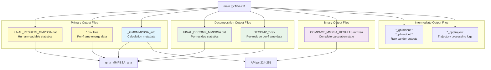
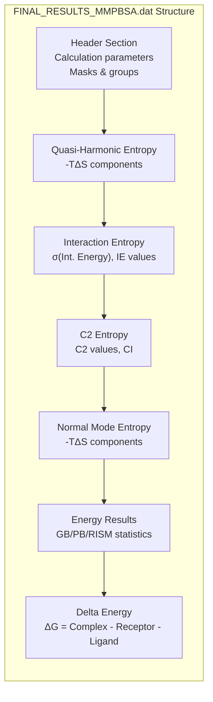
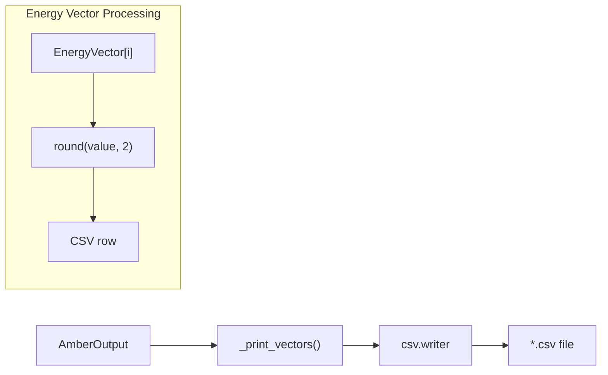
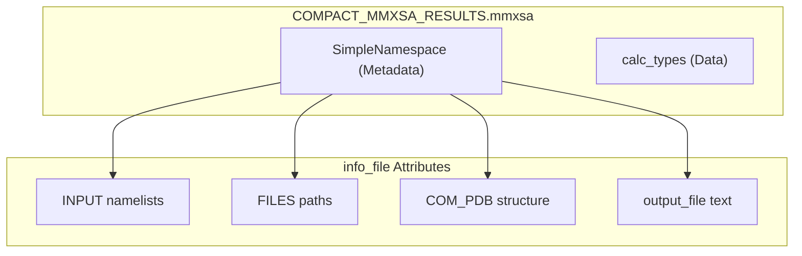

# Output Files and Data Formats

Relevant source files

The following files were used as context for generating this wiki page:

- [GMXMMPBSA/API.py](GMXMMPBSA/API.py)
- [GMXMMPBSA/amber_outputs.py](GMXMMPBSA/amber_outputs.py)
- [GMXMMPBSA/exceptions.py](GMXMMPBSA/exceptions.py)
- [GMXMMPBSA/output_file.py](GMXMMPBSA/output_file.py)
- [docs/output.md](docs/output.md)

This page provides a comprehensive reference for all output files generated by gmx_MMPBSA and their data formats. Understanding these formats is essential for analyzing calculation results and integrating gmx_MMPBSA into custom workflows.

**Scope**: This page covers the structure, content, and format of output files. For information about performing calculations that generate these files, see [Core Application (gmx_MMPBSA)](#3). For information about visualizing and analyzing these outputs, see [Analyzer Application (gmx_MMPBSA_ana)](#4). For programmatic access to output data, see [API Reference (MMPBSA_API)](#7.5).

---

## Output File Ecosystem

gmx_MMPBSA generates multiple output files serving different purposes in the analysis workflow. The following diagram shows the complete output file hierarchy and their relationships:

**Sources**: [GMXMMPBSA/output_file.py:53-68](), [GMXMMPBSA/amber_outputs.py:65-109](), [GMXMMPBSA/API.py:224-251]()

---

## Statistics Output Files

### FINAL_RESULTS_MMPBSA.dat

The primary output file containing human-readable statistics for all calculated energy terms. This file is written by the `write_outputs()` function in `output_file.py` and follows a structured format.

**File Structure**:

**Energy Term Organization**:
The data is organized based on the `data_key_owner` mapping which defines whether a term belongs to the gas phase (`GGAS`) or solvation (`GSOLV`) contribution [GMXMMPBSA/amber_outputs.py:44-62]().

| Section | Components | Statistics | Description |
|---------|-----------|------------|-------------|
| **GGAS** | BOND, ANGLE, DIHED, VDWAALS, EEL, 1-4 VDW, 1-4 EEL | Average, SD(Prop.), SD, SEM(Prop.), SEM | Gas-phase molecular mechanics energy |
| **GSOLV** | EGB/EPB, ESURF/ENPOLAR/EDISPER | Average, SD(Prop.), SD, SEM(Prop.), SEM | Solvation free energy |
| **TOTAL** | GGAS + GSOLV | Average, SD(Prop.), SD, SEM(Prop.), SEM | Total binding free energy |

**Statistics Definitions** [GMXMMPBSA/output_file.py:109-111]():
- **Average**: Arithmetic mean across all frames.
- **SD**: Sample standard deviation.
- **SD(Prop.)**: SD obtained with propagation of uncertainty formula.
- **SEM**: Sample standard error of the mean.
- **SEM(Prop.)**: SEM obtained with propagation of uncertainty formula.

**Sources**: [GMXMMPBSA/output_file.py:53-117](), [GMXMMPBSA/amber_outputs.py:44-62](), [docs/output.md:10-112]()

---

## Per-Frame Energy Data Files

### Energy CSV Files

CSV files containing per-frame energy values for all calculated terms, suitable for time-series analysis and custom post-processing. These are generated if the `FILES.energyout` flag is set [GMXMMPBSA/output_file.py:64-67]().

**Data Generation**:
The CSV writer is invoked by the `_print_vectors()` method in `AmberOutput` [GMXMMPBSA/amber_outputs.py:111-127]().

**CSV Format Structure**:
The columns include the Frame number followed by all keys in `data_keys` and `composite_keys` [GMXMMPBSA/amber_outputs.py:115-120]().

| Column | Type | Description |
|--------|------|-------------|
| Frame # | Integer | Frame number (starts from `startframe` or `nmstartframe`) |
| BOND/ANGLE/DIHED | Float | Internal energy terms (kcal/mol) |
| VDWAALS/EEL | Float | Non-bonded energy terms (kcal/mol) |
| 1-4 VDW/EEL | Float | 1-4 interaction terms (kcal/mol) |
| EGB/EPB/ESURF | Float | Solvation energy terms (kcal/mol) |
| GGAS/GSOLV/TOTAL | Float | Composite energy terms (kcal/mol) |

**Sources**: [GMXMMPBSA/amber_outputs.py:111-127](), [GMXMMPBSA/output_file.py:64-67](), [GMXMMPBSA/utils.py:52-151]()

---

## Decomposition Output Files

### FINAL_DECOMP_MMPBSA.dat

Contains per-residue or pairwise energy decomposition statistics. The output format is determined by the `idecomp` parameter [GMXMMPBSA/amber_outputs.py:37-41]().

**Decomposition Modes**:
- **idecomp = 1 & 2**: Per-residue decomposition.
- **idecomp = 3 & 4**: Pairwise decomposition.

**Sources**: [GMXMMPBSA/amber_outputs.py:37-41](), [GMXMMPBSA/output_file.py:44-45]()

---

## Metadata and API Files

### COMPACT_MMXSA_RESULTS.mmxsa

A binary file generated using Python's `pickle` module. It contains the complete calculation state, making it the primary data source for the `MMPBSA_API` and `gmx_MMPBSA_ana` [GMXMMPBSA/output_file.py:31-51]().

**Structure of .mmxsa**:
The file is created by `data2pkl(app)` and contains two pickled objects:
1. `info_file`: A `SimpleNamespace` containing metadata, input parameters, and structure file contents [GMXMMPBSA/output_file.py:32-46]().
2. `app.calc_types`: The dictionary containing all calculated energy objects [GMXMMPBSA/output_file.py:50]().

**Sources**: [GMXMMPBSA/output_file.py:31-51](), [GMXMMPBSA/API.py:224-251]()

### Internal Data Handling

The `EnergyVector` class (derived from `numpy.ndarray`) is the core container for energy data, providing specialized methods for statistical analysis and error propagation [GMXMMPBSA/utils.py:52-151]().

**Sources**: [GMXMMPBSA/utils.py:52-151](), [GMXMMPBSA/amber_outputs.py:105-107]()

---