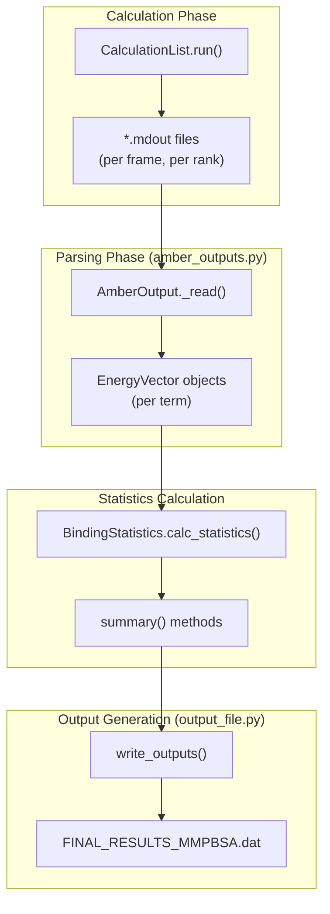
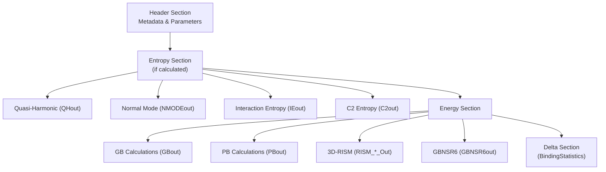
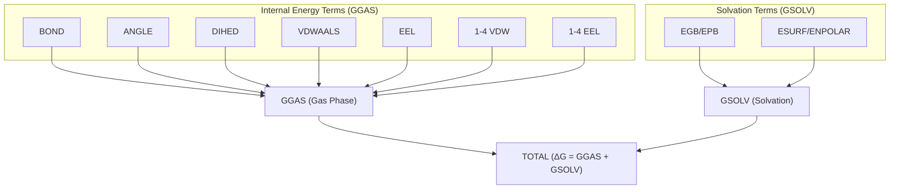

# Statistics Output (FINAL_RESULTS_MMPBSA.dat)

<details>
<summary>Relevant source files</summary>

The following files were used as context for generating this wiki page:

- [GMXMMPBSA/API.py](GMXMMPBSA/API.py)
- [GMXMMPBSA/amber_outputs.py](GMXMMPBSA/amber_outputs.py)
- [GMXMMPBSA/exceptions.py](GMXMMPBSA/exceptions.py)
- [GMXMMPBSA/output_file.py](GMXMMPBSA/output_file.py)
- [docs/output.md](docs/output.md)

</details>


## Purpose and Scope

The `FINAL_RESULTS_MMPBSA.dat` file is the primary statistical output file generated by gmx_MMPBSA. It contains aggregated energy statistics, including averages, standard deviations, and standard errors for all calculated energy terms across the trajectory frames. This file provides the final binding free energy estimates (or stability estimates for single-molecule calculations) along with their associated uncertainties.

For per-frame energy data, see [Per-Frame Energy Data (CSV files)](5.2). For per-residue decomposition statistics, see [Decomposition Output Files](5.3). For programmatic access to these results, see [Metadata and API Files](5.4).

## File Generation

The statistics output file is created by the `write_outputs()` function in [GMXMMPBSA/output_file.py:53-600](). This function is called near the end of the calculation workflow after all energy calculations have been completed and results have been parsed.

### Code Entity Relationship: Results to Output
The following diagram illustrates how raw data flows from the calculation classes into the final `.dat` file.



**Sources:** [GMXMMPBSA/output_file.py:53-600](), [GMXMMPBSA/amber_outputs.py:65-225](), [GMXMMPBSA/utils.py:52-151]()

## File Structure Overview

The output file follows a hierarchical structure with clearly delimited sections. The organization depends on which calculation types were performed and whether it's a binding calculation (complex/receptor/ligand) or stability calculation (single molecule only).



**Sources:** [GMXMMPBSA/output_file.py:69-118](), [GMXMMPBSA/output_file.py:119-295](), [GMXMMPBSA/output_file.py:297-580]()

## Header Section

The header provides essential metadata about the calculation, including system information, number of frames processed, calculation parameters, and important warnings or notes.

### Header Contents

| Information Type | Example | Source Variable |
|-----------------|---------|-----------------|
| Timestamp | Current date/time | `write_date()` [GMXMMPBSA/output_file.py:603-607]() |
| System name | `sys_name` | `INPUT['general']['sys_name']` |
| Receptor/Ligand masks | `":1-240"` | `INPUT['general']['receptor_mask']` [GMXMMPBSA/output_file.py:75]() |
| Number of frames | 16 | `app.numframes` [GMXMMPBSA/output_file.py:81]() |
| Temperature | 300.00 K | `INPUT['general']['temperature']` [GMXMMPBSA/output_file.py:106]() |
| Surface area method | LCPO | `INPUT['gb']['molsurf']` [GMXMMPBSA/output_file.py:103]() |

The header is written by the `OutputFile` class methods at [GMXMMPBSA/output_file.py:602-680]().

**Sources:** [GMXMMPBSA/output_file.py:69-118](), [GMXMMPBSA/output_file.py:602-680]()

## Entropy Results Section

Entropy calculations appear first in the results. The system supports Quasi-Harmonic (QH), Normal Mode (NMODE), Interaction Entropy (IE), and C2 Entropy.

### Quasi-Harmonic (QH) Results
QH results show translational, rotational, and vibrational entropy components. The output is generated by the `QHout` class at [GMXMMPBSA/amber_outputs.py:361-477]().

**Format Example:**
```
           TRANSLATIONAL      ROTATIONAL      VIBRATIONAL           TOTAL
Complex       -13.45             -15.23           -45.67            -74.37
```

### Interaction Entropy (IE) and C2 Results
IE results display the entropy value along with the internal energy standard deviation (σ). A warning is issued if σ > 3.6 kcal/mol [GMXMMPBSA/output_file.py:189-193]().

C2 entropy includes confidence intervals obtained through bootstrapping (2000 re-samplings) [GMXMMPBSA/output_file.py:88-90]().

**Sources:** [GMXMMPBSA/output_file.py:119-228](), [GMXMMPBSA/amber_outputs.py:227-359]()

## Energy Results Section

The energy section contains the primary MM/PBSA or MM/GBSA results.

### Energy Components Hierarchy



**Sources:** [GMXMMPBSA/amber_outputs.py:44-62](), [GMXMMPBSA/amber_outputs.py:212-225]()

### Statistical Terms Explained

The output provides multiple statistical measures for each term:

| Column | Description | Implementation |
|--------|-------------|----------------|
| **Average** | Mean value across frames | `EnergyVector.mean()` [GMXMMPBSA/utils.py:153]() |
| **SD(Prop.)** | Propagated standard deviation | `EnergyVector.stdev()` [GMXMMPBSA/utils.py:155]() |
| **SD** | Sample standard deviation | `EnergyVector.std()` [GMXMMPBSA/utils.py:154]() |
| **SEM(Prop.)** | Propagated standard error | `EnergyVector.semp()` [GMXMMPBSA/utils.py:158]() |
| **SEM** | Sample standard error | `EnergyVector.sem()` [GMXMMPBSA/utils.py:157]() |

**Sources:** [GMXMMPBSA/utils.py:52-159](), [GMXMMPBSA/amber_outputs.py:155-186]()

## Key Classes and Methods

### `AmberOutput` (Base Class)
Defined at [GMXMMPBSA/amber_outputs.py:65-225](). It is the parent for all calculation-specific output parsers.
- `summary()`: Returns a list of statistics for each energy term [GMXMMPBSA/amber_outputs.py:155-186]().
- `_fill_composite_terms()`: Calculates GGAS, GSOLV, and TOTAL from raw components [GMXMMPBSA/amber_outputs.py:212-225]().

### `BindingStatistics`
Defined at [GMXMMPBSA/amber_outputs.py:587-934](). It orchestrates the subtraction of Receptor and Ligand energies from the Complex energy.
- `calc_statistics()`: Computes ΔG values and their uncertainties [GMXMMPBSA/amber_outputs.py:731-780]().
- `print_summary()`: Formats the final DELTA section for the output file [GMXMMPBSA/amber_outputs.py:783-844]().

### `OutputFile`
Defined at [GMXMMPBSA/output_file.py:602-691](). A helper class for writing formatted text to the `.dat` file.
- `add_section(text)`: Adds a block of text surrounded by separators [GMXMMPBSA/output_file.py:623-628]().

**Sources:** [GMXMMPBSA/amber_outputs.py:65-1538](), [GMXMMPBSA/output_file.py:602-691]()

## Programmatic Access

For users wishing to perform custom analysis, the data used to generate `FINAL_RESULTS_MMPBSA.dat` is also saved to `COMPACT_MMXSA_RESULTS.mmxsa` via `data2pkl()` [GMXMMPBSA/output_file.py:31-50](). This binary file can be loaded using the `MMPBSA_API` in [GMXMMPBSA/API.py]().

**Sources:** [GMXMMPBSA/output_file.py:31-50](), [GMXMMPBSA/API.py:195-800]()

---