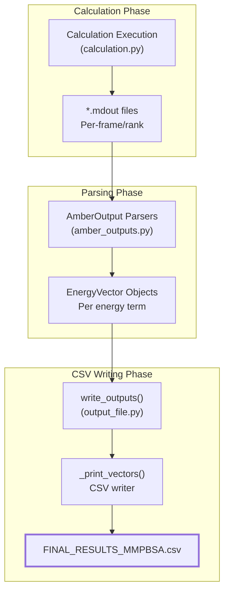
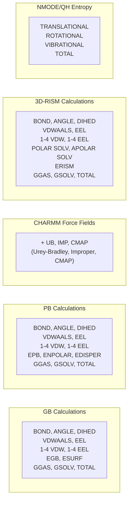
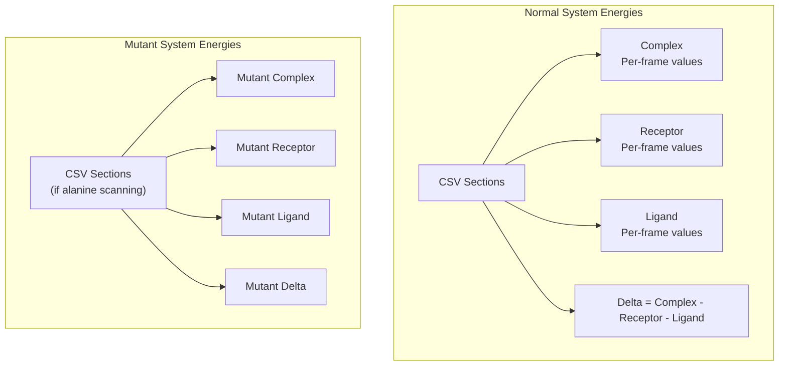
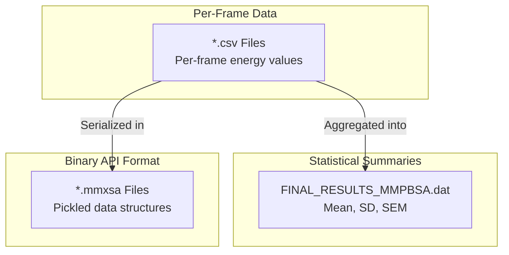

# Per-Frame Energy Data (CSV files)

<details>
<summary>Relevant source files</summary>

The following files were used as context for generating this wiki page:

- [GMXMMPBSA/API.py](GMXMMPBSA/API.py)
- [GMXMMPBSA/amber_outputs.py](GMXMMPBSA/amber_outputs.py)
- [GMXMMPBSA/exceptions.py](GMXMMPBSA/exceptions.py)
- [GMXMMPBSA/output_file.py](GMXMMPBSA/output_file.py)
- [docs/output.md](docs/output.md)

</details>


This page documents the CSV (Comma-Separated Values) file format used by `gmx_MMPBSA` to store per-frame energy values for all calculated terms. These files provide time-series energy data that complements the statistical summaries in `FINAL_RESULTS_MMPBSA.dat` (see [Statistics Output (FINAL_RESULTS_MMPBSA.dat)](#5.1)).

For decomposition-specific CSV files with per-residue or pairwise energy breakdowns, see [Decomposition Output Files](#5.3).

## Overview

CSV files contain the raw energy values computed for each trajectory frame, enabling:

- Time-series analysis of energy contributions
- Custom statistical calculations
- Visualization of energy fluctuations
- Correlation analysis between different energy components
- Export to spreadsheet applications or data analysis tools

Unlike the statistics file which provides averages, standard deviations, and standard errors, CSV files preserve the per-frame granularity of the calculations.

**Sources:** [GMXMMPBSA/output_file.py:53-340](), [GMXMMPBSA/amber_outputs.py:111-127]()

## Enabling CSV Output

CSV output is controlled by the `-eo` (energy output) command-line flag:

```bash
gmx_MMPBSA -i mmpbsa.in -cs com.tpr -ct com_traj.xtc \
    -ci index.ndx -cg 3 4 \
    -o FINAL_RESULTS_MMPBSA.dat \
    -eo FINAL_RESULTS_MMPBSA.csv
```

The `-eo` flag specifies the filename for the main energy CSV file. If omitted, no CSV output is generated [GMXMMPBSA/output_file.py:64-66](). For decomposition CSV files, use the `-deo` flag (see [Decomposition Output Files](#5.3)).

**Sources:** [GMXMMPBSA/output_file.py:64-66]()

## CSV Generation Workflow



**Diagram: CSV File Generation Pipeline**

The workflow follows this sequence:

1. **Calculation Execution**: Energy calculations produce `*.mdout` files for each frame/MPI rank.
2. **Parsing**: `AmberOutput` subclasses parse mdout files into `EnergyVector` objects [GMXMMPBSA/amber_outputs.py:105-108]().
3. **CSV Writing**: The `_print_vectors()` method serializes energy vectors to CSV format [GMXMMPBSA/amber_outputs.py:111-127]().

**Sources:** [GMXMMPBSA/amber_outputs.py:105-127](), [GMXMMPBSA/output_file.py:53-340]()

## CSV File Structure

### General Format

All CSV files follow this structure:

```csv
Frame #,BOND,ANGLE,DIHED,VDWAALS,EEL,1-4 VDW,1-4 EEL,GGAS,GSOLV,TOTAL
1,324.56,423.12,789.34,−2345.67,−4523.89,123.45,234.56,−5123.45,1234.56,−3888.89
11,328.91,419.88,792.11,−2351.23,−4519.12,124.01,235.78,−5118.34,1229.87,−3888.47
21,331.22,425.66,788.99,−2348.01,−4527.34,122.89,233.44,−5126.78,1238.11,−3888.67
```

**Column Structure:**
- **First column**: Frame number (according to `startframe` and `interval` parameters).
- **Subsequent columns**: Energy terms in kcal/mol.
- **Last columns**: Composite terms (`GGAS`, `GSOLV`, `TOTAL`).

### Frame Numbering

Frame numbers in the CSV correspond to the actual trajectory frames processed, derived from the input configuration [GMXMMPBSA/amber_outputs.py:123-127]():

```python
# Logic from GMXMMPBSA/amber_outputs.py:123-127
c = self.INPUT['nmode']['nmstartframe'] if self.__class__ == NMODEout else self.INPUT['general']['startframe']
# ... loop through frames ...
csvwriter.writerow([c] + energy_values)
c += self.INPUT['nmode']['nminterval'] if self.__class__ == NMODEout else self.INPUT['general']['interval']
```

For example, with `startframe=1` and `interval=10`:
- Row 1: Frame 1
- Row 2: Frame 11  
- Row 3: Frame 21

**Sources:** [GMXMMPBSA/amber_outputs.py:123-127]()

## Energy Terms by Calculation Type



**Diagram: Energy Terms Included in CSV Files by Calculation Type**

**Sources:** [GMXMMPBSA/amber_outputs.py:44-62](), [GMXMMPBSA/amber_outputs.py:89-96]()

### Standard Energy Terms (GB/PB)

| Term | Description | Units |
|------|-------------|-------|
| `BOND` | Bond energy | kcal/mol |
| `ANGLE` | Angle energy | kcal/mol |
| `DIHED` | Dihedral energy | kcal/mol |
| `VDWAALS` | van der Waals energy | kcal/mol |
| `EEL` | Electrostatic energy | kcal/mol |
| `1-4 VDW` | 1-4 van der Waals | kcal/mol |
| `1-4 EEL` | 1-4 electrostatics | kcal/mol |
| `EGB` | Generalized Born solvation [GMXMMPBSA/amber_outputs.py:54]() | kcal/mol |
| `ESURF` | Nonpolar solvation (GB) [GMXMMPBSA/amber_outputs.py:54]() | kcal/mol |
| `EPB` | Poisson-Boltzmann solvation [GMXMMPBSA/amber_outputs.py:52]() | kcal/mol |
| `ENPOLAR` | Nonpolar solvation (PB) [GMXMMPBSA/amber_outputs.py:52]() | kcal/mol |
| `EDISPER` | Dispersion term (PB) [GMXMMPBSA/amber_outputs.py:52]() | kcal/mol |
| `GGAS` | Gas phase energy (sum) | kcal/mol |
| `GSOLV` | Solvation energy (sum) | kcal/mol |
| `TOTAL` | Total energy (GGAS + GSOLV) | kcal/mol |

### CHARMM Additional Terms

When using CHARMM force fields (`self.chamber = True`), additional columns are inserted into `data_keys` [GMXMMPBSA/amber_outputs.py:93-96]():

| Term | Description |
|------|-------------|
| `UB` | Urey-Bradley term |
| `IMP` | Improper dihedral term |
| `CMAP` | Correction map term |

**Sources:** [GMXMMPBSA/amber_outputs.py:44-62](), [GMXMMPBSA/amber_outputs.py:89-96]()

### NMODE/Entropy Terms

For entropy calculations, specific output classes like `NMODEout` handle the data [GMXMMPBSA/amber_outputs.py:123]():

| Term | Description |
|------|-------------|
| `TRANSLATIONAL` | Translational entropy contribution (-TΔS) |
| `ROTATIONAL` | Rotational entropy contribution (-TΔS) |
| `VIBRATIONAL` | Vibrational entropy contribution (-TΔS) |
| `TOTAL` | Total entropy (-TΔS) |

**Sources:** [GMXMMPBSA/amber_outputs.py:61](), [GMXMMPBSA/amber_outputs.py:123]()

## Multiple System CSV Organization



**Diagram: CSV File Organization for Binding Calculations**

For binding free energy calculations, the CSV file contains separate sections written by `write_outputs()` [GMXMMPBSA/output_file.py:53-340]():

1. **Complex**: All energy terms for the complex.
2. **Receptor**: All energy terms for the receptor.
3. **Ligand**: All energy terms for the ligand.
4. **Delta**: Binding energies (Complex - Receptor - Ligand).

Each section is written using the `_print_vectors` method of the respective `AmberOutput` object [GMXMMPBSA/amber_outputs.py:111]().

**Sources:** [GMXMMPBSA/output_file.py:53-340](), [GMXMMPBSA/amber_outputs.py:111-127]()

## CSV Writing Implementation

The core CSV writing logic is implemented in the `_print_vectors()` method of the `AmberOutput` class [GMXMMPBSA/amber_outputs.py:111-127]():

```python
# GMXMMPBSA/amber_outputs.py:111-127
def _print_vectors(self, csvwriter):
    """ Prints the energy vectors to a CSV file for easy viewing
        in spreadsheets
    """
    print_keys = list(self.data_keys)
    # Add on the composite keys
    print_keys += self.composite_keys

    # write the header
    csvwriter.writerow(['Frame #'] + print_keys)

    # write out each frame
    c = self.INPUT['nmode']['nmstartframe'] if self.__class__ == NMODEout else self.INPUT['general']['startframe']
    for i in range(self.numframes):
        csvwriter.writerow([c] + [round(self[key][i], 2) for key in print_keys])
        c += self.INPUT['nmode']['nminterval'] if self.__class__ == NMODEout else self.INPUT['general']['interval']
```

**Key Implementation Details:**

1. **Precision**: Energy values are rounded to 2 decimal places [GMXMMPBSA/amber_outputs.py:125]().
2. **Dynamic Headers**: Column headers are dynamically generated based on `data_keys` and `composite_keys` [GMXMMPBSA/amber_outputs.py:115-120]().
3. **Frame Logic**: Correctly identifies whether to use `nmode` or `general` frame parameters [GMXMMPBSA/amber_outputs.py:123-126]().

**Sources:** [GMXMMPBSA/amber_outputs.py:111-127]()

## Reading CSV Files Programmatically

### Using gmx_MMPBSA API

The `MMPBSA_API` provides structured access to per-frame data, internally utilizing pandas for data manipulation [GMXMMPBSA/API.py:130-175]():

```python
from GMXMMPBSA.API import MMPBSA_API

# Load results from the info file
api = MMPBSA_API()
api.load_file('_GMXMMPBSA_info')

# The API internally processes energy data into pandas DataFrames
# for the analyzer and custom scripts
```

The API module handles the conversion of energy data into `pd.DataFrame` objects, supporting both in-memory and disk-backed (parquet) storage for large datasets [GMXMMPBSA/API.py:135-148]().

**Sources:** [GMXMMPBSA/API.py:130-175]()

## Relationship to Other Output Files



**Diagram: CSV Files in the Output Ecosystem**

| File Type | Purpose | Implementation |
|-----------|---------|----------------|
| `*.csv` | Per-frame time series | `AmberOutput._print_vectors` [GMXMMPBSA/amber_outputs.py:111]() |
| `*.dat` | Statistical summary | `OutputFile.print_file_info` [GMXMMPBSA/output_file.py:72]() |
| `*.mmxsa` | Binary API format | `data2pkl` function [GMXMMPBSA/output_file.py:31]() |

**Sources:** [GMXMMPBSA/output_file.py:31-72](), [GMXMMPBSA/amber_outputs.py:111-127]()

## Performance and Recalculation

The per-frame data in CSV files enables recalculation of statistics for different frame ranges without re-running calculations. The `AmberOutput` class provides a `set_frame_range` method for this purpose [GMXMMPBSA/amber_outputs.py:128-133]():

```python
# GMXMMPBSA/amber_outputs.py:128-133
def set_frame_range(self, start=None, end=None, interval=None):
    d = deepcopy(self)
    for key in d.data_keys:
        d[key] = d[key][start:end:interval]
    d._fill_composite_terms()
    return d
```

This method slices the underlying `EnergyVector` objects and updates composite terms, allowing the `gmx_MMPBSA_ana` GUI to update statistics in real-time.

**Sources:** [GMXMMPBSA/amber_outputs.py:128-133](), [GMXMMPBSA/API.py:130-175]()

---