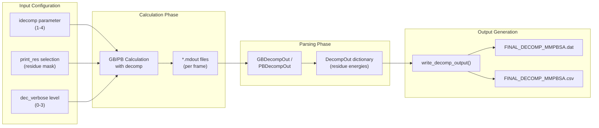
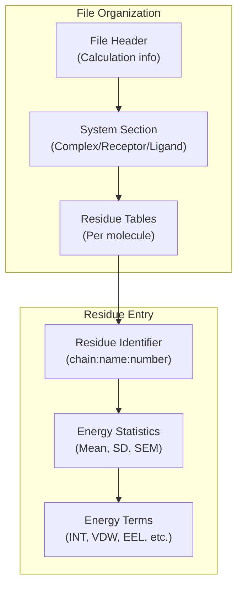
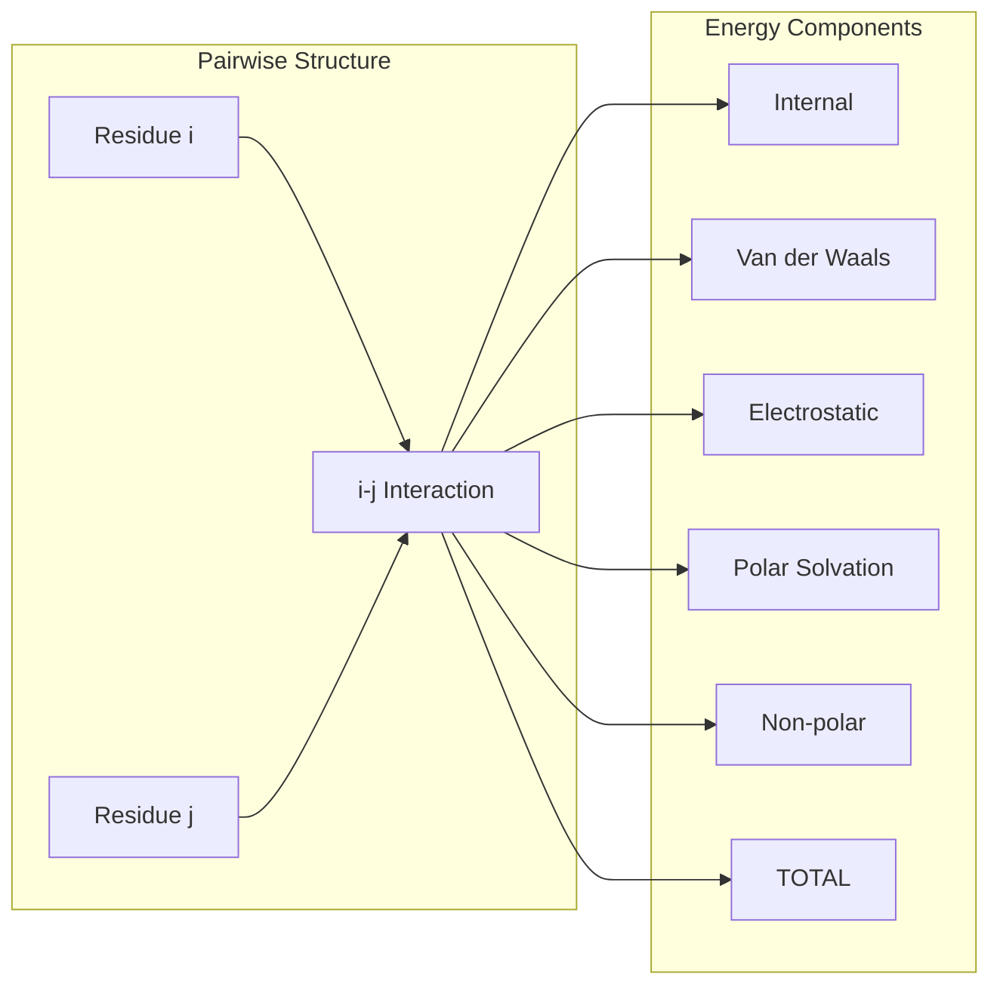
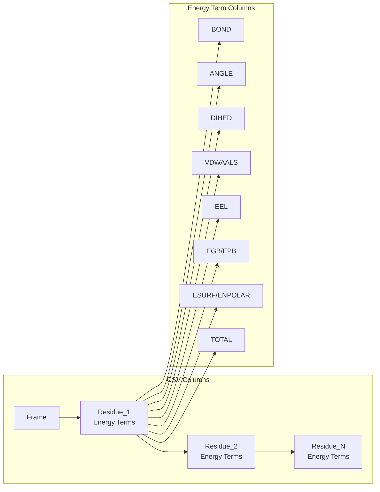
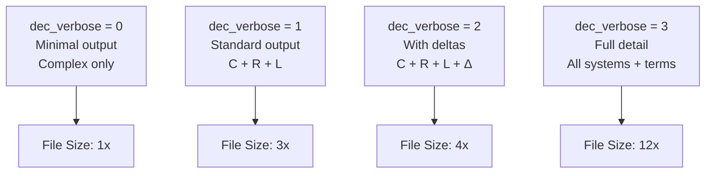
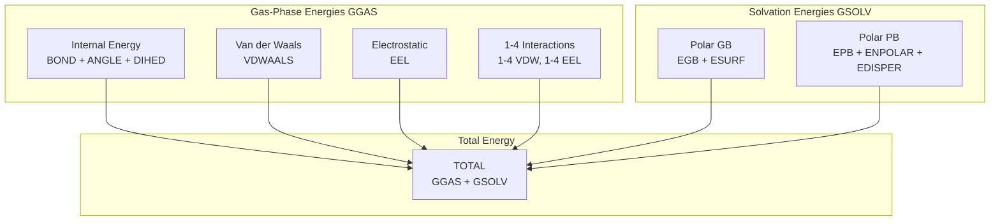
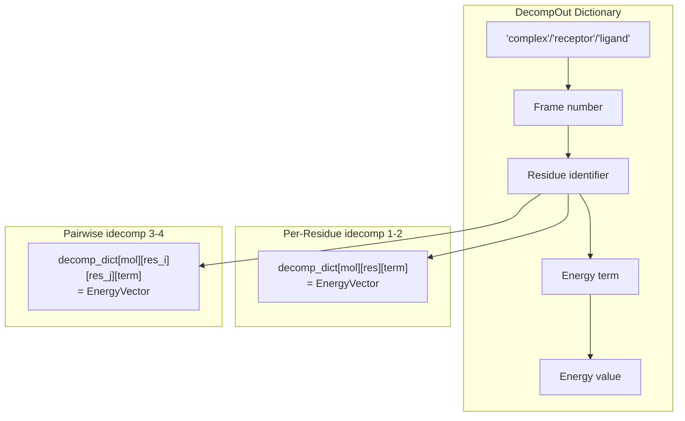
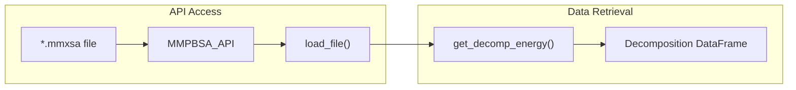

# Decomposition Output Files

<details>
<summary>Relevant source files</summary>

The following files were used as context for generating this wiki page:

- [GMXMMPBSA/API.py](GMXMMPBSA/API.py)
- [GMXMMPBSA/amber_outputs.py](GMXMMPBSA/amber_outputs.py)
- [GMXMMPBSA/exceptions.py](GMXMMPBSA/exceptions.py)
- [GMXMMPBSA/output_file.py](GMXMMPBSA/output_file.py)
- [docs/output.md](docs/output.md)

</details>


This page describes the structure and content of decomposition analysis output files generated by gmx_MMPBSA when per-residue or pairwise energy decomposition is performed. For general output file information, see [Statistics Output (FINAL_RESULTS_MMPBSA.dat)](#5.1). For per-frame energy data, see [Per-Frame Energy Data (CSV files)](#5.2). For details on configuring decomposition analysis, see [Decomposition Analysis](#3.6).

## Overview

When decomposition analysis is enabled (`decomprun=1` in the `&decomp` namelist), gmx_MMPBSA generates specialized output files containing energy contributions broken down by individual residues or residue pairs. These files complement the standard energy output by providing spatial resolution of molecular interactions.

**Output Files Generated:**

| File Name | Format | Description | Command-line Flag |
|-----------|--------|-------------|-------------------|
| `FINAL_DECOMP_MMPBSA.dat` | Text | Human-readable decomposition statistics with means, standard deviations, and standard errors | `-do` |
| `FINAL_DECOMP_MMPBSA.csv` | CSV | Machine-readable per-frame decomposition energies for all selected residues | `-deo` |

**Decomposition Output Flow:**

Title: Decomposition Data Flow


Sources: [GMXMMPBSA/output_file.py:252-595](), [GMXMMPBSA/amber_outputs.py:597-1138]()

## Decomposition Modes (idecomp)

The `idecomp` parameter determines the type and detail level of decomposition analysis. Each mode produces different data structures in the output files.

Title: idecomp Mode Architecture
```mermaid
graph TB
    subgraph "idecomp Values"
        I0["idecomp = 0<br/>No decomposition"]
        I1["idecomp = 1<br/>Per-residue<br/>1-4 → Internal"]
        I2["idecomp = 2<br/>Per-residue<br/>1-4 → EEL+VDW"]
        I3["idecomp = 3<br/>Pairwise<br/>1-4 → Internal"]
        I4["idecomp = 4<br/>Pairwise<br/>1-4 → EEL+VDW"]
    end
    
    subgraph "Output Structure"
        PR["Per-Residue Totals<br/>(idecomp 1-2)"]
        PW["Pairwise Interactions<br/>(idecomp 3-4)"]
    end
    
    subgraph "Energy Terms"
        INT["Internal<br/>(BOND+ANGLE+DIHED)"]
        VDW["Van der Waals<br/>(VDWAALS)"]
        EEL["Electrostatic<br/>(EEL)"]
        POL["Polar Solvation<br/>(EGB/EPB)"]
        NONPOL["Non-polar<br/>(ESURF/ENPOLAR)"]
    end
    
    I0 -.x.-> PR
    I1 --> PR
    I2 --> PR
    I3 --> PW
    I4 --> PW
    
    PR --> INT
    PR --> VDW
    PR --> EEL
    PR --> POL
    PR --> NONPOL
    
    PW --> INT
    PW --> VDW
    PW --> EEL
    PW --> POL
    PW --> NONPOL
```

**Mode Descriptions:**

| idecomp | Type | 1-4 Interaction Treatment | Use Case |
|---------|------|---------------------------|----------|
| 1 | Per-residue | Added to Internal energy | Standard per-residue analysis |
| 2 | Per-residue | Split into EEL and VDW | Detailed per-residue breakdown |
| 3 | Pairwise | Added to Internal energy | Interaction hotspot identification |
| 4 | Pairwise | Split into EEL and VDW | Detailed pairwise interactions |

Sources: [GMXMMPBSA/amber_outputs.py:37-41]()

## Text Output Format (.dat)

The `FINAL_DECOMP_MMPBSA.dat` file contains formatted tables with statistical summaries of decomposition energies. The structure varies based on `idecomp` and `dec_verbose` settings.

### Per-Residue Decomposition (idecomp=1,2)

Title: Per-Residue Data Hierarchy


**Sample Output Structure:**

```
idecomp = 2: Per-residue decomp adding 1-4 interactions to EEL and VDW.

DELTAS:
Energy Contribution for Residue R:A:TYR:32:
Internal:        Mean        SD       SEM
BOND             0.00       0.00      0.00
ANGLE            0.00       0.00      0.00
DIHED            0.00       0.00      0.00
VDW             -2.45       0.82      0.26
EEL            -15.23       3.41      1.08
1-4 VDW          0.00       0.00      0.00
1-4 EEL          0.00       0.00      0.00
POLAR SOLV      12.34       2.19      0.69
APOLAR SOLV     -0.54       0.12      0.04
TOTAL           -5.88       3.12      0.99
```

### Pairwise Decomposition (idecomp=3,4)

For pairwise decomposition, the output contains interaction matrices between residue pairs.

Title: Pairwise Interaction Logic


Sources: [GMXMMPBSA/output_file.py:252-595](), [GMXMMPBSA/amber_outputs.py:597-750]()

## CSV Output Format (.csv)

The `FINAL_DECOMP_MMPBSA.csv` file contains per-frame energy values for all selected residues, suitable for time-series analysis and custom post-processing.

### File Structure

Title: Decomposition CSV Column Mapping


**Column Naming Convention:**

- **Residue identifier**: `{MOL}:{CHAIN}:{NAME}:{NUMBER}:{ICODE}`
  - `MOL`: R (receptor) or L (ligand)
  - `CHAIN`: Chain identifier
  - `NAME`: Residue name (3-letter code)
  - `NUMBER`: Residue number
- **Energy term**: Appended after colon (e.g., `:VDW`, `:EEL`)

Sources: [GMXMMPBSA/output_file.py:463-595](), [GMXMMPBSA/amber_outputs.py:933-1138]()

## Verbosity Levels (dec_verbose)

The `dec_verbose` parameter controls the amount of detail in decomposition output.

**Verbosity Level Matrix:**

| dec_verbose | Complex | Receptor | Ligand | Delta | Energy Term Detail |
|-------------|---------|----------|--------|-------|-------------------|
| 0 | ✓ | ✗ | ✗ | ✗ | Totals only |
| 1 | ✓ | ✓ | ✓ | ✗ | Totals only |
| 2 | ✓ | ✓ | ✓ | ✓ | Totals only |
| 3 | ✓ | ✓ | ✓ | ✓ | All terms |

Title: Verbosity Level Scaling


Sources: [GMXMMPBSA/output_file.py:277-302]()

## Energy Terms in Decomposition

### Standard Energy Components

Title: Decomposition Energy Components


Sources: [GMXMMPBSA/amber_outputs.py:44-62]()

## Data Structure in Memory

The decomposition data is stored in nested dictionary structures during calculation.

Title: Decomp Memory Architecture


The `EnergyVector` class (from [GMXMMPBSA/utils.py:52-151]()) provides statistical methods like `mean()`, `std()`, and `sem()`.

Sources: [GMXMMPBSA/amber_outputs.py:597-1138](), [GMXMMPBSA/utils.py:52-151](), [GMXMMPBSA/output_file.py:252-595]()

## Integration with API

Decomposition data can be accessed programmatically via the `MMPBSA_API.get_decomp_energy()` method.

Title: API Decomposition Retrieval


**API Method Signature:**
The `get_decomp_energy()` method (defined in [GMXMMPBSA/API.py:434-519]()) allows filtering by `dtype`, `model`, `mol`, and specific residues (`resA`, `resB`).

Sources: [GMXMMPBSA/API.py:434-519](), [GMXMMPBSA/API.py:195-293]()

---