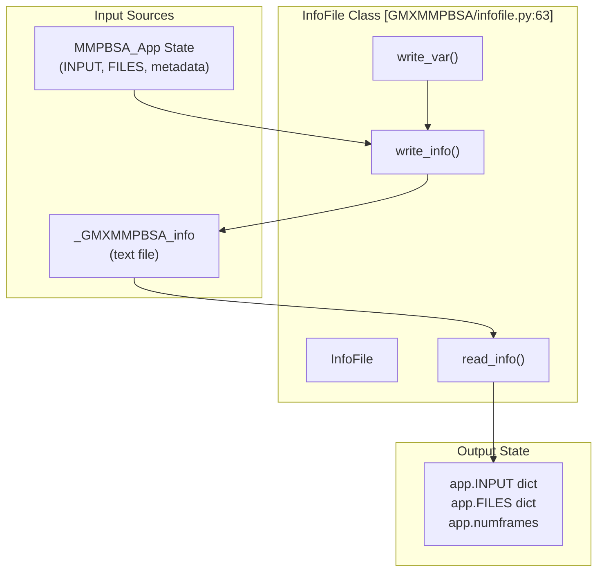
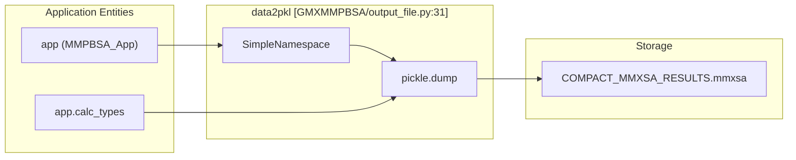
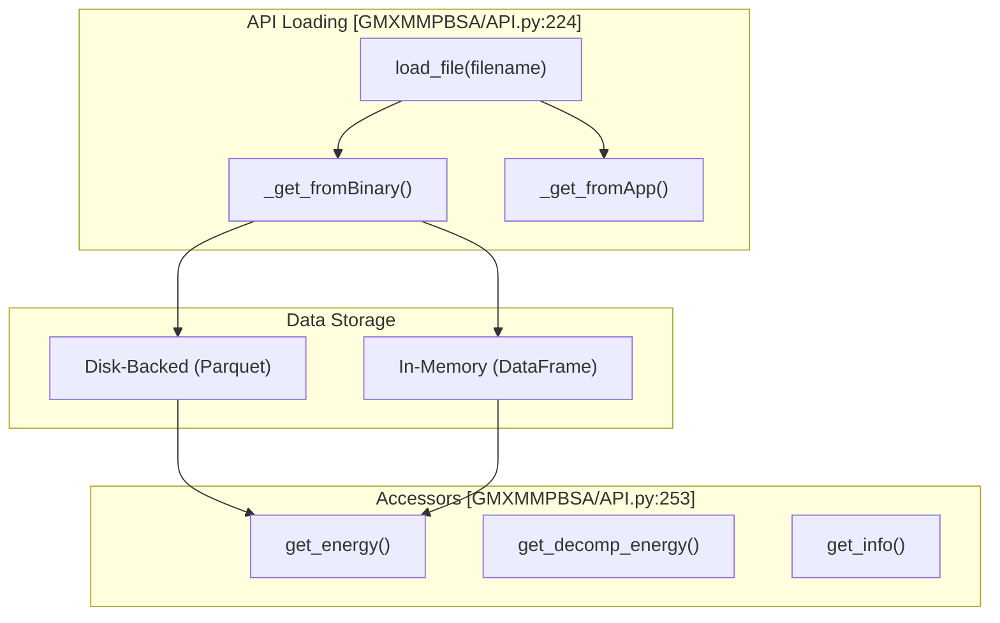

# Metadata and API Files

Relevant source files

The following files were used as context for generating this wiki page:

- [GMXMMPBSA/API.py](GMXMMPBSA/API.py)
- [GMXMMPBSA/amber_outputs.py](GMXMMPBSA/amber_outputs.py)
- [GMXMMPBSA/exceptions.py](GMXMMPBSA/exceptions.py)
- [GMXMMPBSA/infofile.py](GMXMMPBSA/infofile.py)
- [GMXMMPBSA/output_file.py](GMXMMPBSA/output_file.py)
- [docs/analyzer.md](docs/analyzer.md)
- [docs/api.md](docs/api.md)
- [docs/howworks.md](docs/howworks.md)

This document describes the metadata and binary API files generated by gmx_MMPBSA that enable checkpoint/resume functionality and programmatic access to calculation results. These files complement the human-readable output files (see [5.1](), [5.2](), [5.3]()) by providing machine-readable formats optimized for automation and custom analysis workflows.

Two file types are covered:
- **`_GMXMMPBSA_info`**: Text-based metadata file for calculation state management.
- **`.mmxsa` files**: Binary pickled format for efficient programmatic data access via the API.

For information on using the analyzer GUI to visualize results, see [4]().

---

## The _GMXMMPBSA_info File

### Purpose and Function

The `_GMXMMPBSA_info` file stores calculation metadata in a human-readable text format. It serves three primary functions:

1. **Checkpoint/Resume**: Enables resuming interrupted calculations.
2. **Output Rewriting**: Allows regenerating output files without recalculation.
3. **State Preservation**: Records all calculation parameters and file paths.

The file is generated automatically during every gmx_MMPBSA run and is managed by the `InfoFile` class [GMXMMPBSA/infofile.py:63-80]().

**Sources:** [GMXMMPBSA/infofile.py:1-5]()

### File Structure

The `_GMXMMPBSA_info` file uses a simple namelist format similar to the input file. It categorizes variables into editable, "edit with care," and internal variables [GMXMMPBSA/infofile.py:73-80]().

**Key Namelists and Categories:**

| Category | Purpose | Code Reference |
|----------|---------|----------------|
| **Editable** | Variables like `exp_ki`, `sys_name`, and `interaction_entropy` that can be safely modified for re-analysis. | [GMXMMPBSA/infofile.py:73-75]() |
| **Edit with Care** | Sensitive variables like PB input file paths (`inp`). | [GMXMMPBSA/infofile.py:77]() |
| **Internal** | Frame counts, MPI size, and mutated residue indices. | [GMXMMPBSA/infofile.py:91-93]() |

**Sources:** [GMXMMPBSA/infofile.py:72-113]()

### InfoFile Class API

The `InfoFile` class handles the serialization of the `MMPBSA_App` state.

Title: InfoFile Data Flow

**Sources:** [GMXMMPBSA/infofile.py:81-147]()

### Programmatic Access

The `InfoFile` class provides methods to read and write the metadata file:

| Method | Purpose | Location |
|--------|---------|----------|
| `write_info(name)` | Serializes the `app` state to a file (default suffix `.info`). | [GMXMMPBSA/infofile.py:86-119]() |
| `read_info()` | Parses the info file back into the `app.INPUT` and `app.FILES` dictionaries. | [GMXMMPBSA/infofile.py:149-160]() |
| `write_var(var)` | Helper to format Python variables (strings, lists, bools) for the text file. | [GMXMMPBSA/infofile.py:270-285]() |

**Sources:** [GMXMMPBSA/infofile.py:81-285]()

---

## The .mmxsa Binary Format

### Purpose and Contents

The `.mmxsa` file (typically `COMPACT_MMXSA_RESULTS.mmxsa`) is a binary pickled file that encapsulates the entire result set. It is generated by the `data2pkl` function [GMXMMPBSA/output_file.py:31-51]().

Title: Binary Serialization Workflow

**Sources:** [GMXMMPBSA/output_file.py:31-51]()

### Binary File Structure

The `.mmxsa` file contains two distinct pickled objects dumped in sequence:

1.  **Metadata Object (`SimpleNamespace`)**:
    *   `INPUT` and `FILES`: The complete configuration dictionaries [GMXMMPBSA/output_file.py:33-34]().
    *   `numframes` and `numframes_nmode`: Frame counts for energy and entropy [GMXMMPBSA/output_file.py:36-37]().
    *   `COM_PDB`: The complex structure in PDB format [GMXMMPBSA/output_file.py:42]().
    *   `output_file` and `decomp_output_file`: The full text of the generated `.dat` reports [GMXMMPBSA/output_file.py:43-45]().
2.  **Calculation Data (`app.calc_types`)**:
    *   A complex nested structure containing `EnergyVector` objects for every term (BOND, EEL, VDWAALS, etc.) across all calculated models (GB, PB, RISM) [GMXMMPBSA/output_file.py:50](), [GMXMMPBSA/amber_outputs.py:44-62]().

**Sources:** [GMXMMPBSA/output_file.py:31-51](), [GMXMMPBSA/amber_outputs.py:89-91]()

---

## MMPBSA_API Class

### Overview and Architecture

The `MMPBSA_API` class (defined in `GMXMMPBSA/API.py`) is the primary entry point for programmatic data access. It serves as the data layer for `gmx_MMPBSA_ana` [docs/analyzer.md:14-15]().

Title: API Data Resolution

**Sources:** [GMXMMPBSA/API.py:224-251](), [GMXMMPBSA/API.py:294-300]()

### Loading Data

The API can load either the compact binary or re-parse the info file:

*   **`load_file(filename)`**: Detects file type. If it is an info file, it initializes a dummy app and uses `_get_fromApp`. If binary, it uses `_get_fromBinary` [GMXMMPBSA/API.py:224-251]().
*   **Performance Options**: For large datasets, the API supports disk-backed storage using the `parquet` format to save RAM [GMXMMPBSA/API.py:65-76](), [GMXMMPBSA/API.py:135-137]().

**Sources:** [GMXMMPBSA/API.py:224-251](), [GMXMMPBSA/API.py:130-170]()

### Energy and Decomposition Extraction

The API provides high-level methods to retrieve data as `pandas.DataFrame` objects:

| Method | Description | Source |
|--------|-------------|--------|
| `get_energy(...)` | Retrieves binding/stability energies. Supports filtering by `etype` (normal/mutant), `model` (gb/pb/rism), and `mol` (complex/receptor/ligand). | [GMXMMPBSA/API.py:294-424]() |
| `get_decomp_energy(...)` | Retrieves per-residue or pairwise decomposition data. | [GMXMMPBSA/API.py:426-548]() |
| `get_entropy(...)` | Retrieves NMODE, QH, IE, or C2 entropy data. | [GMXMMPBSA/API.py:550-607]() |

These methods include internal logic to handle frame range selection (`startframe`, `endframe`, `interval`) and automatically calculate averages and standard deviations [GMXMMPBSA/API.py:315-325]().

**Sources:** [GMXMMPBSA/API.py:294-607]()

### Data Structure Mapping

The API maps raw `EnergyVector` data into structured DataFrames. It uses a dictionary-based mapping (`data_key_owner`) to associate energy terms with their parent components (`GGAS`, `GSOLV`, `TOTAL`) [GMXMMPBSA/amber_outputs.py:44-62]().

| Term | Category | Model |
|------|----------|-------|
| BOND, ANGLE, DIHED | GGAS | All |
| VDWAALS, EEL | GGAS | All |
| EGB, ESURF | GSOLV | GB |
| EPB, ENPOLAR | GSOLV | PB |
| POLAR/APOLAR SOLV | GSOLV | RISM |

**Sources:** [GMXMMPBSA/amber_outputs.py:44-62](), [GMXMMPBSA/API.py:113-128]()

---