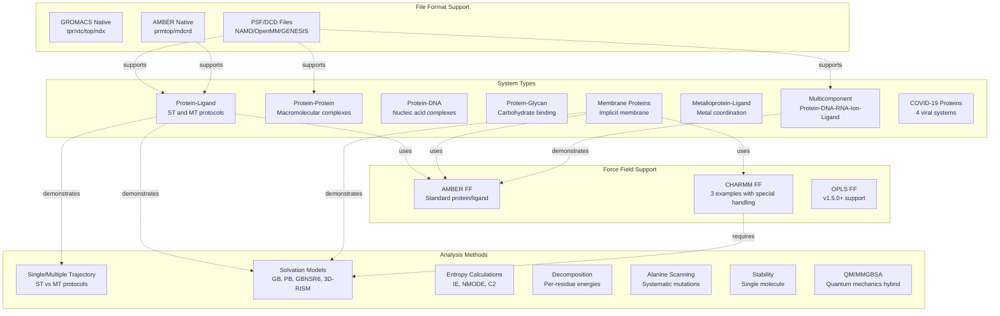
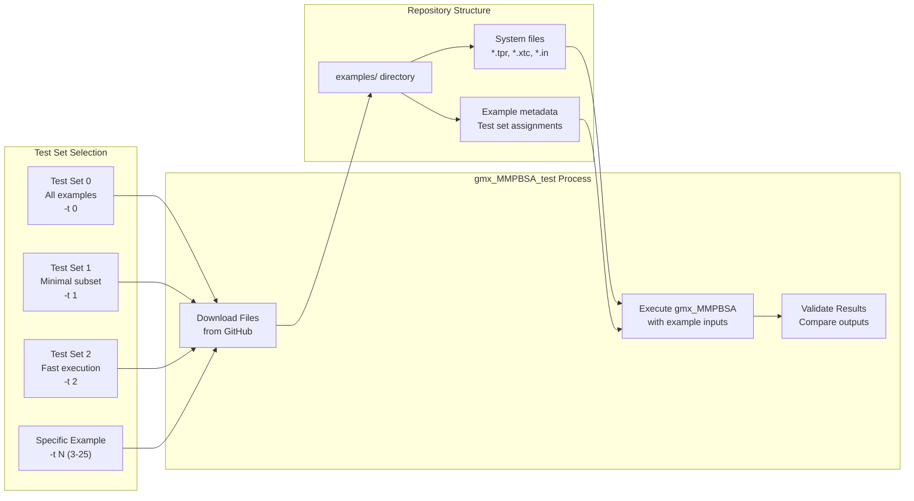

# Example Use Cases

<details>
<summary>Relevant source files</summary>

The following files were used as context for generating this wiki page:

- [docs/examples/AMBER/README.md](docs/examples/AMBER/README.md)
- [docs/examples/README.md](docs/examples/README.md)
- [examples/AMBER/README.md](examples/AMBER/README.md)
- [examples/README.md](examples/README.md)
- [mkdocs.yml](mkdocs.yml)
- [notebooks/gmx_MMPBSA_Colab.ipynb](notebooks/gmx_MMPBSA_Colab.ipynb)

</details>


This page introduces the comprehensive collection of examples provided with gmx_MMPBSA, covering diverse molecular systems and calculation methodologies. These examples serve both as validation tests for your installation and as templates for setting up your own calculations.

For detailed command-line usage, see [Command-Line Interface](#3.1). For input file configuration details, see [Input File Configuration](#3.2). For using the testing utility, see [Validation with gmx_MMPBSA_test](#2.2).

## Overview

gmx_MMPBSA provides over 30 example systems organized by molecular type, force field, and analysis method. Each example includes all necessary input files, complete command-line instructions, and detailed considerations for interpretation. Examples are accessible through three mechanisms:

1.  **gmx_MMPBSA_test utility** - Automatically downloads and runs examples.
2.  **GitHub repository** - Direct download from the `examples/` directory.
3.  **Jupyter Notebooks** - Interactive execution via Google Colab or local environments.

All examples use real molecular systems from published structures, ensuring practical relevance and demonstrating the tool's capabilities on production-quality data.

**Sources:** [docs/examples/README.md:1-84](), [notebooks/gmx_MMPBSA_Colab.ipynb:11-15]()

## Example Organization

The examples are hierarchically organized into three main categories: molecular systems, force field variants, and analysis types. This structure allows users to quickly locate examples matching their specific research needs.

### Example Taxonomy



**Sources:** [docs/examples/README.md:12-84](), [mkdocs.yml:169-213](), [examples/AMBER/README.md:6-25]()

## Accessing Examples

### Using gmx_MMPBSA_test

The `gmx_MMPBSA_test` command-line utility provides the simplest method to run examples. It automatically downloads required files from GitHub, executes calculations, and validates results.



#### Test Set Assignments

| Test Set | Examples Included | Execution Time | Purpose |
|----------|------------------|----------------|---------|
| **0 (All)** | All 20+ examples | Several hours | Comprehensive validation |
| **1 (Minimal)** | 12 core examples | ~1 hour | Basic functionality check |
| **2 (Fast)** | 10 quick examples | ~30 minutes | Rapid validation |
| **3-25** | Individual examples | Varies | Targeted testing |

Examples marked with footnotes in documentation indicate test set membership:
- `[^1]` - Included in All set (test set 0)
- `[^2]` - Included in Minimal set (test set 1)
- `[^3]` - Included in Fast set (test set 2)

**Sources:** [docs/examples/README.md:87-90](), [examples/README.md:87-90](), [examples/AMBER/README.md:39-41]()

### Interactive and Direct Access

- **Google Colab:** A pre-configured environment that installs `AmberTools`, `GROMACS`, and `gmx_MMPBSA` to run bundled examples in the cloud. [notebooks/gmx_MMPBSA_Colab.ipynb:56-59]()
- **Local Notebook:** For extracting data with the Python API and plotting energy terms with `seaborn`. [docs/examples/README.md:19-20]()
- **Direct Download:** Use `downgit` to download specific folders from the repository if you do not wish to clone the entire project. [examples/AMBER/README.md:8-11]()

## Common Example Structure

All examples follow a consistent structure, including required files, command-line syntax, and input file configuration.

### Required Files Pattern

| System Type | Required Files | Optional/Recommended |
|-------------|----------------|----------------------|
| **GROMACS ST** | `mmpbsa.in`, `.tpr`, `.xtc`, `.ndx` | `.top`, `.pdb` (reference) |
| **AMBER ST** | `mmpbsa.in`, `.prmtop`, `.inpcrd`, `.mdcrd` | Receptor/Ligand `.prmtop` |
| **CHARMM** | `mmpbsa.in`, `.tpr`, `.xtc`, `.ndx`, **`.top`** | - |

**Sources:** [examples/AMBER/README.md:15-27](), [docs/examples/README.md:7-10]()

### Standard Input File Structure

Each example provides a complete `mmpbsa.in` file demonstrating best practices. The structure follows the namelist format from Amber's `MMPBSA.py`:

```yaml
# Sample input for AMBER native files
&general
   sys_name="AMBER",
   startframe=1,
   endframe=5,
   interval=1,
   verbose=1,
/
&gb
   igb=2, saltcon=0.100,
/
```

**Sources:** [examples/AMBER/README.md:45-57]()

## Example Categories Overview

### System Type Examples

| System Type | Example Directory | Test ID | Notes |
|------------|------------------|---------|-------|
| Protein-Ligand (ST) | `Protein_ligand/ST/` | 3 | Basic binding calculation |
| Protein-Ligand (MT) | `Protein_ligand/MT/` | 16 | Multiple trajectories |
| Protein-Protein | `Protein_protein/` | 4 | Macromolecular complex |
| Protein-DNA | `Protein_DNA/` | 5 | Nucleic acid binding |
| Membrane Proteins | `Protein_membrane/` | 6 | Implicit membrane model |
| AMBER Native | `AMBER/` | 25 | Native AMBER file support |

### Force Field Specific Examples

| Force Field | Example Directory | Special Considerations |
|------------|------------------|----------------------|
| CHARMM | `Protein_ligand_CHARMMff/` | `PBRadii=7` (charmm_radii) recommended |
| CHARMM (LPH) | `Protein_ligand_LPH_atoms_CHARMMff/` | Virtual particle (LPH) handling |
| OPLS | `OPLS/protein_protein/` | v1.5.0+ support |

**Sources:** [docs/examples/README.md:12-80](), [mkdocs.yml:171-210]()

## Special System Considerations

### AMBER Native Support
`amber_MMPBSA` can process native AMBER files (`prmtop`, `inpcrd`, `mdcrd`) directly without GROMACS intermediates. It follows the single trajectory (ST) approximation and uses AMBER masks for selection. [examples/AMBER/README.md:63-67]()

### CHARMM Force Field Systems
CHARMM systems require a GROMACS topology file (`.top`) because `gmx_MMPBSA` cannot generate these topologies from a structure file alone. For PB calculations, `PBRadii=7` is recommended. [docs/examples/README.md:74-80]()

### Membrane Protein Systems
Calculations for membrane proteins use implicit membrane models. Users must define parameters like `memopt`, `mthick`, and `mctrdz` to define the heterogeneous dielectric profile.

## Next Steps

Explore specific example categories:

- **[Protein-Ligand Systems](#6.1)** — Single and multiple trajectory protocols
- **[Protein-Protein and Protein-DNA Systems](#6.2)** — Macromolecular complexes
- **[Membrane Protein Systems](#6.3)** — Implicit membrane calculations
- **[CHARMM Force Field Systems](#6.4)** — Special parameter handling
- **[Multicomponent and Special Systems](#6.5)** — Complex multi-molecule systems

For understanding calculation methodology, see [Calculation Workflow](#3.3). For troubleshooting, see [Troubleshooting and FAQ](#9).

**Sources:** [docs/examples/README.md:1-84](), [mkdocs.yml:168-213]()

---