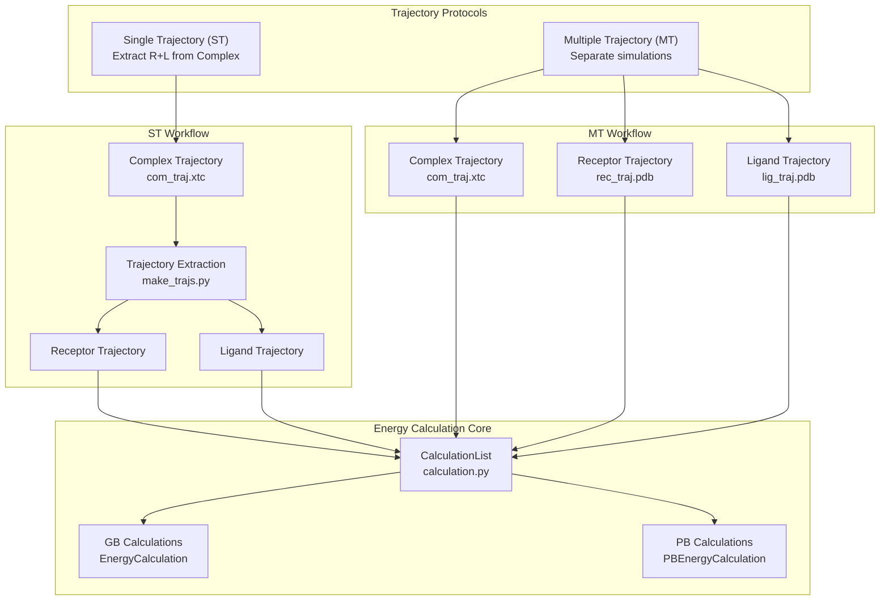
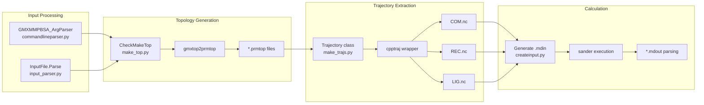

# Protein-Ligand Systems

<details>
<summary>Relevant source files</summary>

The following files were used as context for generating this wiki page:

- [docs/examples/Protein_ligand/ST/README.md](docs/examples/Protein_ligand/ST/README.md)
- [docs/examples/Stability/README.md](docs/examples/Stability/README.md)
- [examples/Protein_ligand/ST/README.md](examples/Protein_ligand/ST/README.md)

</details>


## Purpose and Scope

This page describes how to perform binding free energy calculations for protein-ligand complexes using `gmx_MMPBSA`. It covers both Single Trajectory (ST) and Multiple Trajectory (MT) protocols, required input files, configuration parameters, and practical examples. For protein-protein or protein-DNA systems, see [6.2](). For membrane protein systems with special considerations, see [6.3]().

## Overview of Protein-Ligand Calculations

Protein-ligand binding free energy calculations in `gmx_MMPBSA` follow the MM/PB(GB)SA methodology, computing the difference in free energy between the bound complex and separated receptor and ligand states. The tool supports two fundamental trajectory protocols that differ in how receptor and ligand structures are obtained:

### Trajectory Protocol Mapping

The following diagram bridges the conceptual protocols to the code entities responsible for handling them.



**Sources:** [docs/examples/Protein_ligand/ST/README.md:83-90](), [docs/examples/Stability/README.md:77-83]()

## Single Trajectory (ST) Method

The Single Trajectory method extracts receptor and ligand coordinates from the complex trajectory. This is computationally efficient and the most commonly used approach, as it requires only one MD simulation. It assumes that the receptor and ligand do not undergo significant conformational changes upon binding.

### Required Input Files

| File Type | Flag | Description | Example |
|-----------|------|-------------|---------|
| Input parameters | `-i` | Configuration file with calculation parameters | `mmpbsa.in` |
| Structure file | `-cs` | Complex structure (TPR or PDB) | `com.tpr` |
| Trajectory | `-ct` | Complex MD trajectory | `com_traj.xtc` |
| Index file | `-ci` | GROMACS index file | `index.ndx` |
| Group numbers | `-cg` | Receptor and ligand group numbers | `3 4` |
| Topology | `-cp` | GROMACS topology file (optional) | `topol.top` |
| Ligand parameters | `-lm` | Ligand mol2 file from Antechamber (if no topology) | `ligand.mol2` |
| Reference structure | `-cr` | Reference PDB (optional but recommended) | `com.pdb` |

**Sources:** [docs/examples/Protein_ligand/ST/README.md:19-31](), [docs/examples/Stability/README.md:18-29]()

### Command-Line Execution

```bash
# Serial execution
gmx_MMPBSA -O -i mmpbsa.in -cs com.tpr -ct com_traj.xtc \
           -ci index.ndx -cg 3 4 -cp topol.top \
           -o FINAL_RESULTS_MMPBSA.dat -eo FINAL_RESULTS_MMPBSA.csv

# MPI parallel execution
mpirun -np 2 gmx_MMPBSA -O -i mmpbsa.in -cs com.tpr -ct com_traj.xtc \
                        -ci index.ndx -cg 3 4 -cp topol.top \
                        -o FINAL_RESULTS_MMPBSA.dat -eo FINAL_RESULTS_MMPBSA.csv
```

**Sources:** [docs/examples/Protein_ligand/ST/README.md:42-48](), [docs/examples/Stability/README.md:36-42]()

### ST Internal Processing Flow

This diagram shows how the input flags and files are processed by the internal Python modules.



**Sources:** [docs/examples/Protein_ligand/ST/README.md:83-95](), [docs/examples/Stability/README.md:77-83]()

### Example ST Input File

```yaml
# Protein-ligand ST calculation with GB model
&general
sys_name="Prot-Lig-ST",
startframe=1,
endframe=10,
/
&gb
igb=5, saltcon=0.150,
/
```

**Sources:** [docs/examples/Protein_ligand/ST/README.md:57-73]()

## Stability Calculations

Stability calculations are a special case of the ST method where only the complex is considered. Any receptor or ligand information provided is ignored, and the tool calculates the stability of the single system.

### Stability Command-Line

```bash
gmx_MMPBSA -O -i mmpbsa.in -cs com.tpr -ct com_traj.xtc -ci index.ndx -cg 3 4 -cp topol.top -o FINAL_RESULTS_MMPBSA.dat -eo FINAL_RESULTS_MMPBSA.csv
```

**Sources:** [docs/examples/Stability/README.md:38-42](), [docs/examples/Stability/README.md:85-86]()

## Common Configuration Parameters

### General Namelist (`&general`)

The `&general` namelist contains system-wide parameters that apply to all calculation types:

| Parameter | Default | Description | Typical Values |
|-----------|---------|-------------|----------------|
| `sys_name` | None | System identifier for analysis | `"Prot-Lig-ST"`, `"Stability"` |
| `startframe` | 1 | First frame to analyze | 1, 5, 10 |
| `endframe` | 9999999 | Last frame to analyze | 10, 100, 1000 |

**Sources:** [docs/examples/Protein_ligand/ST/README.md:65-69](), [docs/examples/Stability/README.md:58-62]()

### GB Namelist (`&gb`)

Generalized Born implicit solvation parameters:

| Parameter | Default | Description | Recommendations |
|-----------|---------|-------------|-----------------|
| `igb` | 5 | GB model selection | 2 (GB-OBC1), 5 (GB-OBC2) |
| `saltcon` | 0.0 | Salt concentration (M) | 0.150 (physiological) |

**Sources:** [docs/examples/Protein_ligand/ST/README.md:70-72](), [docs/examples/Stability/README.md:63-65]()

## Best Practices and Considerations

### Topology and Ligand Parameters
- **Topology Provided:** When a GROMACS topology file (`-cp`) is defined, the ligand `.mol2` file is not needed. The tool will use the information in the `top` and `itp` files.
- **Topology NOT Provided:** If `gmx_MMPBSA` must build the Amber topology from a structure, the ligand `.mol2` file (Antechamber output) is required via the `-lm` flag (though `-lm` is often implied by the structure-based workflow).

### Output Files
- `FINAL_RESULTS_MMPBSA.dat`: A plain text file containing the statistics of the calculation.
- `FINAL_RESULTS_MMPBSA.csv`: A CSV-format file containing energy terms for every frame. This is only generated if the `-eo` flag is used.

**Sources:** [docs/examples/Protein_ligand/ST/README.md:33-35](), [docs/examples/Protein_ligand/ST/README.md:92-95]()

## Testing with gmx_MMPBSA_test

The installation can be verified using predefined test cases for protein-ligand systems:

| Test ID | System Type | Command |
|---------|-------------|---------|
| 3 | Protein-Ligand (ST) | `gmx_MMPBSA_test -t 3` |
| 13 | Stability | `gmx_MMPBSA_test -t 13` |

**Sources:** [docs/examples/Protein_ligand/ST/README.md:52](), [docs/examples/Stability/README.md:46]()

---