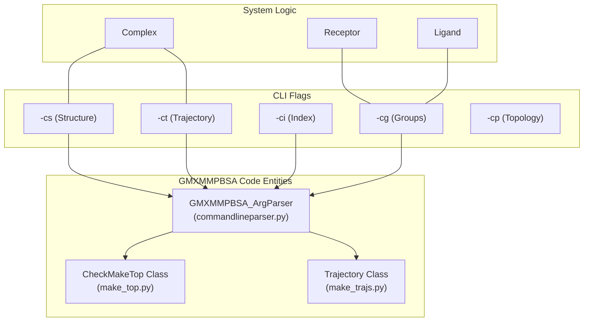
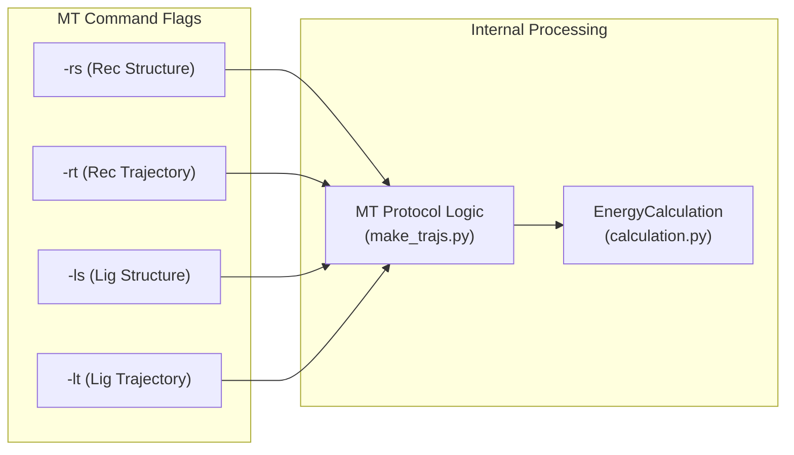
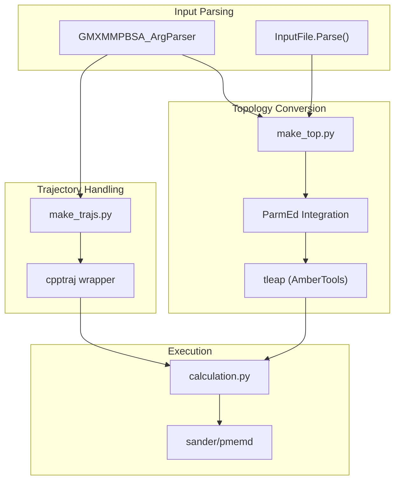

# Protein-Protein and Protein-DNA Systems

<details>
<summary>Relevant source files</summary>

The following files were used as context for generating this wiki page:

- [docs/examples/Protein_DNA/README.md](docs/examples/Protein_DNA/README.md)
- [docs/examples/Protein_DNA_RNA_Ion_ligand/README.md](docs/examples/Protein_DNA_RNA_Ion_ligand/README.md)
- [docs/examples/Protein_ligand/MT/README.md](docs/examples/Protein_ligand/MT/README.md)
- [docs/examples/Protein_protein/README.md](docs/examples/Protein_protein/README.md)
- [examples/Protein_DNA/README.md](examples/Protein_DNA/README.md)
- [examples/Protein_protein/README.md](examples/Protein_protein/README.md)

</details>


## Purpose and Scope

This page documents binding free energy calculations for **macromolecular complexes** where the ligand is another protein, DNA, or RNA molecule. These systems require specific force field configurations and parameter selections that differ from protein-ligand calculations. For protein-ligand systems with small molecules, see [Protein-Ligand Systems](#6.1). For multicomponent systems involving multiple molecular types simultaneously, see [Multicomponent and Special Systems](#6.5).

## System Definition

In `gmx_MMPBSA` terminology, protein-protein and protein-DNA systems are treated as **receptor-ligand complexes** where:

- **Receptor**: The primary protein component (or Protein+DNA/RNA in some multicomponent cases).
- **Ligand**: A secondary macromolecule (protein, DNA, or RNA).
- **Complex**: The bound state of receptor and ligand.

### Code-to-System Mapping
The following diagram maps the logical molecular components to the code entities and command-line flags used in `gmx_MMPBSA`.

Title: System Mapping to Code Entities

Sources: [docs/examples/Protein_protein/README.md:15-30](), [docs/examples/Protein_DNA/README.md:15-30](), [docs/examples/Protein_DNA_RNA_Ion_ligand/README.md:21-32]()

## Key Differences from Protein-Ligand Systems

| Aspect | Protein-Ligand | Protein-Protein / Protein-DNA |
|--------|----------------|-------------------------------|
| Ligand mol2 file | **Required** (from Antechamber) | **Not required** (unless building from structure) |
| Force field | Protein + GAFF | Protein + Protein/DNA force fields |
| Topology generation | Requires ligand parametrization | Uses standard protein/nucleic acid parameters |
| Dielectric constant | `intdiel=1.0` (default) | `intdiel=10` recommended for DNA systems |
| Solvation model | GB/PB standard parameters | GB-Neck2 (igb=8) recommended for DNA |

Sources: [docs/examples/Protein_protein/README.md:75-87](), [docs/examples/Protein_DNA/README.md:74-88](), [docs/examples/Protein_DNA_RNA_Ion_ligand/README.md:85-94]()

## Input File Requirements

### Required Files for Single Trajectory (ST)
For standard protein-protein or protein-DNA systems, the ST approximation is used, extracting all components from a single complex simulation.

- **Structure File (`-cs`)**: `tpr` or `pdb` containing the system coordinates.
- **Trajectory File (`-ct`)**: `xtc`, `trr`, or `pdb` (fitted and no PBC).
- **Index File (`-ci`)**: GROMACS `ndx` file containing receptor and ligand groups.
- **Group Numbers (`-cg`)**: Integers identifying the receptor and ligand in the index file.
- **Input Parameters (`-i`)**: `mmpbsa.in` file.

### Multiple Trajectory (MT) Requirements
If using the MT method, separate structure and trajectory files must be provided for the receptor and ligand.

Title: MT Workflow Code Association

Sources: [docs/examples/Protein_ligand/MT/README.md:18-32](), [docs/examples/Protein_ligand/MT/README.md:85-95]()

## Force Field Configuration

### Protein-Protein Systems
Standard protein force fields are specified in the `&general` namelist.

```yaml
&general
sys_name="Prot-Prot",
forcefields="leaprc.protein.ff14SB",
/
```
Sources: [docs/examples/Protein_protein/README.md:57-62]()

### Protein-DNA/RNA Systems
DNA/RNA systems often require high dielectric constants due to charged interfaces and specific radii sets.

```yaml
&general
sys_name="Prot-DNA",
PBRadii=4
/
&gb
igb=8, saltcon=0.150, intdiel=10
/
```
- **igb=8**: GB-Neck2 model, optimized for nucleic acids.
- **PBRadii=4**: mbondi3 radii, required for GB-Neck2 accuracy.
- **intdiel=10**: High internal dielectric constant to account for the high density of charged residues at the interface.

Sources: [docs/examples/Protein_DNA/README.md:56-65](), [docs/examples/Protein_DNA/README.md:74-83]()

## Multicomponent Systems (Protein-DNA-RNA-Ion-Ligand)
For complex systems involving ions and ligands simultaneously, `gmx_MMPBSA` allows multiple force fields and ion parameters.

- **Ions**: Li/Merz ion parameters can be specified using `ions_parameters=1` in `&general`.
- **Multiple Force Fields**: Specified as a comma-separated list in `forcefields`.

```yaml
&general
sys_name="Prot-DNA-RNA-ION-Lig",
forcefields="oldff/leaprc.ff99SBildn,leaprc.gaff",
PBRadii=4, ions_parameters=1
/
```
Sources: [docs/examples/Protein_DNA_RNA_Ion_ligand/README.md:65-75](), [docs/examples/Protein_DNA_RNA_Ion_ligand/README.md:96-98]()

## Calculation Workflow

Title: Macromolecular Calculation Data Flow


**Implementation Details:**
1. **Topology Generation**: The `make_top.py` script uses `ParmEd` to convert GROMACS topologies to Amber format. For macromolecules, it relies on `tleap` to assign parameters from the specified `forcefields` [docs/examples/Protein_DNA_RNA_Ion_ligand/README.md:85-94]().
2. **Trajectory Processing**: `make_trajs.py` utilizes `cpptraj` to extract the receptor and ligand from the complex trajectory based on the index groups provided via `-cg` [docs/examples/Protein_DNA/README.md:74-83]().
3. **Energy Calculation**: Orchestrated by `calculation.py`, which calls AmberTools' `sander` or `gbnsr6` to perform the actual MM/GBSA or MM/PBSA calculations [docs/examples/Protein_protein/README.md:75-82]().

## Command-Line Execution

### Protein-Protein (ST)
```bash
gmx_MMPBSA -O -i mmpbsa.in -cs com.tpr -ct com_traj.xtc -ci index.ndx -cg 3 4 -cp topol.top -o FINAL_RESULTS_MMPBSA.dat -eo FINAL_RESULTS_MMPBSA.csv
```
Sources: [docs/examples/Protein_protein/README.md:36-37]()

### Protein-Ligand (MT)
```bash
mpirun -np 2 gmx_MMPBSA -O -i mmpbsa.in -cs com.tpr -ci index.ndx -cg 1 13 -ct com_traj.xtc -rs rec.pdb -ri rec_index.ndx -rg 1 -rt rec_traj.pdb -lm ligand.mol2 -ls lig.pdb -li lig_index.ndx -lg 2 -lt lig_traj.pdb -o FINAL_RESULTS_MMPBSA.dat -eo FINAL_RESULTS_MMPBSA.csv
```
Sources: [docs/examples/Protein_ligand/MT/README.md:47-51]()

## Validation with gmx_MMPBSA_test
To verify the installation and the specific macromolecular workflows, use the following test tags:

- **Protein-Protein**: `gmx_MMPBSA_test -t 4`
- **Protein-DNA**: `gmx_MMPBSA_test -t 5`
- **Protein-DNA-RNA-Ions-Ligand**: `gmx_MMPBSA_test -t prot_dna_rna_ions_lig`
- **Protein-Ligand (MT)**: `gmx_MMPBSA_test -t 16`

Sources: [docs/examples/Protein_protein/README.md:43-45](), [docs/examples/Protein_DNA/README.md:42-44](), [docs/examples/Protein_DNA_RNA_Ion_ligand/README.md:50-52](), [docs/examples/Protein_ligand/MT/README.md:53-55]()

---