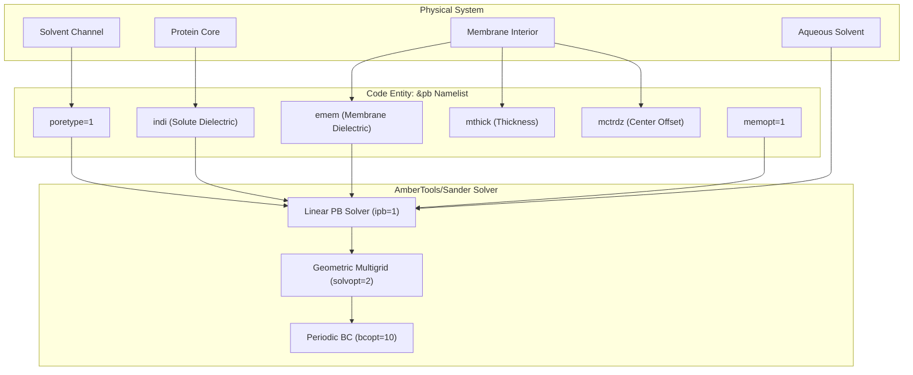
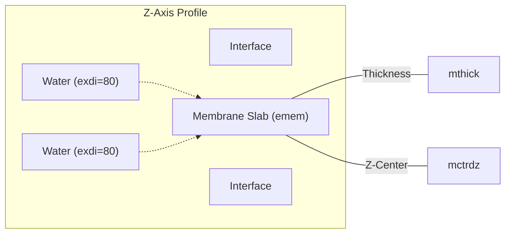
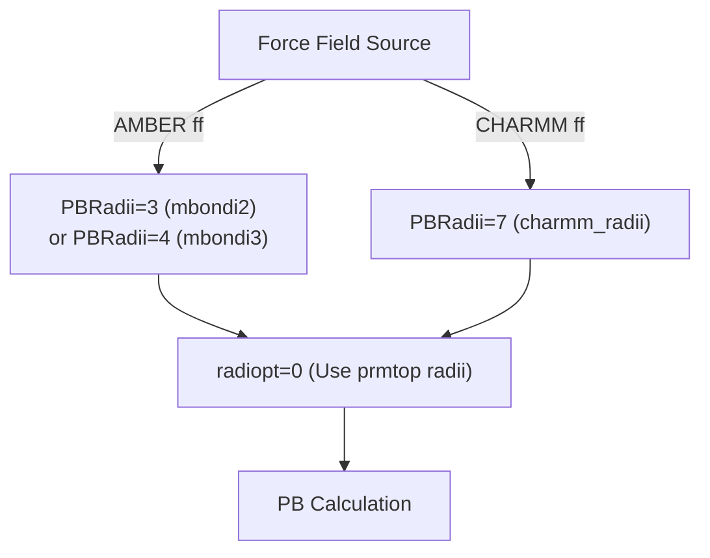

# Membrane Protein Systems

<details>
<summary>Relevant source files</summary>

The following files were used as context for generating this wiki page:

- [docs/examples/3D-RISM/README.md](docs/examples/3D-RISM/README.md)
- [docs/examples/Alanine_scanning/README.md](docs/examples/Alanine_scanning/README.md)
- [docs/examples/Comp_receptor/README.md](docs/examples/Comp_receptor/README.md)
- [docs/examples/Protein_glycan/README.md](docs/examples/Protein_glycan/README.md)
- [docs/examples/Protein_ligand_CHARMMff/README.md](docs/examples/Protein_ligand_CHARMMff/README.md)
- [docs/examples/Protein_ligand_LPH_atoms_CHARMMff/README.md](docs/examples/Protein_ligand_LPH_atoms_CHARMMff/README.md)
- [docs/examples/Protein_membrane/README.md](docs/examples/Protein_membrane/README.md)
- [docs/examples/Protein_membrane_CHARMMff/README.md](docs/examples/Protein_membrane_CHARMMff/README.md)
- [examples/Protein_ligand_LPH_atoms_CHARMMff/README.md](examples/Protein_ligand_LPH_atoms_CHARMMff/README.md)

</details>


## Purpose and Scope

This page covers the specific requirements, parameters, and best practices for performing MM/PBSA calculations on membrane protein systems using `gmx_MMPBSA`. Membrane proteins require special treatment due to their heterogeneous dielectric environment, consisting of a low-dielectric hydrophobic membrane region and high-dielectric aqueous solvent regions.

**Sources:** [docs/examples/Protein_membrane/README.md:6-12](), [docs/examples/Protein_membrane_CHARMMff/README.md:26-31]()

## Overview of Membrane Protein Calculations

Membrane proteins span regions of dramatically different dielectric constants: the low-dielectric membrane interior ($\epsilon \approx 2-7$) and the high-dielectric aqueous solution ($\epsilon \approx 80$). Standard implicit solvent models cannot account for this heterogeneity without modification.

`gmx_MMPBSA` implements an implicit membrane model within the Poisson-Boltzmann (PB) framework. This model extends the solute dielectric region to include a slab-like planar region of uniform dielectric constant representing the membrane. This model is enabled through the `&pb` namelist and is currently **only supported with PB calculations, not GB models**.

### System Architecture and Code Entities

The following diagram bridges the physical system components to the parameters used in the `&pb` namelist and the underlying `sander` PB solver logic.

Title: Membrane System Parameter Mapping


**Sources:** [docs/examples/Protein_membrane/README.md:94-115](), [docs/examples/Protein_membrane_CHARMMff/README.md:113-135]()

## Implicit Membrane Model Implementation

The membrane region is represented as a slab with uniform dielectric constant (`emem`) running parallel to the $xy$-plane. Its position is defined relative to the protein center.

### Dielectric Profile Logic

The dielectric constant must satisfy the hierarchy: `indi` $\le$ `emem` < `exdi` (where `exdi` is typically 80.0 for water).

Title: Dielectric Slab Geometry


**Sources:** [docs/examples/Protein_membrane/README.md:94-107](), [docs/examples/Protein_membrane_CHARMMff/README.md:113-126]()

## Critical Parameters for Membrane Systems

### Core Membrane Parameters (`&pb` namelist)

| Parameter | Default | Recommended | Description |
| :--- | :--- | :--- | :--- |
| `memopt` | 0 | **1** | Enables implicit membrane model. |
| `emem` | N/A | **2.0 - 7.0** | Membrane interior dielectric constant. |
| `mthick` | N/A | **30.0 - 40.0** | Membrane thickness in Å. |
| `mctrdz` | 0.0 | **Variable** | Center of membrane region relative to protein center (Å). |
| `poretype` | 0 | **1** | Set to 1 to identify solvent-filled channel regions. |

### Required Solver Settings

Membrane calculations require specific solver configurations to handle the slab geometry and avoid edge effects.

| Parameter | Setting | Description |
| :--- | :--- | :--- |
| `ipb` | **1** | Linear PB solver is required for membrane models. |
| `solvopt` | **2** | Geometric multigrid solver is chosen for efficiency. |
| `bcopt` | **10** | Periodic boundary conditions to avoid unphysical edge effects. |
| `eneopt` | **1** | Total electrostatic energy via P3M procedure. |
| `sasopt` | **0** | Classical solvent excluded surface (recommended for numerical stability). |
| `fillratio` | **1.25 - 2.0** | **CRITICAL**: Lower values are required to avoid massive memory usage with PBC. |

**Sources:** [docs/examples/Protein_membrane/README.md:109-137](), [docs/examples/Protein_membrane_CHARMMff/README.md:128-155]()

## Force Field Considerations

### CHARMM Force Field and `charmm_radii`
A significant addition in `gmx_MMPBSA` v1.5.0 is the `charmm_radii` set (`PBRadii=7`). This set is optimized for systems prepared with CHARMM force fields and includes specific radii for halogens (Cl: 1.86, Br: 1.98, I: 2.24).

Title: Force Field to Radii Mapping


**Sources:** [docs/examples/Protein_membrane_CHARMMff/README.md:11-25](), [docs/examples/Protein_ligand_LPH_atoms_CHARMMff/README.md:45-52]()

## Energy Calculation Behavior (`eneopt=1`)

When using the implicit membrane model (`eneopt=1`), the total electrostatic energy is computed using the particle-particle particle-mesh (P3M) procedure.

- **Combined Terms**: The reaction field energy (`EPB`) and Coulombic energy (`EEL`) are combined into a single term in the output.
- **EPB Zeroing**: In the final results, the `EPB` term will appear as 0.0, while `EEL` contains the total electrostatic contribution.
- **Decomposition**: While $\Delta G_{TOTAL}$ remains accurate, the individual $\Delta G_{GAS}$ and $\Delta G_{SOLV}$ components are not properly separated.

**Sources:** [docs/examples/Protein_membrane/README.md:118-128](), [docs/examples/Protein_membrane_CHARMMff/README.md:137-147]()

## Command-Line Usage Examples

### Standard Membrane Protein-Ligand (AMBER)
```bash
gmx_MMPBSA -O -i mmpbsa.in -cs com.pdb -ci index.ndx -cg 1 13 -ct com_traj.pdb -lm ligand.mol2 -o FINAL_RESULTS_MMPBSA.dat -eo FINAL_RESULTS_MMPBSA.csv
```
**Sources:** [docs/examples/Protein_membrane/README.md:43]()

### Membrane System with CHARMM Force Field
```bash
gmx_MMPBSA -O -i mmpbsa.in -cs com.pdb -ci index.ndx -cg 6 5 -ct md.xtc -cp topol.top -o FINAL_RESULTS_MMPBSA.dat -eo FINAL_RESULTS_MMPBSA.csv
```
**Sources:** [docs/examples/Protein_membrane_CHARMMff/README.md:56]()

## Handling Special Particles (LPH Atoms)

In CHARMM systems, halogens often use Lone Pair Halogen (LPH) virtual particles. `gmx_MMPBSA` cannot process these particles directly.
- **Workaround**: Users must generate a modified index file and topology that excludes LPH particles before running the calculation.
- **Caution**: Since LPH particles represent the halogen bond, their exclusion may affect results in systems where halogen bonding is a primary binding determinant.

**Sources:** [docs/examples/Protein_ligand_LPH_atoms_CHARMMff/README.md:33-43](), [docs/examples/Protein_ligand_LPH_atoms_CHARMMff/README.md:89-160]()

## Troubleshooting and Memory Management

### The `fillratio` Warning
Using the default `fillratio=4.0` with periodic boundary conditions (`bcopt=10`) is computationally prohibitive. It can lead to memory requirements exceeding 30 GB per thread. 
- **Solution**: Always set `fillratio` between **1.25 and 2.0** for membrane systems.

### Solvent Probe Radii
When using `sasopt=0`, the program computes surfaces with:
- **Water probe**: `prbrad=1.40` (default)
- **Membrane probe**: `mprob=2.70` (default)

This combination has been found to be consistent with explicit solvent MD simulations for membrane systems.

**Sources:** [docs/examples/Protein_membrane/README.md:109-115](), [docs/examples/Protein_membrane/README.md:130-137]()

---